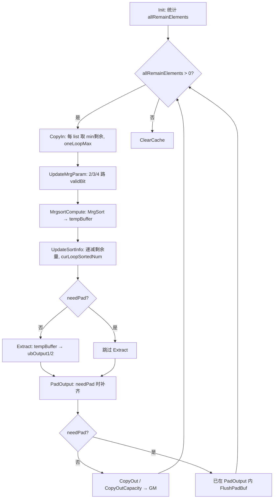

# MoeMrgsortOut 实现逻辑文档

> 对应源码：`moe/moe_token_permute_with_routing_map/op_kernel/moe_mrgsort_out.h`  
> 调用方：`MoeSortMultiCore::SortOutProcess()`（`blockIdx == 0` 单核执行）

## 1. 功能定位

`MoeMrgsortOut` 是 MOE Token Permute 排序流水线的 **最终归并输出阶段（SortOut）**：

- **输入**：VBS / VMS 阶段写入 workspace 的多条已排序 float 列表（每条为 `(key, value)` 对，key 为负 token id）
- **输出**：GM 上的 `sorted_indices`（`int32_t` 一维数组）
- **职责**：多路 `MrgSort` 归并 →（可选）按 token 分组并补齐 topK 个 `-1` → 流式写入 GM

在整体排序中的位置：

```
maskselect → VBS(各核 UB 排序) → VMS(核间归并) → SortOut(MoeMrgsortOut) → tokencopy
```

## 2. 参数与状态

### 2.1 MoeMrgsortParam（由 MoeSortMultiCore 传入）

| 字段 | 含义 |
|------|------|
| `perListElements` | 前 `listNum-1` 条 list 的元素个数 |
| `lastListElements` | 最后一条 list 的元素个数 |
| `oneLoopMaxElements` | 每轮 CopyIn 每 list 最多取元素数（来自 `sortOutTilingData`，约 1024） |
| `needPad` | 是否稀疏 routing 补齐模式（`actualOutTokens < topK×numTokens`） |
| `topK` | 每 token 最多专家数 |
| `numTokens` | token 总数 |

### 2.2 归并循环状态

| 成员 | 含义 |
|------|------|
| `listNum` | 输入 list 条数（≤4，由 `SetInput` 累加） |
| `listRemainElements[i]` | 第 i 条 list 尚未归并的元素数 |
| `offsets[i]` | 第 i 条 list 在 GM 上的偏移（float 对为单位） |
| `allRemainElements` | 所有 list 剩余元素总和；**Process 循环条件** |
| `curLoopSortedNum` | 本轮 MrgSort 实际输出的 pair 数 |
| `outOffset` | 已写入 GM 的 int32 个数 |

### 2.3 needPad 跨轮补齐状态（仅 needPad=true）

| 成员 | 含义 |
|------|------|
| `padNextExpectedTokenId` | 全局流中下一个应处理的 token id（用于填“空 token” gap） |
| `padOngoingTokenId` | 上一轮 chunk 末尾未凑满 topK 的 token（-1 表示无） |
| `padOngoingEmittedCount` | 该 token 已写出有效 value 个数（不含待补 -1） |

`Init` / `ClearCache` 时重置为：`padNextExpectedTokenId=0`，`padOngoingTokenId=-1`，`padOngoingEmittedCount=0`。

## 3. 数据格式约定

### 3.1 排序 key / value

VBS 阶段对 token index 做 `Muls(..., -1)`，故 MrgSort 后 `tempBuffer` 中每对为：

```
pair[i] = ( key_float, value_int32 )
         = ( -tokenId,   permuted_position )
```

`PadOutput` 解析 token id：`curTokenId = -static_cast<int32_t>(tempFloat.GetValue(pairIdx * 2))`  
输出 value：`tempInt.GetValue(pairIdx * 2 + 1)`

### 3.2 目标输出（needPad=true）

最终 GM 长度为 **topK × numTokens**，按 token 分组，每组 topK 个 int32：

```
[token0: v0, v1, ..., v_{k-1} 或 -1 补齐]
[token1: ...]
...
```

无 routing 的 token：整组为 -1。

## 4. 主流程 Process()



要点：

- `allRemainElements` **只由 UpdateSortInfo 递减**，PadOutput **不得**将其清零。
- `needPad` 时：**不** Extract，**不** CopyOut；数据经 PadOutput + FlushPadBuf 写 GM。
- 仅 `blockIdx==0` 的核执行 SortOutProcess → Process()。

## 5. 各步骤说明

### 5.1 Init

- 按 `listNum` 初始化 `offsets[i]`、`listRemainElements[i]`（末 list 用 `lastListElements`）。
- `allRemainElements = Σ listRemainElements[i]`。
- `needPad` 时重置 pad 状态。

### 5.2 CopyIn

- 对每条 list：`lengths[i] = min(oneLoopMaxElements, listRemainElements[i])`。
- 从 `gmInputs[i][offsets[i]]` 搬到 `ubInputs[i]`。
- 统计本轮参与归并的 `remainListNum`（非空 list 数）。

### 5.3 UpdateMrgParam + MrgsortCompute

- 2/3/4 路：`MrgSort<float, true>(tempBuffer, ...)`，结果在 **tempBuffer**。
- 1 路：直接 DataCopy 到 tempBuffer。
- `listSortedNums[j]` 记录每路本轮输出元素数。

### 5.4 UpdateSortInfo

```
listRemainElements[i] -= listSortedNums[j]
allRemainElements      -= listSortedNums[j]
offsets[i]             += GetSortOffset(listSortedNums[j])
curLoopSortedNum       += listSortedNums[j]
```

`curLoopSortedNum` = 本轮归并出的 pair 总数。

### 5.5 Extract（仅 needPad=false）

```cpp
Extract(ubOutput1, ubOutput2, tempBuffer, Ceil(curLoopSortedNum, ONE_REPEAT_SORT_NUM));
```

从 KV 对中拆出 key / value 到 UB，供 CopyOut 按序追加到 GM。

### 5.6 CopyOut / CopyOutCapacity（仅 needPad=false）

- 将 ubOutput2（value）连续写入 `gmOutput1[outOffset]`，长度 `curLoopSortedNum * sizeof(int32)`。
- CopyOutCapacity 在达到 capacity 时截断并置 `allRemainElements=0`（带容量上限场景）。

## 6. PadOutput 逻辑（needPad=true）

### 6.1 输入 / 输出缓冲

| 缓冲 | 用途 |
|------|------|
| tempBuffer | 本轮 MrgSort 的 KV 对（只读） |
| ubOutput1（作 int32） | 本轮补齐结果暂存，`bufCapacity = oneLoopMaxElements * 2` |
| gmOutput1 | 最终 sorted_indices，经 FlushPadBuf 分段写入 |

### 6.2 本轮是否“全局归并结束”

```cpp
bool mergeFinished = (allRemainElements == 0);  // UpdateSortInfo 之后判断
```

- `mergeFinished == false`：可能还有后续 chunk，**不能**对未结束的 token 补 -1，**不能**对末尾空 token 做全局 -1 填充。
- `mergeFinished == true`：输入已全部归并完，可补齐末尾无数据的 token。

### 6.3 处理顺序（单轮 PadOutput 调用）

```
① 若有 padOngoingTokenId：续写跨 chunk 未完成的 token
② while (pairIdx < pairCount)：处理本轮 KV 对
   - gap 填充：padNextExpectedTokenId .. curTokenId-1 → 每组 topK 个 -1
   - 收集 curTokenId 的全部 value
   - tokenComplete = (还有下一 token) OR mergeFinished
     · 完成 → 补 (topK - count) 个 -1，padNextExpectedTokenId = curTokenId+1
     · 未完成 → 记 padOngoing*，Flush 后 return（等下轮）
③ 若 mergeFinished：padNextExpectedTokenId .. numTokens-1 → 每组 topK 个 -1
④ 若 outPos > 0：FlushPadBuf
```

### 6.4 tokenComplete 判定

| 条件 | 含义 |
|------|------|
| `pairIdx < pairCount` | 本轮 chunk 内还有更大 token id 的 pair → 当前 token 已结束 |
| `mergeFinished` | 输入耗尽 → 当前 token 不会再有后续 pair |

否则：当前 token 的 pair 延续到下一 chunk → 设置 `padOngoingTokenId` / `padOngoingEmittedCount` 并提前 return。

### 6.5 输出示例

`numTokens=3, topK=3`，排序后有效 pair 对应 token0×2、token1×3：

```
MrgSort 流: (0,v0),(0,v1),(1,v2),(1,v3),(1,v4)
Pad 后 GM: [v0,v1,-1, v2,v3,v4,-1,-1,-1]
            |--token0--| |---token1---| |--token2--|
```

## 7. needPad 与非 needPad 路径对比

| 项目 | needPad=false | needPad=true |
|------|---------------|--------------|
| Extract | 执行 | 跳过 |
| 读 KV | 经 Extract 到 ubOutput2 | 直接读 tempBuffer |
| 写 GM | CopyOut 追加 curLoopSortedNum 个 | FlushPadBuf 按补齐后长度写 |
| 输出长度 | actualOutTokens（连续索引） | topK × numTokens（分组 + -1） |
| 跨轮状态 | 无 | padNextExpectedTokenId 等 |

## 8. 与 MoeSortMultiCore 的衔接

`SortOutProcess()`（仅 core0）：

```cpp
mrgsortParam.perListElements = perListElements;   // 来自 VMS 结束状态
mrgsortParam.lastListElements = lastListElements;
mrgsortParam.oneLoopMaxElements = sortOutTilingData->oneLoopMaxElements;
// needPad / topK / numTokens 由 SetNeedPad() 设置

InitMoeMrgSortOut(&sorter, listNum, coreOffset);
sorter.Init(&mrgsortParam, pipe);
sorter.Process();
```

`InitMoeMrgSortOut`：

- 从 `workspaceGms[srcWsIndex]` 挂最多 4 条 SetInput。
- SetOutput(sortedExpertForSourceRowGm, ...)：输入输出同一 GM（原地写出最终 indices）。
- SetBuffer(sortedBuffer 子区) 作 MrgSort 临时区。

非对齐场景在 Process() 前会调用 `RecalcVBSMultiCoreParams(actualOutTokens)` 重算 VBS；SortOut 仍用 host tiling 的 `sortOutTilingData->oneLoopMaxElements`，但 VMS 后的 listNum/perListElements 已随 VBS 重算变化，MrgsortOut 按实际剩余 list 做多轮归并。

## 9. 关键不变量（实现约束）

1. **allRemainElements**：仅表示待归并输入剩余量；与 pad 输出长度无关。
2. **全局有序性**：各 list 已按 -tokenId 有序，多路 MrgSort 保证 chunk 内有序；跨 chunk 由多轮 Process 保持全局有序。
3. **-1 补齐时机**：仅 tokenComplete 或 mergeFinished 时对 token 补 -1；避免中间轮对未结束 token 误补。
4. **UB 容量**：`outPos + need > bufCapacity` 时 FlushPadBuf，避免 ubOutput1 溢出。

## 10. 相关 API 一览

| 方法 | 作用 |
|------|------|
| SetInput / SetOutput / SetBuffer | 绑定 GM/UB 资源 |
| Init | 初始化 list 剩余量与 pad 状态 |
| Process() | 标准归并输出循环 |
| Process(capacity) | 带输出上限版本 |
| ClearCache | 结束后清零 list/pad 状态 |

## 修订记录

| 版本 | 日期 | 说明 |
|------|------|------|
| v1.0 | 2026-05-29 | 初始版本，反映 PadOutput 多轮归并与跨 chunk 补齐修复后的实现 |
