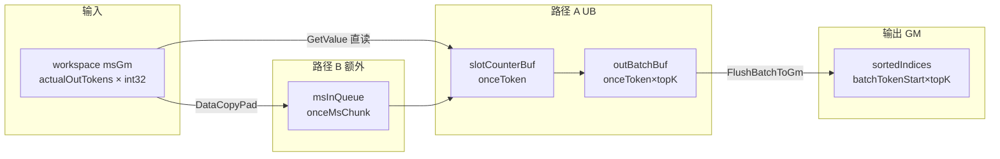
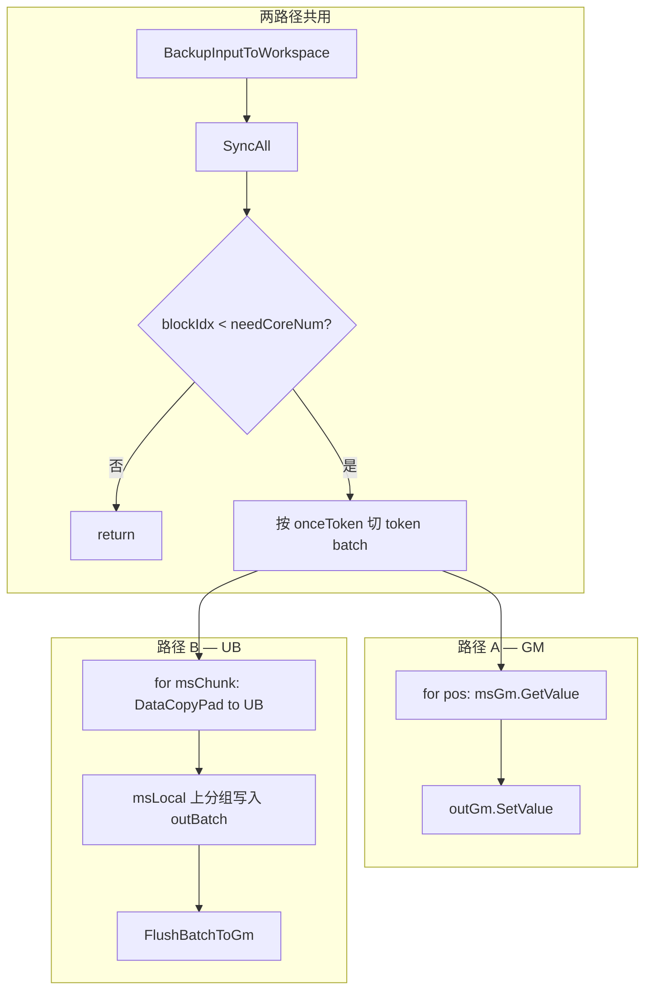

# 非对齐场景 Indices Pad 多核方案设计

> **状态**：v0.3 — 双实现并行，待性能测试后择优保留  
> **关联算子**：`moe_token_permute_with_routing_map`  
> **替换目标**：`NONALIGNED_SORT_COPY_IMPL` 中的 `MoeSortMultiCore`（`RecalcVBSMultiCoreParams` + VBS/VMS/SortOut 全链路）  
> **修订日期**：2026-06-11

---

## 1. 背景与动机

### 1.1 现状

当 `actualOutTokens != topK × numTokens`（非对齐 / 稀疏 routing）时，主 kernel 走 `NONALIGNED_SORT_COPY_IMPL`：

```
maskselect → MoeSortMultiCore(RecalcVBSMultiCoreParams) → MoeindexCopyOp
```

Sort 阶段完成两件事：

1. 按 **token id** 对 masked select 输出重新分组排序  
2. 将 **permute position** 按 `topK × numTokens` 布局写出，不足处填 `-1`

该路径依赖 VBS → VMS → `MoeMrgsortOut::PadOutput` 多级归并，逻辑复杂、workspace 占用大、单核 SortOut 瓶颈明显。

### 1.2 目标

用**直接扫描 + 分组写入**替代排序归并：

- masked select 已按 routing map 遍历顺序输出 **token id 流**（如 `1,2,4,5,6,1,2,1`）
- 每条记录在流中的下标即 **permute position**（与当前 sort 输出的 value 语义一致）
- 无需排序，只需按 token id 分组并 pad 到 `topK` 槽位

### 1.3 设计原则

| 原则 | 说明 |
|------|------|
| Tiling 侧不修改 | 继续复用 `indexCopyComputeParamsOp` 中已有的多核切分参数 |
| 接口兼容 | 输出 `sorted_indices` 格式与现网一致：`[topK × numTokens]`，`int32`，`-1` 表示空槽 |
| 双实现 A/B | **GM 直读** 与 **UB 分批读** 各一文件，功能等价，性能测试后删劣留优 |
| 临时并存 | 两路径仅用于对比验证，最终只保留一个头文件 |

---

## 2. 数据语义

### 2.1 masked select 输出（Pad 阶段输入）

| 属性 | 说明 |
|------|------|
| 存储位置 | `sortedIndices[0 .. actualOutTokens-1]`（maskselect 写入） |
| 元素含义 | **token id**（`0 .. numTokens-1`），与 Golden 中 `token_indices.masked_select(routing_map.T)` 一致 |
| 下标含义 | 下标 `pos` 即为 **permute position**，后续 tokencopy 用它定位输出行 |

**示例**（`numTokens=7, topK=3, actualOutTokens=8`）：

```
pos:     0  1  2  3  4  5  6  7
tokenId: 1  2  4  5  6  1  2  1
```

### 2.2 Pad 阶段输出

| 属性 | 说明 |
|------|------|
| 存储位置 | `sortedIndices[0 .. topK×numTokens-1]`（原地覆盖） |
| 布局 | 按 token 分组，每组 `topK` 个 `int32` |
| 元素含义 | permute position；无 routing 的槽位为 `-1` |

上例期望输出（`topK=3`）：

```
token0: [-1, -1, -1]
token1: [0,  5,  7 ]      ← pos 0,5,7 处 tokenId=1
token2: [1,  6,  -1]
token3: [-1, -1, -1]
token4: [2,  -1, -1]
token5: [3,  -1, -1]
token6: [4,  -1, -1]
```

### 2.3 与 tokencopy 的衔接

`MoeindexCopyOp<tokenDtype, true>` 已支持 `indicesValue == -1` 时跳过搬移，**Pad 输出格式无需改动 tokencopy**。

---

## 3. 总体方案

### 3.1 双实现模块（临时并存）

| 实现 | 文件 | 类名 | 读 masked select 方式 |
|------|------|------|----------------------|
| **路径 A — GM 直读** | `op_kernel/moe_indices_pad_multi_core_gm.h` | `MoeIndicesPadMultiCoreGm` | `GlobalTensor::GetValue(pos)`，**不** DataCopy 到 UB |
| **路径 B — UB 分批读** | `op_kernel/moe_indices_pad_multi_core_ub.h` | `MoeIndicesPadMultiCoreUb` | `DataCopyPad` 分 chunk 读入 UB，在 LocalTensor 上处理 |

两路径共享：

- 相同的多核 token 切分（§4）
- 相同的核心分组算法语义（§5.1）
- 相同的 workspace 输入备份（§5.3）
- 相同的对外 `Init` / `Process` 签名
- **相同的输出**（逐元素一致）

**生命周期**：开发阶段两文件均编译接入；用户完成精度 + 性能对比后，**删除较慢实现及对应 include/宏分支**，只保留优胜路径（届时可重命名为 `moe_indices_pad_multi_core.h`）。

### 3.2 数据流（替换后）

```
maskselect
    │  sortedIndices[0:actualOutTokens] = tokenId 流
    │  actualOutTokens（局部变量）
    ▼
BackupInputToWorkspace（block0 → userWS，SyncAll）
    ▼
MoeIndicesPadMultiCoreGm / MoeIndicesPadMultiCoreUb :: Process()
    │  多核按 token 切分，各核扫描完整 masked select 流
    │  输出 sortedIndices[0:topK×numTokens] = position + pad
    ▼
MoeindexCopyOp<tokenDtype, true>::Process()
```

### 3.3 主 kernel 集成（A/B 切换）

`moe_token_permute_with_routing_map.cpp` 中 `NONALIGNED_SORT_COPY_IMPL`：

```cpp
// 编译期或宏切换，便于对比测试（测试完成后删除其一）
#define MOE_INDICES_PAD_USE_GM 1   // 1=路径A(GM直读), 0=路径B(UB读)

#if MOE_INDICES_PAD_USE_GM
#include "moe_indices_pad_multi_core_gm.h"
// ...
MoeIndicesPadMultiCoreGm op2;
#else
#include "moe_indices_pad_multi_core_ub.h"
// ...
MoeIndicesPadMultiCoreUb op2;
#endif

op2.Init(sortedIndices, sortedIndices, actualOutTokens, t, userWS, &sortPipe2);
op2.Process();
```

**删除**（两路径均替代）：

```cpp
MoeSortMultiCore<int32_t> op2;
op2.RecalcVBSMultiCoreParams(...);
op2.SetNeedPad(true, t->topK, t->n);
op2.InitAfterRecalc(...);
op2.Process();
```

---

## 4. 多核切分策略（两路径共用）

### 4.1 复用 indexCopy 切分参数

直接读取 tiling 中 `indexCopyComputeParamsOp` 已有字段（与 `moe_index_copy.h::Init` 一致）：

| 字段 | 含义 |
|------|------|
| `needCoreNum` | 参与计算的核数 |
| `frontCoreNum` | 处理 `coreCalcNum` 个 token 的前段核数 |
| `tailCoreNum` | 处理 `coreCalcTail` 个 token 的后段核数 |
| `coreCalcNum` | `GetCeilInt(numTokens, realCoreNumAiv)` |
| `coreCalcTail` | `GetDiv(numTokens, realCoreNumAiv)` |

Host 侧（`moe_token_permute_with_routing_map_tiling.cpp:954-958`）：

```cpp
params.frontCoreNum = GetRem(tokenNums, realCoreNumAiv) != 0
                          ? GetRem(tokenNums, realCoreNumAiv) : realCoreNumAiv;
params.tailCoreNum  = tokenNums <= realCoreNumAiv ? 0 : realCoreNumAiv - params.frontCoreNum;
params.coreCalcNum  = GetCeilInt(tokenNums, realCoreNumAiv);
params.coreCalcTail = GetDiv(tokenNums, realCoreNumAiv);
```

### 4.2 各核职责

```
if blockIdx < frontCoreNum:
    tokenStart = blockIdx * coreCalcNum
    tokenCount = coreCalcNum
else if blockIdx < needCoreNum:
    tokenStart = frontCoreNum * coreCalcNum + (blockIdx - frontCoreNum) * coreCalcTail
    tokenCount = coreCalcTail
else:
    不参与
```

- **输出 GM 区间**：`sortedIndices[tokenStart×topK .. (tokenStart+tokenCount)×topK)`  
- **扫描输入**：完整 `[0, actualOutTokens)`（从 workspace 备份读）  
- 写区间互不重叠，Pad 阶段各核之间**无需 SyncAll**（备份后仅 block0 需 SyncAll 一次）

---

## 5. 核心算法（两路径语义一致）

### 5.1 分组写入逻辑

对每个核、每个 token 批，维护 `slotCounter[batchTokenSize]`（初值 0）：

```
for pos in 0 .. actualOutTokens-1:
    tokenId = READ_INPUT(pos)          // 路径A: msGm.GetValue(pos)
                                       // 路径B: msLocal[i]（来自 UB chunk）
    if tokenId in [batchTokenStart, batchTokenStart + batchTokenSize):
        localIdx = tokenId - batchTokenStart
        slot = slotCounter[localIdx]
        if slot < topK:
            WRITE_OUTPUT(tokenId, slot, pos)   // 见 §5.4 / §5.5
            slotCounter[localIdx]++
```

未写入槽位保持 `-1`（初始化保证）。

### 5.2 token 批：`onceToken` 循环（两路径共用）

每个核将负责的 token 按 UB 容量切批（**输出批**占用 UB；路径 A 的输入不占 UB）：

```
onceToken = floor(ubLeft / (topK × sizeof(int32) + sizeof(int32)))  // 输出批 + slotCounter
onceToken = clamp(onceToken, 1, tokenCount)
numTokenBatches = ceil(tokenCount / onceToken)

for batch in 0 .. numTokenBatches-1:
    batchTokenStart = tokenStart + batch × onceToken
    batchTokenSize  = min(onceToken, tokenCount - batch × onceToken)
    // 初始化 slotCounter；扫描 actualOutTokens；写本批输出
```

### 5.3 输入备份（GM 覆盖问题，两路径共用）

Pad 输出 `[token×topK]` 与输入 tokenId 流 `[0:actualOutTokens)` **地址重叠**。

**固定方案**：Pad 开始前，`blockIdx==0` 拷贝至 workspace，全体 `SyncAll`：

```
workspace[0 : actualOutTokens×4] ← sortedIndices[0:actualOutTokens]
```

两路径扫描源均为 **workspace 上的 `GlobalTensor<int32_t>`**（`msGm`），不再读即将被覆盖的 `sortedIndices` 头部。

### 5.4 路径 A — GM 直读（`moe_indices_pad_multi_core_gm.h`）

#### 思路

- masked select 流：**全程 GM scalar 读**，`tokenId = msGm.GetValue(pos)`
- **不**为输入分配 UB，**不**发起 MTE2 DataCopy 读 ms 流
- 输出：优先 **GM 直写** `outGm.SetValue(...)`；若本批需批量初始化 `-1`，可用小块 UB + `Duplicate` + 一次 `DataCopyPad` flush

#### Process 伪代码

```
BackupInputToWorkspace(); SyncAll()
if blockIdx >= needCoreNum: return

for each token batch (batchTokenStart, batchTokenSize):
    Init slotCounter[batchTokenSize] = 0          // UB 或 scalar
    Init out region to -1                           // GM SetValue 或 UB flush

    for pos in 0 .. actualOutTokens-1:
        tokenId = msGm.GetValue(pos)                // ★ GM 直读，无 UB
        // §5.1 判定
        if hit:
            outGm.SetValue((tokenId * topK + slot), pos)   // ★ GM 直写

    // 可选早停：本批 slotCounter 全满则 break 内层 pos 循环
```

#### UB 占用（路径 A）

路径 A **不为 ms 流分配 UB**；UB 仅用于本批输出缓冲与 slot 计数。完整布局与公式见 **§6**。

| Buffer | 是否必需 | 说明 |
|--------|----------|------|
| `outBatchBuf` | **推荐** | `onceToken×topK×4`，本批 pad 结果；`-1` 初始化后 flush GM |
| `slotCounterBuf` | **必需** | `onceToken×4`，本批各 token 已填 slot 数 |
| `msInQueue` | **不需要** | 输入走 GM `GetValue` |

#### 特点

| 优点 | 缺点 |
|------|------|
| 无 ms 流 MTE2 搬入，实现简单 | `actualOutTokens` 大时 GM GetValue 次数多，可能受 GM 带宽/延迟影响 |
| UB 占用小，留给 onceToken 更大 | 难以向量化，纯 scalar |
| 代码路径短，易调试 | 与 UB 批读相比性能未知，需实测 |

### 5.5 路径 B — UB 分批读（`moe_indices_pad_multi_core_ub.h`）

#### 思路

- masked select 流：按 `onceMsChunk` **DataCopyPad 到 UB**，在 LocalTensor 上遍历
- 每个 token 批内，外层 `onceToken` 循环，内层 `onceMsChunk` 扫描 `actualOutTokens`
- 输出：本批结果在 UB 凑齐后 **FlushBatchToGm**（与 indexCopy 风格一致）

#### Process 伪代码

```
BackupInputToWorkspace(); SyncAll()
if blockIdx >= needCoreNum: return

for each token batch (batchTokenStart, batchTokenSize):
    Init outBatch UB to -1, slotCounter = 0

    for msOffset in 0 .. actualOutTokens step onceMsChunk:
        msLen = min(onceMsChunk, actualOutTokens - msOffset)
        DataCopyPad(msLocal, msGm[msOffset], msLen)     // ★ UB 读入
        for i in 0 .. msLen-1:
            pos = msOffset + i
            tokenId = msLocal.GetValue(i)
            // §5.1 判定 → 写 outBatch UB
        // 可选早停

    FlushBatchToGm(outBatch → sortedIndices[batchTokenStart×topK])
```

#### UB 占用（路径 B）

路径 B 在路径 A 三块 UB 基础上**额外**分配 `msInQueue`。完整布局、双缓冲与 `onceMsChunk` 推导见 **§6**。

| Buffer | 大小 | 用途 |
|--------|------|------|
| `outBatchBuf` | `onceToken × topK × 4` | 本批 pad 输出 |
| `slotCounterBuf` | `onceToken × 4` | slot 计数 |
| `msInQueue` | `onceMsChunk × 4`（可双缓冲 ×2） | ms 流读批 |

#### 特点

| 优点 | 缺点 |
|------|------|
| MTE2 批量搬入，UB 内访问快 | 多一次 GM→UB 搬移，UB 占用更大 |
| 后续可扩展 vector 处理 chunk | 实现与 buffer 管理更复杂 |
| 与现有算子 DataCopy 风格一致 | `onceMsChunk` 受限时仍要多次扫全流 |

---

## 6. UB 划分详细设计

Pad 阶段在 `NONALIGNED_SORT_COPY_IMPL` 内使用**独立** `TPipe sortPipe2`（与 maskselect / indexCopy 的 Pipe **不同时存活**），因此实现上可认为 **整片物理 UB 专用于 Pad**。以下按单核 Pad 视角描述划分；多核各有一份 UB，参数相同。

### 6.1 UB 总量与可用空间

| 符号 | 来源 | 说明 |
|------|------|------|
| `ubSize` | `PlatformAscendC::GetCoreMemSize(UB)` | 典型 910B AIV：**192 KiB**（196608 B）；以平台为准 |
| `ubSizeAlign` | `FloorAlign(ubSize, 32)` | 与 indexCopy tiling 一致，**32 B** 对齐 |
| `TPipeReserve` | kernel 常量 | TPipe 元数据 / 对齐余量，建议 **256 B**（可调） |
| `ubAvail` | `ubSizeAlign - TPipeReserve` | Pad 可分配给 `InitBuffer` / `TBuf` 的上限 |

```cpp
constexpr int64_t ONE_BLOCK_BYTE = 32;
constexpr int64_t INT32_SIZE     = 4;
constexpr int64_t TPIPE_RESERVE   = 256;

int64_t ubSizeAlign = (ubSize / ONE_BLOCK_BYTE) * ONE_BLOCK_BYTE;
int64_t ubAvail     = ubSizeAlign - TPIPE_RESERVE;
```

> **与 indexCopy `ubLeft` 的关系**：Host 侧 `ubLeft = ubSize - MAX_INDICES_NUM×4`（2048 B）是为 **tokencopy** 预留 indices 区。Pad 使用**独立 TPipe**，不直接占用 indexCopy 的 `tokenUB/indicesUB`，但 Pad 的 `onceToken` 公式在形式上与之类似（按 `topK` 和 int32 估算）。

### 6.2 划分原则

1. **按 token 批（onceToken）切分**：约束 `onceToken × topK × 4 ≤ 输出区容量`（用户要求的核心不等式）。
2. **32 B 对齐**：凡经 `DataCopyPad` 的 buffer，字节数 `UpAlign(bytes, 32)`，避免 MTE 非对齐。
3. **固定分配 + 批内复用**：`Init()` 时按 `onceToken` **一次性** `InitBuffer`；每个 token batch 复用同一块 UB，不随 `batchTokenSize` 重新分配。
4. **slotCounter 常驻 UB**：扫描内层循环高频读写，必须放 LocalTensor，**不放 GM**。
5. **路径 A 输出可 GM 直写**：若采用 GM `SetValue` 写结果，可省略 `outBatchBuf`，仅保留 `slotCounterBuf`；**推荐仍用 outBatchBuf** 统一 `-1` 初始化 + 批量写 GM。

### 6.3 公共参数：`onceToken` 推导

每个核负责 `tokenCount` 个 token，按 `onceToken` 个一批扫描全量 `actualOutTokens` 流。

**单批每 token 所需 UB（未对齐）**：

```
outBatchBytes    = onceToken × topK × INT32_SIZE      // 本批输出 [onceToken, topK]
slotCounterBytes = onceToken × INT32_SIZE              // 每 token 一个 int32 计数
```

**路径 A — 仅输出区 + 计数器**：

```cpp
int64_t perTokenUb = topK * INT32_SIZE + INT32_SIZE;   // topK 输出 + 1 计数
int64_t onceTokenA = ubAvail / perTokenUb;
onceTokenA = Max(onceTokenA, 1);
onceTokenA = Min(onceTokenA, tokenCount);              // 不超过本核 token 数

int64_t outBatchBytesA    = UpAlign(onceTokenA * topK * INT32_SIZE, ONE_BLOCK_BYTE);
int64_t slotCounterBytesA = UpAlign(onceTokenA * INT32_SIZE, ONE_BLOCK_BYTE);
// 校验: outBatchBytesA + slotCounterBytesA <= ubAvail
```

**路径 B — 额外 ms 读批**：

```cpp
// 先用与 A 相同的 perTokenUb 得到 onceToken 上界
int64_t onceTokenB = ubAvail / perTokenUb;
onceTokenB = Max(onceTokenB, 1);
onceTokenB = Min(onceTokenB, tokenCount);

int64_t outBatchBytesB    = UpAlign(onceTokenB * topK * INT32_SIZE, ONE_BLOCK_BYTE);
int64_t slotCounterBytesB = UpAlign(onceTokenB * INT32_SIZE, ONE_BLOCK_BYTE);
int64_t msUbLeft          = ubAvail - outBatchBytesB - slotCounterBytesB;

// ms 队列：单缓冲
int64_t onceMsChunk = Max(msUbLeft / INT32_SIZE, 1);

// 若启用 ms 双缓冲（BUFFER_NUM=2，与 indexCopy 一致）
int64_t onceMsChunkDb = Max(msUbLeft / (INT32_SIZE * BUFFER_NUM), 1);
```

**批次数**：

```
numTokenBatches = Ceil(tokenCount, onceToken)
batchTokenSize  = Min(onceToken, tokenCount - batch × onceToken)   // 最后一批可能更小
```

> 最后一批 `batchTokenSize < onceToken` 时，仍使用**同一块** `outBatchBuf`，只使用 `[0, batchTokenSize×topK)` 有效区再 flush GM。

### 6.4 路径 A — UB 内存地图

#### 6.4.1 布局示意（推荐：outBatch + slotCounter）

```
ubAvail (例如 196352 B)
┌──────────────────────────────────────────────────────────────┐
│ outBatchBuf   │ onceToken × topK × int32, 32B 对齐           │
│               │ 逻辑形状: [onceToken, topK] 行主序              │
│               │ outBatch[tokenLocal * topK + slot] = pos|-1  │
├───────────────┼──────────────────────────────────────────────┤
│ slotCounterBuf│ onceToken × int32, 32B 对齐                  │
│               │ slotCounter[tokenLocal] ∈ [0, topK]          │
├───────────────┼──────────────────────────────────────────────┤
│ (未使用)      │ ubAvail - 已分配, 保留                        │
└──────────────────────────────────────────────────────────────┘

ms 输入: 不占用 UB，msGm.GetValue(pos) 直读 workspace
```

#### 6.4.2 `outBatchBuf` 逻辑布局

对 batch 内 `tokenLocal ∈ [0, batchTokenSize)`：

```
GM 写地址: sortedIndices[(batchTokenStart + tokenLocal) × topK + slot]

UB 索引:   outBatch[tokenLocal × topK + slot]
           其中 slot = slotCounter[tokenLocal]（写入前），写后 slotCounter++
```

初始化（每 token batch 开始）：

```cpp
Duplicate(outBatch, (int32_t)-1, onceToken * topK);   // 或只 Duplicate batchTokenSize×topK
for (i = 0; i < batchTokenSize; ++i)
    slotCounter.SetValue(i, 0);
```

扫描结束后 **FlushBatchToGm**（推荐，即使命中时已 GM 直写也可统一 flush 保证 `-1`）：

```cpp
DataCopyPad(outGm[batchTokenStart * topK], outBatch, batchTokenSize * topK * INT32_SIZE);
```

#### 6.4.3 路径 A 极简模式（无 outBatchBuf）

若坚持输出全程 `outGm.SetValue`：

```
ubAvail
┌─────────────────────┐
│ slotCounterBuf only │  onceToken × 4
└─────────────────────┘
onceTokenA = ubAvail / UpAlign(INT32_SIZE, 32)   // 计数器占满可用 UB 时更大
```

`-1` 初始化需对 GM 负责区间逐元素 `SetValue(-1)` 或按 32B 小块 Duplicate + DataCopyPad。

#### 6.4.4 TPipe 分配（路径 A 推荐）

```cpp
int64_t outBatchElems = onceToken * topK;
int64_t outBatchBytes = UpAlign(outBatchElems * INT32_SIZE, ONE_BLOCK_BYTE);
int64_t slotBytes     = UpAlign(onceToken * INT32_SIZE, ONE_BLOCK_BYTE);

pipe->InitBuffer(outBatchQue, 1, outBatchBytes);      // TQue 或 TBuf
pipe->InitBuffer(slotCounterBuf, slotBytes);           // TBuf<TPosition::VECCALC>
```

### 6.5 路径 B — UB 内存地图

#### 6.5.1 布局示意

```
ubAvail
┌──────────────────────────────────────────────────────────────┐
│ outBatchBuf   │ 同 §6.4.1                                     │
├───────────────┼──────────────────────────────────────────────┤
│ slotCounterBuf│ 同 §6.4.1                                     │
├───────────────┼──────────────────────────────────────────────┤
│ msInQueue     │ onceMsChunk × int32 [× BUFFER_NUM 若双缓冲]    │
│               │ DataCopyPad(msGm[offset], msLocal, msLen)     │
├───────────────┼──────────────────────────────────────────────┤
│ (未使用)      │ 余量                                          │
└──────────────────────────────────────────────────────────────┘
```

#### 6.5.2 ms 读批与扫描

```
msBatches = Ceil(actualOutTokens, onceMsChunk)

for msBatch in 0 .. msBatches-1:
    msOffset = msBatch × onceMsChunk
    msLen    = Min(onceMsChunk, actualOutTokens - msOffset)
    DataCopyPad(msLocal, msGm[msOffset], msLen × INT32_SIZE)
    // MTE2 → S 同步
    for i in 0 .. msLen-1:
        pos     = msOffset + i
        tokenId = msLocal.GetValue(i)
        // §5.1 → 写 outBatch UB（不写 GM，批末统一 flush）
```

**双缓冲（可选）**：`InitBuffer(msInQueue, BUFFER_NUM=2, onceMsChunk×4)`，MTE2 搬下一块与 V/S 处理当前块流水；Pad 阶段计算量小，**首版可用单缓冲**。

#### 6.5.3 TPipe 分配（路径 B）

```cpp
pipe->InitBuffer(outBatchQue, 1, outBatchBytes);
pipe->InitBuffer(slotCounterBuf, slotBytes);
pipe->InitBuffer(msInQueue, 1, onceMsChunk * INT32_SIZE);   // 或 BUFFER_NUM=2
```

### 6.6 数值示例

假设 **910B**：`ubSizeAlign = 196608`，`TPipeReserve = 256` → `ubAvail = 196352`  
`topK = 8`，本核 `tokenCount = 1000`

| 项 | 路径 A | 路径 B |
|----|--------|--------|
| `perTokenUb` | 8×4 + 4 = **36 B** | 同左 |
| `onceToken` | 196352 / 36 ≈ **5454** → cap 1000 → **1000** | 同左（本例 1 批即覆盖全核） |
| `outBatchBytes` | UpAlign(1000×8×4) = **32000 B** | 32000 B |
| `slotCounterBytes` | UpAlign(1000×4) = **4000 B** | 4000 B |
| `msUbLeft` | — | 196352 − 32000 − 4000 = **160352 B** |
| `onceMsChunk` | — | 160352 / 4 = **40088** |
| ms 批次数（`actualOutTokens=5000`） | — | Ceil(5000/40088) = **1** |

若 `topK = 64`：

| 项 | 路径 A | 路径 B |
|----|--------|--------|
| `perTokenUb` | 64×4 + 4 = **260 B** | 同左 |
| `onceToken` | 196352 / 260 ≈ **755** | 同左 |
| `outBatchBytes` | UpAlign(755×64×4) = **193280 B** | 193280 B |
| `slotCounterBytes` | UpAlign(755×4) = **3040 B** | 3040 B |
| `msUbLeft` | — | 196352 − 193280 − 3040 = **32 B** → `onceMsChunk=1` |

可见 **topK 大时路径 B 的 ms 缓冲会被严重压缩**；路径 A 无 ms UB， `onceToken` 仅受输出区限制，此场景 A 可能更有利。

### 6.7 单批内数据流（对照）



### 6.8 与 indexCopy UB 的时序隔离

```
时间线 ──────────────────────────────────────────────────────►

  [maskselect TPipe]  Destroy
         SyncAll
  [Pad TPipe sortPipe2]  InitBuffer → Process → Destroy     ← 本文 §6
         SyncAll（可选）
  [indexCopy TPipe]  InitBuffer( tokenUB, indicesUB ) → Process
```

Pad 与 indexCopy **不共享 UB**，故 Pad 可按 `ubAvail` 尽量用大 `onceToken`；无需扣减 indexCopy 的 `tokenUB + indicesUB`，仅需在 Pad 自己的 `InitBuffer` 总和 ≤ `ubAvail`。

### 6.9 实现检查清单

| 检查项 | 要求 |
|--------|------|
| `outBatchBytes + slotCounterBytes + msBytes ≤ ubAvail` | 必须 |
| `onceToken ≥ 1` | 即使 topK 极大也至少 1 token/批 |
| 最后一批 flush 长度 | `batchTokenSize × topK`，非 `onceToken × topK` |
| msLen DataCopy | 字节数 `UpAlign(msLen×4, 32)` 或 length 32B 对齐 |
| slotCounter 批初清零 | 每 token batch 必须 |
| outBatch 批初 -1 | 每 token batch 必须（保证空槽） |

---

## 7. 路径对比总表

| 维度 | 路径 A — GM 直读 | 路径 B — UB 分批读 |
|------|------------------|-------------------|
| 文件 | `moe_indices_pad_multi_core_gm.h` | `moe_indices_pad_multi_core_ub.h` |
| 类名 | `MoeIndicesPadMultiCoreGm` | `MoeIndicesPadMultiCoreUb` |
| 读 ms 流 | `msGm.GetValue(pos)` | `DataCopyPad` → `msLocal.GetValue(i)` |
| 写输出 | `outGm.SetValue` 或 UB flush | UB 累积 → `DataCopyPad` 写 GM |
| 输入 UB | 无 | `onceMsChunk × 4` |
| onceToken | 较大（UB 压力小） | 较小（需分给 ms chunk） |
| 扫描复杂度 | O(tokenBatches × actualOutTokens) | O(tokenBatches × msBatches × chunkLen)，等价全扫 |
| 预期适用 | `actualOutTokens` 中小规模 | `actualOutTokens` 大、GM 随机读慢 |

---

## 8. 类接口设计（两路径相同签名）

```cpp
namespace MoeTokenPermute {

// 路径 A: moe_indices_pad_multi_core_gm.h
class MoeIndicesPadMultiCoreGm { /* ... */ };

// 路径 B: moe_indices_pad_multi_core_ub.h
class MoeIndicesPadMultiCoreUb { /* ... */ };

// 公共接口（两 class 一致）
public:
    __aicore__ inline void Init(
        GM_ADDR msTokenIdsGm,      // Pad 前 sortedIndices（仅 Backup 源地址）
        GM_ADDR sortedIndicesOut,  // 最终输出 GM
        int32_t actualOutTokens,
        const MoeTokenPermuteWithRoutingMapTilingData* tilingData,
        GM_ADDR workspace,
        TPipe* pipe);

    __aicore__ inline void Process();

private:
    __aicore__ inline void BackupInputToWorkspace();
    // 路径 A 特有
    __aicore__ inline void ProcessTokenBatchGm(...);
    // 路径 B 特有
    __aicore__ inline void ProcessTokenBatchUb(...);
    __aicore__ inline void ScanMsChunkUb(...);
    __aicore__ inline void FlushBatchToGm(...);
};

} // namespace MoeTokenPermute
```

### 8.1 Init 职责（共用）

1. 读 `topK`、`n`、`indexCopyComputeParamsOp` 切分字段  
2. 算本核 `tokenStart`、`tokenCount`、`onceToken`  
3. 路径 B 额外算 `onceMsChunk`  
4. 绑定 `msGm`（workspace）、`outGm`（sortedIndicesOut）  
5. 路径 B：`TPipe::InitBuffer` 分配 ms/out/counter；路径 A：仅 counter（及可选 outInit）

### 8.2 Process 流程对比



---

## 9. 与现有 Sort 路径对比

| 维度 | 现有 MoeSortMultiCore | 新 Pad 双路径 |
|------|----------------------|---------------|
| 计算 | O(N log N) 排序 + 归并 | O(tokenBatches × actualOutTokens) 线性扫描 |
| workspace | 大量 float KV 缓冲 | 仅 `actualOutTokens×4` 备份 |
| 多核 | VBS/VMS + SortOut 单核 | 全程 `needCoreNum` 并行 |
| Tiling | kernel 内 Recalc | 复用 indexCopy 切分，无重算 |
| 输出 | 现网格式 | **与现网逐元素一致** |

---

## 10. 边界与约束（两路径相同）

| 场景 | 处理 |
|------|------|
| `actualOutTokens == 0` | 各核输出区间全 `-1` |
| 某 token 无 routing | 对应 topK 槽全 `-1` |
| routing 数 < topK | 已写 position，其余 `-1` |
| routing 数 > topK | 只写前 topK（依赖上游约束） |
| `blockIdx >= needCoreNum` | 不参与 |
| tokenId 越界 | 忽略（`0 <= tokenId < n`） |

---

## 11. Tiling / 结构体变更

**无 Host 侧变更。** Kernel 只读：

- `tilingData->n`、`tilingData->topK`
- `indexCopyComputeParamsOp.{needCoreNum, frontCoreNum, tailCoreNum, coreCalcNum, coreCalcTail}`

`onceToken` / `onceMsChunk` 均在 kernel 内按 UB 动态计算。

---

## 12. 集成与编译

| 文件 | 变更 |
|------|------|
| `op_kernel/moe_indices_pad_multi_core_gm.h` | **新增**（路径 A，自包含，可整文件删除） |
| `op_kernel/moe_indices_pad_multi_core_ub.h` | **新增**（路径 B，自包含，可整文件删除） |
| `op_kernel/moe_token_permute_with_routing_map.cpp` | `MOE_INDICES_PAD_USE_GM` 宏 + 替换 `NONALIGNED_SORT_COPY_IMPL` |
| `moe_sort_multi_core.h` 等 | **不修改**（对齐场景仍走原 sort） |

### 12.1 择优删除清单（测试后）

性能较差的实现确认后删除：

1. 删除对应 `.h` 文件（`moe_indices_pad_multi_core_gm.h` **或** `moe_indices_pad_multi_core_ub.h`）
2. 删除 `MOE_INDICES_PAD_USE_GM` 宏、`#if` 分支及未使用的 `#include`
3. 幸存类可重命名为 `MoeIndicesPadMultiCore`（可选）
4. 更新本文档 §3.1 / §7 为单路径描述

---

## 13. 验证计划

### 13.1 功能（两路径均需通过）

| 用例 | 说明 |
|------|------|
| L0 稀疏 routing | `actualOutTokens < topK×n`，对比 CPU Golden |
| 全 topK 选中 | 与 `SORT_COPY_IMPL` 输出一致 |
| 空 routing | 全 `-1` |
| 单 token 部分 expert | pad 正确 |
| **A vs B 一致性** | 同输入下 GM 路径与 UB 路径 `sorted_indices` **逐元素相同** |

### 13.2 精度

- `sorted_indices` 与 Golden 比对  
- 串联 tokencopy 后 ST end-to-end 通过  

### 13.3 性能对比（择优依据）

| 对比项 | 方法 |
|--------|------|
| A vs B | 相同 shape/dtype 各跑 N 次，比 wall time / profiling |
| vs 旧 Sort | NONALIGNED 原路径 vs 优胜 Pad 路径 |
| 关注 shape | 大 `numTokens` + 小 `actualOutTokens`；大 `actualOutTokens` |

**决策**：由用户测试后选定保留路径，删除另一实现。

---

## 14. 风险

| 风险 | 缓解 |
|------|------|
| GM GetValue 延迟高 | 路径 B 作为备选；实测择优 |
| UB 路径多轮全扫 | 早停：本批 slot 全满则 break |
| 双文件维护成本 | 明确为**临时** A/B，测完删一 |
| scalar 热点 | 优胜路径稳定后可再做 vector 优化 |

---

## 15. 修订记录

| 版本 | 日期 | 说明 |
|------|------|------|
| v0.1 | 2026-06-11 | 初稿，单文件 UB 方案 |
| v0.2 | 2026-06-11 | 拆分为 GM 直读 / UB 分批读双文件；明确 A/B 测试后删劣留优 |
| v0.3 | 2026-06-11 | 新增 §6 UB 划分详细设计（内存地图、公式、数值示例、TPipe 时序） |
| v0.4 | 2026-06-11 | 实现落地：gm/ub 双路径自包含文件，`MOE_INDICES_PAD_USE_GM` 宏切换（无 common 提取） |
