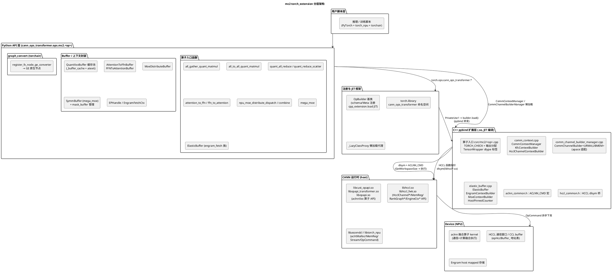
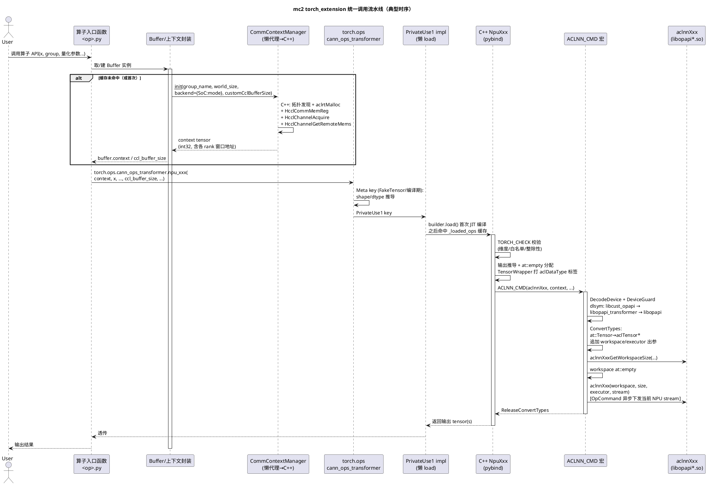
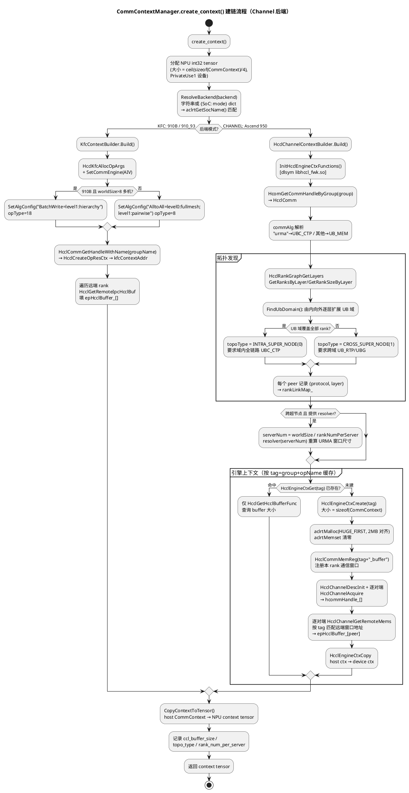
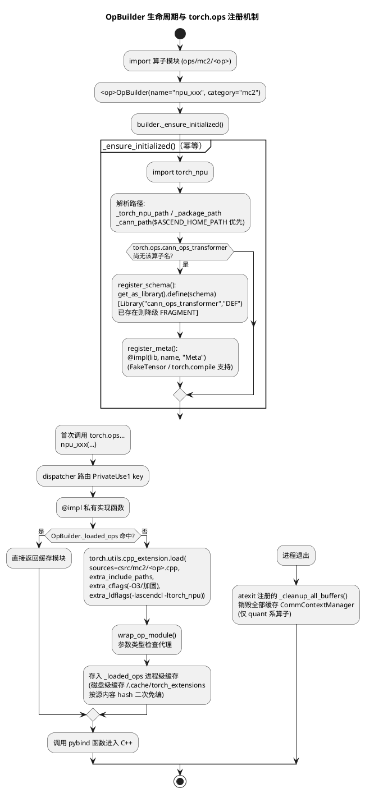
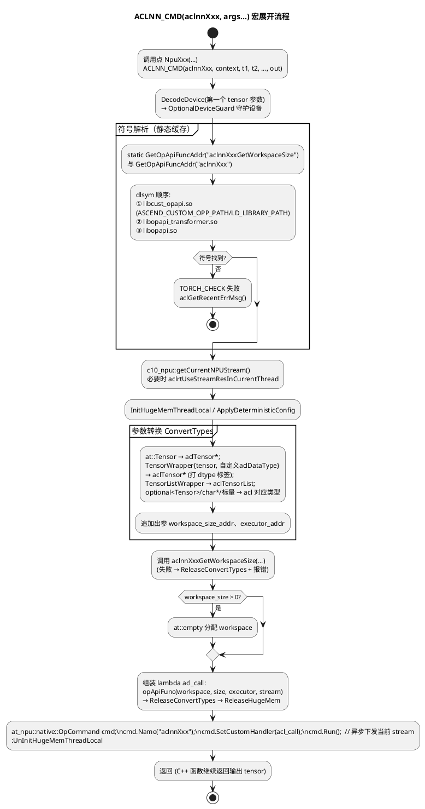
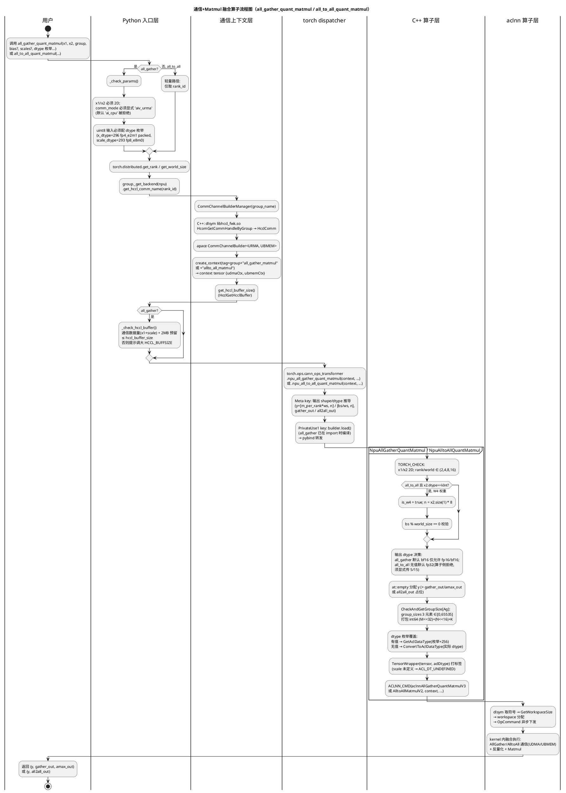
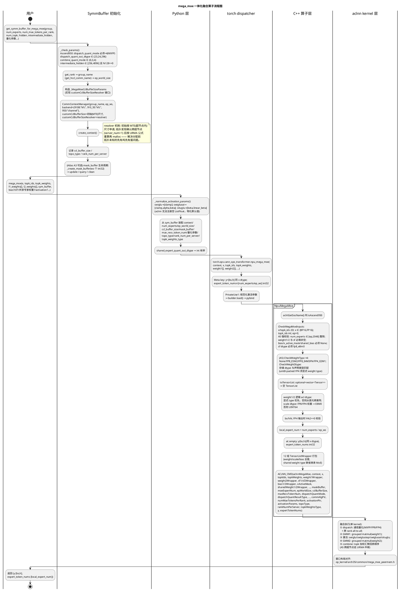

# mc2 torch_extension 完整设计文档

> 适用范围：`ops-transformer/mc2` 下全部 10 个 `torch_extension` 目录（1 个公共基础设施 + 9 个算子扩展）。
> 本文档中所有代码细节均以 PlantUML 图呈现；每个不同类别的算子各配一张独立流程图。

---

## 目录

- [1. 概述](#1-概述)
- [2. 总体架构](#2-总体架构)
- [3. 公共基础设施设计（common/torch_extension）](#3-公共基础设施设计commontorch_extension)
- [4. 关键横切机制](#4-关键横切机制)
- [5. 各类算子设计与流程图](#5-各类算子设计与流程图)
  - [5.1 通信+Matmul 融合算子](#51-通信matmul-融合算子all_gather_quant_matmul--all_to_all_quant_matmul)
  - [5.2 量化集合通信算子](#52-量化集合通信算子quant_all_reduce--quant_reduce_scatter)
  - [5.3 MoE 分发/汇聚算子](#53-moe-分发汇聚算子moe_distribute_dispatch--moe_distribute_combine)
  - [5.4 MoE 一体化融合算子](#54-moe-一体化融合算子mega_moe)
  - [5.5 流式层间切换算子](#55-流式层间切换算子attention_to_ffn--ffn_to_attention)
  - [5.6 弹性缓冲算子（Engram / MoE-EP）](#56-弹性缓冲算子elasticbufferengram--moe-ep)
- [6. 算子-aclnn 映射总表](#6-算子-aclnn-映射总表)
- [7. 构建、打包与部署体系](#7-构建打包与部署体系)
- [8. 设计要点与约束清单](#8-设计要点与约束清单)

---

## 1. 概述

### 1.1 设计目标

mc2（Massive-scale Cluster Communication 2.0）torch_extension 为 **通信-计算融合类分布式算子**（MoE 专家并行、集合通信融合 Matmul、量化集合通信、Attention/FFN 分离部署流式通信、Engram 弹性存储等）提供 PyTorch 侧的 **eager + 图模式（torchair/GE）** 双形态接入层。它位于 CANN aclnn 算子之上、用户脚本之下，承担四类职责：

1. **通信上下文管理**：封装 HCCL 通信域/通信窗口（CCL buffer）的建立、注册、复用与销毁，产出可随张量下发的 `context` tensor；
2. **算子注册与调度**：以 `torch.library` 的 `cann_ops_transformer` 命名空间统一注册自定义算子（schema + Meta + PrivateUse1），支持 `torch.compile`/FakeTensor 追踪；
3. **参数校验与输出推导**：Python Meta 层与 C++ TORCH_CHECK 双层校验，输出 shape/dtype 双份独立推导并严格对齐；
4. **JIT 编译加载**：基于 `torch.utils.cpp_extension.load` 的按需编译、进程级缓存与 dlsym 符号解析（aclnn 算子 + HCCL API 均为运行期函数指针绑定）。

### 1.2 目录组织

```
mc2/
├── common/torch_extension/          # 公共基础设施（所有算子共享）
│   ├── comm_context.py + csrc/comm_context.cpp                 # CommContextManager（KFC/Channel 双后端）
│   ├── comm_channel_builder_manager.py + csrc/...              # CommChannelBuilderManager（apace URMA+UBMEM 适配）
│   ├── elastic_buffer.py + csrc/elastic_buffer.cpp             # ElasticBuffer（Engram 存储 + MoE-EP 通信）
│   └── moe_distribute_buffer.py                                # MoeDistributeBuffer（低时延 dispatch/combine 封装）
├── all_gather_matmul_v3/torch_extension/    # 通信+Matmul 融合（AllGather 路径）
├── allto_all_matmul_v2/torch_extension/     # 通信+Matmul 融合（AlltoAll 路径）
├── quant_all_reduce/torch_extension/        # 量化集合通信（AllReduce）
├── quant_reduce_scatter/torch_extension/    # 量化集合通信（ReduceScatter）
├── attention_to_ffn_v2/torch_extension/     # 流式层间切换（Attention→FFN）
├── ffn_to_attention_v2/torch_extension/     # 流式层间切换（FFN→Attention）
├── moe_distribute_dispatch/torch_extension/ # MoE 分发（EP all-to-all）
├── moe_distribute_combine/torch_extension/  # MoE 汇聚（EP 反向汇聚）
└── mega_moe/torch_extension/                # MoE 一体化融合（dispatch→GMM→激活→GMM→combine）
```

每个算子目录统一遵循 **五段式骨架**：

| 段 | 文件 | 职责 |
|---|---|---|
| ① OpBuilder 子类 | `<op>.py` | 定义 name/category/sources/schema/register_meta，完成 torch.library 注册 |
| ② PrivateUse1 实现 | `<op>.py` | `@impl(get_as_library(), name, "PrivateUse1")` 懒加载 pybind 模块并转发 |
| ③ Buffer/上下文封装类 | `<op>.py` 或 common | 持有通信上下文（context tensor + ccl_buffer_size），供多次调用复用 |
| ④ C++ 入口 | `csrc/<op>.cpp` | TORCH_CHECK 校验 → 输出分配 → TensorWrapper 打 dtype 标签 → `ACLNN_CMD` |
| ⑤ graph_convert | `graph_convert_<op>.py` | torchair `register_fx_node_ge_converter` 注册 GE 图转换（部分算子） |

---

## 2. 总体架构

### 2.1 分层架构图



### 2.2 统一调用流水线（时序图）

所有算子共享同一条调用主干：**Python 入口 → 通信上下文准备 → torch.ops 调度（Meta/PrivateUse1）→ pybind C++ → ACLNN_CMD → aclnn 算子（kernel 内完成通信与计算融合）**。



---

## 3. 公共基础设施设计（common/torch_extension）

### 3.1 公共类图

```plantuml
@startuml
title mc2 torch_extension 公共基础设施类图

skinparam classAttributeIconSize 0

package "Python 层" {
  class OpBuilder <<abstract>> {
    -_loaded_ops : dict[str, Module]  // 进程级缓存
    +name : str
    +category : str
    +_ensure_initialized() : void
    +register_schema() : void
    +{abstract} sources() : list[str]
    +{abstract} schema() : str|list|None
    +{abstract} register_meta() : void
    +include_paths() : list[str]
    +cxx_args() : list[str]
    +extra_ldflags() : list[str]
    +load(verbose=True) : Module
  }
  class CommContextOpBuilder {
    sources: ["csrc/mc2/comm_context.cpp"]
    schema: None  // 纯 pybind 类
  }
  class CommChannelBuilderManagerOpBuilder {
    +include_paths()\n// 额外探测 5 处 apace 头文件候选路径
  }
  class ElasticBufferOpBuilder {
    schema: engram_fetch / engram_fetch_train /\nengram_fetch_wait / engram_fetch_grad
    +extra_ldflags()  // 追加 -lhcomm
  }
  class _LazyClassProxy {
    -_name : str
    -_builder : OpBuilder
    -_real_cls : type
    +__call__(*args)
    +__getattr__(name)
    -_ensure_loaded()
  }

  class CommContextManager <<lazy proxy>> {
    // C++ pybind 类的 Python 代理
  }
  class CommChannelBuilderManager <<lazy proxy>>
  class MoeDistributeBuffer {
    +group / rank_id / world_size / group_name
    +context : Tensor
    +ccl_buffer_size : int
    +{static} get_low_latency_ccl_buffer_size(\nworld_size, num_max_dispatch_tokens_per_rank,\nhidden, num_moe_expert, topk, ...) : int
    +update_ctx(new_group) : bool
    +low_latency_dispatch(x, topk_idx, num_experts, ...) : 6 元组
    +low_latency_combine(x, topk_idx, topk_weights,\nassist_info, ep_send_counts, ...) : Tensor
  }
  class ElasticBuffer {
    +FETCH_MODE_SLICED = 0
    +FETCH_MODE_LOCAL = 1
    +engram_write(storage, sf=None)
    +engram_fetch(indices) : Callable  // wait callable
    +engram_fetch_grad(grad_fetched, fetch_ctx) : (Tensor, Tensor)
    +barrier(use_comm_stream, with_cpu_sync)
    +dispatch(x, *, topk_idx, handle, ...) : (recv_x, _, recv_topk_weights, EPHandle)
    +combine(x, handle, *, topk_weights) : (Tensor, Tensor|None)
    +destroy()
    +{static} get_engram_storage_size_hint(...)
    +{static} get_moe_ep_ccl_buffer_size(...)
  }
  class EPHandle <<dataclass>> {
    +dst_buffer_slot_idx : Tensor
    +recv_src_metadata : Tensor  // 5 列 packed 视图
    +recv_rank_offsets : Tensor
    +recv_metadata_buffer : Tensor  // 宿主 packed buffer
    +num_recv_tokens_per_rank / per_expert
    +num_experts / expert_alignment
    +num_max_tokens_per_rank / topk_idx
    +route_count / route_dst_scaleout / route_scaleout_slot
    +num_recv_tokens : int  // property
  }
  class EngramFetchCtx <<dataclass>> {
    +perm : Tensor          // (T,) 桶排列索引
    +send_counts : Tensor   // (W*8,) 对齐填充
    +recv_counts : Tensor   // (W,)
    +recv_local_entry : Tensor
    +num_recv : Tensor      // (1,)
  }
}

package "C++ 层 (pybind)" {
  class "CommContextManager\n(csrc/comm_context.cpp)" as CCMCpp {
    +create_context() : Tensor
    +update_group(group, contextTensor)
    +destroy()
    +get_local_buffer_tensor(dtype, offset=0) : Tensor
    +ccl_buffer_size : int  // property
    +topo_type : int        // property
    +rank_num_per_server : int  // property
  }
  class "CommContext (struct)" as CommCtx {
    +epRankId : u32
    +rankSizePerServer : u32
    +kfcContextAddr : u64
    +epHcclBuffer_[1024] : u64  // 各 rank CCL 窗口地址
    +hcommHandle_[1024] : u64   // 各 rank channel 句柄
  }
  class "KfcContextBuilder" as Kfc {
    +Build() : CommContext
    // HcclKfcAllocOpArgs → SetCommEngine(AIV)
    // → SetAlgConfig → HcclCommGetHandleWithName
    // → HcclCreateOpResCtx → HcclGetRemoteIpcHcclBuf
  }
  class "HcclChannelContextBuilder" as Chan {
    +Build() : CommContext
    // HcomGetCommHandleByGroup → 拓扑发现
    // → HcclEngineCtxCreate → aclrtMalloc
    // → HcclCommMemReg → HcclChannelAcquire
    // → HcclChannelGetRemoteMems
  }
  class "CommChannelBuilderManager\n(csrc/comm_channel_builder_manager.cpp)" as CCBM {
    +get_rank_id() / get_rank_size()
    +create_context(ctx_tag) : Tensor
    +get_hccl_buffer_size() : int
  }
  class "ElasticBuffer\n(csrc/elastic_buffer.cpp)" as EBCpp {
    +moe_ep_dispatch(...) : 6 元组
    +moe_ep_dispatch_epilogue(...) : (recv_x, meta, w, s)
    +moe_ep_combine(...) : void
    +moe_ep_combine_epilogue(...) : (x, w)
    +get_context_tensor() / get_local_storage_addr()
  }
  class "HostPinnedCounter" as HPC {
    +reset()          // *hostPtr = -1
    +spin_wait()      // volatile 自旋直至 >=0
    +device_ptr() : int
  }
  class "gMoeSharedBuffers" as Pool <<global>> {
    // 进程级 MoE 通信 buffer 共享池
    // (HcclCommMemReg 无反注册接口,\n同 tag 实例共享、Destroy 仅解除引用)
  }
}

OpBuilder <|-- CommContextOpBuilder
OpBuilder <|-- CommChannelBuilderManagerOpBuilder
OpBuilder <|-- ElasticBufferOpBuilder
OpBuilder <.. 各算子 OpBuilder 子类 : 继承

_LazyClassProxy o-- OpBuilder
_LazyClassProxy ..> CommContextManager : 代理
_LazyClassProxy ..> CommChannelBuilderManager : 代理

CommContextManager ..> CCMCpp : 懒加载
CCMCpp *-- CommCtx : 产出并拷入 device tensor
CCMCpp o-- Kfc : DispatchBuild(910B/910_93)
CCMCpp o-- Chan : DispatchBuild(950/channel)

CommChannelBuilderManager ..> CCBM : 懒加载
MoeDistributeBuffer o-- CommContextManager
MoeDistributeBuffer ..> "torch.ops.cann_ops_transformer\n.npu_moe_distribute_dispatch/.combine" as TorchOps : low_latency_dispatch / low_latency_combine
ElasticBuffer ..> EBCpp : 持有 runtime 实例
EBCpp o-- Pool : 首建注册 / 同 tag 复用
EBCpp o-- HPC : do_cpu_sync 路径
ElasticBuffer ..> EPHandle : dispatch 产出
ElasticBuffer ..> EngramFetchCtx : fetch_train 产出
@enduml
```


### 3.2 CommContextManager：通信上下文建立流程（核心公共机制）

`CommContextManager` 是整个 mc2 torch_extension 的**通信底座**。它把"HCCL 通信域 + 自定义 CCL 窗口"抽象为一个 int32 的 `context` tensor（内含全部对端 rank 的窗口设备地址表），算子 kernel 在 device 侧直接依据该地址表做跨卡读写，host 侧不再参与路由。

**内存布局（`CommContext` 结构，即 context tensor 的语义）：**

| 偏移 | 字段 | 说明 |
|---|---|---|
| 0 | `epRankId` (u32) | 本 rank 在 EP 通信域中的编号 |
| 4 | `rankSizePerServer` (u32) | 每台服务器的 rank 数（超节点拓扑） |
| 8 | `kfcContextAddr` (u64) | KFC 后端：OpResCtx 地址 |
| 16 | `epHcclBuffer_[1024]` (u64×N) | **各 rank 的 CCL 窗口设备地址表**（Channel 后端） |
| … | `hcommHandle_[1024]` (u64×N) | 各 rank 的 channel 句柄表 |

Python 侧 `AttentionToFfnBuffer.get_window_addr()` 即按 `offset = 2*4 + 8 + rank_id*8` 用 ctypes 解析本 rank 窗口地址，与该布局严格对应。

**建链流程（Channel 后端，Ascend 950）：**



**关键设计约束：**

- `HcclCommMemReg` **没有反注册接口**。因此 `destroy()` 只做 `aclrtSynchronizeDevice + aclrtFree`，已注册内存和 channel 残留在 HCCL 侧；频繁 destroy/重建会累积失效注册并可能引发 kernel 软同步死锁（quant_all_reduce 的缓存复用逻辑、ElasticBuffer 的 `gMoeSharedBuffers` 进程级共享池均为此设计）。
- `update_group()` 在"已分配 channel buffer 且带 resolver"场景下禁止复用（mega_moe 的 `SymmBuffer.update_group` 因此选择整体新建后替换）。

### 3.3 CommChannelBuilderManager（apace 适配层）

对 apace 原版 `CommChannelBuilder<ChannelMode::URMA, ChannelMode::UBMEM>` 的 torch_extension 适配壳：

- 构造：`InitHcclEngineCtxFunctions()`（dlsym libhccl_fwk.so）→ `HcomGetCommHandleByGroup(group)` → 持有 `DefaultCommChannelBuilder`；
- `create_context(ctx_tag)`：调 apace `CreateDeviceContext` 填充 `{udmaCtx, ubmemCtx}` 双通道上下文，`at::from_blob` 包装返回；
- `get_hccl_buffer_size()`：`HcclGetHcclBuffer` 查询 HCCL 内置 buffer 大小；
- include 路径需在 CANN 安装目录下 5 处候选位置探测 apace 头文件（`opp/vendors/custom_transformer/...`、`opp/built-in/op_impl/...` 等）。

### 3.4 ElasticBuffer（Engram 弹性存储 + MoE-EP 通信）

`ElasticBuffer` 是最复杂的公共设施，同时承担两类语义：

1. **Engram 存储**：CPU pinned 内存作为分布式 KV/Embedding 表，支持切片分存（`FETCH_MODE_SLICED=0`，取数走 RDMA）与全量冗余（`FETCH_MODE_LOCAL=1`，取数纯本地）两种模式；训练模式（`with_grad=True`）将用户 storage 零拷贝 host-register，反向经 `engram_fetch_grad` 融合算子完成 a2a 反传 + scatter-add 去重。
2. **MoE-EP 通信**：`moe_ep_dispatch / dispatch_epilogue / moe_ep_combine / combine_epilogue` 四入口，走独立于 `MoeDistributeBuffer` 的 `MoeContextBuilder`（物理内存优先 1G 大页、失败降级 2M 大页；进程级共享池 `gMoeSharedBuffers` 同 tag 复用；`do_cpu_sync=True` 时经 `HostPinnedCounter` host pinned 计数区 volatile 自旋获取实际接收 token 数，避免 `.item()` 同步开销）。

其生命周期与调用细节见 [5.6 节流程图](#56-弹性缓冲算子elasticbufferengram--moe-ep)。

### 3.5 MoeDistributeBuffer（低时延 dispatch/combine 封装）

- 构造时即创建 `CommContextManager`（backend 按SoC：910B/910_93→kfc，950→channel），并支持 `customCclBufferSize`；
- `get_low_latency_ccl_buffer_size(...)`：静态方法，按 world_size/hidden/topk/专家数推导最小 CCL 窗口（MB），含完整参数范围校验（world_size∈[2,768]、hidden∈[1024,8192]、topk∈[1,16]、共享专家数∈[0,4] 等）；
- `low_latency_dispatch/low_latency_combine`：填充 context/ep_world_size/ep_rank_id/ccl_buffer_size/global_bs 后调 `torch.ops.cann_ops_transformer.npu_moe_distribute_dispatch/combine`。

---

## 4. 关键横切机制

### 4.1 OpBuilder JIT 框架与算子注册



**要点：**

- `.so` 加载时机分两类：`all_gather_matmul_v3` **import 即 load**（模块级直接 `load()`），其余算子 `_ensure_initialized()` 只注册 schema/Meta、**首次调用才 JIT 编译**；
- `comm_context / comm_channel_builder_manager` 的 Python 侧用 `_LazyClassProxy` 把 pybind 类的加载推迟到首次实例化；
- schema=None 的 builder（comm_context 等）是纯 pybind 类模块，不注册 torch 算子；`elastic_buffer` 则混合两种形态——pybind 类 `ElasticBuffer` + 4 个 torch 算子（`engram_fetch/_train/_wait/_grad`，Meta+PrivateUse1 齐备）。

### 4.2 ACLNN_CMD 宏：C++ 层调用 aclnn 的统一入口



> **TensorWrapper 的意义**：torch 侧 dtype 枚举（如 296=fp4_e2m1 packed、293=fp8_e8m0、285=int4）没有对应的 at::ScalarType 物理存储类型（物理上以 uint8 存储）。`TensorWrapper{tensor, aclDataType}` 允许"存储 dtype"与"逻辑 dtype"分离——aclnn 算子按标签识别真实量化语义，而非 tensor 的物理 dtype。`TensorListWrapper` 是其列表版本（mega_moe 的 12 组 weight/scale/bias 列表使用）。

### 4.3 graph_convert：torchair GE 图模式转换

quant_all_reduce / quant_reduce_scatter / moe_distribute_dispatch / moe_distribute_combine / mega_moe 提供 `graph_convert_<op>.py`，在包导入时通过 `@register_fx_node_ge_converter(torch.ops.cann_ops_transformer.<op>.default)` 把 FX 节点替换为 GE 原生算子节点：

- **GE 算子定义**：`ge_op(op_type=..., inputs=..., attrs=..., ir=IrDef(...))` 或手动 `get_default_ge_graph().op.add()`（combine 因 V1 遗留参数占位需要）；
- **context 占位符问题**：图模式下 context tensor 会成为图输入占位符，编译期 tiling 读取其中 `nPerServer` 会读到野指针。方案：Python 侧把 `context.cpu().tolist()` 存入 `_context_data_cache`，转换器用 `ge.Const(cached_int32_list)` 注入，缓存未命中立即 raise（快速失败，防止不可定位的 kernel 卡死）；
- **dtype 适配**：fp4 packed（296/297）走 `Bitcast + Shape*2 + Reshape`，其余 Bitcast + 显式 `desc.dtype`；
- **版本错位处理**：torch 层是 V2 风格 schema，eager 走 `aclnnMoeDistributeDispatchV5/CombineV5`，GE 图走 `MoeDistributeDispatchV3/CombineV3`；combine 的 GE 节点必须为 V1 遗留的 activation_scale/weight_scale/group_list 三个输入做 `get_invalid_desc()` 占位（canndev 内部按 A2/A3 平台选 V1/V2 aclnn）。

---

## 5. 各类算子设计与流程图

### 5.1 通信+Matmul 融合算子（all_gather_quant_matmul + all_to_all_quant_matmul）

**类别特征**：AllGather/AlltoAll 集合通信与（量化）Matmul 融合为单个 aclnn kernel，通信上下文由 **CommChannelBuilderManager**（apace URMA+UBMEM 双模通道）建立；关心 fp4/fp8 量化枚举配套、group_sizes 三元组打包、HCCL_BUFFSIZE 容量预检。

| 维度 | all_gather_matmul_v3 | allto_all_matmul_v2 |
|---|---|---|
| torch op | `npu_all_gather_quant_matmul` | `npu_all_to_all_quant_matmul` |
| aclnn 算子 | `aclnnAllGatherQuantMatmulV3` | `AlltoAllMatmulV2`（导出名无 aclnn 前缀） |
| 语义 | `y = AllGather(x1) @ x2^T` | AlltoAll + Permute + Matmul |
| 返回 | `(y, gather_out, amax_out)` | `(y, all2all_out)` |
| rank 白名单 | {2,4,8,16} | {2,4,8,16} |
| 特有校验 | comm_mode 必须 'aiv_urma'；HCCL_BUFFSIZE 预检 | W4 权重特判（x2 dtype=kInt → n×8）；quant_mode 默认 x1→7/x2→2 |
| .so 时机 | import 即 load | 首次调用懒加载 |



### 5.2 量化集合通信算子（quant_all_reduce + quant_reduce_scatter）

**类别特征**：先量化（INT8/FP8/FP4 + scale）再集合通信，输出高精度；通信上下文由 **CommContextManager**（Ascend950→channel 后端）+ **自定义 CCL buffer 尺寸** 建立，并带 **进程级 buffer 缓存复用** 与 **GE 图模式转换**。两算子代码逐行同构，差异仅在输出 shape（AllReduce 保留全量 / ReduceScatter 沿 BS 轴切分）与 GE op 类型。

| 维度 | quant_all_reduce | quant_reduce_scatter |
|---|---|---|
| torch op | `npu_quant_all_reduce` | `npu_quant_reduce_scatter` |
| aclnn 算子 | `aclnnQuantAllReduce` | `aclnnQuantReduceScatter` |
| 输出 shape | `x.sizes()`（全量） | `[BS/world_size, H]`（BS 轴切分） |
| world 白名单 | {2,4,8} | {2,4,8} |
| GE op_type | `QuantAllReduce` | `QuantReduceScatter` |

```plantuml
@startuml
title 量化集合通信算子流程图（quant_all_reduce / quant_reduce_scatter）

|用户|
start
:调用 quant_all_reduce(x, scales, hcom,\nworld_size, reduce_op?, dtype 枚举...)\n或 quant_reduce_scatter(...);

|Python 入口层|
:op_name = f"quant_all_reduce_{seq}"\n(每次调用唯一序号，避免 HCCL tag 冲突);
:解析 group_name:\nhcom 为 str 直接用，否则\nget_hccl_comm_name(rank_id, init_comm=False);

|Buffer 缓存层|
if (_buffer_cache[group_name] 命中\n且 world_size 相同\n且容量足够?) then (复用)
  :直接取缓存 QuantXxxBuffer\n(注释: destroy 不反注册 HCCL\nchannel/mem，频繁重建残留失效注册\n会引发 kernel 软同步死锁，故复用);
else (重建)
  :旧 buffer 存在且尺寸不足?\n→ torch.npu.synchronize() 后 destroy;
  :_get_quant_xxx_ccl_buffer_size():\nwin = 32B对齐(x+scales字节数)*ws + 1MB\nbuffer = 2 * win;
  :CommContextManager(group_name, ws,\nbackend={"Ascend950": "channel"},\nopName, customCclBufferSize);
  :create_context() → context tensor;
  :context.cpu().tolist()\n→ 存入 _context_data_cache\n(供 GE 转换注入 Const);
  :缓存 buffer 实例;
endif

|torch dispatcher|
:torch.ops.cann_ops_transformer\n.npu_quant_all_reduce(buffer.context,\nx, scales, hccl_buffer_size, world_size,\nreduce_op, dtype 枚举...)\n或 .npu_quant_reduce_scatter(...);
:Meta key: 校验 ws∈{2,4,8};\n推导输出 shape\n(all_reduce: x.sizes();\nreduce_scatter: BS/ws 切分);
:PrivateUse1 → pybind;

|C++ 算子层|
partition "NpuQuantAllReduce / NpuQuantReduceScatter" {
  :x 2D(bs,h) 或 3D(b,s,h) 非空;
  :x_dtype 枚举 ∈ {INT8, HIFLOAT8,\nFP8_E5M2, FP8_E4M3FN, FP4_E1M2, FP4_E2M1};
  :world_size ∈ {2,4,8};
  :BS 轴可被 world_size 整除;
  :H ∈ [1024, 8192] 且 128 对齐;
  :scales 2/3/4D 非空;\nscales_dtype ∈ {FLOAT, FLOAT8_E8M0};
  :输出 dtype 默认 bf16\n仅允许 fp16/bf16/fp32;
  :outputTensor = at::empty(\nall_reduce: x.sizes();\nreduce_scatter: [BS/ws, H]);
  :TensorWrapper 打量化 dtype 标签\n("标记真实属性让 aclnn 识别");
  :ACLNN_CMD(aclnnQuantAllReduce\n或 aclnnQuantReduceScatter,\ncontext, xWrapper, scalesWrapper,\nhcclBufferSize, worldSize,\nreduceOpPtr, outputTensor);
}

|aclnn 算子层|
:kernel: 量化校验/scale 处理\n→ AllReduce / Reduce+Scatter\n→ 反量化输出;

|用户|
:返回 output tensor;
note right of 用户
  GE 图模式（torchair）分支:
  register_fx_node_ge_converter 把 FX 节点
  换成 GE QuantAllReduce/
  QuantReduceScatter 原生节点;
  context 用 _context_data_cache 的
  int32 列表 ge.Const 注入
  (防 tiling 读占位符野指针);
  fp4(296/297) 输入走
  Bitcast+Shape*2+Reshape。
end note
stop
@enduml
```

### 5.3 MoE 分发/汇聚算子（moe_distribute_dispatch + moe_distribute_combine）

**类别特征**：MoE 专家并行（EP）的 all-to-all 通信对。dispatch 按 topk 路由把 token 发往专家所在 rank 并输出按专家排列的 `expand_x`；combine 把各专家 FFN 输出按 topk 权重加权汇聚回原始 token 顺序。高层入口为 `MoeDistributeBuffer.low_latency_dispatch/low_latency_combine`；输出 shape 在 Python Meta 与 C++ **双份独立推导、严格对齐**。

| 维度 | moe_distribute_dispatch | moe_distribute_combine |
|---|---|---|
| torch op | `npu_moe_distribute_dispatch` | `npu_moe_distribute_combine` |
| aclnn 算子 | `aclnnMoeDistributeDispatchV5` | `aclnnMoeDistributeCombineV5` |
| GE op_type | `MoeDistributeDispatchV3` | `MoeDistributeCombineV3`（V1 遗留 3 参数占位） |
| 输入 | x[bs,h] + expert_ids[bs,k] | expand_x + expert_ids + assist_info + ep_send_counts + topk 权重 |
| 输出 | 7 元组（expand_x, dynamic_scales, expand_idx/assist_info, expert_token_nums, ep/tp_recv_counts, expand_scales） | 单 tensor y[bs,h] |
| 关键推导 | `a`（接收 token 上界）：共享专家卡 `max_bs*max_shared_group_num`；普通卡 `global_bs*min(local_expert_num,k)`；950 上 dynamic_scales shape 随 quant_mode 变化（per-group→[a,⌈h/128⌉]，MX→[a,⌈h/32⌉向上取偶]）；packed FP4 无 scale 时末维 h/2 | 输出 dtype 继承 expand_x；expand_x 为 Int 时输出 BF16（FP8 通信后反量化） |

```plantuml
@startuml
title MoE 分发/汇聚算子流程图（moe_distribute_dispatch / moe_distribute_combine）

|用户|
start
:MoeDistributeBuffer(group,\nccl_buffer_size?)\n[一次初始化];

|Buffer 初始化|
:get_rank / get_world_size\n→ group_name;
:CommContextManager(group_name, world_size,\nbackend={910B:"kfc", 910_93:"kfc",\n950:"channel"}, customCclBufferSize);
:create_context() → context tensor;
:buffer.ccl_buffer_size 就绪;
:(可选) get_low_latency_ccl_buffer_size()\n预计算最小窗口;

|用户|
==== dispatch 阶段 ====
:buffer.low_latency_dispatch(\nx, topk_idx, num_experts,\nquant_mode?, comm_alg?, ...);

|Python 层|
:填充 context / ep_world_size /\nep_rank_id / ccl_buffer_size /\nglobal_bs = num_max_tokens_per_rank*ws;

|torch dispatcher|
:torch.ops.cann_ops_transformer\n.npu_moe_distribute_dispatch(context, ...);
:Meta key: 推导 local_moe_expert_num、\n接收上界 a、7 个输出 shape/dtype\n(与 C++ 推导严格对齐);
:PrivateUse1 → builder.load() → pybind;

|C++ dispatch 层|
partition "NpuMoeDistributeDispatch" {
  :校验: x/expert_ids 2D;\nep_rank_id ∈ [0, ws);\n共享专家三种合法组合;\nexpert_token_nums_type ∈ {0,1};
  :形状推导:\nbs/h/k; sharedFront=(shard_type==0);
  if (本卡为共享专家卡?) then (是)
    :local_expert_num=1;\na = max_bs*max_shared_group_num;
  else (否)
    :a = global_bs_real *\nmin(local_expert_num, k);
  endif
  :elastic_info 存在时放大 a\n与 local_expert_num;
  :ep_recv_cnt_num (tp==2 时 ×2;\n带 expert_scales 且非 950 时\n扩容 + 2*global_bs*k*(ws//8));
  :输出 dtype: quant_mode==0 → x.dtype;\ny_dtype 枚举覆盖;\nGetStorageScalarType: packed FP4 → kByte;
  :at::empty 分配 7 输出\n(expand_x[.h/2 若 packed FP4],\ndynamic_scales, assist_info[\nmax(bs*k, a*128)],\nexpert_token_nums[int64],\nep/tp_recv_counts[int32],\nexpand_scales[f32]);
  :TensorWrapper: x/scales 的\naclDataType 枚举覆盖;
  :ACLNN_CMD(aclnnMoeDistributeDispatchV5,\ncontext, xWrapper, expertIds, ...);
}

|aclnn 算子层|
:kernel: 通信量化(可选)\n→ 跨 rank all-to-all\n→ 按专家排列 expand_x\n→ 产出 assist_info/计数;

|用户|
:返回 (expand_x, dynamic_scales,\nexpand_idx, expert_token_nums,\nep_recv_counts, expand_scales);

|用户|
==== 用户侧专家计算 ====
:expand_x = ExpertFFN(expand_x)\n(用户自行执行本地专家计算);

|用户|
==== combine 阶段 ====
:buffer.low_latency_combine(\nexpand_x, topk_idx, topk_weights,\nassist_info_for_combine,\nep_send_counts=ep_recv_counts, ...);

|Python 层|
:校验 assist_info / ep_send_counts 必填\ntopk_weights 为 None 时补空 f32 tensor;

|torch dispatcher|
:torch.ops.cann_ops_transformer\n.npu_moe_distribute_combine(context, ...);
:Meta key: 输出 = expand_x.new_empty(\n(expert_ids.size(0), expand_x.size(1)));

|C++ combine 层|
partition "NpuMoeDistributeCombine" {
  :校验: expand_x/expert_ids 2D;\nexpand_x dtype ∈ {BF16, FP16, Int};\nexpert_ids int32;
  :bs = expert_ids.size(0);\nh = expand_x.size(1);
  :分配 output {bs, h}:\nexpand_x 非 Int → 同 dtype;\nInt → BF16 (FP8 通信反量化);
  :V1 遗留参数 (activation_scale/\nweight_scale/group_list) 传 nulltensor;
  :ACLNN_CMD(aclnnMoeDistributeCombineV5,\ncontext, expandX, expertIds,\nassistInfo, epSendCounts,\nexpertScales, ...);
}

|aclnn 算子层|
:kernel: 反向 all-to-all\n→ 按 topk 权重加权\n→ 还原原始 token 顺序;

|用户|
:返回 y [bs, h];
stop
@enduml
```

### 5.4 MoE 一体化融合算子（mega_moe）

**类别特征**：单次 `aclnnMegaMoe` 把「dispatch（含通信量化 MXFP/FP8/FP4）→ GMM1（weight1）→ 激活（swiglu 系）→ GMM2（weight2）→ combine」完整 MoE FFN 前向融合进一个 CANN kernel（融合逻辑在 op_kernel 内部，torch 层不串联调用 dispatch/combine 的 aclnn）。缓冲封装使用独立的 **SymmBuffer**（含 mask_buffer 管理、MTE→URMA 尺寸 resolver、通信组重建）。



**mega_moe 与 dispatch/combine 的关系**：不共享 aclnn 调用（`NpuMegaMoe` 只调 `aclnnMegaMoe` 一次），但共享通信底座（CommContextManager/context tensor/comm_alg 语义）与 buffer 尺寸计算思路（A2/A3 公式与 `tiling_arch22.cpp CalcLeastCclBufferSize` 手工对齐，A5 公式与 `mega_moe_peermem.h` 布局对齐）。

### 5.5 流式层间切换算子（attention_to_ffn + ffn_to_attention）

**类别特征**：MoE 场景下 **Attention/FFN 分离部署**（prefill/decode 解耦）的点对点流式 token 搬移对。数据直接写入对端 HCCL 通信窗口（`schema -> ()` 无 host 可见输出），路由在 kernel 内完成：attention_to_ffn 按「专家→FFN 卡」路由（支持 7 种量化模式），ffn_to_attention 按「token→Attention worker」路由回传（恒原精度）。两者 Python/C++ 结构完全镜像，均仅支持 Ascend 950PR/950DT，backend 恒为 `{910B:kfc, 910_93:kfc, 950:channel}` + `commAlg="urma"`。

| 维度 | attention_to_ffn | ffn_to_attention |
|---|---|---|
| torch op | `npu_attention_to_ffn` | `npu_ffn_to_attention` |
| aclnn 算子 | `aclnnAttentionToFfnV2` | `aclnnFFNToAttentionV2` |
| 数据方向 | Attention → FFN（前向） | FFN → Attention（回传） |
| 路由依据 | `expert_ids` + `expert_rank_table`（专家→FFN 卡） | `session_ids` + 可选 `attn_rank_table`（worker→rank） |
| x 形状 | 3D `(X, BS, H)` | 2D `(Y, H)` |
| 量化 | quant_mode 0/2/3/4/5/6/7 + `scales` | 不支持（恒 2B/元素） |
| 动态 token 数 | 无 | `actual_token_num`（int64） |
| 可选 tensor | scales、active_mask | attn_rank_table |
| 写入位置 | micro_batch+token+expertOffset 元信息 + 数据区 | 元信息表 + 数据区 |

```plantuml
@startuml
title 流式层间切换算子流程图（attention_to_ffn / ffn_to_attention）

|用户|
start
:get_buffer_for_attention_to_ffn(group, ...\nffn_token_info_table_shape(3),\nffn_token_data_shape(5), quant_mode)\n或 get_buffer_for_ffn_to_attention(\ngroup, ..., token_info_table_shape(3),\ntoken_data_shape(4));

|Buffer 初始化（两算子镜像同构）|
:get_rank(group) → rank_id;
:_get_hccl_comm_name(group, rank_id)\n[group.get_hccl_comm_name 优先，\n否则 _get_backend(npu) 回退];
:计算窗口尺寸(调 C++ 导出函数);
note right
  attention_to_ffn:\n  tokenInfo = attnWorkerNum × microBatchNum
  × infoLastDim × 4B
  + tokenData = attnWorkerNum × microBatchNum
  × BS × (K+shared) × HS × (量化?1B:2B)
  → CeilAlign 2MB
  ffn_to_attention:
  tokenData = microBatchNum × BS
  × expertNumPerToken × HS × 2B (恒2B)
  + tokenInfo = microBatchNum × BS
  × expertNumPerToken × 4B
  → CeilAlign 2MB
end note
:CommContextManager(group_name, ep_ws,\nbackend={910B:"kfc",910_93:"kfc",\n950:"channel"}, commAlg="urma",\nopName=<算子名>,\ncustomCclBufferSize=required);
:create_context()\n[Channel 后端: HcclCommMemReg 注册窗口\n+ HcclChannelAcquire 逐对端建通道\n+ HcclChannelGetRemoteMems\n取回全部对端窗口地址];
:buffer.context / ccl_buffer_size 就绪\n(get_window_addr 可解出本 rank 窗口地址);

|用户|
==== 每步调用 ====
:attention_to_ffn(buffer, x,\nsession_id, micro_batch_id, layer_id,\nexpert_ids, expert_rank_table,\nattn_token_info_table_shape,\nmoe_expert_num, sync_flag,\nffn_start_rank_id, scales?, mask?)\n====或====\nffn_to_attention(buffer, x,\nsession_ids, micro_batch_ids, token_ids,\nexpert_offsets, actual_token_num,\nattn_rank_table?);

|Python 入口层|
:展开 buffer 封装参数\n(context/group/world_size/shape/\nccl_buffer_size/quant_mode);
:torch.ops.cann_ops_transformer\n.npu_attention_to_ffn(...) 或 .npu_ffn_to_attention(...);
:Meta key: 维度/shape 长度校验\n(a2f: x 3D, shape 长 3/5/3;\nf2a: x 2D, shape 长 3/4);
:PrivateUse1: 可选 tensor 参数位置重排\n(scales/active_mask 或 attn_rank_table\n移至 expert_rank_table/actual_token_num 后)\n→ pybind;

|C++ 算子层|
partition "NpuAttentionToFfn / NpuFFNToAttention" {
  :TORCH_CHECK 维度:\na2f: x.dim()==3, 5 个 ids 张量 int32 1D/3D;\nf2a: x.dim()==2, 4 个 ids 张量 int32 1D,\nactual_token_num int64;
  :x dtype ∈ {BF16, Half};\nworldSize>0; group 非空;\nshape 长度 3/5/3 或 3/4;
  :OptionalDeviceGuard(x);\ngroup str → char*;\nvector<int64_t> → IntArrayRef;
  :ACLNN_CMD(aclnnAttentionToFfnV2\n[20 个实参] 或 aclnnFFNToAttentionV2\n[14 个实参], context, x, ...);
}

|aclnn 算子层|
:NnopbaseSetHcclServerType(executor, MTE)\n[弱符号，存在则设置] → Inner 算子;
:kernel 内 device 侧直接写远端窗口:\na2f: 按 expert_ids 查 expert_rank_table\n路由, token 数据(可选量化)写入目标\nFFN 卡数据区 + 元信息表;\nf2a: 按 session_ids(+attn_rank_table)\n确定目标卡, 按 micro_batch+token+\nexpert_offset 确定写入位置,\n原精度回传;
note right
  无 host 可见输出 (schema -> ()):
  唯一可变参数是 context tensor。
  host 侧只需 torch.npu.synchronize()
  等待 kernel 完成。
end note

|用户|
:返回 None（数据已在对端窗口）;
:（生命周期末）buffer.destroy()\n[aclrtSynchronizeDevice + aclrtFree];
stop
@enduml
```

### 5.6 弹性缓冲算子（ElasticBuffer：Engram + MoE-EP）

**类别特征**：`common/torch_extension/elastic_buffer.py` + `csrc/elastic_buffer.cpp`，一个 pybind 类承载两类能力，**4 个 torch 算子**（`engram_fetch/_train/_wait/_grad`，Meta+PrivateUse1 齐备，支持 torch.compile）+ **4 个 MoE-EP 方法**（实例方法，非 torch 算子）。Engram 侧把 CPU pinned 内存注册为分布式 KV/Embedding 表；MoE-EP 侧提供带 `EPHandle` 的 dispatch/combine（上下文惰性建立、进程级共享）。

**核心子机制：**

- **两种 fetch 模式**：`FETCH_MODE_SLICED(0)` 全局表切片分存各 rank、取数走 RDMA/a2a；`FETCH_MODE_LOCAL(1)` 全量表冗余每卡、取数纯本地（kernel 完成即数据可见，wait 短路）。
- **训练零拷贝**：`with_grad=True` 时用户 pinned storage 直接 host-register 映射（`aclrtHostRegisterV2`），无数据拷贝；反向由 `aclnnEngramFetchGrad` 单 kernel 完成 a2a 反传 + scatter-add 去重。
- **MoE 共享池**：`HcclCommMemReg` 无反注册 → `gMoeSharedBuffers`（mutex 保护的进程级池）同 tag 共享物理内存；同 group 重建按首建容量复用（新声明容量不得超过首建值，否则 kernel 写越界）。
- **HostPinnedCounter**：`do_cpu_sync=True` 时 host pinned 计数区（4×int64，host/device 双地址可见），kernel 完成路由后写计数，Python 侧 volatile 自旋 `spin_wait()` 拿到实际接收 token 数后再分配输出 tensor。
- **EPHandle 元数据打包**：`(capacity×5 列) rows + (ws+1) offsets` 打包进单个 int32 buffer（512B 对齐），dispatch epilogue 产出、combine 消费，`_checked_handle_metadata_buffer` 校验视图与宿主 buffer 的 data_ptr 一致性。

```plantuml
@startuml
title ElasticBuffer（Engram + MoE-EP）流程图

|用户|
start
:ElasticBuffer(group,\nnum_cpu_bytes=2MB 对齐?,\nnum_max_tokens_per_rank?, hidden?,\nnum_topk?, with_grad?,\nexplicitly_destroy?, fetch_mode?);
note right
  MoE 三参数 (num_max_tokens_per_rank/
  hidden/num_topk) 必须同时提供或同时缺省;
  with_grad=True 时
  num_max_tokens_per_rank 必须为正整数。
end note

|ElasticBuffer Python|
:_validate_init_args;\nget_hccl_comm_name(rank_id)\n(空则 init_comm=True 重试);
:C++ ElasticBuffer runtime 实例\n(此时不建任何通信上下文——全部惰性);

|用户|
==== Engram 路径 ====
:engram_write(storage, sf?);

|C++ ElasticBuffer|
:EnsureEngramContext()\n[首次调用]:\n专用通信流 commStream_ 分配;\nwith_grad → numCpuBytes=0\n(由外部 storage 地址注册);
partition "AllocateAndRegisterBuffer" {
  if (with_grad 外部 storage?) then (是)
    :aclrtHostRegisterV2(外部 pinned 指针)\n(失败降级假定已注册);
  else (否)
    :aclrtMallocHost +\naclrtHostRegisterV2(MAPPED);
  endif
  :aclrtHostGetDevicePointer\n→ device 映射地址;
  :HcclCommMemReg(tag=group+\n"engram_embedding_buffer");
}
if (fetch_mode?) then (SLICED=0)
  :拓扑校验 UBC_CTP;\nwith_grad → HCCL 内置 buffer\n作训练 a2a 缓冲(channelsPerPeer=72/ws);\n否则 HcclChannelAcquire +\nGetRemoteMems 填 virtualAddrList;
else (LOCAL=1)
  :不取跨卡通道，仅记录本 rank 表基址;
endif
:HcclEngineCtxCopy → device ctx;

|C++ ElasticBuffer|
:EngramWrite:\n前后双 EngramBarrier(false,true);\n非 with_grad → memcpy_s 分块\n(单块 ≤ INT32_MAX) 拷入 host buffer;\nwith_grad → 记录 storage 引用;\n记录 hidden/num_entries/dtype +\ncontext_tensor/local_storage_addr/\ncomm_buffer_size/rank_size;

|用户|
:wait_fn = engram_fetch(indices);

|Python engram_fetch|
:校验: indices NPU 1D int32;\n无进行中 fetch;已有 engram_write;
if (with_grad?) then (训练前向)
  :torch.ops...engram_fetch_train(\ncontext, indices, hidden, num_entries,\ndtype_int, local_storage_addr,\nnum_max_tokens_per_rank,\ncomm_buffer_size, rank_size, fetch_mode);
  :返回 (fetched, EngramFetchCtx{\nperm, send_counts, recv_counts,\nrecv_local_entry, num_recv})\n的 _wait_train callable;
else (推理)
  if (sf 表存在?) then (是)
    :预分配 fetched_sf;
  endif
  :torch.ops...engram_fetch(context,\nindices, ..., sf, fetched_sf, fetch_mode);
  if (fetch_mode == LOCAL?) then (是)
    :返回短路 _wait\n(kernel 完成即数据可见，无 RDMA 在途);
  else (否)
    :返回 _wait:\ntorch.ops...engram_fetch_wait(\ncontext, fetched) 后返回;
  endif
endif

|用户|
:fetched[, sf] = wait_fn()\n[必须先调用，才能再次 fetch];

|用户|
==== 反向（with_grad）====
:grad_unique, unique_entry =\nengram_fetch_grad(grad_fetched, fetch_ctx);

|C++ ElasticBuffer|
:校验: with_grad; grad 2D 同 dtype;\nctx 5 张量 int32 1D NPU;\nsend_counts 长 rank_size*8;\nrecv_local_entry 长 max_tokens*rank_size;
:aclnnEngramFetchGrad(\ncontext, grad, perm, send/recv_counts,\nrecv_local_entry, num_recv, ...)\n→ (grad_unique[maxR,H],\nunique_local_entry[maxR], num_unique[1]);
note right
  kernel 内: ① 按 perm 重排梯度
  ② a2a 反传(send/recv_counts)
  ③ scatter-add 按 recv_local_entry
  聚合去重
end note

|Python engram_fetch_grad|
:num_unique.item() 同步 → narrow 到\nactualK 行 (graph 外做，非 graph-safe);

|用户|
==== MoE-EP 路径 ====
:recv_x, _, recv_topk_weights, handle =\nbuffer.dispatch(x, topk_idx=...,\nnum_experts=..., handle=缓存?);

|Python dispatch|
:_ensure_moe_config();\n校验 x/tuple、expert_alignment==1;
:_prepare_dispatch_args:\nhandle 缓存路由(复用 dst_slot/route_* /\npacked_metadata, 禁 topk/do_cpu_sync)\n或全新路由(topk_idx 必填);
:校验 x.hidden==配置 hidden;\ntopk_idx.topk==配置 num_topk;
:_prepare_host_counter(do_cpu_sync):\nHostPinnedCounter reset → device_ptr;
:_get_moe_ep_window_bytes(\nep_ws, max_tokens, hidden,\nnum_experts, topk) [Python 镜像布局公式];

|C++ MoeEpDispatch|
:EnsureMoeContext(ccl_buffer_size)\n[四入口同等触发权]:\nMoeContextBuilder.Build:\n① 拓扑发现(UBC_CTP) + 容量校验(2MB 对齐);\n② AllocateHugePageBuffer:\naclrtReserveMemAddress →\naclrtMallocPhysical(PINNED) →\naclrtMapMem → SetAccess(RW)\n[优先 1G 大页对齐, 失败降级 2M];\n③ aclrtMemset 清零 + HcclCommMemReg;\n④ 通道: UBG peer→1 条,否则 64/rankDim\n→ HcclChannelAcquire;\n⑤ 首建物理内存入 gMoeSharedBuffers\n(tag="group+moe_dispatch_combine_\nmulti_channel"; 同 tag 复用,\n新容量 ≤ 首建容量);
:ResolveTopoType:\nws>1 且 rank_per_server>1\n→ HYBRID(1) 否则 DIRECT(0);
:校验 cached 路由一致性\n(cached 与 do_cpu_sync 互斥);
:分配 num_recv_per_rank/per_expert +\ndst_slot + route_count/route_dst_scaleout/\nroute_scaleout_slot;
:ACLNN_CMD(aclnnMoeEpDispatch,\nmoe_ctx, x, topkIdx, topkWeights, scales,\ncached×4, ..., hostPinnedCounterAddr,\ntopoType, rankNumPerServer, ...);

|Python dispatch|
:actual_a = cached容量 或\nhost_counter.spin_wait() 或\n上界公式 ws*max_tokens*min(topk,\nlocal_experts);
:at::empty 分配 recv_x/\nrecv_src_meta(packed)/recv_topk_weights?/\nrecv_scales?;

|C++ MoeEpDispatchEpilogue|
:CheckMoeEpMetadataTensor\n(packed 5 列 + 512B 对齐 offsets 布局);
:ACLNN_CMD(aclnnMoeEpDispatchEpilogue, ...)\n→ (recv_x, recv_src_meta,\nrecv_topk_weights?, recv_scales?);

|Python dispatch|
:打包 EPHandle{\ndst_buffer_slot_idx, recv_src_metadata[5列视图],\nrecv_rank_offsets, recv_metadata_buffer 宿主,\nnum_recv_tokens_per_rank/per_expert,\nroute_* 系列缓存张量};

|用户|
:expand_x = (recv_x, recv_scales)?\n→ 用户侧专家 FFN 计算 →\nx', _ = buffer.combine(x', handle,\ntopk_weights=...);

|C++ MoeEpCombine|
:_checked_handle_metadata_buffer:\n校验元数据视图与宿主 buffer 的\nshape/dtype/device/data_ptr 一致;
:ACLNN_CMD(aclnnMoeEpCombine,\nmoe_ctx, x, topkIdx, metadata_buffer,\nnum_recv_per_expert, topkWeights, ...)\n[无返回——结果留在通信窗口];

|C++ MoeEpCombineEpilogue|
:ACLNN_CMD(aclnnMoeEpCombineEpilogue, ...)\n→ (combined_x, combined_topk_weights?);

|用户|
:返回 (combined_x, topk_weights?);

|用户|
==== 生命周期结束 ====
:buffer.destroy();
note right
  先 EngramBarrier;
  MoE buffer 只解除本实例引用
  (共享池保留至进程级);
  engram host buffer 按归属
  Unregister/Free;
  explicitly_destroy=True 时析构
  只告警不清理。
end note
stop
@enduml
```

---

## 6. 算子-aclnn 映射总表

| torch_extension 目录 | torch op（cann_ops_transformer 命名空间） | C++ 入口函数 | 调用的 aclnn 算子 | GE op_type | 通信上下文设施 |
|---|---|---|---|---|---|
| all_gather_matmul_v3 | `npu_all_gather_quant_matmul` | `NpuAllGatherQuantMatmul` | `aclnnAllGatherQuantMatmulV3` | — | CommChannelBuilderManager |
| allto_all_matmul_v2 | `npu_all_to_all_quant_matmul` | `NpuAlltoAllQuantMatmul` | `AlltoAllMatmulV2`（无 aclnn 前缀） | — | CommChannelBuilderManager |
| quant_all_reduce | `npu_quant_all_reduce` | `NpuQuantAllReduce` | `aclnnQuantAllReduce` | `QuantAllReduce` | CommContextManager + buffer 缓存 |
| quant_reduce_scatter | `npu_quant_reduce_scatter` | `NpuQuantReduceScatter` | `aclnnQuantReduceScatter` | `QuantReduceScatter` | CommContextManager + buffer 缓存 |
| moe_distribute_dispatch | `npu_moe_distribute_dispatch` | `NpuMoeDistributeDispatch` | `aclnnMoeDistributeDispatchV5` | `MoeDistributeDispatchV3` | MoeDistributeBuffer → CommContextManager |
| moe_distribute_combine | `npu_moe_distribute_combine` | `NpuMoeDistributeCombine` | `aclnnMoeDistributeCombineV5` | `MoeDistributeCombineV3` | MoeDistributeBuffer → CommContextManager |
| mega_moe | `npu_mega_moe` | `NpuMegaMoe` | `aclnnMegaMoe` | `MegaMoe` | SymmBuffer → CommContextManager（resolver） |
| attention_to_ffn_v2 | `npu_attention_to_ffn` | `NpuAttentionToFfn` | `aclnnAttentionToFfnV2` | — | AttentionToFfnBuffer → CommContextManager（urma） |
| ffn_to_attention_v2 | `npu_ffn_to_attention` | `NpuFFNToAttention` | `aclnnFFNToAttentionV2` | — | FFNToAttentionBuffer → CommContextManager（urma） |
| common（ElasticBuffer） | `engram_fetch` / `engram_fetch_train` / `engram_fetch_wait` / `engram_fetch_grad` | `ElasticBuffer` 静态方法 | `aclnnEngramFetch`（含训练变体）/ `aclnnEngramFetchWait` / `aclnnEngramFetchGrad`；MoE-EP：`aclnnMoeEpDispatch` / `aclnnMoeEpDispatchEpilogue` / `aclnnMoeEpCombine` / `aclnnMoeEpCombineEpilogue` | — | 自建 Engram/Moe ContextBuilder + 共享池 |
| common（comm_context） | —（纯 pybind 类） | `CommContextManager` | — | — | 自身即设施 |
| common（comm_channel_builder_manager） | —（纯 pybind 类） | `CommChannelBuilderManager` | — | — | apace CommChannelBuilder 适配 |

## 7. 构建、打包与部署体系

### 7.1 打包期（源码 → pip 包）

`torch_extension/setup.py` 的 `_collect_op(op_cat, op_dir, te_dir)`：

- `mc2/<op>/torch_extension/*.py` → 包内 `cann_ops_transformer/ops/mc2/<op>/`；
- `mc2/<op>/torch_extension/csrc/*.cpp` → 包内 `cann_ops_transformer/csrc/mc2/*.cpp`。

这解释了各 OpBuilder `sources()` 写 `csrc/mc2/<op>.cpp`（相对 `_package_path` 解析）而仓库中该路径不存在的原因。运行期 `cann_ops_transformer.ops.mc2.<op>` 经目录扫描动态发现加载（含 legacy 别名映射 `quant_reduce_scatter/quant_all_reduce → mc2.*`）。

### 7.2 JIT 编译期

- `OpBuilder.load()` → `torch.utils.cpp_extension.load`（磁盘缓存按源内容 hash，二次免编）；
- include：vendors `op_api/include` + torch_npu（含 third_party/hccl、acl、op-plugin）+ `$CANN/include(/aclnnop)` + 包内 `common/`；CommChannelBuilderManager 额外探测 5 处 apace 头文件候选路径；ElasticBuffer 额外 `-lhcomm`；
- cflags：`-O3` + 栈保护/RELRO/NX/隐藏符号/`_FORTIFY_SOURCE=2`，`_GLIBCXX_USE_CXX11_ABI` 随 torch 配置。

### 7.3 CANN 侧算子编译（mc2/CMakeLists.txt）

- 两阶段遍历：先 `add_subdirectory` 全部算子目录（约 40 个，排除 `3rd/common`），再编公共目录——保证算子先声明对公共目标的依赖与 `MC2_COMPILE` 宏，公共 tiling/infershape/gentask/opapi 对象最后进编；
- 公共产物：`hccl_formulaic_tiling.cpp`、`moe_ep_window_layout.cpp` 等编入 tiling obj；`mc2_aclnn_util.cpp + mc2_context.cpp` 编入 opapi obj；UT 模式以 stub 替换 `mc2_hcom_topo_info.cpp`。

### 7.4 运行期动态符号解析顺序

- **aclnn 算子**：`libcust_opapi.so`（`$ASCEND_CUSTOM_OPP_PATH`/`LD_LIBRARY_PATH` 下定制库）→ `libopapi_transformer.so` → `libopapi.so`；
- **HCCL API**：KFC 老接口（`HcclGetRemoteIpcHcclBuf` 等）主要自 `libhccl.so`；EngineCtx/Channel/MemReg/RankGraph 新接口自 `libhccl_fwk.so`。

---

## 8. 设计要点与约束清单

1. **context tensor 是核心抽象**：所有跨卡路由信息（各 rank 窗口地址/channel 句柄/拓扑参数）在 host 侧一次性物化进 int32 tensor，kernel 在 device 侧直接寻址，host 不参与 per-token 路由——这是"通信计算融合"的关键前提。
2. **HCCL 注册不可撤销**：`HcclCommMemReg`/`HcclChannelAcquire` 无反注册接口，因此（a）quant 系 buffer 进程级缓存复用；（b）ElasticBuffer MoE 侧物理内存入共享池、Destroy 仅解引用；（c）mega_moe `update_group` 整体新建替换而非原地更新。
3. **双份输出推导必须同步**：dispatch 的接收上界 `a`、`ep_recv_cnt_num` 扩容、950 dynamic_scales shape、packed FP4 的 h/2 等在 Python Meta 与 C++ 各推导一份，修改需两处同步（含 mega_moe buffer 公式与 kernel 布局的手工对齐）。
4. **TensorWrapper 分离存储与逻辑 dtype**：fp4/fp8/int4 等无物理 ScalarType 的量化类型靠 wrapper 标签传递给 aclnn；GE 图模式侧对应 `Bitcast(+Reshape)` 适配。
5. **图模式的 context 注入**：GE 编译期不能读占位符 tensor，context 数据必须由 Python 缓存（`_context_data_cache`）以 `ge.Const` 注入，缓存未命中快速失败。
6. **`.so` 惰性加载策略**：除 all_gather_matmul_v3（import 即编译）外，全部算子首次调用才 JIT，公共类经 `_LazyClassProxy` 延迟实例化，降低 import 开销。
7. **平台矩阵**：910B/910_93 走 KFC 后端（AlltoAll/BatchWrite 算法配置），Ascend 950 走 Channel 后端（URMA/UB_MEM 协议、跨超节点 URMA 中继）；attention_to_ffn/ffn_to_attention 仅支持 950PR/950DT；mega_moe A5 强校验量化组合。
