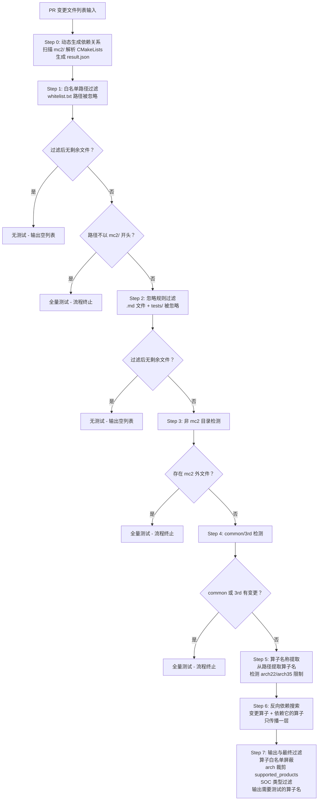

# MC2 算子测试选择工具 Wiki

## 1. 概述

本工具根据 Git PR 变更文件列表，通过多层过滤和依赖分析，自动确定需要执行的算子测试用例。

**核心目标**：避免每次 PR 都跑全量测试，智能地只测试受变更影响的算子及其依赖者。

**当前策略**：
- 路径不以 `mc2/` 开头 -> 全量测试
- `mc2/common/` 或 `mc2/3rd/` 变更 -> 全量测试（不再做特殊映射）
- 仅算子目录变更 -> 部分测试（变更算子 + 反向依赖算子）
- 白名单/忽略规则命中的变更 -> 无测试

---

## 2. 整体流程图



---

## 3. 全分支输入文件与逐步过滤演示

以下构造一个覆盖所有分支的输入文件，逐行标注每个文件在哪一步被踢出或保留进入下一步。

### 3.1 输入文件（12 行，覆盖所有分支）

```
mc2/common/op_kernel/mc2_matmul_block.h
mc2/common/utils/math_util.h
mc2/all_gather_matmul/tests/test_main.py
mc2/all_gather_matmul/README.md
mc2/matmul_all_reduce/tests/test_perf.py
ops-math/CMakeLists.txt
mc2/common/op_api/mc2_aclnn_util.h
mc2/3rd/quant_batch_matmul_v3/quant_batch_matmul_v3.cpp
mc2/all_gather_matmul/op_host/all_gather_matmul_def.cpp
mc2/matmul_all_reduce/op_host/op_tiling/arch22/matmul_all_reduce_tiling.cpp
mc2/matmul_reduce_scatter/op_host/op_tiling/arch35/matmul_reduce_scatter_tiling.h
mc2/common/op_kernel/unknown_file.xyz
```

### 3.2 逐步过滤过程（合并视图）

> 图例：~~删除线~~ = 被踢出，← 后标注踢出的 Step 和原因；普通文本 = 保留到最终

~~mc2/common/op_kernel/mc2_matmul_block.h~~ ← Step1 精确匹配 whitelist.txt
~~mc2/common/utils/math_util.h~~ ← Step1 精确匹配 whitelist.txt
~~mc2/all_gather_matmul/tests/test_main.py~~ ← Step1 通配符匹配 mc2/*/tests/
~~mc2/all_gather_matmul/README.md~~ ← Step2 .md 后缀忽略
~~mc2/matmul_all_reduce/tests/test_perf.py~~ ← Step2 tests/ 目录忽略
~~ops-math/CMakeLists.txt~~ ← Step1后 路径不以 mc2/ 开头，全量测试
~~mc2/common/op_api/mc2_aclnn_util.h~~ ← Step4 common 文件，全量测试
~~mc2/3rd/quant_batch_matmul_v3/quant_batch_matmul_v3.cpp~~ ← Step4 3rd 文件，全量测试
~~mc2/common/op_kernel/unknown_file.xyz~~ ← Step4 common 文件，全量测试
mc2/all_gather_matmul/op_host/all_gather_matmul_def.cpp → Step5 提取算子: all_gather_matmul (无 arch 限制)
mc2/matmul_all_reduce/op_host/op_tiling/arch22/matmul_all_reduce_tiling.cpp → Step5 提取算子: matmul_all_reduce (arch22)
mc2/matmul_reduce_scatter/op_host/op_tiling/arch35/matmul_reduce_scatter_tiling.h → Step5 提取算子: matmul_reduce_scatter (arch35)

Step 6 反向依赖扩展后算子集合：

~~matmul_all_reduce~~ ← Step7 [ascend910b] 白名单屏蔽
~~matmul_all_reduce_add_rms_norm~~ ← Step7 [ascend910b] 白名单屏蔽
~~inplace_matmul_all_reduce_add_rms_norm~~ ← Step7 [ascend910b] 白名单屏蔽
all_gather_matmul → 保留
matmul_reduce_scatter → 保留

Step 7 arch 裁剪 + SOC 过滤后（假设 --soc ascend910b）：

all_gather_matmul → supported_products: [ascend910b]
matmul_reduce_scatter → supported_products: [ascend910b] (arch35 裁剪为 [910b,950]，与 --soc 交集)

**最终输出**：

```json
{
  "ascend910b": ["all_gather_matmul", "matmul_reduce_scatter"]
}
```

---

## 4. 关键配置与数据

### 4.1 白名单内容（whitelist.txt）

匹配到此文件中路径模式的变更文件会被忽略（不参与后续过滤）。

| 类型 | 路径 | 说明 |
|------|------|------|
| 通配符 | `tests/` | 顶层 tests 目录 |
| 通配符 | `mc2/*/tests/` | 各算子下的 tests 目录 |
| 精确 | `mc2/common/op_host/op_tiling/formulaic_tiling_datatype.h` | tiling 数据类型 |
| 精确 | `mc2/common/op_host/op_tiling/hccl_performance.h` | HCCL 性能配置 |
| 精确 | `mc2/common/op_host/op_tiling/hccl_performance_arch35.h` | HCCL 性能配置 (arch35) |
| 精确 | `mc2/common/op_host/op_tiling/matmul_performance.h` | matmul 性能配置 |
| 精确 | `mc2/common/op_host/op_tiling/matmul_performance_arch35.h` | matmul 性能配置 (arch35) |
| 精确 | `mc2/common/op_host/op_tiling/new_mc2_matmul_tiling_cfg.h` | matmul tiling 配置 |
| 精确 | `mc2/common/op_host/op_tiling/tiling_key.h` | tiling key 定义 |
| 精确 | `mc2/common/op_kernel/moe_distribute_comm_ctx.h` | moe 通信上下文 |
| 精确 | `mc2/common/op_kernel/mc2_matmul_block.h` | matmul block |
| 精确 | `mc2/common/op_kernel/mc2_matmul_block_l2cache.h` | matmul block L2 cache |
| 精确 | `mc2/common/op_kernel/mc2_mat_mul_asw_block.h` | ASW block |
| 精确 | `mc2/common/op_kernel/qbmm_asw_block_noncontiguous.h` | QBMM block |
| 精确 | `mc2/common/op_kernel/qbmm_perblock_api_utils_noncontiguous.h` | QBMM API utils |
| 精确 | `mc2/common/op_kernel/reduce_sum.h` | reduce sum |
| 精确 | `mc2/common/op_kernel/reduce_sum_utils.h` | reduce sum utils |
| 精确 | `mc2/common/op_kernel/mc2_templates/communication/communicator/hccl_communicator.h` | HCCL 通信器 |
| 精确 | `mc2/common/op_kernel/mc2_templates/communication/primitives/hccl_primitives.h` | HCCL 基础操作 |
| 精确 | `mc2/common/op_kernel/mc2_templates/computation/compute_stage.h` | 计算阶段 |
| 精确 | `mc2/common/op_kernel/mc2_templates/computation/matmul/matmul_base.h` | matmul 模板基类 |
| 精确 | `mc2/common/op_kernel/mc2_templates/computation/matmul/mc2_kc_quant_matmul.h` | KC 量化 matmul |
| 精确 | `mc2/common/op_kernel/mc2_templates/computation/matmul/mc2_mx_quant_matmul.h` | MX 量化 matmul |
| 精确 | `mc2/common/op_kernel/mc2_templates/quantization/fp8/fp8_dynamic_quant_pertoken.h` | FP8 量化 |
| 精确 | `mc2/common/op_kernel/mc2_templates/quantization/quantize_stage.h` | 量化阶段 |
| 精确 | `mc2/common/utils/math_util.h` | 数学工具 |

### 4.2 算子依赖关系（result.json）

由 Step 0 动态扫描 `mc2/` 目录生成，共 35 个算子。以下列出有依赖关系的算子：

| 算子 | 依赖 | 支持芯片 |
|------|------|----------|
| all_gather_matmul | all_gather_matmul_v2 | ascend910b, ascend910_93, ascend950 |
| allto_all_matmul | matmul_allto_all | ascend910b, ascend910_93 |
| distribute_barrier_extend | distribute_barrier | ascend910b |
| grouped_mat_mul_allto_allv | allto_allv_grouped_mat_mul | ascend910b, ascend910_93 |
| inplace_matmul_all_reduce_add_rms_norm | matmul_all_reduce_add_rms_norm, matmul_all_reduce | ascend910b |
| matmul_all_reduce_add_rms_norm | matmul_all_reduce | ascend910b, ascend910_93 |
| matmul_reduce_scatter | matmul_reduce_scatter_v2 | ascend910b, ascend910_93 |
| moe_distribute_combine | moe_distribute_dispatch_v2, moe_distribute_combine_v2, moe_distribute_dispatch_v3, moe_distribute_combine_v3 | ascend910b |
| moe_distribute_combine_add_rms_norm | moe_distribute_dispatch_v2, moe_distribute_combine_v2, moe_distribute_dispatch_v3, moe_distribute_combine_v3 | ascend910b |
| moe_distribute_combine_teardown | moe_distribute_combine_setup | ascend910b |
| moe_distribute_combine_v2 | moe_distribute_dispatch_v2, moe_distribute_dispatch_v3 | ascend910b |
| moe_distribute_combine_v3 | moe_distribute_dispatch_v2, moe_distribute_dispatch_v3, moe_distribute_combine_v2 | ascend910b |
| moe_distribute_dispatch | moe_distribute_dispatch_v2, moe_distribute_dispatch_v3 | ascend910b |
| moe_distribute_dispatch_setup | moe_distribute_dispatch_v2, moe_distribute_dispatch_v3 | ascend910b |
| moe_distribute_dispatch_teardown | moe_distribute_dispatch_setup | ascend910b |
| moe_distribute_dispatch_v3 | moe_distribute_dispatch_v2 | ascend910b |
| quant_all_reduce | quant_reduce_scatter | ascend910b, ascend910_93 |
| quant_grouped_mat_mul_allto_allv | allto_allv_quant_grouped_mat_mul | ascend910b, ascend910_93 |

### 4.3 arch 限制与支持芯片对应关系

| arch 类型 | 支持芯片 | 说明 |
|-----------|----------|------|
| arch22 | ascend910b, ascend910_93 | 路径含 `op_host/op_tiling/arch22` |
| arch35 | ascend910b, ascend950 | 路径含 `op_host/op_tiling/arch35` |
| 无限制 | 全部芯片 | 同一算子同时有 arch22 和 arch35 路径时视为无限制 |

---

## 5. 触发条件决策表

| 触发条件 | 结果 | 流程终止点 |
|----------|------|------------|
| 白名单过滤后无剩余文件 | 无测试 | Step 1 |
| 路径不以 mc2/ 开头 | 全量测试 | Step 1 后 |
| 忽略规则过滤后无剩余文件 | 无测试 | Step 2 |
| mc2 目录外有变更文件 | 全量测试 | Step 3 |
| common 目录有变更文件 | 全量测试 | Step 4 |
| 3rd 目录有变更文件 | 全量测试 | Step 4 |
| 仅算子目录变更（无 arch 限制） | 部分测试 | Step 7 |
| 仅算子目录变更（有 arch 限制） | 部分测试 + arch 裁剪 | Step 7 |
| 仅算子目录变更 + 指定 --soc | 部分测试 + SOC 过滤 | Step 7 |

---

## 6. 特殊处理配置（已禁用）

> **以下特殊处理映射逻辑已禁用**，common/3rd 目录变更现在直接触发全量测试。
> 如需恢复，取消 `op_step4_common_3rd.py` 中 `COMMON_FILE_OP_MAPPING` 和 `THIRD_PARTY_OP_MAPPING` 的注释，
> 并恢复 `filter_common_3rd` 函数中的特殊处理分支逻辑。

### 禁用前的行为

- `mc2/common/` 中特定文件变更 -> 只触发映射表中指定的算子（不做反向依赖推导）
- `mc2/3rd/` 中特定子目录变更 -> 只触发映射表中指定的算子（不做反向依赖推导）
- `mc2/common/` 中非映射文件变更 -> 全量测试
- `mc2/3rd/` 中非映射子目录变更 -> 全量测试

### 禁用后的行为

- `mc2/common/` 任何文件变更 -> 全量测试
- `mc2/3rd/` 任何文件变更 -> 全量测试
