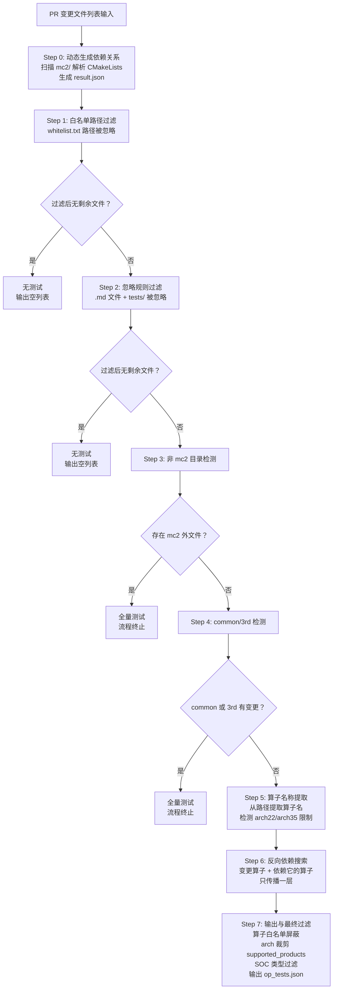

# MC2 算子测试选择工具 Wiki

## 1. 概述

本工具根据 Git PR 变更文件列表，通过多层过滤和依赖分析，自动确定需要执行的算子测试用例。

**核心目标**：避免每次 PR 都跑全量测试，智能地只测试受变更影响的算子及其依赖者。

**当前策略**：
- `mc2/` 外文件变更 -> 全量测试
- `mc2/common/` 或 `mc2/3rd/` 变更 -> 全量测试（不再做特殊映射）
- 仅算子目录变更 -> 部分测试（变更算子 + 反向依赖算子）
- 白名单/忽略规则命中的变更 -> 无测试

---

## 2. 整体流程图



---

## 3. 全分支输入文件与逐步过滤演示

以下构造一个覆盖所有分支的输入文件，逐行标注每个文件在哪一步被踢出或保留进入下一步。

### 3.1 输入文件（12 行，覆盖所有分支）

```
mc2/common/op_kernel/mc2_matmul_block.h
mc2/common/utils/math_util.h
mc2/all_gather_matmul/tests/test_main.py
mc2/all_gather_matmul/README.md
mc2/matmul_all_reduce/tests/test_perf.py
ops-math/CMakeLists.txt
mc2/common/op_api/mc2_aclnn_util.h
mc2/3rd/quant_batch_matmul_v3/quant_batch_matmul_v3.cpp
mc2/all_gather_matmul/op_host/all_gather_matmul_def.cpp
mc2/matmul_all_reduce/op_host/op_tiling/arch22/matmul_all_reduce_tiling.cpp
mc2/matmul_reduce_scatter/op_host/op_tiling/arch35/matmul_reduce_scatter_tiling.h
mc2/common/op_kernel/unknown_file.xyz
```

### 3.2 逐步过滤过程

> 图例：<span style="color:red">红色</span> = 该文件在本步被踢出；普通文本 = 保留进入下一步

**Step 1 - 白名单路径过滤**（命中 `whitelist.txt` 的文件被忽略）：

```
mc2/common/op_kernel/mc2_matmul_block.h          ← 精确匹配 whitelist.txt，踢出
mc2/common/utils/math_util.h                      ← 精确匹配 whitelist.txt，踢出
mc2/all_gather_matmul/tests/test_main.py          ← 通配符匹配 mc2/*/tests/，踢出
mc2/all_gather_matmul/README.md                   → 保留
mc2/matmul_all_reduce/tests/test_perf.py          → 保留
ops-math/CMakeLists.txt                           → 保留
mc2/common/op_api/mc2_aclnn_util.h                → 保留
mc2/3rd/quant_batch_matmul_v3/quant_batch_matmul_v3.cpp → 保留
mc2/all_gather_matmul/op_host/all_gather_matmul_def.cpp → 保留
mc2/matmul_all_reduce/op_host/op_tiling/arch22/matmul_all_reduce_tiling.cpp → 保留
mc2/matmul_reduce_scatter/op_host/op_tiling/arch35/matmul_reduce_scatter_tiling.h → 保留
mc2/common/op_kernel/unknown_file.xyz             → 保留
```
> 踢出 3 个 -> 剩余 9 个进入 Step 2

**Step 2 - 忽略规则过滤**（`.md` 后缀 + `mc2/<算子>/tests/` 目录被忽略）：

```
mc2/all_gather_matmul/README.md                   ← .md 后缀，踢出
mc2/matmul_all_reduce/tests/test_perf.py          ← tests/ 目录，踢出
ops-math/CMakeLists.txt                           → 保留
mc2/common/op_api/mc2_aclnn_util.h                → 保留
mc2/3rd/quant_batch_matmul_v3/quant_batch_matmul_v3.cpp → 保留
mc2/all_gather_matmul/op_host/all_gather_matmul_def.cpp → 保留
mc2/matmul_all_reduce/op_host/op_tiling/arch22/matmul_all_reduce_tiling.cpp → 保留
mc2/matmul_reduce_scatter/op_host/op_tiling/arch35/matmul_reduce_scatter_tiling.h → 保留
mc2/common/op_kernel/unknown_file.xyz             → 保留
```
> 踢出 2 个 -> 剩余 7 个进入 Step 3

**Step 3 - 非 mc2 目录检测**（mc2 外文件触发全量测试）：

```
ops-math/CMakeLists.txt                           ← mc2 外文件，触发全量测试，流程终止
mc2/common/op_api/mc2_aclnn_util.h                → 保留（mc2 内）
mc2/3rd/quant_batch_matmul_v3/quant_batch_matmul_v3.cpp → 保留（mc2 内）
mc2/all_gather_matmul/op_host/all_gather_matmul_def.cpp → 保留（mc2 内）
mc2/matmul_all_reduce/op_host/op_tiling/arch22/matmul_all_reduce_tiling.cpp → 保留（mc2 内）
mc2/matmul_reduce_scatter/op_host/op_tiling/arch35/matmul_reduce_scatter_tiling.h → 保留（mc2 内）
mc2/common/op_kernel/unknown_file.xyz             → 保留（mc2 内）
```
> 实际运行到此终止，输出全量算子列表。以下为完整说明继续。

**Step 4 - common/3rd 目录检测**（common/3rd 任何变更触发全量测试）：

```
mc2/common/op_api/mc2_aclnn_util.h                ← common 文件，触发全量测试
mc2/3rd/quant_batch_matmul_v3/quant_batch_matmul_v3.cpp ← 3rd 文件，触发全量测试
mc2/all_gather_matmul/op_host/all_gather_matmul_def.cpp → 保留（算子文件）
mc2/matmul_all_reduce/op_host/op_tiling/arch22/matmul_all_reduce_tiling.cpp → 保留（算子文件）
mc2/matmul_reduce_scatter/op_host/op_tiling/arch35/matmul_reduce_scatter_tiling.h → 保留（算子文件）
mc2/common/op_kernel/unknown_file.xyz             ← common 文件，触发全量测试
```
> 实际运行到此终止。以下继续说明部分测试路径。

**Step 5 - 算子名称提取**（仅保留算子目录文件，提取算子名 + arch 限制）：

```
mc2/all_gather_matmul/op_host/all_gather_matmul_def.cpp         → 算子: all_gather_matmul (无 arch 限制)
mc2/matmul_all_reduce/op_host/op_tiling/arch22/matmul_all_reduce_tiling.cpp → 算子: matmul_all_reduce (arch22)
mc2/matmul_reduce_scatter/op_host/op_tiling/arch35/matmul_reduce_scatter_tiling.h → 算子: matmul_reduce_scatter (arch35)
```

**Step 6 - 反向依赖搜索**（变更算子 + 依赖它的算子，只传播一层）：

```
all_gather_matmul              → 变更算子本身，保留
matmul_all_reduce              → 变更算子本身，保留
matmul_reduce_scatter          → 变更算子本身，保留
matmul_all_reduce_add_rms_norm ← 反向依赖扩展: 依赖 matmul_all_reduce，加入
inplace_matmul_all_reduce_add_rms_norm ← 反向依赖扩展: 依赖 matmul_all_reduce，加入
```

**Step 7 - 输出与最终过滤**（算子白名单屏蔽 + arch 裁剪 + SOC 过滤，假设 `--soc ascend910b`）：

白名单屏蔽阶段：

```
all_gather_matmul              → 保留，不在白名单中
matmul_all_reduce              ← 在 [ascend910b] 白名单中，踢出
matmul_reduce_scatter          → 保留，不在白名单中
matmul_all_reduce_add_rms_norm ← 在 [ascend910b] 白名单中，踢出
inplace_matmul_all_reduce_add_rms_norm ← 在 [ascend910b] 白名单中，踢出
```

arch 裁剪 + SOC 过滤后：

```
all_gather_matmul       → supported_products: [ascend910b]  (无 arch 限制，与 --soc 交集)
matmul_reduce_scatter   → supported_products: [ascend910b]  (arch35 裁剪为 [910b,950]，再与 --soc 交集)
```

**最终输出** (`op_tests.json`)：

```json
{
  "ascend910b": ["all_gather_matmul", "matmul_reduce_scatter"]
}
```

---

## 4. 各步骤详细说明

### Step 0: 动态生成依赖关系

| 项目 | 说明 |
|------|------|
| 输入 | `mc2/` 目录路径 |
| 输出 | `result.json` |
| 扫描对象 | `mc2/` 下所有算子子目录（排除 `3rd/`、`common/`、`tools/`） |
| 依赖提取 | 从 `op_host/CMakeLists.txt` 中提取 `_depends` 变量（含 `PARENT_SCOPE`） |
| 产品提取 | 从 `op_host/*_def.cpp` 中提取 `.AddConfig()` 支持的产品类型 |
| 屏蔽规则 | 依赖中的 `3rd`、`common`、`tools` 路径会被屏蔽 |

**result.json 结构**：

```json
{
  "算子名称": {
    "dependencies": ["依赖的算子列表"],
    "supported_products": ["ascend910b", "ascend910_93", "ascend950"],
    "warnings": []
  }
}
```

**当前依赖关系示例**（共 35 个算子，部分有依赖）：

| 算子 | 依赖 | 支持芯片 |
|------|------|----------|
| all_gather_matmul | all_gather_matmul_v2 | ascend910b, ascend910_93, ascend950 |
| all_gather_matmul_v2 | (无) | ascend910b, ascend910_93, ascend950 |
| allto_all_matmul | matmul_allto_all | ascend910b, ascend910_93 |
| matmul_all_reduce | (无) | ascend910b, ascend910_93 |
| matmul_all_reduce_add_rms_norm | matmul_all_reduce | ascend910b, ascend910_93 |
| inplace_matmul_all_reduce_add_rms_norm | matmul_all_reduce_add_rms_norm, matmul_all_reduce | ascend910b |
| matmul_reduce_scatter | matmul_reduce_scatter_v2 | ascend910b, ascend910_93 |
| moe_distribute_combine | moe_distribute_dispatch_v2, moe_distribute_combine_v2, ... | ascend910b |
| moe_distribute_combine_v2 | moe_distribute_dispatch_v2, moe_distribute_dispatch_v3 | ascend910b |
| moe_distribute_combine_v3 | moe_distribute_dispatch_v2, moe_distribute_dispatch_v3, moe_distribute_combine_v2 | ascend910b |
| moe_distribute_dispatch | moe_distribute_dispatch_v2, moe_distribute_dispatch_v3 | ascend910b |
| moe_distribute_dispatch_v3 | moe_distribute_dispatch_v2 | ascend910b |

---

### Step 1: 白名单路径过滤

| 项目 | 说明 |
|------|------|
| 输入 | PR 变更文件列表 |
| 白名单 | `whitelist.txt` |
| 过滤逻辑 | 匹配白名单的文件被**忽略**，剩余文件继续 |
| 匹配方式 | 精确匹配、前缀匹配、子路径匹配、通配符匹配（`*` 单层、`**` 多层） |

**当前 whitelist.txt 包含的路径模式**：

| 类型 | 路径示例 | 说明 |
|------|----------|------|
| 通配符 | `tests/` | 顶层 tests 目录 |
| 通配符 | `mc2/*/tests/` | 各算子下的 tests 目录 |
| 精确 | `mc2/common/op_kernel/mc2_matmul_block.h` | common 下的特定头文件 |
| 精确 | `mc2/common/utils/math_util.h` | common 下的数学工具头文件 |
| 精确 | `mc2/common/op_host/op_tiling/tiling_key.h` | tiling key 定义 |
| ... | ... | 共 25 个精确路径 + 2 个通配符模式 |

---

### Step 2: 忽略规则过滤

| 项目 | 说明 |
|------|------|
| 输入 | Step 1 输出的文件列表 |
| 规则 1 | `.md` 后缀文件被忽略 |
| 规则 2 | `mc2/<算子名>/tests/` 目录下文件被忽略 |

---

### Step 3: 非 mc2 目录检测

| 项目 | 说明 |
|------|------|
| 输入 | Step 2 输出的文件列表 |
| 检测逻辑 | 判断每个文件是否在 `mc2/` 目录下 |
| 结果 | 存在 mc2 外文件 -> **全量测试，流程终止** |
| 结果 | 全部在 mc2 内 -> 继续 Step 4 |

---

### Step 4: common/3rd 目录检测

| 项目 | 说明 |
|------|------|
| 输入 | Step 3 输出的文件列表 |
| 检测逻辑 | 判断每个文件是否在 `mc2/common/` 或 `mc2/3rd/` 下 |
| 结果 | common 或 3rd 有变更 -> **全量测试，流程终止** |
| 结果 | 无 common/3rd 变更 -> 算子目录文件继续 Step 5 |

> **注意**：common/3rd 的特殊处理映射逻辑已禁用，任何 common/3rd 变更都直接触发全量测试。

---

### Step 5: 算子名称提取

| 项目 | 说明 |
|------|------|
| 输入 | Step 4 输出的算子目录文件列表 |
| 提取规则 | `mc2/<算子名>/...` -> 提取算子名 |
| 提取规则 | `attention/<算子名>/...` -> 提取算子名 |
| 提取规则 | `moe/<算子名>/...` -> 提取算子名 |
| 提取规则 | `gmm/<算子名>/...` -> 提取算子名 |
| arch 检测 | 路径含 `op_host/op_tiling/arch22` -> arch22 限制 |
| arch 检测 | 路径含 `op_host/op_tiling/arch35` -> arch35 限制 |
| arch 检测 | 同一算子同时有 arch22 和 arch35 -> 无限制 |

**arch 限制与支持芯片对应关系**：

| arch 类型 | 支持芯片 |
|-----------|----------|
| arch22 | ascend910b, ascend910_93 |
| arch35 | ascend910b, ascend950 |
| 无限制 | 全部芯片 |

---

### Step 6: 反向依赖搜索

| 项目 | 说明 |
|------|------|
| 输入 | Step 5 提取的变更算子集合 |
| 逻辑 | 构建反向依赖图：如果算子 A 依赖算子 B，则 B 变更时 A 也需测试 |
| 传播规则 | **只传播一层**，不继续传播被纳入测试的算子 |
| 输出 | 变更算子 + 直接反向依赖算子的集合 |

**反向依赖示例**：

假设变更了 `matmul_all_reduce`，反向依赖搜索结果：

```
matmul_all_reduce (变更算子本身)
  -> matmul_all_reduce_add_rms_norm (依赖 matmul_all_reduce)
  -> inplace_matmul_all_reduce_add_rms_norm (依赖 matmul_all_reduce)
```

最终需测试：`{matmul_all_reduce, matmul_all_reduce_add_rms_norm, inplace_matmul_all_reduce_add_rms_norm}`

---

### Step 7: 输出与最终过滤

| 项目 | 说明 |
|------|------|
| 输入 | Step 6 输出的算子集合 |
| 过滤 1 | 算子白名单屏蔽（`whitelist_ops.txt`） |
| 过滤 2 | arch 限制裁剪 `supported_products` |
| 过滤 3 | SOC 类型过滤（`--soc` 参数） |
| 输出 | `op_tests.json` |

**算子白名单屏蔽规则**（`whitelist_ops.txt`）：

| Section | 屏蔽范围 | 算子数 |
|---------|----------|--------|
| 全局屏蔽 | 所有 SOC 都不测试 | 2 个：attention_to_ffn, ffn_to_attention |
| [ascend910_93] | 仅 ascend910_93 不测试 | 16 个 |
| [ascend910b] | 仅 ascend910b 不测试 | 27 个 |
| [ascend950] | 仅 ascend950 不测试 | 6 个 |

**SOC 类型过滤逻辑**：

- 指定 `--soc` 时，只保留支持该 SOC 的算子
- arch22 算子：`supported_products` 裁剪为 `{ascend910b, ascend910_93}`
- arch35 算子：`supported_products` 裁剪为 `{ascend910b, ascend950}`
- ascend950 SOC 特殊处理：`moe_distribute_*` 系列合并为单个 `moe_distribute` 关键字

**输出格式**（指定 `--soc` 时）：

```json
{
  "ascend910b": ["all_gather_matmul", "matmul_all_reduce"],
  "ascend910_93": ["allto_all_matmul"]
}
```

**输出格式**（未指定 `--soc` 时）：

```json
[
  {
    "op_name": "all_gather_matmul",
    "supported_products": ["ascend910b", "ascend910_93", "ascend950"]
  }
]
```

---

## 5. 触发条件决策表

| 触发条件 | 结果 | 流程终止点 |
|----------|------|------------|
| 白名单过滤后无剩余文件 | 无测试 | Step 1 |
| 忽略规则过滤后无剩余文件 | 无测试 | Step 2 |
| mc2 目录外有变更文件 | 全量测试 | Step 3 |
| common 目录有变更文件 | 全量测试 | Step 4 |
| 3rd 目录有变更文件 | 全量测试 | Step 4 |
| 仅算子目录变更（无 arch 限制） | 部分测试 | Step 7 |
| 仅算子目录变更（有 arch 限制） | 部分测试 + arch 裁剪 | Step 7 |
| 仅算子目录变更 + 指定 --soc | 部分测试 + SOC 过滤 | Step 7 |

---

## 6. 特殊处理配置（已禁用）

> **以下特殊处理映射逻辑已禁用**，common/3rd 目录变更现在直接触发全量测试。
> 如需恢复，取消 `op_step4_common_3rd.py` 中 `COMMON_FILE_OP_MAPPING` 和 `THIRD_PARTY_OP_MAPPING` 的注释，
> 并恢复 `filter_common_3rd` 函数中的特殊处理分支逻辑。

### 禁用前的行为

- `mc2/common/` 中特定文件变更 -> 只触发映射表中指定的算子（不做反向依赖推导）
- `mc2/3rd/` 中特定子目录变更 -> 只触发映射表中指定的算子（不做反向依赖推导）
- `mc2/common/` 中非映射文件变更 -> 全量测试
- `mc2/3rd/` 中非映射子目录变更 -> 全量测试

### 禁用后的行为

- `mc2/common/` 任何文件变更 -> 全量测试
- `mc2/3rd/` 任何文件变更 -> 全量测试

---

## 7. 使用方法

### 一键执行（推荐）

```bash
# 使用默认参数
python op_filters/select_op_tests_main.py --pr changed_files.txt

# 指定 SOC 类型过滤
python op_filters/select_op_tests_main.py --pr changed_files.txt --soc ascend910b ascend910_93

# 自定义所有参数
python op_filters/select_op_tests_main.py \
    --pr changed_files.txt \
    --whitelist custom_whitelist.txt \
    --mc2 /path/to/mc2 \
    --output-json result.json \
    --output-log output.log \
    --soc ascend910b ascend910_93
```

### 逐步执行（调试用）

每个步骤脚本都支持独立运行，详见 README.md。
