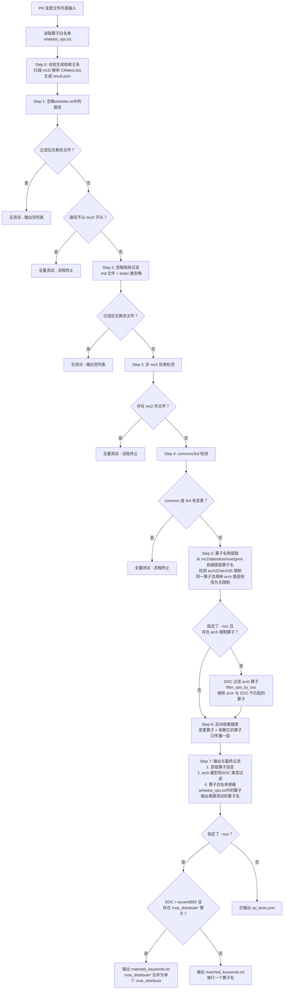

根据 Git PR 变更文件列表，通过多层过滤和依赖分析，自动确定需要执行的算子测试用例。

**核心目标**：避免每次 PR 都跑全量测试，智能地只测试受变更影响的算子及其依赖者。

**当前策略**：
- 路径不以 `mc2/` 开头 -> 全量测试
- `mc2/common/` 或 `mc2/3rd/` 变更 -> 全量测试（不再做特殊映射）
- 仅算子目录变更 -> 部分测试（变更算子 + 反向依赖算子）
- 白名单/忽略规则命中的变更 -> 无测试

---

## 2. 整体流程图



---

## 3. 逐步过滤演示

本节通过三个场景演示完整的过滤流程，覆盖全部 24 条过滤规则：

- **场景 A：部分测试** - 使用 `--soc ascend950`，演示算子级提取、arch 混合、SOC 过滤、反向依赖、白名单屏蔽、moe_distribute 合并等核心规则
- **场景 B：全量测试** - 演示非 mc2 路径、common 变更、3rd 变更三种全量触发条件
- **场景 C：无测试** - 演示 Step 1 白名单全部命中和 Step 2 忽略规则全部命中两种空输出情况

### 3.1 场景 A：部分测试

**输入文件列表**（11 个文件，均以 `mc2/` 开头或匹配路径白名单）：

```
tests/test_config.yaml
mc2/all_gather_matmul/tests/CMakeLists.txt
mc2/all_gather_matmul/README.md
mc2/matmul_all_reduce/tests/CMakeLists.txt
mc2/all_gather_matmul/op_host/all_gather_matmul_def.cpp
mc2/matmul_reduce_scatter/op_host/op_tiling/arch22/matmul_reduce_scatter_tiling_a2a3.cpp
mc2/matmul_reduce_scatter/op_host/op_tiling/arch35/matmul_reduce_scatter_tiling_a5.cpp
mc2/moe_distribute_combine_setup/op_host/op_tiling/arch22/moe_distribute_combine_setup_tiling_arch22.cpp
mc2/distribute_barrier/op_host/op_tiling/distribute_barrier_tiling.cpp
mc2/moe_distribute_dispatch/op_host/op_tiling/moe_distribute_dispatch_tiling.cpp
mc2/moe_distribute_combine/op_host/op_tiling/moe_distribute_combine_tiling.cpp
```

**文件级过滤**：

| 文件路径 | 命中步骤 | 原因 |
|----------|----------|------|
| tests/test_config.yaml | Step 1 | 匹配 `tests/` 顶层通配符（whitelist.txt 第 4 行） |
| mc2/all_gather_matmul/tests/CMakeLists.txt | Step 1 | 匹配 `mc2/*/tests/` 通配符（whitelist.txt 第 5 行） |
| mc2/all_gather_matmul/README.md | Step 2 | `.md` 后缀忽略 |
| mc2/matmul_all_reduce/tests/CMakeLists.txt | Step 2 | `tests/` 目录忽略 |
| mc2/all_gather_matmul/op_host/all_gather_matmul_def.cpp | Step 5 | 提取算子: all_gather_matmul（无 arch 限制） |
| mc2/matmul_reduce_scatter/op_host/op_tiling/arch22/matmul_reduce_scatter_tiling_a2a3.cpp | Step 5 | 提取算子: matmul_reduce_scatter（arch22） |
| mc2/matmul_reduce_scatter/op_host/op_tiling/arch35/matmul_reduce_scatter_tiling_a5.cpp | Step 5 | 提取算子: matmul_reduce_scatter（arch35，与 arch22 混合视为无限制，op_step5_extractor.py 第 148-153 行） |
| mc2/moe_distribute_combine_setup/op_host/op_tiling/arch22/moe_distribute_combine_setup_tiling_arch22.cpp | Step 5 | 提取算子: moe_distribute_combine_setup（arch22） |
| mc2/distribute_barrier/op_host/op_tiling/distribute_barrier_tiling.cpp | Step 5 | 提取算子: distribute_barrier（无 arch 限制） |
| mc2/moe_distribute_dispatch/op_host/op_tiling/moe_distribute_dispatch_tiling.cpp | Step 5 | 提取算子: moe_distribute_dispatch（无 arch 限制） |
| mc2/moe_distribute_combine/op_host/op_tiling/moe_distribute_combine_tiling.cpp | Step 5 | 提取算子: moe_distribute_combine（无 arch 限制） |

**Step 5 filter_ops_by_soc**（对应 op_step5_extractor.py 第 207-212 行）：

使用 `--soc ascend950` 时，`ARCH22_SUPPORTED_PRODUCTS = {ascend910b, ascend910_93}`，`ascend950` 不在其中。因此 `moe_distribute_combine_setup`（arch22）被移除，其余无 arch 限制的算子保留。

**算子级处理**（Step 6 反向依赖 + Step 7 过滤）：

| 算子 | 来源 | supported_products | 命中步骤 | 原因/结果 |
|------|------|-------------------|----------|-----------|
| all_gather_matmul | Step 5 提取 | [910b, 910_93, 950] | Step 7.2 | arch 无限制，与 `--soc ascend950` 交集为 [ascend950]，保留 |
| matmul_reduce_scatter | Step 5 提取 | [910b, 910_93, 950] | Step 7.2 | arch22+arch35 混合视为无限制（op_step5_extractor.py 第 148-153 行），与 `--soc ascend950` 交集为 [ascend950]，保留 |
| moe_distribute_combine_setup | Step 5 提取 | [ascend950] | Step 5 filter_ops_by_soc | arch22，ascend950 不在 {ascend910b, ascend910_93}，移除（op_step5_extractor.py 第 207-212 行） |
| distribute_barrier | Step 5 提取 | [ascend950, ascend910_93] | Step 7.2 | 与 `--soc ascend950` 交集为 [ascend950]，保留 |
| distribute_barrier_extend | Step 6 反向依赖 | [ascend950] | Step 7.3 | 在 ascend950 白名单中，屏蔽移除（op_step7_output.py 第 202-227 行） |
| moe_distribute_dispatch | Step 5 提取 | [ascend950, ascend910_93, ascend910b] | Step 7.2 | 与 `--soc ascend950` 交集为 [ascend950]，保留 |
| moe_distribute_combine | Step 5 提取 | [ascend950, ascend910_93, ascend910b] | Step 7.2 | 与 `--soc ascend950` 交集为 [ascend950]，保留 |

**最终输出**：

op_tests.json（按产品分组，不合并）：

```json
{
  "ascend950": ["all_gather_matmul", "distribute_barrier", "matmul_reduce_scatter", "moe_distribute_combine", "moe_distribute_dispatch"]
}
```

matched_keywords.txt（ascend950 下 moe_distribute* 合并为单个 moe_distribute，对应 op_step7_output.py 第 460-465 行）：

```
all_gather_matmul
distribute_barrier
matmul_reduce_scatter
moe_distribute
```

**备注**：

1. **SOC 交集为空移除（规则 20）**：当算子的 supported_products 不包含 `--soc` 指定的值时，该算子会被移除（对应 op_step7_output.py 第 363-368 行）。本场景中所有保留的算子均支持 ascend950，故未触发此规则。例如 `grouped_mat_mul_all_reduce` 的 supported_products 为 [ascend910b, ascend910_93]，若未被白名单屏蔽，则在 `--soc ascend950` 下会因交集为空被移除。

2. **arch35 对称移除规则（规则 15）**：本场景演示了 arch22 算子被 filter_ops_by_soc 移除。对称地，若 `--soc` 指定的值不在 `ARCH35_SUPPORTED_PRODUCTS = {ascend910b, ascend950}` 中（如 `--soc ascend910_93`），则纯 arch35 算子会被移除。

3. **Step 3 非 mc2 检测（规则 6）**：Step 3 的非 mc2 目录检测仅在独立脚本模式触发。主流程中，路径不以 `mc2/` 开头的文件在 Step 1 后即被拦截触发全量测试（见场景 B.1）。

4. **attention/moe/gmm 前缀提取（规则 10）与不在 dependency_data 忽略（规则 17）**：`extract_op_name` 函数（op_step5_extractor.py 第 62 行）支持 `mc2/`、`attention/`、`moe/`、`gmm/` 四种前缀提取算子名。但在主流程中，`attention/`、`moe/`、`gmm/` 开头的路径不以 `mc2/` 开头，会在 Step 1 后的 mc2 外部检测中触发全量测试，不会走到 Step 5。这两个规则仅在独立运行 `op_step5_extractor.py` 时生效：此时能从这些前缀提取算子名，但提取出的算子（如 `flash_attention_score`、`moe_init_routing`、`grouped_matmul`）不在 `result.json` 中，会在 Step 7.1 被忽略（op_step7_output.py 第 112-113 行）。

### 3.2 场景 B：全量测试

本场景演示三种触发全量测试的条件，每种条件下输出 result.json 中全部 35 个算子（经白名单屏蔽后）。

#### 3.2.1 非 mc2 路径触发全量

**输入文件**：

```
common/CMakeLists.txt
mc2/all_gather_matmul/op_host/all_gather_matmul_def.cpp
```

**触发条件**：`common/CMakeLists.txt` 路径不以 `mc2/` 开头，在 Step 1 后的 mc2 外部文件检测中触发全量测试。

**结果**：输出 result.json 中全部 35 个算子（经白名单屏蔽后）。

#### 3.2.2 common 变更触发全量

**输入文件**：

```
mc2/common/op_api/mc2_aclnn_util.h
```

**触发条件**：路径在 `mc2/common/` 下，Step 4 检测到 common 变更，触发全量测试。

**结果**：输出 result.json 中全部 35 个算子（经白名单屏蔽后）。

#### 3.2.3 3rd 变更触发全量

**输入文件**：

```
mc2/3rd/quant_batch_matmul_v3/op_host/op_tiling/quant_batch_matmul_v3_tiling_base.cpp
```

**触发条件**：路径在 `mc2/3rd/` 下，Step 4 检测到 3rd 变更，触发全量测试。

**结果**：输出 result.json 中全部 35 个算子（经白名单屏蔽后）。

### 3.3 场景 C：无测试

本场景演示两种输出空列表的情况。

#### 3.3.1 Step 1 白名单全部命中

**输入文件**：

```
tests/test_config.yaml
mc2/all_gather_matmul/tests/CMakeLists.txt
```

**过滤过程**：`tests/test_config.yaml` 匹配 `tests/` 顶层通配符（whitelist.txt 第 4 行），`mc2/all_gather_matmul/tests/CMakeLists.txt` 匹配 `mc2/*/tests/` 通配符（whitelist.txt 第 5 行）。Step 1 过滤后无剩余文件。

**结果**：输出空列表 `[]`。

#### 3.3.2 Step 2 忽略规则全部命中

**输入文件**：

```
mc2/all_gather_matmul/README.md
mc2/matmul_all_reduce/tests/CMakeLists.txt
```

**过滤过程**：`mc2/all_gather_matmul/README.md` 为 `.md` 文件被忽略，`mc2/matmul_all_reduce/tests/CMakeLists.txt` 在 `tests/` 目录下被忽略。Step 2 过滤后无剩余文件。

**结果**：输出空列表 `[]`。

---

## 4. 关键配置与数据

### 4.1 路径白名单（whitelist.txt）

匹配到此文件中路径模式的变更文件会被忽略（不参与后续过滤）。

| 类型 | 路径 | 说明 |
|------|------|------|
| 通配符 | `tests/` | 顶层 tests 目录 |
| 通配符 | `mc2/*/tests/` | 各算子下的 tests 目录 |

### 4.2 算子白名单（whitelist_ops.txt）

匹配到此文件中算子名称的算子会被屏蔽（不参与最终测试输出），原因是有些算子没有用例或者暂时不支持。

**当前各 section 屏蔽算子数量**：

| section | 屏蔽算子数量 | 算子列表 |
|---------|-------------|----------|
| global | 2 | attention_to_ffn, ffn_to_attention |
| ascend910_93 | 16 | all_gather_matmul_v2, allto_allv_quant_grouped_mat_mul, quant_grouped_mat_mul_allto_allv, distribute_barrier_extend<br>grouped_mat_mul_all_reduce, matmul_all_reduce, matmul_all_reduce_add_rms_norm, inplace_matmul_all_reduce_add_rms_norm<br>matmul_reduce_scatter_v2, quant_reduce_scatter, quant_all_reduce, mega_moe<br>moe_distribute_dispatch_setup, moe_distribute_dispatch_teardown, moe_distribute_combine_setup, moe_distribute_combine_teardown |
| ascend910b | 30 | all_gather_matmul_v2, allto_all_all_gather_batch_mat_mul, matmul_allto_all, allto_all_matmul<br>allto_allv_grouped_mat_mul, grouped_mat_mul_allto_allv, allto_allv_quant_grouped_mat_mul, quant_grouped_mat_mul_allto_allv<br>batch_mat_mul_reduce_scatter_allto_all, distribute_barrier, distribute_barrier_extend, grouped_mat_mul_all_reduce<br>matmul_all_reduce_add_rms_norm, inplace_matmul_all_reduce_add_rms_norm, matmul_reduce_scatter_v2, mega_moe<br>moe_distribute_dispatch, moe_distribute_dispatch_v2, moe_distribute_dispatch_v3, moe_distribute_dispatch_setup<br>moe_distribute_dispatch_teardown, moe_distribute_combine, moe_distribute_combine_v2, moe_distribute_combine_v3<br>moe_distribute_combine_add_rms_norm, moe_distribute_combine_setup, moe_distribute_combine_teardown, moe_update_expert<br>quant_reduce_scatter, quant_all_reduce |
| ascend950 | 6 | allto_all_all_gather_batch_mat_mul, batch_mat_mul_reduce_scatter_allto_all, grouped_mat_mul_all_reduce<br>matmul_all_reduce_add_rms_norm, inplace_matmul_all_reduce_add_rms_norm, distribute_barrier_extend |

### 4.3 算子依赖关系（result.json）

由 Step 0 动态扫描 `mc2/` 目录生成，共 35 个算子。以下列出有依赖关系的算子：

| 算子 | 依赖 | 支持芯片 |
|------|------|----------|
| all_gather_matmul | all_gather_matmul_v2 | ascend910b, ascend910_93, ascend950 |
| allto_all_matmul | matmul_allto_all | ascend910b, ascend910_93 |
| distribute_barrier_extend | distribute_barrier | ascend910b |
| grouped_mat_mul_allto_allv | allto_allv_grouped_mat_mul | ascend910b, ascend910_93 |
| inplace_matmul_all_reduce_add_rms_norm | matmul_all_reduce_add_rms_norm, matmul_all_reduce | ascend910b |
| matmul_all_reduce_add_rms_norm | matmul_all_reduce | ascend910b, ascend910_93 |
| matmul_reduce_scatter | matmul_reduce_scatter_v2 | ascend910b, ascend910_93 |
| moe_distribute_combine | moe_distribute_dispatch_v2, moe_distribute_combine_v2, moe_distribute_dispatch_v3, moe_distribute_combine_v3 | ascend910b |
| moe_distribute_combine_add_rms_norm | moe_distribute_dispatch_v2, moe_distribute_combine_v2, moe_distribute_dispatch_v3, moe_distribute_combine_v3 | ascend910b |
| moe_distribute_combine_teardown | moe_distribute_combine_setup | ascend910b |
| moe_distribute_combine_v2 | moe_distribute_dispatch_v2, moe_distribute_dispatch_v3 | ascend910b |
| moe_distribute_combine_v3 | moe_distribute_dispatch_v2, moe_distribute_dispatch_v3, moe_distribute_combine_v2 | ascend910b |
| moe_distribute_dispatch | moe_distribute_dispatch_v2, moe_distribute_dispatch_v3 | ascend910b |
| moe_distribute_dispatch_setup | moe_distribute_dispatch_v2, moe_distribute_dispatch_v3 | ascend910b |
| moe_distribute_dispatch_teardown | moe_distribute_dispatch_setup | ascend910b |
| moe_distribute_dispatch_v3 | moe_distribute_dispatch_v2 | ascend910b |
| quant_all_reduce | quant_reduce_scatter | ascend910b, ascend910_93 |
| quant_grouped_mat_mul_allto_allv | allto_allv_quant_grouped_mat_mul | ascend910b, ascend910_93 |

### 4.4 arch 限制与支持芯片对应关系

| arch 类型 | 支持芯片 | 说明 |
|-----------|----------|------|
| arch22 | ascend910b, ascend910_93 | 路径含 `op_host/op_tiling/arch22` |
| arch35 | ascend910b, ascend950 | 路径含 `op_host/op_tiling/arch35` |
| 无限制 | 全部芯片 | 同一算子同时有 arch22 和 arch35 路径时视为无限制 |


