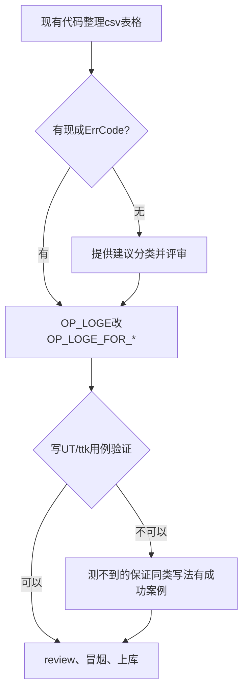

# GMM/GMMFR 算子错误码规范化整改 SRS

## 1. 迭代信息

| 项目 | 内容 |
| --- | --- |
| AR编号 | AR20260328158974 |
| 责任人 | 琦钧 |
| 预计工作量 | 0.7K |
| 时间节点 | SRS 5.9 → CODING 5.18 → UT 5.22 → ST 5.29 → 合入 6.1 |

---

## 2. 整改目标与范围

**目标：** 将主机层 ERROR 日志规范化为 EZ0008-EZ0024 错误码

**范围：** A5责任田 host 层（op_api + op_host）

**数据统计：**

| 错误类型 | GMMFR | GMM | 合计 |
| --- | --- | --- | --- |
| OP_LOGE | 231 | 653 | **884** |
| CHECK_COND | 0 | 397 | **397** |
| CHECK_RET | 18 | 7 | **25** |
| OPS_REPORT | 50 | 43 | **93** |
| **总计** | **322** | **1292** | **1614** |

### 2.1 涉及文件分类

| 文件 | 呈现类别 | 错误类型 |
| -- | -- | -- |
| op_api | ACLNN_ERR_INNER | dtype |
| op_host | ACLNN_ERR_PARAM_INVALID | shape |
| | ACLNN_ERR_PARAM_NULLPTR | format |
| | ASCENDC_ASSERT | |
| | OP_LOGE | |
| | OPS_REPORT | |
| | OPS_REPORT_CUBE_INNER_ERR | |

### 2.2 GMM 文件清单

**完整清单：**

| 完整路径 | 计数 | 占比 | 涉及芯片 | 量化类型 |
| -- | --: | --: | -- | -- |
| gmm/grouped_matmul/op_api/aclnn_grouped_matmul.cpp | 359 | 27.1% | 公共 | - |
| gmm/grouped_matmul/op_api/grouped_matmul.cpp | 3 | 0.2% | 公共 | - |
| gmm/grouped_matmul/op_api/grouped_matmul_no_quant_950_checker.cpp | 3 | 0.2% | A5 | 非量化 |
| gmm/grouped_matmul/op_api/grouped_matmul_weight_quant_950_checker.cpp | 111 | 8.4% | A5 | 伪量化 |
| gmm/grouped_matmul/op_api/grouped_matmul_950_checker.cpp | 153 | 11.5% | 公共 | - |
| gmm/grouped_matmul/op_graph/fallback_grouped_matmul.cpp | 23 | 1.7% | A5 | - |
| gmm/grouped_matmul/op_kernel/arch35/weight_quant_basic_block/tool.h | 4 | 0.3% | A5 | 伪量化 |
| gmm/grouped_matmul/op_kernel/arch35/weight_quant_basic_block/custom_policy/wqbmm_copy_cube_out.h | 2 | 0.2% | A5 | 伪量化 |
| gmm/grouped_matmul/op_kernel/arch35/quant_adaptive_sliding_window_templates/mm_extension_interface/gqmm_copy_cube_out.h | 2 | 0.2% | A5 | 全量化 |
| gmm/grouped_matmul/op_kernel/a16w4_msd/tool.h | 2 | 0.2% | A5 | 伪量化 |
| gmm/grouped_matmul/op_host/grouped_matmul_infershape_weight_quant_checker.cpp | 97 | 7.3% | A5 | 伪量化 |
| gmm/grouped_matmul/op_host/grouped_matmul_infershape.cpp | 190 | 14.3% | 公共 | - |
| gmm/grouped_matmul/op_host/grouped_matmul_infershape_quant_checker.cpp | 62 | 4.7% | 公共 | - |
| gmm/grouped_matmul/op_host/op_tiling/grouped_matmul_tiling.cpp | 53 | 4.0% | 公共 | - |
| gmm/grouped_matmul/op_host/op_tiling/arch35/grouped_quant_matmul_tiling.cpp | 106 | 8.0% | A5 | - |
| gmm/grouped_matmul/op_host/op_tiling/arch35/grouped_quant_basic_api_matmul_tiling.cpp | 4 | 0.3% | A5 | - |
| gmm/grouped_matmul/op_host/op_tiling/arch35/grouped_weight_quant_batch_matmul_tiling.cpp | 123 | 9.3% | A5 | 伪量化 |
| gmm/grouped_matmul/op_host/op_tiling/arch35/grouped_no_quant_matmul_tiling.cpp | 28 | 2.1% | A5 | 非量化 |
| gmm/grouped_matmul/op_host/op_tiling/arch35/grouped_quant_matmul_tiling.h | 2 | 0.2% | A5 | 全量化 |

**筛选 A5、伪量化后：**

| 完整路径 | 计数 | 占比 | 涉及芯片 | 量化类型 |
| -- | --: | --: | -- | -- |
| gmm/grouped_matmul/op_api/grouped_matmul_weight_quant_950_checker.cpp | 111 | 8.4% | A5 | 伪量化 |
| gmm/grouped_matmul/op_kernel/arch35/weight_quant_basic_block/tool.h | 4 | 0.3% | A5 | 伪量化 |
| gmm/grouped_matmul/op_kernel/arch35/weight_quant_basic_block/custom_policy/wqbmm_copy_cube_out.h | 2 | 0.2% | A5 | 伪量化 |
| gmm/grouped_matmul/op_kernel/a16w4_msd/tool.h | 2 | 0.2% | A5 | 伪量化 |
| gmm/grouped_matmul/op_host/grouped_matmul_infershape_weight_quant_checker.cpp | 97 | 7.3% | A5 | 伪量化 |
| gmm/grouped_matmul/op_host/op_tiling/arch35/grouped_weight_quant_batch_matmul_tiling.cpp | 123 | 9.3% | A5 | 伪量化 |

### 2.3 GMMFR 文件清单

**完整清单：**

| 完整路径 | 计数 | 占比 | 涉及芯片 | 量化类型 |
| -- | --: | --: | -- | -- |
| gmm/grouped_matmul_finalize_routing/op_api/grouped_matmul_finalize_routing_weight_quant_950_checker.h | 46 | 10.5% | A5 | 伪量化 |
| gmm/grouped_matmul_finalize_routing/op_api/grouped_matmul_finalize_routing_950_checker.h | 48 | 11.0% | A5 | - |
| gmm/grouped_matmul_finalize_routing/op_api/aclnn_grouped_matmul_finalize_routing.cpp | 108 | 24.7% | 公共 | - |
| gmm/grouped_matmul_finalize_routing/op_graph/fallback_grouped_matmul_finalize_routing.cpp | 18 | 4.1% | 公共 | - |
| gmm/grouped_matmul_finalize_routing/op_kernel/arch35/common/tool.h | 4 | 0.9% | A5 | - |
| gmm/grouped_matmul_finalize_routing/op_host/grouped_matmul_finalize_routing_base_tiling.cpp | 16 | 3.7% | 公共 | - |
| gmm/grouped_matmul_finalize_routing/op_host/grouped_matmul_finalize_routing_infershape.cpp | 45 | 10.3% | 公共 | - |
| gmm/grouped_matmul_finalize_routing/op_host/grouped_matmul_finalize_routing_tiling.cpp | 5 | 1.1% | 公共 | - |
| gmm/grouped_matmul_finalize_routing/op_host/op_tiling/arch35/grouped_matmul_finalize_routing_weight_quant_tiling.cpp | 84 | 19.2% | A5 | 伪量化 |
| gmm/grouped_matmul_finalize_routing/op_host/op_tiling/arch35/grouped_matmul_finalize_routing_quant_tiling.cpp | 64 | 14.6% | A5 | 全量化 |

**筛选 A5、伪量化后：**

| 完整路径 | 计数 | 占比 | 涉及芯片 | 量化类型 |
| -- | --: | --: | -- | -- |
| gmm/grouped_matmul_finalize_routing/op_api/grouped_matmul_finalize_routing_weight_quant_950_checker.h | 46 | 10.5% | A5 | 伪量化 |
| gmm/grouped_matmul_finalize_routing/op_host/op_tiling/arch35/grouped_matmul_finalize_routing_weight_quant_tiling.cpp | 84 | 19.2% | A5 | 伪量化 |

---

## 2.1 需修改文件清单（按错误类型分类）

### dtype 错误【92条】→ EZ0018

**整改策略：直接替换为 OP_LOGE_FOR_INVALID_DTYPE**

- `grouped_matmul/op_host/grouped_matmul_infershape.cpp` (31条)
- `grouped_matmul/op_host/grouped_matmul_infershape_weight_quant_checker.cpp` (17条)
- `grouped_matmul/op_host/op_tiling/arch35/grouped_weight_quant_batch_matmul_tiling.cpp` (13条)
- `grouped_matmul/op_host/op_tiling/arch35/grouped_quant_matmul_tiling.cpp` (8条)
- 其他6个文件 (23条)

### format 错误【22条】→ EZ0016

**整改策略：直接替换为 OP_LOGE_FOR_INVALID_FORMAT**

- `grouped_matmul/op_host/grouped_matmul_infershape.cpp` (9条)
- `grouped_matmul_finalize_routing/op_api/aclnn_grouped_matmul_finalize_routing.cpp` (4条)
- `grouped_matmul/op_host/op_tiling/arch35/grouped_weight_quant_batch_matmul_tiling.cpp` (3条)
- 其他4个文件 (6条)

### shape 错误【108条】→ EZ0008

**整改策略：直接替换为 OP_LOGE_FOR_INVALID_SHAPE**

- `grouped_matmul_finalize_routing/op_host/op_tiling/arch35/grouped_matmul_finalize_routing_weight_quant_tiling.cpp` (30条)
- `grouped_matmul/op_host/grouped_matmul_infershape.cpp` (21条)
- `grouped_matmul/op_host/grouped_matmul_infershape_weight_quant_checker.cpp` (13条)
- 其他7个文件 (44条)

### dim 错误【104条】→ EZ0011

**整改策略：直接替换为 OP_LOGE_FOR_INVALID_SHAPEDIM**

- `grouped_matmul_finalize_routing/op_api/aclnn_grouped_matmul_finalize_routing.cpp` (21条)
- `grouped_matmul/op_host/grouped_matmul_infershape.cpp` (20条)
- `grouped_matmul_finalize_routing/op_host/op_tiling/arch35/grouped_matmul_finalize_routing_weight_quant_tiling.cpp` (15条)
- 其他7个文件 (48条)

### value 错误【41条】→ EZ0023

**整改策略：直接替换为 OP_LOGE_FOR_INVALID_VALUE_WITH_REASON**

- `grouped_matmul/op_host/grouped_matmul_infershape.cpp` (17条)
- `grouped_matmul/op_host/grouped_matmul_infershape_weight_quant_checker.cpp` (6条)
- 其他7个文件 (18条)

### 其他参数错误【496条】→ EZ0023 细分

**整改策略：按参数类型细分，替换为 OP_LOGE_FOR_INVALID_VALUE_WITH_REASON**

#### group参数错误【271条】

- `grouped_matmul/op_api/aclnn_grouped_matmul.cpp` (101条)
- `grouped_matmul/op_host/grouped_matmul_infershape.cpp` (43条)
- `grouped_matmul/op_api/grouped_matmul_950_checker.cpp` (43条)
- `grouped_matmul/op_api/grouped_matmul_weight_quant_950_checker.cpp` (24条)
- 其他3个文件 (60条)

#### scale参数错误【140条】

- `grouped_matmul/op_api/grouped_matmul_950_checker.cpp` (47条)
- `grouped_matmul/op_api/aclnn_grouped_matmul.cpp` (32条)
- `grouped_matmul/op_host/grouped_matmul_infershape.cpp` (17条)
- 其他4个文件 (44条)

#### quant参数错误【114条】

- `grouped_matmul/op_api/aclnn_grouped_matmul.cpp` (38条)
- `grouped_matmul/op_host/grouped_matmul_infershape.cpp` (32条)
- `grouped_matmul/op_host/op_tiling/arch35/grouped_weight_quant_batch_matmul_tiling.cpp` (20条)
- 其他3个文件 (24条)

#### optional参数错误【86条】→ 评审

**整改策略：需评审决定是否新增 EZ_OPTIONAL_PARAM 或使用 EZ0023**

- `grouped_matmul/op_api/aclnn_grouped_matmul.cpp` (54条)
- `grouped_matmul/op_api/grouped_matmul_weight_quant_950_checker.cpp` (17条)
- 其他2个文件 (15条)

#### support/unsupported错误【69条】

- `grouped_matmul/op_host/grouped_matmul_infershape.cpp` (18条)
- `grouped_matmul/op_api/aclnn_grouped_matmul.cpp` (18条)
- 其他5个文件 (33条)

#### 其他参数细分

- **per_token参数【60条】** - 主要在 checker 文件
- **tensorlist参数【48条】** - 主要在 aclnn_grouped_matmul.cpp
- **bias参数【46条】** - 分散在多个文件
- **offset参数【34条】** - 分散在多个文件
- **transpose参数【34条】** - 分散在多个文件

### 参数无效错误【383条】→ CHECK_COND 展开

**整改策略：CHECK_COND 宏展开后，按内容分类**

- `grouped_matmul/op_api/aclnn_grouped_matmul.cpp` (209条)
- `grouped_matmul/op_api/grouped_matmul_950_checker.cpp` (107条)
- `grouped_matmul/op_api/grouped_matmul_weight_quant_950_checker.cpp` (65条)
- `grouped_matmul/op_api/grouped_matmul_no_quant_950_checker.cpp` (2条)

### 内部错误【25条】→ 上报新增

**整改策略：上报无法匹配，推荐新增 EZ_INNER_NULLPTR**

- `grouped_matmul_finalize_routing/op_api/aclnn_grouped_matmul_finalize_routing.cpp` (18条)
- `grouped_matmul/op_api/aclnn_grouped_matmul.cpp` (7条)

### OPS_REPORT【93条】→ 分类处理

**整改策略：手动分析内容，参数验证类整改，内部错误类上报**

- `grouped_matmul/op_host/op_tiling/grouped_matmul_tiling.cpp` (43条)
- `grouped_matmul_finalize_routing/op_host/grouped_matmul_finalize_routing_infershape.cpp` (43条)
- 其他3个文件 (7条)

---

## 3. 整改方案

### 3.1 直接整改类

**原则：替换为 OP_LOGE_FOR_* 宏**

**示例：dtype 错误**

```cpp
// 原代码
OP_LOGE(ACLNN_ERR_PARAM_INVALID, "x1 and x2 dtype should be same, actual x1 dtype is %s and x2 dtype is %s.", 
        x1_dtype, x2_dtype);

// 整改后
OP_LOGE_FOR_INVALID_DTYPES_WITH_REASON(
    ACLNN_ERR_PARAM_INVALID,
    "x1, x2",
    "actual_x1_dtype, actual_x2_dtype",
    "x1 and x2 dtype should be same"
);
```

### 3.2 上报推荐新增类

**原则：上报无法匹配 EZ0008-EZ0024，推荐新增错误码**

**示例：CHECK_RET 内部错误**

```cpp
// 原代码
CHECK_RET(matmulRet != nullptr, ACLNN_ERR_INNER_NULLPTR);

// 整改：上报并推荐新增 EZ_INNER_NULLPTR
```

### 3.3 评审后决定类

**原则：需评审决定是否新增错误码或归类到现有类型**

**示例：空指针错误**

```cpp
// 原代码
CHECK_COND(x != nullptr, ACLNN_ERR_PARAM_NULLPTR, "X must not be nullptr.");

// 评审决策点：
// - 方案A：新增 EZ_PARAM_NULLPTR
// - 方案B：使用 EZ0023 覆盖
```

---

## 4. 整改流程

### 4.1 整改流程图



### 4.2 整改阶段

| Phase | 任务 | 工具 |
| --- | --- | --- |
| Phase 0 | 生成整改表格 | generate_refactor_table.py |
| Phase 1 | 审阅表格 | 手动审阅 |
| Phase 2 | 代码替换 | 手动替换 |
| Phase 3 | 编译验证 | build.sh |
| Phase 4 | 生成报告 | unmatched_errors_report.md |

---

## 5. EZ错误码速查

| 错误场景 | 错误码 | 宏名称 |
| --- | --- | --- |
| Shape 错误 | EZ0008 | OP_LOGE_FOR_INVALID_SHAPE |
| Dtype 错误 | EZ0018 | OP_LOGE_FOR_INVALID_DTYPE |
| Format 错误 | EZ0016 | OP_LOGE_FOR_INVALID_FORMAT |
| Value 错误 | EZ0023 | OP_LOGE_FOR_INVALID_VALUE_WITH_REASON |

---

## 6. 待评审事项

### 6.1 错误码新增建议

| 错误类型 | 数量 | 建议 |
| --- | --- | --- |
| CHECK_COND(ACLNN_ERR_PARAM_NULLPTR) | 13条 | 新增 EZ_PARAM_NULLPTR 或使用 EZ0023 |
| CHECK_RET(ACLNN_ERR_INNER) | 25条 | 新增 EZ_INNER_NULLPTR |
| optional参数错误 | 86条 | 新增 EZ_OPTIONAL_PARAM 或使用 EZ0023 |

### 6.2 OPS_REPORT 分类处理

- **93条 OPS_REPORT**：需逐条分析，分类为：
  - 参数验证类 → 整改
  - 内部错误类 → 上报新增
  - 业务逻辑类 → 上报

---

## 7. 参考文档

- `ops-transformer/.opencode/skills/ascendc-error-code-refactor/SKILL.md`
- `ops-transformer/CANN_ERROR_LOG_COLLECTION_GUIDE.md`