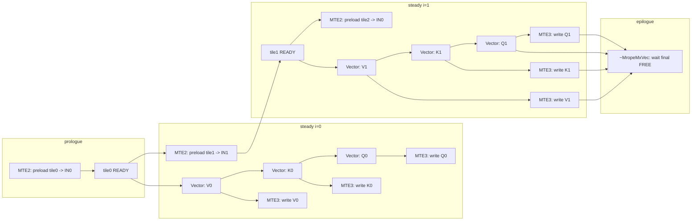
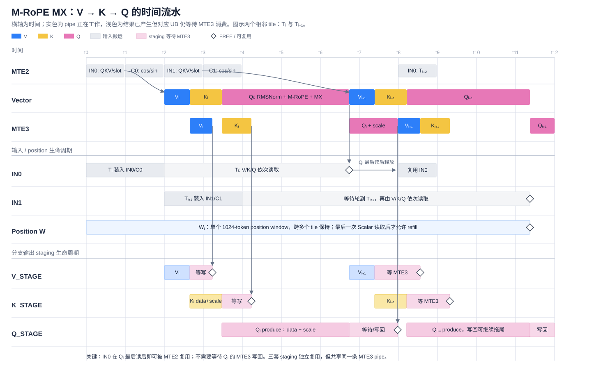

# M-RoPE MX AIV 执行设计

> 状态：历史执行实验快照，不是当前交付实现的事实源。文中的 SIMT 与 `simt_vk` 路径已经删除；
> 当前 M-RoPE MX 只保留一个 AIV-only SIMD key，正式设计以 `docs/srs_stc/mrope_mx_srs.md` 和源码为准。
> 阅读顺序：如何分核 → 核内如何遍历 → 一个逻辑事务如何处理 → 流水/同步 → 空间/生命周期。

## 0. 与原设计冲突或特别重要、仍待确认的项

| ID | 当前源码事实 | 状态 |
|---|---|---|
| D11 UB layout | 原设计要求 Host/Device 调用同一个 layout helper。实际 Host 使用 checked `TryMakeMropeMxUbLayout`，device 使用 uint32 `MakeMropeMxUbLayoutDevice`，以避免 device compiler-rt 宽乘依赖；两者按同一公式分别物化。当前没有逐字段 exact-equality UT。 | 是否接受该偏离并补 exact-equality UT，仍待用户确认。 |
| D25 lane 规则 | `01_contract.md` 的 M-RoPE lane 公式是规范；当前 Vector gather-index、SIMT `MropeMxSimtAxis` 和 Golden 各自实现，没有统一 helper。 | 已实现但存在漂移风险，是否抽取共享事实源仍待用户确认。 |
| D26 窄化边界 | Host 拒绝非法 shape、stride、tile 和不可表示字段；device 消费已验证 tiling，公共 copy helper 仍直接 cast 到窄字段。 | 是否接受 Host 作为安全边界，仍待用户确认。 |
| Vector K scale 物理布局 | 公开/逻辑 K scale 是 `[t,Nk,S]`，`S=ceil(D/32)`；Vector UB 中每个 token 的物理 pitch 是 `align_up(Nk*S,32)` bytes。Q scale 在 UB 中保持 compact `[t,Nq,S]`，仅整个 region 末尾对齐。 | 必须保持“逻辑 shape”和“UB padding”两种描述，不得互换。 |
| Vector RowBatch16 | 所有合法Q配置进入同一个运行时head数VF。Q按token拆成16-row完整批次和可选8-row尾批；K在自己的融合VF中逐行处理。Q scratch按完整批次数分片。 | 不按`64/8/8`选择专用函数；同一token的全部完整批次共享三次本地内存屏障。 |
| SIMT 边界 | SIMT 与 Vector 具有相同公开合同、按 token 分核、V→K→Q 语义和 GM 写集合；SIMT 直接读写 GM，没有 tile、position window、UB staging 或 staging READY/FREE 协议，仅在末尾有一次 `V_S` 完成 fence。 | SIMT 只是内部 A/B variant，不新增公开 scene。 |
| SIMT 调度已变化 | 当前 launch 是 `512 threads=16 warps`；每个 warp 分成两个 16-lane subgroup。V 一次处理两个 head；K/Q 仍以 16-head group 分派，但组内按 head-pair 遍历，两个 subgroup 分别处理一个 head。 | 旧的 `1024/32`、三路 row-per-warp 以及后续一 warp/一 head 版本均已失效。 |
| `simt_vk` 阶段序 | 原 SIMT 是全核 `V->K->Q` 三 phase；隔离 key 改为每 token/head-pair 内 `V->K`，VK VF 完成后再执行原 Q VF。 | 不能把原 SIMT 的全局阶段序套到新 key；V/K 写集合互斥，数值合同不变。 |
| 验证边界 | 当前 RowBatch16 Vector 已在 `T=768,Nq=16/24/32/64` 完成 ACLNN 五输出 `100%` 和 TTK ACLNN 性能验证。 | 固定seed 42、`reuse_hbm=false`；四组耗时为 `14.474/20.901/21.517/32.669 us`。 |

原草案中的按 token 分片、Vector 双输入槽、position 单窗口、V/K/Q staging、RAII 闭合和 V→K→Q 顺序均已落地，不再列作“实现前待确认”。

## 1. 硬件拓扑与共同不变量

新 scene 有三个 AIV-only 编译期实例：

| variant | tiling key | kernel type | 核内组织 |
|---|---:|---|---|
| Vector | `302059776` | AIV-only | token tile；GM→UB；双输入槽；position 单窗；V/K/Q staging→GM |
| SIMT | `4597027072`（设计值） | AIV-only | V head-pair、K/Q head-group 内的 head-pair 任务；直接 GM 读写；无 UB staging |
| SIMT-VK | `8891994368` | AIV-only | token-per-warp；token 内按 head-pair V→K；复用原 Q；直接 GM 读写 |

共同不变量：

- 只沿 token 维分核，不沿 head 或 D 分核；
- 每个 AIV 获得连续且不重叠的 token 区间；
- Vector 与原 SIMT 的分支顺序固定为 V→K→Q；`simt_vk` 的顺序是 token/head-pair 内 V→K，全部 VK 完成后 Q；
- Q/K 计算为 FP32 `RMSNorm -> M-RoPE -> D32 MX`，V 为 per-head-per-channel static quant；
- K/V/KScale 只写本核 token 对应的唯一 slot，Q/QScale 连续写本核 token 区间；
- 不使用 AIC/Cube、L1/L0、MMAD、Fixpipe 或 CrossCore flag；
- 不消费任务自有 GM workspace。

## 2. 第一层：如何分核

### 2.1 Host 决定启用的 AIV 数

新 scene 使用：

```text
activeAiv = min(T, platform.aivNum)
```

Host 以 AIV-only 方式设置 blockDim，device 所见 `GetBlockNum()` 就是 `activeAiv`。它不再使用旧 mixed 路径的 `aicNum`、`blockIdx/2` 或 `GetSubBlockIdx()`。

### 2.2 Device 商余分片

对 `aivIndex in [0,activeAiv)`：

```text
base  = T / activeAiv
rem   = T % activeAiv
begin = aivIndex * base + min(aivIndex, rem)
count = base + (aivIndex < rem ? 1 : 0)
end   = begin + count
```

因此：

- `[begin,end)` 两两不重叠且并集恰好是 `[0,T)`；
- 每核 token 数相差至多 1；
- Host/tiling data 不需要存 per-core offset 数组；
- `T>=1` 且 `activeAiv<=T`，不会发射空 AIV。

Vector Controller 与 SIMT `ProcessMropeMxSimt` 分别计算这组公式；这是同一分核语义的两次 device 实现，不改变公开结果。

## 3. 第二层：核内如何遍历

### 3.1 Vector：按基本块遍历

Vector 的“基本块”是一项 `MropeMxTileDesc` 逻辑事务，而不是新增 BasicBlock class：

```text
MropeMxTileDesc {
    tokenBegin;
    tokenCount;
    inputSlot;
}
```

Controller 从 `range.begin` 向 `range.end` 递增生成 tile。右边界同时受三项限制：

```text
windowBegin = coreBegin + floor((cursor-coreBegin)/1024)*1024
windowEnd   = min(windowBegin+1024, coreEnd)
tileEnd     = min(cursor+tokenTile, windowEnd, coreEnd)

tile.tokenBegin = cursor
tile.tokenCount = tileEnd-cursor
tile.inputSlot  = tileOrdinal & 1
```

一个 tile 永远不跨本核 1024-token position window。首窗从本核 `coreBegin` 锚定，而不是全局按 1024 对齐。

Controller 的物理发射顺序为：

```cpp
range = MakeCoreTokenRange(...);
MropeMxVec vec(tensors, tilingData, range.begin, range.end);
vec.PrepareBeforeLoop();

FillTile(current, range.begin, 0);
vec.PreloadTile(current);

while (hasCurrent) {
    vec.WaitTileReady(current);
    hasNext = FillTile(next, current.end, ordinal + 1);
    if (hasNext) {
        vec.PreloadTile(next);       // 唯一 lookahead 点，使用另一 input slot
    }
    vec.ProcessV(current);
    vec.ProcessK(current);
    vec.ProcessQ(current);
    vec.ReleaseInput(current);
    current = next;
}
// 离开作用域，~MropeMxVec() 闭合最终流水
```

`Preload(next)` 在当前 tile ready 后即可发射，不需要等待 L1/Cube，因为新路径根本没有这些资源。它只受目标 input slot 的 `INPUT_FREE` 和可能的 position window 复用依赖约束。

### 3.2 SIMT：不遍历 token tile

SIMT 不使用 `tokenTile`、`MropeMxTileDesc`、input slot 或 position window。每核先得到 `[tokenBegin,tokenEnd)`，然后仅发起三次 SIMT VF：

```text
asc_vf_call<MropeMxSimtV>
asc_vf_call<MropeMxSimtK>
asc_vf_call<MropeMxSimtQ>
V_S final fence
```

每次 launch 为 512 threads，即 16 个完整 warp。每个 warp 分成两个 16-lane subgroup：

```text
subgroup = lane / 16       # 0/1，各拥有一个 head
subLane = lane % 16
pairOffset = 2*subLane
每个 D32 block 读取 pairOffset 与 pairOffset+1
四个 block 合计覆盖一个 head 的 D128
```

warp 的逻辑任务按分支不同：

- V：`row=(token,V-head-pair)`，warp 按 `row += 16` 遍历，两个 subgroup 分别处理 `headPair` 与 `headPair+1`；尾部奇数 head 由有效 subgroup 独立完成；
- K/Q：`headGroupCount=ceil(headNum/16)`，`group=(token,head-group)`，warp 按 `group += 16` 遍历；组内 `headPair += 2`，因此最多 8 次迭代覆盖 16 个 head；
- gamma pair 在 K/Q phase 进入 group 循环前加载一次；RoPE pair、slot 基址在每个 group 内加载/计算一次。

collective 仍以完整 32-lane warp 执行。为同时得到两个 subgroup/head 的独立结果，每个 head-pair 的 RMS 使用两次 masked `asc_reduce_add`；四个 D32 amax 各使用两次 masked `asc_reduce_max`，共八次。两个 head 独立产生 data 和四个 scale byte；head-pair 组织不改变数值合同或 GM 写集合。

## 4. 第三层：一个逻辑事务如何处理

### 4.1 Vector tile 输入视图与 preload

令：

```text
t = tile.tokenCount
H = Nq + Nk + Nv = Nq + 2*Nk
g = tile.tokenBegin + u, 0 <= u < t
```

一个 input slot 包含：

- `qkv[t,H,D]` BF16；
- 根据 position gather 后的 `rawCosSin[t,3,D]` FP32；
- `slotMapping[t]` INT32。

QKV 每个 tile 只从 GM 搬一次，V/K/Q 通过 head offset 共享同一份 TND 视图：

```text
Q: [0, Nq)
K: [Nq, Nq+Nk)
V: [Nq+Nk, Nq+Nk+Nv)
```

`PreloadTile` 的依赖顺序为：

```text
1. MTE2 等待目标 INPUT_FREE[inputSlot]
2. 必要时等待 POSITION_FREE，原地加载下一 position window
3. MTE2 搬 slotMapping，发 SLOT_READY 给 Scalar
4. MTE2 搬 qkv
5. Scalar 读 position，生成三路 cosSin GM 地址；MTE2 搬 rawCosSin
6. 旧 position window 最后一次读取后，Scalar 发 POSITION_FREE
7. qkv/rawCosSin 完成后，MTE2 发 INPUT_READY 给 Vector
```

position window 与 rawCosSin 不是同一 buffer：前者是 `[<=1024,3]` INT32 索引，后者是当前 tile 的 `[t,3,D]` FP32 数值。

### 4.2 Vector 的 V→K→Q 事务

当前 tile ready 后，Controller 严格调用：

```text
ProcessV -> ProcessK -> ProcessQ -> ReleaseInput
```

每个 `Process*` 都包含“Vector 生产 staging + 向 MTE3 发射本分支写回”的完整事务。函数返回时 MTE3 可以仍在执行。

| 分支 | 输入行 | Vector 计算 | Vector UB staging | GM 写回 |
|---|---|---|---|---|
| V | `qkv[u,Nq+Nk+n,:]` | `fp32(v)*vScale[n,:] -> E4M3FN` | data 实际遍历布局 `[Nv,t,D]` | 按 slot scatter 到 V cache |
| K | `qkv[u,Nq+n,:]` | RMSNorm + M-RoPE + D32 MX | data `[t,Nk,D]`；scale 逻辑 `[t,Nk,S]` | data+scale 作为同一事务 scatter |
| Q | `qkv[u,n,:]` | RMSNorm + M-RoPE + D32 MX | data `[t,Nq,D]`；scale compact `[t,Nq,S]` | 按全局 token 连续写 |

其中：

```text
B = ceil(D/32)
S = ceil(D/32)
```

当前 D128 specialization 中 `B=S=4`。K scale 的 Vector UB 物理地址是：

```text
kScaleTokenPitch = align_up(Nk*S, 32) bytes
kScaleUbBytes    = t*kScaleTokenPitch
logical value    = kScale[u,n,s], 0<=s<S
```

也就是说，每个 token 后可能有 UB padding；写 GM 时只 scatter 每个 head 的 S 个有效字节。Q scale 则按 `[t,Nq,S]` 紧凑存放，整个 region 末尾再作 32B 对齐。

Q 对所有合法 head 配置执行 RowBatch16。每个 token 先连续生成全部16-row完整批次，把 FP32 data 和D32 max写入不同 scratch 切片；一次 `LocalMemBar<VEC_STORE,VEC_LOAD>` 后逐批生成scale和reciprocal；第二次屏障后逐批量化data；最后一次 `LocalMemBar<VEC_LOAD,VEC_STORE>` 允许8-row尾批或下一个token复用scratch。三个屏障按token支付，不按完整批次重复。K在自己的融合VF中逐行完成RMSNorm、M-RoPE和MX量化，不使用scratch。这里的barrier只排序同一VF内的Vector local-memory访问。

一个完整批次的scratch为：

```text
data FP32       = 16*128*4 = 8192 B
max UINT32      = 16*4*4   =  256 B
reciprocal BF16 = 16*4*2   =  128 B
per batch                     8576 B
```

总大小为 `max(1,floor(Nq/16))*8576B`。M-RoPE输出数据以FP32写入并重载，没有BF16 data rounding boundary；reciprocal是E8M0 scale派生的2次幂，以BF16高16位保存后重载。8-row Q尾批复用第一个切片并逐行量化。

### 4.3 SIMT 的 V→K→Q 事务

SIMT 三个 phase 直接从 GM 读取公共输入并直接写 GM：

- V：warp 对一个 `(token,V-head-pair)` 任务计算两个 head，两个 subgroup 各把四个 D32 的相邻 FP8 pair 直接 scatter；
- K：warp 对一个 `(token,K-head-group)` 复用 gamma、RoPE 因子及 slot 基址，组内按 head-pair 完成 RMSNorm、M-RoPE、四个 D32 MX block并直接 scatter K data；每个 subgroup 的 sublane 0 写对应 head 的四个 K scale byte；
- Q：warp 对一个 `(token,Q-head-group)` 复用 gamma 与 RoPE 因子，组内按 head-pair 完成同样计算并直接写连续 Q data；每个 subgroup 的 sublane 0 写对应 head 的四个 Q scale byte。

SIMT 不建立 rawCosSin tile，而是根据 `mropePosition[token,axis]` 直接从 GM 读取相应 cos/sin；不建立 slot-derived 地址数组，而是在 V row 或 K group 内直接计算 cache offset。

FP8 数据转换采用 E4M3、RINT 和 SATFINITE；E8M0 scale 使用与 `DynamicMxQuantV3(scaleAlg=1)` 对齐的位算法。相邻 FP8 data 对齐时以 `uint16_t` 写回，四个 scale 对齐时以 `uint32_t` 写回；padded cache stride 可能破坏对齐，所以 V/K data 和 K scale 保留逐 byte fallback。三次 `asc_vf_call` 共享同一 Vector pipeline，源码顺序就是 V→K→Q 的执行顺序。

## 5. 随时间变化的流水

### 5.1 Vector 流水

Vector 使用 prologue/steady/epilogue。下面的箭头表示真实依赖，不表示每段宽度的精确性能比例：



关键点：

- tile1 preload 只需 tile1 目标槽 `IN1` 可写；它不等待 L1，也不等待 tile0 的 MTE3 全部完成；
- tile2 复用 `IN0`，必须等待 tile0 的 Q 最后读取并发出 `INPUT_FREE[0]`；
- V/K/Q 各有独立 staging，因此 Vector 生产下一分支可以与前一分支 MTE3 写回重叠；
- MTE3 仍只有一条物理 pipe，V/K/Q 写回按发射顺序进入同一 pipe；
- K/Q data 与 scale 各自属于同一个 staging 生命周期。

已有的同时间轴图继续作为更细的 pipe/buffer 视图：



### 5.2 SIMT 流水

SIMT 没有 tile lookahead、MTE2 preload、MTE3 staging 写回或 UB 生命周期：


因此 SIMT 没有 Vector 路径的 INPUT/POSITION/V/K/Q READY/FREE event。末尾 `V_S` 只是保证最后一个异步 SIMT phase 完成后才返回，不代表一个 UB staging 协议。

## 6. 同步协议对比

### 6.1 Vector

这些是硬件 pipe 排序 token，不是 CPU 线程同步：

| token | HardEvent | producer → consumer | 生命周期含义 |
|---|---|---|---|
| `INPUT_READY[2]` | `MTE2_V` | MTE2 → Vector | 当前槽 qkv/rawCosSin 可读 |
| `INPUT_FREE[2]` | `V_MTE2` | Vector → MTE2 | Q 最后读取后，该槽可覆盖 |
| `SLOT_READY[2]` | `MTE2_S` | MTE2 → Scalar | slotMapping 可用于地址计算 |
| `POSITION_READY` | `MTE2_S` | MTE2 → Scalar | 当前 position window 可读 |
| `POSITION_FREE` | `S_MTE2` | Scalar → MTE2 | 当前 window 最后读取完成，可原地 refill |
| `V/K/Q_READY` | `V_MTE3` | Vector → MTE3 | 相应 staging 已生产 |
| `V/K/Q_FREE` | `MTE3_V` | MTE3 → Vector | 相应 GM 写回完成，staging 可覆盖 |
| `PERSISTENT_READY` | `MTE2_V` | MTE2 → Vector | gamma/vScale 常驻数据完成 |
| `GATHER_READY` | `S_V` | Scalar → Vector | M-RoPE gather index 完成 |

READY 表示当前数据可消费，FREE 表示物理 buffer 可覆盖；两种语义不合并。Vec 构造函数初始化 event，析构函数消费最终 reuse token，且 Vec 禁止复制/移动，确保一个 event 状态机只有一个 owner。

### 6.2 SIMT

SIMT 不使用上述 buffer event，也无 CrossCore flag。V、K、Q 三次 `asc_vf_call` 在同一 Vector pipeline 按源码顺序发射；最终 `SetFlag/WaitFlag<HardEvent::V_S>(0)` 形成返回前的完成 fence。

## 7. 空间与生命周期

### 7.1 Vector UB

定义 `A(x)=align_up(x,32)`、`t=tokenTile`、`H=Nq+Nk+Nv`、`S=ceil(D/32)`。

```text
persistent =
    A(D*4)                     // qGamma FP32
  + A(D*4)                     // kGamma FP32
  + A(Nv*D*4)                  // vScale FP32
  + A((D/2)*4)                 // gather index UINT32
  + A(1024*3*4)                // position window INT32

oneInputSlot =
    A(t*H*D*2)                 // qkv BF16
  + A(t*3*D*4)                 // rawCosSin FP32
  + A(t*4)                     // slotMapping INT32

vData      = A(t*Nv*D)         // FP8
kData      = A(t*Nk*D)         // FP8
kScale     = A(t*A(Nk*S))      // E8M0，按 token 32B pitch
qData      = A(t*Nq*D)         // FP8
qScale     = A(t*Nq*S)         // E8M0，compact

fullBatchCount = floor(Nq/16)
scratchBatchCount = max(1, fullBatchCount)
totalUb = persistent + 2*oneInputSlot
        + vData + kData + kScale + qData + qScale
        + scratchBatchCount*8576 // Q RowBatch16 mxScratch
```

所有 region base 与 size 均按 32B 对齐。Host 用 checked 公式选择 `tokenTile`；device 用相同区域顺序和公式物化地址。D11 的问题仅在“两份函数实体”，不是当前已知 offset 公式不同。

生命周期：

| Region | 数量 | 首次写 | 最后读 | 可复用/释放条件 |
|---|---:|---|---|---|
| gamma/vScale/gather index | 每核 1 | 初始化阶段 | 全部 tile 结束 | kernel 结束 |
| position window | 1 | window MTE2 | Scalar 最后一次 position 读 | `POSITION_FREE` |
| `IN0/IN1` | 2 | tile MTE2 | Q 最后一次 qkv/rawCosSin 读 | `INPUT_FREE[s]` |
| V staging | 1 | V Vector | V MTE3 完成 | `V_FREE` |
| K data+scale staging | 1 | K Vector | K/KScale MTE3 完成 | `K_FREE` |
| Q data+scale staging | 1 | Q Vector | Q/QScale MTE3 完成 | `Q_FREE` |
| Q `mxScratch` | `max(1,floor(Nq/16))`个切片 | 同一token的全部完整Q批次 | 全部完整批次data/reciprocal最后一次Vector load | 每token三次`LocalMemBar`后由尾批或下一token复用 |

### 7.2 SIMT 存储

SIMT 不调用 Vector UB layout，不分配 input/output staging 或 position window。每个 subgroup lane 持有四个相邻 value pair，两个 head 的 RMS/MX 中间值和 reciprocal/scale 由寄存器与完整 warp collective 承载；公开输入和输出直接位于 GM。

从生命周期看：

- V phase 只持有当前 V head-pair 和 cache 地址；
- K phase 在一个 head-group 内持有复用的 gamma pair、RoPE pair 和 slot 基址，并逐 head-pair 覆盖当前值与四个 scale；
- Q phase 在一个 head-group 内持有复用的 gamma pair、RoPE pair，并逐 head-pair 覆盖当前值与四个 scale；
- 三个 phase 写集合互不重叠，phase 结束后不保留供下一 phase 消费的中间数据。

## 8. T 大于 1024 时如何处理

Vector 的 1024 只是“每核 position window 容量”，不是 T 上限。每核在自己的 token range 中循环：

1. 加载最多 1024 行 position；
2. 窗内按 `tokenTile` 处理多个 tile；
3. Scalar 读完最后一个 tile 后发 `POSITION_FREE`；
4. MTE2 在同一 UB region 原地 refill 下一窗；
5. 直到 `coreEnd`。

所以 Vector 不需要随 T 增长的 position UB 或 GM workspace。SIMT 与 SIMT-VK 不建立窗口，按各自 token 任务所需 position 直接读 GM，同样不受 1024 限制。公开合同上限仍是 `T<=262144`；新增隔离 key 前的优化 SIMT 已在 ACLNN 上完成 `T=262144` stress，五输出均为 `100%`。当前 package 的 SIMT-VK 最大 T 尚未重跑。

## 9. A/B 选择与 cache 隔离

Host 的私有进程环境变量：

```text
QKV_MROPE_MX_IMPL unset/vector -> Vector key 302059776
QKV_MROPE_MX_IMPL simt         -> SIMT key   4597027072
QKV_MROPE_MX_IMPL simt_vk      -> SIMT-VK key 8891994368
其他值                          -> 仅新 M-RoPE MX scene 参数失败
```

旧 scene 忽略该变量，继续选择原 key。环境变量不是公开算子属性。

三个实现必须在不同进程中运行。原因是 framework 可能按算子/shape 缓存 tiling 或 kernel 选择；在同一进程内先后改环境变量，不能证明后续 launch 真正使用了另一 key。A/B 证据必须记录实际 tiling key。

## 10. 当前验证边界

当前 RowBatch16 Vector 的四组代表shape已闭环：

- IDENTITY：VF SHA256 `d43e6bba...7323`，layout SHA256 `89d11e1d...754b`，4a3 object SHA256 `c419b316...9d2b`；
- BUILD：干净Ascend950 opkernel构建通过，实测OPP的三个object、三个JSON和Host tiling库与干净构建一致；
- VERIFY：`Nq=16/24/32/64`四条ACLNN用例的五输出均为`100%`；
- PERF：固定seed 42、TTK内部warmup、`--run=50`、`reuse_hbm=false`为`14.474/20.901/21.517/32.669 us`。

尚未闭环的是`Nq=8/40/48/56`、priority-0全矩阵、最大T、Torch E2E、详细msopprof、wheel，以及D11/D25/D26的设计确认。证据分层、对象哈希与失败分类见`08_validation_evidence.md`。
