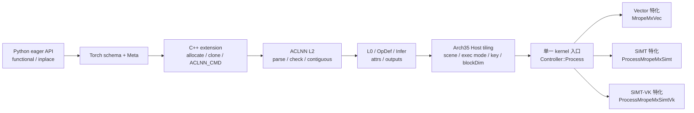
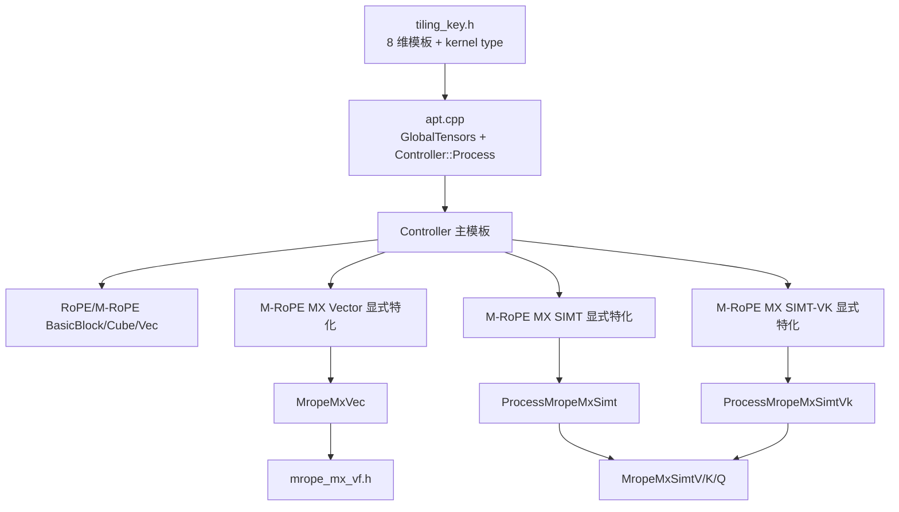

# M-RoPE MX 历史代码架构快照

> 状态：历史实验快照，不是当前交付实现的事实源。本文保留早期多执行模式实验的结构和证据，
> 因而仍会出现当时的 `EXEC_MODE`、SIMT 和 SIMT-VK。当前交付合同以
> `docs/srs_stc/mrope_mx_srs.md` 和源码为准：tiling key 没有 `EXEC_MODE` 维度，M-RoPE MX
> 由一个 AIV-only key 分派，Q 的组批方式由 Kernel 从 `qHeadNum` 推导。
> 目标原则：复用同一算子、同一公开合同和现有测试基础设施；只为真正不同的内部执行拓扑增加实体。

## 0. 与原设计冲突或特别重要、仍待确认的项

| ID | 当前源码事实 | 状态 |
|---|---|---|
| D11 layout 单一事实源 | 原设计要求一份 Host/Device 共用 helper。实际 `mrope_mx_layout.h` 内有 `TryMakeMropeMxUbLayout` 与 `MakeMropeMxUbLayoutDevice` 两个物化入口：前者做 uint64 checked arithmetic，后者只用 uint32，避免 device compiler-rt 宽乘依赖。公式与 region 顺序相同，但尚无逐字段 exact-equality UT。 | 是否接受双物化并补 exact-equality UT，仍待用户确认。 |
| D25 lane 单一事实源 | `01_contract.md` 是规范；Vector gather-index、SIMT `MropeMxSimtAxis` 和 Python Golden 各自表达相同 T/H/W lane 规则，并未共享一个 helper。 | 已实现但存在漂移风险；是否抽取共享事实源仍待用户确认。 |
| D26 device 窄化 | Host checker/tiling 采用拒绝式验证；device 假定 tiling 已合法，公共 copy helper 中仍直接 cast 窄字段。 | 是否接受 Host 为安全边界，仍待用户确认。 |
| 内部 A/B | `QKV_MROPE_MX_IMPL` 只在 Host tiling 中选择同一公开新 scene 的 Vector/SIMT/`simt_vk` key，不是 OpDef/ACLNN/Torch 属性。A/B 必须独立进程，非法值只拒绝新 scene，旧 scene 忽略。 | 已实现，不能扩散为第二公开合同。 |
| Vector RowBatch16 | 所有合法Q配置调用同一个运行时head数VF；完整16-row批次按token聚合三个阶段，可选8-row尾批逐行量化。K使用自己的运行时逐行融合VF。 | 不按特定head组合选择函数；Q scratch按完整批次数分配。 |
| SIMT 调度已变化 | 当前为 `512 threads=16 warps`；warp 分为两个 16-lane subgroup。V 是 `(token,head-pair)`-per-warp；K/Q 是 `(token,head-group)`-per-warp，组内每次并行处理两个 head。 | 旧的 `1024/32`、三路 row-per-warp 和后续一 warp/一 head 描述均已失效。 |
| 验证边界 | 当前 RowBatch16 Vector 已完成`Nq=16/24/32/64`的ACLNN五输出`100%`和TTK ACLNN性能验证。 | 固定seed 42、默认`reuse_hbm=false`，结果为`14.474/20.901/21.517/32.669 us`。 |

旧文中的“评审通过后才实现”和 Stage 1–4 计划状态已经过时；这些模块已实现。本文只保留当前架构、分层证据和剩余 Gate，不把隔离 Kernel 编译写成最终产品构建。

## 1. 设计文档分工

| 文档 | 唯一负责的事实 |
|---|---|
| `01_contract.md` | 对外 scene、输入输出 shape/dtype、数值、alias 与 ABI 合同 |
| `02_execution_design.md` | 分核、核内遍历、Vector/SIMT/SIMT-VK 流水、同步、UB/寄存器空间与生命周期 |
| `03_code_architecture.md` | 端到端通路、文件/模块映射、测试接入和验证状态（本文） |
| `04_kernel_architecture.md` | kernel 模块调用关系、入口编译期路由与对象所有权 |
| `05_kernel_function_contracts.md` | kernel 入口、数据结构、layout、Controller 与 Vec 调度接口 |
| `06_kernel_vec_vf_contracts.md` | Vec 私有搬运、VF 数值入口、event helper 与 copy 约束 |
| `07_host_tiling_design.md` | Host scene/resource 选择、tokenTile、key、blockDim、workspace、TilingData 与 Host UT |

04–07 已按当前 Vector/SIMT/SIMT-VK 源码快照同步；若后续 D11/D25/D26 决策改变实现，必须同时更新各自负责的事实，不能让 03 复制出另一套函数事实。

## 2. 端到端调用链



端到端只有一个公开 mode 矩阵：

- `qQuantMode/kQuantMode` 决定公开 scene；
- cache dtype 决定存储类型，不能替代 quant mode；
- `QKV_MROPE_MX_IMPL` 只在已经确认是新 M-RoPE MX scene 后选择内部 exec mode；
- qScale presence 由公开 scene 决定，任何层都不能仅凭 cache dtype 或 `isMrope` 推断。

## 3. 公共接口与 Host 模块

### 3.1 ACLNN L2 与 checker

当前修改文件：

- `op_host/op_api/aclnn_qkv_rms_norm_rope_cache_with_k_scale.h`
- `op_host/op_api/aclnn_qkv_rms_norm_rope_cache_with_k_scale.cpp`
- `op_host/op_api/qkv_rms_norm_rope_cache_with_k_scale_checker.h`

已实现职责：

- 在 `qQuantMode` 后透传 `kQuantMode`，空值默认 `PerTokenPerHead`；
- checker 使用三态 scene，只接受合同中的三组组合；
- rotation 按 scene 检查：旧两路必选，新 MX 必须缺席；
- 新 MX 检查 TND→TND、D128、`T<=262144`、head 关系、rank/dtype/stride；
- `qScale` 在新 MX 是真实 E8M0 rank3 输出，旧 NoQuant 才允许内部 placeholder；
- DFX 输出顺序保持 `[qOut,qScale,kCache,vCache,kScaleCache]`。

### 3.2 L0、OpDef 与 Infer

当前修改文件：

- `op_host/op_api/qkv_rms_norm_rope_cache_with_k_scale.h/.cpp`
- `op_host/qkv_rms_norm_rope_cache_with_k_scale_def.cpp`
- `op_host/qkv_rms_norm_rope_cache_with_k_scale_infershape.cpp`

已实现职责：

- `OP_ATTR` 增加 `kQuantMode`，属性索引固定为 0..7；
- OpDef 增加默认值为 `PerTokenPerHead` 的 `k_quant_mode`；
- dtype type-group 同步包含旧 RoPE、旧 M-RoPE、新 M-RoPE MX；
- Infer 产生三态 qScale：旧 RoPE FP32 rank2、旧 M-RoPE 内部 placeholder/公开 None、新 MX E8M0 `[T,Nq,ceil(D/32)]`；
- cache 输出继续复制 cache 输入 shape/dtype，保留 ref alias 合同。

### 3.3 Torch eager

当前修改文件：

- `torch_extension/cann_ops_transformer/ops/qkv_rms_norm_rope_cache_with_k_scale.py`
- `torch_extension/cann_ops_transformer/ops/csrc/qkv_rms_norm_rope_cache_with_k_scale.cpp`
- `torch_extension/cann_ops_transformer/docs/zh/qkv_rms_norm_rope_cache_with_k_scale.md`

已实现职责：

- Python schema/Meta/PrivateUse1 增加 `k_quant_mode`；
- `query_start_loc`、`seq_lens` 和返回 `q_scale` 使用 optional；
- Meta 为新 MX 分配 E4M3FN `qOut[T,Nq,D]` 与 E8M0 `qScale[T,Nq,ceil(D/32)]`；
- C++ extension 解析 K mode，并将 Q/K mode 一起传给 ACLNN；
- inplace 复用 cache ref；functional 先 clone K/V/KScale，再调用 ACLNN，保证原输入 cache value semantics；
- 不增加 TorchAir converter，也不把 eager/ACLGraph 结果宣称为 TorchAir fullgraph 支持。

## 4. Host tiling 与编译期路由

主要文件：

- `op_host/op_tiling/arch35/qkv_rms_norm_rope_cache_with_k_scale_base_tiling.h/.cpp`
- `op_host/op_tiling/arch35/qkv_rms_norm_rope_cache_with_k_scale_tiling.h/.cpp`
- `op_kernel/arch35/qkv_rms_norm_rope_cache_with_k_scale_tiling_key.h`
- `op_kernel/arch35/qkv_rms_norm_rope_cache_with_k_scale_tiling_data.h`
- `op_kernel/arch35/qkv_rms_norm_rope_cache_with_k_scale_mrope_mx_layout.h`

### 4.1 Scene 与内部 exec mode

Host 先按公开属性和输入存在性判定 scene。只有新 M-RoPE MX scene 才读取私有进程变量：

```text
QKV_MROPE_MX_IMPL unset/vector -> ExecMode::VECTOR
QKV_MROPE_MX_IMPL simt         -> ExecMode::SIMT
QKV_MROPE_MX_IMPL simt_vk      -> ExecMode::SIMT_VK
非法值                          -> 新 scene 失败
旧 scene                        -> 忽略该变量
```

必须在独立进程中做三路 A/B，避免 tiling/kernel cache 污染。路由证据必须记录实际 key，而不能只记录环境变量。

### 4.2 八维 key

模板参数顺序为：

```text
HEAD_DIM, QKV_LAYOUT, Q_OUT_LAYOUT, ROPE_MODE,
K_CACHE_DTYPE, Q_QUANT_MODE, K_QUANT_MODE, EXEC_MODE
```

`EXEC_MODE` 追加在末尾，且 Vector=0，因此旧 key 数值保持不变。合法行：

| scene | key | kernel type |
|---|---:|---|
| RoPE NTD→NTD | `0` | mixed AIC 1:2 |
| RoPE TND→NTD | `256` | mixed AIC 1:2 |
| RoPE TND→TND | `4352` | mixed AIC 1:2 |
| 旧 M-RoPE TND→TND | `17895680` | mixed AIC 1:2 |
| 新 M-RoPE MX Vector | `302059776` | AIV-only |
| 新 M-RoPE MX SIMT | `4597027072` | AIV-only |
| 新 M-RoPE MX SIMT-VK | `8891994368` | AIV-only |

每行通过 `ASCENDC_TPL_KERNEL_TYPE_SEL` 声明 task type；kernel 入口不再使用 `KERNEL_TASK_TYPE*`。

### 4.3 Resource、blockDim 与 TilingData

新 scene：

- `activeAiv=min(T,aivNum)`；不依赖 AIC/L1/L0C 或 1:2 mixed 拓扑；
- Vector 使用 `TryMakeMropeMxUbLayout` 搜索最大 fit `tokenTile`；
- SIMT、SIMT-VK 与 Vector 共用现有 TilingData 和 token 商余分片；两个 SIMT variant 不消费 `tokenTile`/UB layout；
- cache/scale stride 与全局 offset 使用 uint64 element 单位；
- 不新增 task-owned GM workspace，保留框架 workspace ABI；
- D11 的 Host/Device layout 双物化仅影响 Vector。

完整 Host 选择流程与字段合同由 `07_host_tiling_design.md` 负责。

## 5. Kernel 模块与调用关系

### 5.1 文件结构

```text
op_kernel/
  qkv_rms_norm_rope_cache_with_k_scale_apt.cpp
  arch35/
    qkv_rms_norm_rope_cache_with_k_scale_common.h
    qkv_rms_norm_rope_cache_with_k_scale_tiling_key.h
    qkv_rms_norm_rope_cache_with_k_scale_controller.h
    qkv_rms_norm_rope_cache_with_k_scale_mrope_mx_controller.h
    qkv_rms_norm_rope_cache_with_k_scale_mrope_mx_struct.h
    qkv_rms_norm_rope_cache_with_k_scale_mrope_mx_layout.h
    qkv_rms_norm_rope_cache_with_k_scale_mrope_mx_vec.h
    qkv_rms_norm_rope_cache_with_k_scale_mrope_mx_vf.h
    qkv_rms_norm_rope_cache_with_k_scale_mrope_mx_simt.h
    qkv_rms_norm_rope_cache_with_k_scale_mrope_mx_simt_vk.h
```

### 5.2 单一入口与 Controller 特化



入口文件只完成：

- 绑定 global 参数为 `GlobalTensors`；
- 实例化八维 `QkvRmsNormRopeCacheWithKScaleController`；
- 调用一次 `Process`；
- 保存/恢复既有 overflow mode。

入口没有 scene 的运行时 `if`、虚函数或第二入口。主模板承载旧 mixed 路径；三个完整模板参数组分别命中 Vector、SIMT 与 SIMT-VK 显式特化。

### 5.3 Vector 文件职责

| 文件 | 当前职责 | 不负责 |
|---|---|---|
| `mrope_mx_struct.h` | `MropeMxTileDesc` 等 Controller/Vec 最小共享结构 | scene、GM view、数值公式 |
| `mrope_mx_layout.h` | UB region公式；Host checked与device uint32两种物化；按Q完整批次数分配`mxScratch` | 搬运、event、数值 |
| `mrope_mx_controller.h` Vector 特化 | token 商余分片、window 边界切 tile、lookahead、V→K→Q 调度 | GM/UB binding、VF 数值 |
| `mrope_mx_vec.h` | 构造时 Init/InitEvents；常驻数据、preload、event、V/K/Q staging 和 MTE3；析构闭合 | scene、分核、SIMT |
| `mrope_mx_vf.h` | Q RowBatch16 VF、K逐行融合VF、MX scale/data callee；V VF来自shared header | GM scatter、跨pipe event |

Vector没有新增只转发的Controller基类、BasicBlock或scatter class。V复用已有`VScaleFp8D128ToNtdVfImpl<true>`。所有合法Q配置使用`QRmsNormMropeMxD128RowBatch16VfImpl`；K使用`KRmsNormMropeMxD128RowBatch16VfImpl`并在函数内逐行处理。两个入口复用相同RMSNorm、M-RoPE和MX数值helper。

K scale 逻辑为 `[t,Nk,S]`，但 Vector UB 每 token pitch 是 `align_up(Nk*S,32)`；Q scale compact。该物理差异通过 `scaleTokenStrideWords` 传给共用 Q/K VF，不能在架构图中省略。

### 5.4 SIMT 文件职责

`mrope_mx_simt.h` 是 SIMT 内部 variant 的唯一设备文件，包含：

- `ProcessMropeMxSimt`：token 分片、GM pointer binding、依次三次 `asc_vf_call`、最终 `V_S` fence；
- `MropeMxSimtV`：V static quant 与 V cache direct scatter；
- `MropeMxSimtK`：K RMSNorm/M-RoPE/MX 与 K/KScale direct scatter；
- `MropeMxSimtQ`：Q RMSNorm/M-RoPE/MX 与连续 Q/QScale store；
- scaleAlg=1、FP8 pair conversion/packed store、warp reduction 和 lane-axis helper。

它不依赖 Vector 的 TileDesc、UB layout、Vec 或 event 状态机。每次 launch 为 512 threads，即 16 个 warp；warp 切成两个 16-lane subgroup，每个 subgroup 负责一个 head，并由每个 sublane 处理四个 D32 block 中的相邻 value pair。V 一个 warp 对应一个 `(token,head-pair)`；K/Q 一个 warp 对应一个 `(token,head-group)`，group size 为 16，组内 `headPair+=2`。由于 collective 仍作用于完整 warp，每个 head-pair 的 RMS 使用两次 masked `asc_reduce_add`，四个 D32 amax 使用八次 masked `asc_reduce_max`。

data 对齐时使用 `uint16_t` pair store，四个 scale 对齐时使用 `uint32_t` packed store。Q 连续输出满足对齐；V/K data 和 K scale 允许 padded cache stride，因而保留逐 byte fallback。

SIMT 的 lane-axis helper 与 Vector/Golden 尚未统一，见 D25。

`mrope_mx_simt_vk.h` 只拥有新的 VK 合并遍历和 V/K 写回调度：一个 warp 固定 token，按 head-pair 先 V 后 K，随后调用 `mrope_mx_simt.h` 中现有 Q VF。RMSNorm、M-RoPE 选轴、MX scale 和 FP8 转换继续复用原 SIMT helper；因此它是独立调度实体而不是第二份数值事实源。详细生命周期与性能证据见 `09_simt_vk_experiment.md`。

## 6. ops-test-kit 资产与唯一 Golden

当前算子侧资产：

```text
tests/
  assets/
    qkv_rms_norm_rope_cache_with_k_scale_golden.py
  st/arch35/
    ttk_kernel_qkv_rms_norm_rope_cache_with_k_scale_mrope_mx_st.csv
    ttk_aclnn_qkv_rms_norm_rope_cache_with_k_scale_mrope_mx_st.csv
    ttk_e2e_qkv_rms_norm_rope_cache_with_k_scale_mrope_mx_st.csv
```

新增这些实体的原因是 ops-test-kit 三种 runner 的 ABI/输出采集字段不同，无法由一份 CSV 无损表达；它们不是新的业务事实源。防漂移链为：

```text
一个 Python Golden core
  -> Kernel TestSpec adapter
  -> ACLNN TestSpec adapter
  -> Torch inplace/functional TestSpec adapter
三份 CSV 只保存 runner 路由、shape/dtype/属性与 case
```

Golden 独立计算：

```text
BF16 -> FP32 RMSNorm -> M-RoPE
Q/K DynamicMxQuantV3(scaleAlg=1, block=32)
V per-head-per-channel static quant
slot scatter + untouched cache inheritance
```

它不调用另一个 NPU DynamicMxQuant 作为 oracle。D25 指出的是 lane 条件仍分别编码，并非 Golden 与 Kernel 共用被测实现。

### 6.1 输出采集

统一输出顺序：

```text
[qOut, qScale, kCache, vCache, kScaleCache]
```

ACLNN CSV 通过 tensor index 显式收集 Q/QScale 与三个 ref cache；Torch inplace 收集正常返回和修改后的 cache；Torch functional 还捕获调用后的三个原输入 cache，用于证明 clone 前后的输入整块不变。

混合 dtype 比对规则：

- E4M3FN data：普通 case 做量化语义比较，远离边界的 deterministic case可做 bit-equal；
- E8M0 scale：shape 与 raw byte binary-equal；
- 未命中 cache：相对初始 cache bit-equal；
- functional 原输入 cache：整块 bit-equal。

不能用命令行全局 `--compare close` 覆盖这些逐输出判据。

### 6.2 A/B 运行约束

同一 TTK CSV 即可测试三种内部实现，不复制 variant CSV：

```text
进程 A：QKV_MROPE_MX_IMPL=vector 或 unset
进程 B：QKV_MROPE_MX_IMPL=simt
进程 C：QKV_MROPE_MX_IMPL=simt_vk
```

三个进程必须使用同一输入/seed，并分别记录实际 key。这样复用同一公开 case，避免为内部 variant 新增重复测试事实。

## 7. 当前有效验证证据

| 层级 | 当前优化源码身份结果 | 边界 |
|---|---|---|
| Host UT | `155/155 PASS` | 新增 `simt_vk` 路由后重跑 |
| op-api UT | 前一轮 `137/137 PASS` | 公开接口未变化；未随本轮 Kernel/Host 私有路由重跑 |
| clean opkernel/package | PASS | package SHA256 `01bd6229...595`；三个目标 JSON 同时包含三 key |
| ACLNN代表shape | 当前RowBatch16 Vector四条用例的五输出均为`100%` | `T=768,Nq=16/24/32/64` |
| TTK ACLNN性能 | 四条用例PASS | 固定seed 42、`reuse_hbm=false`，见`08_validation_evidence.md` |
| 前一 SIMT priority-0/最大 T | `9/9 PASS`、`1/1 PASS` | 新增隔离 key 前、SIMT 数值 header 未变化；不替代 SIMT-VK 全矩阵 |
| Torch E2E/详细 msopprof | NOT_EVALUATED | 当前 package 尚未重跑 |

源码声明 Vector `302059776`、SIMT `4597027072` 与 SIMT-VK `8891994368`，三者均为 AIV-only。当前实测OPP绑定Vector object和Host tiling库；旧实现路由证据属于前一身份。

当前 RowBatch16 Vector 的固定seed TTK ACLNN耗时为`14.474/20.901/21.517/32.669 us`，对应`Nq=16/24/32/64`。其他旧耗时只保留为历史证据。

## 8. 验证结论与仍待确认项

当前 RowBatch16 Vector 已完成`T=768,Nq=16/24/32/64`的ACLNN五输出精度与TTK ACLNN性能。

仍待闭环的是`Nq=8/40/48/56`、priority-0全矩阵、最大T、Torch E2E、详细msopprof、wheel、D11 exact-equality UT，以及D25、D26。若因此修改合同、Golden、tiling或Kernel，必须生成新身份并重跑受影响Gate。

证据身份、旧 false PASS、动态编译产物路径恢复和 Torch test-only import shim 的边界见 `08_validation_evidence.md`。

## 9. 参考入口

- [ops-test-kit](https://gitcode.com/cann/ops-test-kit)：CLI、TestSpec、compare context 与 Torch package loader；
- [MatMulV3 ACLNN TTK CSV](https://gitcode.com/cann/ops-nn/blob/master/matmul/mat_mul_v3/tests/st/arch35/ttk_aclnn_mat_mul_v3_basic_st.csv)：output tensor/inplace index 用法；
- [MatMulV3 Kernel Golden](https://gitcode.com/cann/ops-nn/blob/master/matmul/mat_mul_v3/tests/assets/mmv3_kernel_golden.py)：Golden core 与 runner adapter 的组织方式；
- `ops-nn/quant/dynamic_mx_quant/docs/aclnnDynamicMxQuantV3.md` 及其 Arch35 kernel：本 scene 的 MX 数值语义来源。
