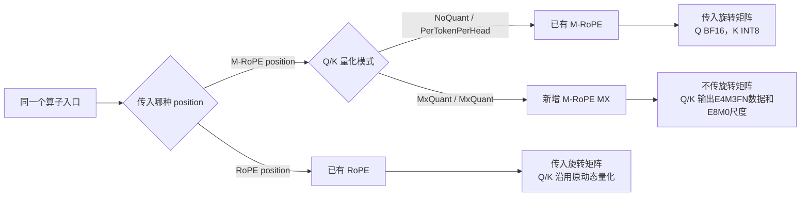
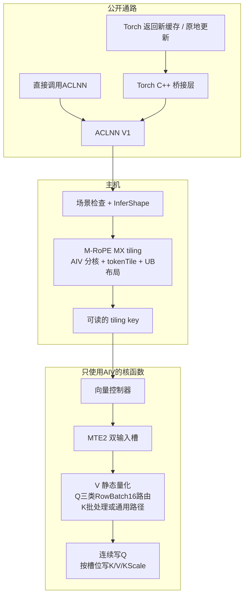
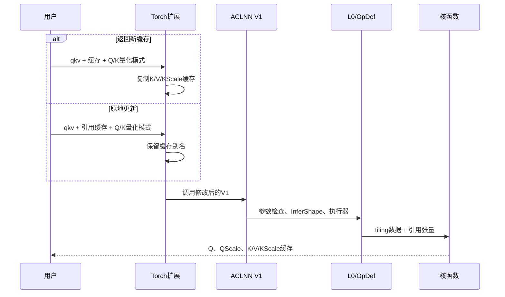
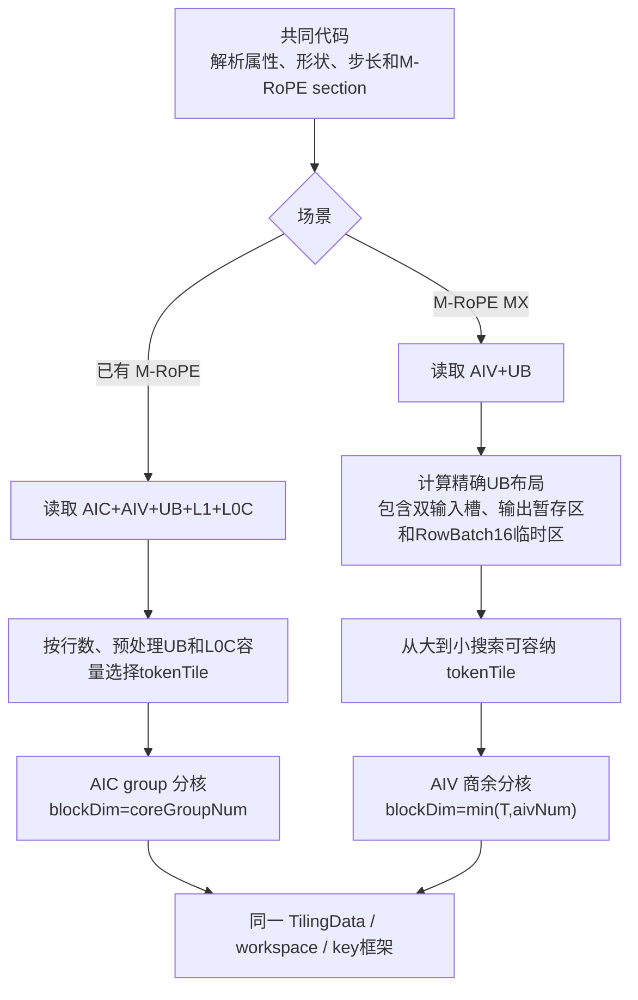
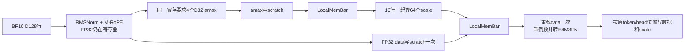
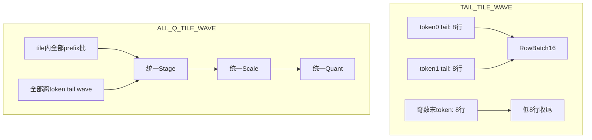

# QkvRmsNormRopeCacheWithKScale M-RoPE MX SRS

## 1. 本文说明什么

本文规定如何在已有 M-RoPE 中增加 M-RoPE MX。调用方继续使用同一个算子、同一个 ACLNN V1 和同一个核函数入口。

本文依次说明公开接口、主机 tiling、核函数数据流和 SIMD VF。[implementation_deviations.md](implementation_deviations.md) 记录当前代码尚未完成的要求。

## 2. 目标和约束

### 2.1 功能目标

- Q VF 依次执行 RMSNorm、M-RoPE 和 D32 动态 MX 量化。完整 16-row 批在 token 内处理；8-row 尾部根据 prefix 数量跨两个 token 组批，或与完整 prefix 一起组成 tile-wide 流水。K VF 在能整除 16 行时跨 token 组批，其余行走通用路径。Q/K 都输出 E4M3FN 数据和 E8M0 尺度。
- V VF 沿用按头、按通道的静态量化，并按槽位写入缓存。
- 接口支持 `0 < Nq <= 64`，并要求 `Nq % 8 = 0`、`Nq = 8 * Nk`、`Nk = Nv`。
- 场景检查器保留已有 RoPE 和 M-RoPE 的数值及接口行为。
- Host 为 M-RoPE MX 固定选择一个公开 `VECTOR` tiling key。Kernel 在 Q 入口按 `Nq` 一次性选择 `ROW_BATCH16`、`TAIL_TILE_WAVE` 或 `ALL_Q_TILE_WAVE`；三条内部 Q schedule 都以 RowBatch16 为尺度计算单位。K 在 `Nk=2/4/8` 时分别把 8/4/2 个 token 组成 16 行，其他 `Nk` 和余数走通用路径。

### 2.2 各层必须怎样做

1. ACLNN V1 的 workspace 接口直接增加 `kQuantMode`。工程不新增 ACLNN V2。
2. 场景检查器用量化模式选择算法，用缓存类型校验存储格式。两个字段各自决定一项检查。
3. Q 的完整 prefix 批只包含同一个 token 的连续 head；每个 token 的 8-row 尾部允许与相邻 token 合成 RowBatch16。Q 数据和尺度仍按原 token/head 顺序连续写出。K VF 可跨 token 组满 16 行，并按物理 token/head 步长写 K 尺度。
4. VF 在寄存器和 UB 中完成 RMSNorm、M-RoPE 和 MX 量化，不向 GM 写中间结果。
5. 核函数、ACLNN 和 Torch 测试调用同一个 Golden 计算期望值。
6. SRS 写目标要求；验证文档分别记录构建、精度、性能和代码差距。

## 3. 新场景与已有场景的区别

### SRS-MX-001 场景判定



| 维度 | 已有 M-RoPE | M-RoPE MX | 设计影响 |
|---|---|---|---|
| `qQuantMode` / `kQuantMode` | `NoQuant` / `PerTokenPerHead` | `MxQuant` / `MxQuant` | 主机分别读取两个模式并选择场景 |
| 旋转矩阵 | BF16 `[128,128]`，存在 | 不传入 | 核函数不执行共享旋转矩阵乘 |
| Q 输出 | BF16 `[T,Nq,128]` | E4M3FN `[T,Nq,128]` | Q VF 增加动态 MX 量化 |
| Q 尺度 | 不存在 | E8M0 `[T,Nq,4]` | 每个 D32 块输出一个尺度 |
| K 缓存 | INT8 | E4M3FN | K VF 完成动态 MX 量化后按槽位写入 |
| K 尺度缓存 | FP32 `[...,1]` | E8M0 `[...,4]` | 核函数按新布局写入四个尺度 |
| V 路径 | E4M3FN 静态量化 | E4M3FN 静态量化 | V VF 调用已有计算函数 |
| 核函数资源 | 既有 M-RoPE 资源模型 | 只使用 AIV，并分配 RowBatch16 临时区 | 主机按 Q 路由计算 UB；Q tail 和可整除的 K 跨 token 填满 16 行 |

场景检查器分别校验输出类型和量化模式，并拒绝 `MxQuant/PerTokenPerHead` 等混合组合。主机在启动设备任务前返回参数错误。

## 4. 数据怎样进入 VF

上层入口把新增场景送到 M-RoPE MX 向量实现。ACLNN 接口增加 K quant mode；主机按 AIV 和 UB 选择 tile，并为 RowBatch16 分配临时区；核函数跳过旋转矩阵乘，让 Q/K VF 连续执行 M-RoPE 和动态 MX 量化。



## 5. 公开接口与数据合同

### SRS-MX-002 直接修改 ACLNN V1

保留公开符号：

```cpp
aclnnQkvRmsNormRopeCacheWithKScaleGetWorkspaceSize(...);
aclnnQkvRmsNormRopeCacheWithKScale(...);
```

workspace 接口在 `qQuantMode` 后增加：

```cpp
const char *qQuantMode,
const char *kQuantMode,
aclTensor *qOut,
aclTensor *qScaleOptional,
uint64_t *workspaceSize,
aclOpExecutor **executor
```

- `kQuantMode` 为 `nullptr`、空字符串或 `PerTokenPerHead` 时保持旧 K 算法；`MxQuant` 选择 MX 算法；其他值拒绝。
- DFX 同时记录 Q/K mode。接口返回 Q、QScale 和三个引用缓存。
- 调用方使用新头文件重新编译，才能调用修改后的 V1 原型。修改后的原型不兼容旧二进制调用约定。
- 工程不增加第二套公开符号、算子名或 Torch schema。

### SRS-MX-003 Torch、L2/L0 与 OpDef 通路



- OpDef 保留已有属性索引，在 `q_out_dtype` 后追加可选 `k_quant_mode`，默认 `PerTokenPerHead`。
- Torch 返回新缓存时复制 K/V/KScale；原地更新时直接传入引用缓存。
- L2 只把非引用输入转为连续布局，并把缓存的存储描述和别名关系传给核函数。

### SRS-MX-004 形状、类型和可选输入

```text
D = 128
0 < Nq <= 64
Nq % 8 = 0
Nq = 8 * Nk
Nk = Nv
1 <= T <= 262144
layoutQkv = TND
layoutQOut = TND
```

| 输入 | 形状 | 类型 | 约束 |
|---|---|---|---|
| `qkv` | `[T,Nq+Nk+Nv,128]` | BF16 | 紧凑连续 |
| `qGamma`、`kGamma` | `[128]` | FP32 | RMSNorm gamma |
| `cosSin` | `[MaxSeqLen,128]` | FP32 | 前 64 列 cos，后 64 列 sin |
| `slotMapping` | `[T]` | INT32 | 值域合法且全局唯一 |
| `kCacheRef` | `[BlockNum,Nk,BlockSize,128]` | E4M3FN | 输入输出别名，尾轴连续 |
| `vCacheRef` | `[BlockNum,Nv,BlockSize,128]` | E4M3FN | 输入输出别名，尾轴连续 |
| `kScaleCacheRef` | `[BlockNum,Nk,BlockSize,4]` | E8M0 | 输入输出别名，末轴紧凑 |
| `vScaleOptional` | `[Nv,128]` | FP32 | 必须存在 |
| `mropePositionOptional` | `[T,3]` | INT32 | 每个 token 的 T/H/W 位置 |
| `mropeSectionOptional` | `[3]` | INT64数组 | 沿用已有M-RoPE的lane分配规则 |
| RoPE position、rotation | - | - | 必须缺席 |

缓存前三维允许填充。主机检查视图互不重叠，并检查 K/V 前三维步长一致。调用方把 position 元素限制在 `[0,MaxSeqLen)`。

### SRS-MX-005 输出和别名规则

输出顺序固定为：

```text
[qOut, qScaleOptional, kCacheRef, vCacheRef, kScaleCacheRef]
```

| 输出 | 形状 | 类型 | 写入规则 |
|---|---|---|---|
| `qOut` | `[T,Nq,128]` | E4M3FN | 按 token 顺序连续写入 |
| `qScaleOptional` | `[T,Nq,4]` | E8M0 | 连续写入四个 D32 尺度 |
| `kCacheRef` | 原缓存形状 | E4M3FN | 只写槽位命中的位置 |
| `vCacheRef` | 原缓存形状 | E4M3FN | 只写槽位命中的位置 |
| `kScaleCacheRef` | 原缓存形状 | E8M0 | 只写槽位命中的位置 |

核函数逐 bit 保留未命中的缓存区域。Torch 返回新缓存时不修改输入缓存；Torch 原地更新时只修改命中的槽位。

## 6. 主机怎样生成 tiling

### SRS-MX-006 Scene checker 和 InferShape

1. 场景检查器读取 Q/K mode 和可选输入，确定场景。
2. 场景检查器校验布局、形状、类型、连续性、缓存步长和别名关系。
3. InferShape 生成 Q `[T,Nq,128]` 和 QScale `[T,Nq,4]`，并让三个缓存输出继承引用缓存的形状和存储描述。
4. 场景检查器发现错误后立即返回参数错误，不再生成 tiling，也不启动设备任务。

### SRS-MX-007 分核、tokenTile 和 UB 选择

#### 6.2.1 主机继续复用哪些代码

`QkvRmsNormRopeCacheWithKScaleBaseTiling` 增加 M-RoPE MX 分支，并继续调用以下已有代码：

| 复用项 | 两个场景调用的已有代码 |
|---|---|
| 属性和输入解析 | 同一段代码解析 `head_nums/layout/epsilon/mrope_section`，并根据可选输入选择 M-RoPE 模式 |
| 公共形状检查 | 同一段代码检查 `D=128`、TND、`Nq=8*Nk`、`Nk=Nv`及缓存的 block/head/token 视图 |
| M-RoPE 参数 | 同一套 section 合法性检查和 H/W 投影字段 |
| 缓存地址检查 | 同一段代码检查存储形状、视图步长、重叠和最大地址跨度 |
| TilingData | 继续填写同一结构中的 token/head、blockSize、缓存步长、epsilon 和 section 字段 |
| Workspace | 复用算子 workspace 计算；不申请 Q/K 中间 GM workspace |
| Tiling key | 同一个模板生成器继续生成 key，并保留已有场景的编码 |
| 运行分工 | 主机填写每核工作量和 UB 容量；核函数执行 tile 循环并控制数据就绪和缓冲区复用 |

#### 6.2.2 主机为 M-RoPE MX 修改哪些计算

已有 M-RoPE 执行旋转矩阵乘，主机按 AIC、AIV、UB、L1、L0A、L0B 和 L0C 选择 tile。M-RoPE MX 只在 AIV 上执行，主机改用 AIV 数量和精确 UB 字节数选择 tile。

| 设计点 | 已有 M-RoPE | M-RoPE MX RowBatch16 | 修改原因 |
|---|---|---|---|
| 平台资源 | 校验 AIC、AIV、UB、L1、L0C及AIC/AIV比例 | 只读取 AIV 数量和 UB 容量 | 新场景不执行 Cube 和旋转矩阵乘 |
| 分核方法 | 按 AIC 组分配 token，每个 AIC 对应两个 AIV | 令 `activeAiv=min(T,aivNum)`，每个 AIV 按商余取得 token 区间 | 每个 AIV 独立处理自己的 token |
| `blockDim` | `coreGroupNum` | `activeAiv` | 只启动分到 token 的 AIV |
| tile 上限 | 每个 AIV 的行数、Q/K 预处理 UB 和 L0C 行容量共同限制固定小 tile | 取本核 token 数、position 窗口和 VF 字段上限的最小值 | tile 留在当前 position 窗口内 |
| tile 搜索 | 先按行数估算，再检查 UB/L0C | 为每个候选值计算完整 UB 布局，比较精确字节数，并检查搬运和 VF 字段是否可表示 | 计算包含 Q/K 尺度暂存区和 RowBatch16 临时区 |
| UB常驻区 | 旋转矩阵、旧 Q/K 预处理数据和混合通路缓冲区 | gamma、V scale、gather index、position 窗口 | VF 直接读取这些数据 |
| UB流动区 | 既有 QKV、旋转和输出缓冲区 | 双输入槽、Q/K/V 暂存区、RowBatch16 临时区 | MTE2、V、MTE3 可并行处理相邻阶段 |
| 输出尺度 | K 输出 FP32 尺度，QScale 缺席 | Q/K 各输出四个 E8M0 尺度；K 尺度暂存区按 token 留出步长 | 输出布局匹配接口形状 |
| 公共字段 | 旧控制器使用 `coreTokenTile/coreGroupNum` | 字段保持原 ABI 位置；核函数用 `totalTokens/blockDim/blockIdx` 的商余计算 AIV 范围 | 新场景继续使用同一份 TilingData |



#### 6.2.3 M-RoPE MX tiling 伪代码

```cpp
BuildTiling(context) {
    input = ParseWithExistingBaseTiling(context);
    ValidateCommonMropeContract(input);

    if (!IsMropeMx(input)) {
        return BuildExistingMropeTiling(input);
    }

    ValidateMxPresenceDtypeAndScaleStride(input);
    Require(platform.aivNum > 0 && platform.ubSize > 0);

    upper = min(input.T, POSITION_WINDOW_TOKENS, UINT16_MAX);
    for (candidate = upper; candidate >= 1; --candidate) {
        hasQTail = input.Nq % 16 == 8;
        layout = hasQTail
            ? TryMakeMropeMxQTailWaveUbLayout(candidate, input.Nq, input.Nk, input.D)
            : TryMakeMropeMxUbLayout(candidate, input.Nq, input.Nk, input.D);
        if (layout.valid && layout.totalBytes <= platform.ubSize &&
            CopyAndVfFieldsRepresentable(candidate, layout)) {
            tokenTile = candidate;
            break;
        }
    }
    Require(tokenTile >= 1);

    activeAiv = min(input.T, platform.aivNum);
    FillCommonTilingData(input, tokenTile);  // 复用现有字段和ABI
    blockDim = activeAiv;
    workspace = ExistingWorkspacePolicy();  // 不增加中间GM
    key = Encode(D128, TND, TND, MROPE, E4M3FN, MX, MX);
}
```

已有 BaseTiling 增加 M-RoPE MX 的资源选择分支，并继续使用原解析代码、TilingData 和 workspace 计算。

一个 RowBatch16 的临时区为：

```text
FP32 数据        [16,128] = 8192 B
UINT32 D32 max   [16,4]   =  256 B
BF16 reciprocal [16,4]   =  128 B
每批合计                   8576 B
```

基础布局分配 `max(1,floor(Nq/16)) * 8576B`。存在 8-row Q 尾部时，Host 根据 `Nq` 直接计算内部 schedule 所需的临时区：`TAIL_TILE_WAVE` 至少增加一个 RowBatch16 槽；`ALL_Q_TILE_WAVE` 为 tile 内全部 prefix 批和 `ceil(tokenTile/2)` 个 tail wave 分配独立槽。Host 从大到小搜索 `tokenTile`，并让 `TAIL_TILE_WAVE` 只选择偶数 tile 或单 token 回退。该选择不写入 tiling key 或 tiling data；Kernel 从同一个 `qHeadNum` 得到相同 schedule。若 UB 连 `tokenTile=1` 都放不下，Host 返回资源不足错误。

### SRS-MX-008 可读 tiling key

设计人员和评审人员用以下字段解释 key：

| 维度 | M-RoPE MX 取值 | 含义 |
|---|---|---|
| `HEAD_DIM` | `D128` | 固定 headDim 128 |
| `QKV_LAYOUT` | `TND` | 输入 token-major |
| `Q_OUT_LAYOUT` | `TND` | Q 输出 token-major |
| `ROPE_MODE` | `MROPE` | 三轴 position 选路 |
| `K_CACHE_DTYPE` | `E4M3FN` | K data cache 类型 |
| `Q_QUANT_MODE` | `MX` | Q Dynamic MX Quant |
| `K_QUANT_MODE` | `MX` | K Dynamic MX Quant |

评审人员按下面的字段读取该场景的 key：

```text
(D128, TND, TND, MROPE, E4M3FN, MX, MX)
```

执行引擎不是 tiling key 维度。该场景在 selector 中直接声明为 AIV-only；Kernel 从 `qHeadNum`
推导 Q 的内部组批方式。运行框架只用生成后的整数分派核函数。删除末尾恒为零的旧
`EXEC_MODE` 字段后，前七个字段和已有整数 key 编码保持不变。

## 7. 核函数怎样处理数据

### SRS-MX-009 控制器怎样搬运和复用 UB

- 单一 `__global__ __aicore__` 入口根据编译期 key 创建 M-RoPE MX 向量控制器。
- 控制器取得本核 token 区间，再按 `tokenTile` 切分；每个 tile 留在当前 1024-position 窗口内。
- 控制器按 V→K→Q 的顺序处理每个 tile。Q 和批处理 K 都使用 RowBatch16 临时区；两条路径不同时存活，并在各自 VF 结束后复用。各核只处理自己的 token。
- `MTE2_V/V_MTE2` 事件标记输入数据就绪和输入槽可复用；`V_MTE3/MTE3_V` 事件标记输出数据就绪和输出暂存区可复用。
- VF 用 `LocalMemBar` 排列临时区的写后读和读后写顺序；MTE 事件继续控制搬运流水。

| UB region | 内容 | 生命周期 |
|---|---|---|
| 常驻区 | Q/K gamma、V scale、gather index、position 窗口 | 初始化或窗口切换时更新 |
| 输入槽 0/1 | QKV、raw cos/sin、slot mapping | MTE2/V 双缓冲 |
| V 暂存区 | E4M3FN V 数据 | VF 写入；MTE3 按槽位写完后复用 |
| K 暂存区 | E4M3FN K 数据、E8M0 K 尺度 | VF 写入；MTE3 按槽位写完后复用 |
| Q 暂存区 | E4M3FN Q 数据、E8M0 Q 尺度 | VF 写入；MTE3 连续写完后复用 |
| RowBatch16 临时区 | FP32 数据、D32 max、倒数、deferred RMS 数据 | Q 的 prefix/tail wave 按路由占槽；K 批次随后复用；V 不访问 |

### SRS-MX-010 RowBatch16 SIMD 正式设计

D128 每行产生四个 D32 尺度。64-lane 尺度向量恰好容纳 `16行 × 4尺度`，因此 16 行是完整计算单位。实现不要求 16 行来自同一个 token：完整 Q prefix 来自单 token；8-row Q tail 和 K 小 head 批次可以跨 token 补满 16 行。

#### 7.2.1 接入原则：RMSNorm、M-RoPE 和 MX 留在同一个 VF

每条 Q/K 路由都在同一个 `__simd_vf__` 内完成 RMSNorm、M-RoPE、D32 amax、E8M0 scale 和 E4M3FN 数据转换。控制器不在 RMSNorm/M-RoPE 后再调用第二个 MX VF，也不向 GM 写中间结果。



这种接法保留已有数值顺序，同时去掉第二个 VF 的入口、掩码、地址循环和再次遍历数据求 amax。scratch 只保存跨阶段还要读取的数据。

#### 7.2.2 Q 的三种内部 schedule

| 条件 | 内部 schedule | 行怎样组成 |
|---|---|---|
| `Nq%16==0` | `ROW_BATCH16` | 每个 token 的 head 按 16 行分批 |
| `Nq%16==8` 且 `floor(Nq/16)` 为 0 或 2 | `TAIL_TILE_WAVE` | prefix 先处理；相邻两个 token 的 8-row tail 合成 16 行 |
| `Nq%16==8` 且 `floor(Nq/16)` 为 1 或 3 | `ALL_Q_TILE_WAVE` | tile 内全部 prefix 批和 tail wave 共用 tile-wide 三阶段流水 |

`TAIL_TILE_WAVE` 覆盖 `Nq=8/40`，`ALL_Q_TILE_WAVE` 覆盖 `Nq=24/56`。它们都属于 key `302059776` 的 Kernel 内部 schedule。最后一个奇数 token 始终在当前 tile 内使用低 8 行完成，不跨 tile 或 AIV 保存状态。



#### 7.2.3 Q 伪代码

```cpp
ProcessQ(tile) {
    if (Nq % 16 == 0) {
        VF_CALL<RowBatch16Vector>(tile);
    } else if (Nq / 16 == 1 || Nq / 16 == 3) {
        VF_CALL<GlobalTileWave>(tile);  // prefix + tail共用tile-wide阶段
    } else {
        ProcessFullPrefix(tile);
        VF_CALL<TailTileWave>(tile);   // 两个8-row token合成16行
    }
}

TailTileWave(tile) {
    for each two consecutive tokens {
        PrepareMropeGamma(token0);
        StageEightRows(token0, scratch.low8);
        PrepareMropeGamma(token1);
        StageEightRows(token1, scratch.high8);
        Barrier(); Scale64(); Barrier(); Quant16(); Barrier();
    }
    if (tile.tokenCount is odd) {
        StageEightRows(lastToken, scratch.low8);
        ScaleAndQuantLowEightRows();
    }
}
```

每个 token 单独加载自己的 position、cos 和 sin；跨 token 只合并 scale/data 阶段的行，不共享位置参数。输出地址仍按原 token/head 计算，所以组批不改变公共布局。

#### 7.2.4 K 跨 token 组批

`Nk=Nq/8`，范围为 1 到 8。K 只在 `Nk` 为偶数且整除 16 时进入 `KRmsNormMropeMxD128RowBatch16EvenVfImpl`：

```text
Nk=2: 8 token × 2 head = 16行
Nk=4: 4 token × 4 head = 16行
Nk=8: 2 token × 8 head = 16行
```

完整组用 `ProcessKMropeMxD128RowBatch16` 一次生成 64 个尺度。余下 token 进入通用 VF。`Nk=1/3/5/6/7` 也进入通用 VF。两条路径都按 `scaleTokenStrideWords` 写回 K scale，不能把连续逻辑行误写成紧凑物理 token pitch。

#### 7.2.5 为什么跨 token 仍比 8-row 逐行量化高效

| 方式 | scale lane 使用率 | 固定开销 | 中间数据 |
|---|---:|---|---|
| 每行单独量化 | `4/64` | 每行重复 scale 指令和循环 | 不组成完整批 |
| 单 token 8-row | `32/64` | 每 token 支付半满 scale 阶段 | 8 行 |
| 跨 token RowBatch16 | `64/64` | 两个 Q token 或若干 K token 共付一次 | 16 行 |

跨 token 组批没有减少每行必需的 RMSNorm、M-RoPE 和 FP8 cast，但它填满 scale 向量，并把写后读屏障和 scale 固定指令摊到 16 行。实现还保留以下边界：

1. 一个 wave 不跨 AIV、tile 或 position 数据生命周期；
2. 奇数 token 和 K 批次余数在当前 VF 内明确收尾；
3. `AddrReg` 只在合法地址窗口内递增，token1 通过移动 scratch 基址复用局部 pair 索引；
4. Q/K 输出始终按逻辑 token/head 顺序写回；
5. V、K、Q 的 `V_MTE3/MTE3_V` 生命周期保持独立，继续让相邻阶段重叠。

#### 7.2.6 VF 怎样计算和写尺度

每行四个 D32 amax 按 `block0,block1,block2,block3` 排列。完整 RowBatch16 一次生成 64 个 E8M0 scale 和对应倒数；数据阶段每次读取两个 D128 行，执行 FP32 缩放、舍入、饱和和 E4M3FN 转换。

Q 数据和尺度写入连续 token-major 暂存区。K 数据逻辑连续，K scale 按 token/head 物理步长分段写入。带 padding 或非零 offset 的最终 cache scatter 由 MTE3 使用 Host 提供的 stride 完成。

### SRS-MX-011 V 和 GM 输出

- V 调用已有 D128 静态量化 VF：把 BF16 转为 FP32，乘 `vScale[Nv,128]`，再转为 E4M3FN。
- MTE3 按 token 顺序把 Q 数据和尺度从 UB 连续写入 GM。
- MTE3 根据 `slotMapping` 计算 block 和 offset，再写入 K、V 和 KScale。对齐地址使用合并写入；带填充的步长逐段写入。
- MTE3 只写命中的缓存位置，不覆盖填充区、尾部或未命中位置。

## 8. 错误处理、兼容和非目标

### 8.1 场景检查器拒绝哪些输入

- `Nq<=0`、`Nq>64`、`Nq%8!=0`、`Nq!=8*Nk` 或 `Nk!=Nv`；
- `D!=128`、`T` 超界或布局不是TND；
- M-RoPE MX 传入旋转矩阵，或同时传入两种position；
- Q/K mode 不属于三个合法场景；
- 缓存类型、形状或尾轴步长错误，视图重叠，或带溢出检查的地址计算失败；
- UB无法容纳最小布局。

### 8.2 兼容要求

- 场景检查器保留已有 RoPE/M-RoPE 的计算、输出可选关系和路由。
- V1 增加参数后，调用方使用新头文件重新编译。工程不增加另一个接口保留旧调用约定。
- OpDef 把 `k_quant_mode` 设为可选，并默认使用旧 K 模式，使旧图继续进入原场景。

### 8.3 本次不做什么

- 工程不新增第二套 ACLNN 接口、第二个算子、第二份 Golden 或公开执行模式属性。
- 性能报告记录测试形状、源码身份和测试口径，再报告比例。
- 正式性能测试设置 `reuse_hbm=false`。

## 9. 验收要求

- 测试程序分别验证核函数、ACLNN V1、Torch返回新缓存和Torch原地更新，并按输出类型使用数值或原始bit判据检查五个输出。
- 测试程序确认八组 head 都命中公开 key `302059776`，并分别执行 `ROW_BATCH16`、`TAIL_TILE_WAVE`、`ALL_Q_TILE_WAVE` 及 K 批处理/通用路径；用例覆盖偶数完整组、奇数末 token 和 K 批次余数。
- 用例覆盖 token 尾部、多 tile、position 窗口、乱序跨 block 写缓存、K scale 步长、最大 T 和旧场景回归。
- ACLNN 测试全部调用修改后的 V1；符号检查程序发现第二套接口名称时报告FAIL。
- 测试人员分别报告构建、启动、精度、性能、全矩阵和wheel；未执行项标为`NOT_EVALUATED`。
- [mrope_mx_stc.md](mrope_mx_stc.md) 列出详细用例；[implementation_deviations.md](implementation_deviations.md) 列出当前代码缺口。

## 10. 各层修改内容

| 层级 | 目标修改 |
|---|---|
| ACLNN 头文件/L2 | 修改 V1 workspace 原型并解析 `kQuantMode` |
| L0/OpDef/Torch | 追加 `k_quant_mode`并统一调用 V1 |
| Checker/InferShape | 校验 MX 场景的可选输入、形状、类型和步长，并推导五个输出 |
| 主机 tiling | 计算带溢出检查的 UB 布局，搜索 tokenTile，分配 RowBatch16 临时区，生成只使用 AIV 的 key |
| 核函数控制器 | 切分 token 和窗口，轮换双输入槽，按 V→K→Q 调度；按 key 调用 Q 三种路由，并让 K 批次余数进入通用VF |
| 融合 RowBatch16 VF | Q/K 都在同一个`__simd_vf__`内完成RMSNorm、M-RoPE、D32 max、尺度和数据量化 |
| 行生成 | 完整 Q prefix 在 token 内组批；8-row Q tail 和 `Nk=2/4/8` 的 K 跨 token 补满16行；奇数/余数明确收尾 |
| 尺度/数据SIMD | 完整16行执行64-lane尺度计算和双行数据量化；通用余数保持相同数值算法 |
| 布局写入 | 连续写Q，按token步长分段写K尺度 |
| 测试 | 调用同一个Golden，分层测试V1，并覆盖完整head矩阵和批次尾部 |
