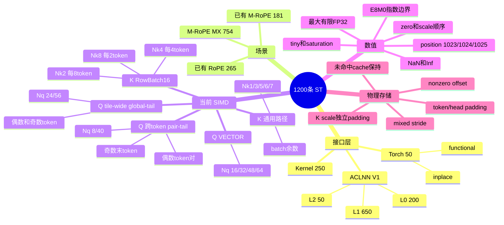

# QkvRmsNormRopeCacheWithKScale M-RoPE MX STC

## 1. 目的和事实源

本 STC 说明 1200 条用例怎样覆盖公开接口、当前 Host tiling 和当前 SIMD 路由。测试设计和执行文件位于 [tests/st](../../tests/st/)；[generate_st_cases.py](../../tests/st/generate_st_cases.py) 从 `design/` 生成全部 CSV。

生成器只调用直接增加 `kQuantMode` 的 `aclnnQkvRmsNormRopeCacheWithKScale` V1。数值期望只由 [Golden](../../tests/assets/qkv_rms_norm_rope_cache_with_k_scale_golden.py) 计算。

## 2. 用例设计脑图



## 3. 数量和优先级

### STC-MX-001 固定数量

| 执行文件 | M-RoPE MX | 已有 RoPE | 已有 M-RoPE | 合计 |
|---|---:|---:|---:|---:|
| [ACLNN L0](../../tests/st/arch35/ttk_aclnn_qkv_rms_norm_rope_cache_with_k_scale_l0_st.csv) | 110 | 55 | 35 | 200 |
| [ACLNN L1](../../tests/st/arch35/ttk_aclnn_qkv_rms_norm_rope_cache_with_k_scale_l1_st.csv) | 400 | 150 | 100 | 650 |
| [ACLNN L2](../../tests/st/arch35/negative_aclnn_qkv_rms_norm_rope_cache_with_k_scale_l2_manifest.csv) | 30 | 10 | 10 | 50 |
| [Kernel](../../tests/st/arch35/ttk_kernel_qkv_rms_norm_rope_cache_with_k_scale_st.csv) | 180 | 40 | 30 | 250 |
| [Torch](../../tests/st/arch35/ttk_e2e_qkv_rms_norm_rope_cache_with_k_scale_st.csv) | 34 | 10 | 6 | 50 |
| **合计** | **754** | **265** | **181** | **1200** |

[07_因子值.csv](../../tests/st/07_因子值.csv) 索引同一批 1200 条用例，不重复计数。

### STC-MX-002 优先级

| 执行文件 | P0 | P1 | P2 |
|---|---:|---:|---:|
| ACLNN L0 | 22 | 152 | 26 |
| ACLNN L1 | 0 | 596 | 54 |
| ACLNN L2 | 50 | 0 | 0 |
| Kernel | 9 | 223 | 18 |
| Torch | 11 | 36 | 3 |
| **合计** | **92** | **1007** | **101** |

执行程序必须跑完所选文件，不能在首个 P0 失败后停止。结果分别统计 `PASS`、`FAIL` 和 `FAILURE`；框架或设备失败不能归为精度失败。

## 4. 生成方法

### STC-MX-003 单一派生链

```text
03_参数定义.yaml
  -> 04_测试因子.yaml
  -> 05_约束定义.yaml
  -> 06_求解配置.yaml        # seed=42、场景和优先级配额
  -> 08_白盒分支覆盖矩阵.yaml
  -> generate_st_cases.py
       -> 07_因子值.csv
       -> ACLNN L0/L1
       -> ACLNN L2 manifest
       -> Kernel
       -> Torch
```

生成器先加入显式白盒、边界和 storage 用例，再从合法参数池选择受限两两组合，最后按 seed 42 的稳定哈希补齐配额。`T=262144` 只生成一条独立 ACLNN L1 压力用例，不参与两两组合，避免产生没有额外覆盖价值的大批超大输入。

`generate` 重写全部生成文件；`check` 重新计算期望并逐字段比较，能发现任何手工修改。

## 5. 接口和公共合同

### STC-MX-004 三个正例场景

| 场景 | `qQuantMode` | `kQuantMode` | position 输入 | rotation | QScale |
|---|---|---|---|---|---|
| M-RoPE MX | `MxQuant` | `MxQuant` | `mropePosition` + `mropeSection` | `None` | E8M0，必须存在 |
| 已有 RoPE | `PerTokenPerHead` | `PerTokenPerHead` | `queryStartLoc` + `seqLens` | 必须存在 | FP32 |
| 已有 M-RoPE | `NoQuant` | `PerTokenPerHead` | `mropePosition` + `mropeSection` | 必须存在 | 不存在 |

所有 ACLNN 正例的 `api_name` 都是 V1。L2 分别把 Q/K quant mode 改成 `null`、空字符串、未知值和错误组合，还覆盖输入 presence、shape、head 比例、布局、上界、输出连续性和 cache stride。

## 6. 当前 SIMD 白盒覆盖

### STC-MX-005 八组 head、一个公开 key 和三类内部 Q schedule

| `Nq/Nk/Nv` | Q 路由 | K 路由 | L0 与 Kernel 锚点 |
|---|---|---|---|
| `8/1/1` | `TAIL_TILE_WAVE` | `K_GENERIC` | `T=128` 偶数对；`T=129` 奇数末 token |
| `16/2/2` | `ROW_BATCH16` | `K_BATCH8` | `T=512` 完整 8-token 批；`T=513` 余数 |
| `24/3/3` | `ALL_Q_TILE_WAVE` | `K_GENERIC` | `T=128/129` tile-wide 偶数/奇数 |
| `32/4/4` | `ROW_BATCH16` | `K_BATCH4` | `T=256` 完整 4-token 批；`T=257` 余数 |
| `40/5/5` | `TAIL_TILE_WAVE` | `K_GENERIC` | `T=128/129` prefix + 跨 token tail |
| `48/6/6` | `ROW_BATCH16` | `K_GENERIC` | `T=64` 单 token/核；`T=128` 多 token/核 |
| `56/7/7` | `ALL_Q_TILE_WAVE` | `K_GENERIC` | `T=128/129` 三个 prefix 批 + tail |
| `64/8/8` | `ROW_BATCH16` | `K_BATCH2` | `T=128` 完整 2-token 批；`T=129` 余数 |

生成器要求 16 个锚点同时出现在 ACLNN L0 和 Kernel。Host UT 另用八条 `T=129` case 检查所有 shape 都返回 tiling key `302059776`，并把 tail-wave 可用 UB 限制到单 token，检查 Host 把 `tokenTile` 降为 1。

### STC-MX-006 Q 怎样跨 token 组批

- `Nq%16==0` 时，`ROW_BATCH16` 按 token 处理完整 16-row 批。
- `Nq=8/40` 时，`TAIL_TILE_WAVE` 把相邻两个 token 的各 8 个尾 head 合成 16 行；最后一个奇数 token 走 8-row 路径。
- `Nq=24/56` 时，`ALL_Q_TILE_WAVE` 把 tile 内所有完整 prefix 批和跨 token tail wave 放入一次 tile-wide `Stage -> Scale -> Quant` 流水；奇数末 token 只使用尾槽的低 8 行。
- 每个 AIV 只组合自己的 token 范围，不跨 tile 或跨 AIV 保留状态。

用例同时覆盖偶数和奇数 `T`，因此不能把“token 总数为偶数”当成实现前提。

### STC-MX-007 K 怎样组成 RowBatch16

`ProcessK` 只在 `Nk` 为偶数且整除 16 时启用批处理：

- `Nk=2`：8 个 token 合成 16 行；
- `Nk=4`：4 个 token 合成 16 行；
- `Nk=8`：2 个 token 合成 16 行。

不足一个完整 token 组的余数进入 `KRmsNormMropeMxD128VfImpl`。`Nk=1/3/5/6/7` 全部使用通用路径。锚点分别让完整批和余数发生，避免只验证 Host 选择而没有执行残余分支。

## 7. 数值、position 和物理存储

### STC-MX-008 数值 profile

M-RoPE MX 正例至少包含：

- `normal`、`zero_qk`、`scale_order`；
- `tiny_qk`、`saturation_qk`、`nan_qk`、`inf_qk`；
- `scale_edge_qk`：四个 D32 使用 raw FP32 `0x04600000/01/02/0x3f800000`，检查 E8M0 指数边界；
- `max_finite_qk`：gamma 使用 raw FP32 `0x7f7fffff`；
- `position_1024`：三行轮换 `1023/1024/1025`。

执行器按原始字节比较 E8M0，顺序固定为每行 `block0, block1, block2, block3`。NaN/Inf 单独统计，不能用普通容差掩盖特殊值差异。

### STC-MX-009 storage view 和 cache scatter

正例覆盖 `dense`、`padded_token`、`padded_head`、`nonzero_offset`、`kscale_padded_token`、`kscale_padded_head` 和 `mixed_stride`。runner 必须把逻辑 view 的 shape、offset、stride 绑定到原始物理 allocation；不能把逻辑 view 展平后继续沿用 padded stride。

槽位覆盖 block 首尾、跨 block、乱序和稀疏映射。Golden 先用非零哨兵填满 K/V/KScale cache，再只更新命中槽位。执行器逐字节检查所有未命中物理位置。

## 8. 各层检查职责

### STC-MX-010 ACLNN L0/L1

- L0 检查公开 V1、基本功能、16 个白盒锚点和单因素边界。
- L1 检查受限两两组合、全部 storage layout、数值 profile、多 tile 和 `T=262144` 独立压力。
- 每条正例检查五个输出；已有 M-RoPE 没有公开 QScale，不制造占位结果。

### STC-MX-011 ACLNN L2

L2 的 50 行都是单一 mutation。manifest 记录基准 case、修改字段、修改值、预期阶段、状态码和错误文本。测试程序必须确认错误发生在参数检查阶段，而且没有生成 tiling、没有启动 kernel。

### STC-MX-012 Kernel

250 条 Kernel case 检查输入/输出 shape、dtype、属性、inplace cache 索引、实际 tiling key、blockDim、五输出和未命中 cache。Kernel case 只使用逻辑连续 tensor；物理 stride/offset 由 ACLNN 和 Torch 层负责。

### STC-MX-013 Torch

50 条 Torch case 同时覆盖 functional 和 inplace。M-RoPE MX 用例覆盖 `TAIL_TILE_WAVE` 与 `ALL_Q_TILE_WAVE` 两种内部 schedule；两者使用同一个公开 tiling key 和同一套 API。functional 保持输入 cache 不变，inplace 保持引用别名并只修改命中槽位。

## 9. 需求追踪

| SRS 需求 | STC 覆盖 |
|---|---|
| `SRS-MX-001` 场景 | STC-MX-004、010、011 |
| `SRS-MX-002` ACLNN V1 | STC-MX-003、004、010、011 |
| `SRS-MX-003` Torch/L0/OpDef | STC-MX-004、013 |
| `SRS-MX-004` shape/dtype | STC-MX-004、005、011 |
| `SRS-MX-005` 五输出和 inplace | STC-MX-009、010、012、013 |
| `SRS-MX-006` checker/InferShape | STC-MX-004、011 |
| `SRS-MX-007` tiling/UB | STC-MX-005、006、007、012 |
| `SRS-MX-008` tiling key | STC-MX-005、012 |
| `SRS-MX-009` buffer/流水 | STC-MX-006、007、009、012 |
| `SRS-MX-010` SIMD RowBatch16 | STC-MX-005、006、007、008 |
| `SRS-MX-011` cache scatter | STC-MX-009、012、013 |

## 10. 执行和验收

1. 执行生成器 `generate` 和 `check`，保存六份文件的 SHA256。
2. clean build 当前源码，保存 source、package、OPP、kernel object 和 runner 身份。
3. 先跑 92 条 P0，但失败后继续跑完所选文件；再执行 P1/P2。
4. 逐行读取结果文件，分别统计 `PASS`、`FAIL`、`FAILURE`，保存旧结果并对补跑按 testcase 去重合并。
5. 对 16 个白盒锚点核对实际 tiling key、blockDim、五输出和 cache 未命中区域。
6. 对数值边界保存 E8M0/E4M3 原始字节；对 storage case 保存物理 allocation、offset 和 stride。
7. 当前 V1 的五类文件全部完成后，才能报告当前 1200 条通过。历史 V2 诊断结果不能直接迁移。

## 11. 当前验证状态

- 生成器 `generate/check`：PASS，1200 行和全部配额不变。
- Host tiling UT：134/134 PASS。
- Golden TND/NTD 离线边界检查：PASS。
- 当前 V1 package 的真实 NPU 1200 条执行：`NOT_RUN`。
