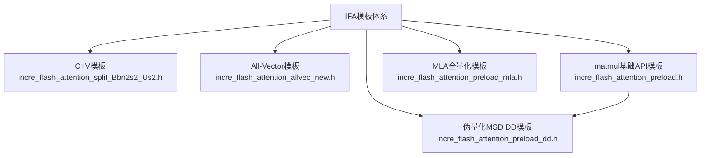

# Ascend C Preload_DD Kernel 模板完全解析

## 一、模板概述

### 1.1 模板定位
**伪量化MSD DD模板**，专用于MTP（Multi-Token Prediction）场景。基于 `incre_flash_attention_preload.h`（matmul基础API模板）开发，使用MSD（Multi-Segment Dequantization）算法优化伪量化场景下的矩阵乘性能。

### 1.2 文件信息
- **源文件**: `incre_flash_attention_preload_dd.h` (3991行)
- **路径**: `attention/incre_flash_attention/op_kernel/arch32/`
- **适用架构**: arch32 (Ascend 910B/310P)
- **所属算子**: 仅支持FIA算子调用，IFA算子不会调用此模板

### 1.3 类定义
```cpp
template <typename IFAT> class IncreFlashAttentionAttenPreloadDD { ... };
```
- 模板参数 `IFAT` 通过 `IFAType` 结构体定义，包含所有编译期类型和配置
- 中间计算数据类型 `T = float`（高精度模式）

### 1.4 与其他模板的关系


### 1.5 核心宏定义 (行35-54)
| 宏 | 值 | 含义 |
|----|-----|------|
| `PRE_LOAD_NUM_DD` | 4 | Workspace预加载乒乓槽数 |
| `EXTRA_NUM` | 6 | ExtraInfo状态数组大小 |
| `TASK_NUM` | 2 | 任务并行深度 |
| `ATTENMASK_STRIDE` | 2048 | Attention Mask行步长 |
| `Q_AMAX_BUF_BYTES` | 2K+256B | Q矩阵Amax buffer大小 |
| `P_AMAX_BUF_BYTES` | 2K+256B | P矩阵Amax buffer大小 |

---

## 二、Tiling切分逻辑详解

### 2.1 Tiling数据结构 (`IncreFlashAttentionTilingData`, tiling.h行141-151)
```cpp
BEGIN_TILING_DATA_DEF(IncreFlashAttentionTilingData)
  TILING_DATA_FIELD_DEF_STRUCT(TCubeTiling,           bmm1TilingData);
  TILING_DATA_FIELD_DEF_STRUCT(TCubeTiling,           bmm2TilingData);
  TILING_DATA_FIELD_DEF_STRUCT(IncreFlashAttentionBaseParams, baseParams);
  TILING_DATA_FIELD_DEF_STRUCT(IncreFlashAttentionSplitKVParams, splitKVParams);
  TILING_DATA_FIELD_DEF_STRUCT(IncreFlashAttentionCoreParams, increFlashAttentionCoreParams);
  TILING_DATA_FIELD_DEF_STRUCT(IncreFlashAttentionSingleCoreParams, increFlashAttentionSingleCoreParams);
  TILING_DATA_FIELD_DEF_STRUCT(IncreFlashAttentionSingleCoreTensorSize, increFlashAttentionSingleCoreTensorSize);
  TILING_DATA_FIELD_DEF_STRUCT(SoftMaxTiling,          softmaxFlashTilingData);
  TILING_DATA_FIELD_DEF_STRUCT(IncreFlashAttentionInitOutputParams, outputParams);
END_TILING_DATA_DEF
```

### 2.2 关键子结构

#### BaseParams (tiling.h行44-87)
| 字段 | 类型 | 说明 |
|------|------|------|
| `batchSize` | uint32_t | Batch大小 |
| `seqSize` | uint32_t | KV序列总长度 |
| `qSeqSize` | uint32_t | Q序列长度 |
| `headSize` | uint32_t | 每个Head的维度 |
| `kvHeadNum` | uint32_t | KV的Head数量 |
| `qHeadNum` | uint32_t | Q的Head数量 |
| `nNumOfQInOneGroup` | uint32_t | GQA的G大小 (qHeadNum/kvHeadNum) |
| `msdIterNum` | uint32_t | MSD反量化迭代次数 |
| `scaleValue` | float | Softmax缩放系数 |
| `antiquantPerTensorFlag` | uint32_t | 反量化per-tensor标记 |
| `antiquantPerHeadFlag` | uint32_t | 反量化per-head标记 |
| `softmaxLseFlag` | uint32_t | 是否输出LSE |
| `attenMaskFlag` | uint32_t | 是否启用Attention Mask |
| `kvPaddingFlag` | uint32_t | KV左padding标记 |

#### SingleCoreParams (tiling.h行114-124)
| 字段 | 类型 | 说明 |
|------|------|------|
| `sInnerLoopTimes` | uint32_t | 每Core内S方向循环次数 |
| `singleProcessSInnerSize` | uint32_t | 每次处理S方向大小 |
| `singleProcessSInnerSizeTail` | uint32_t | 尾块S方向大小 |
| `usedCoreNum` | uint32_t | 实际使用的Core数量 |
| `groupSplitSize` | uint32_t | G轴切块大小Gi |
| `s1SplitSize` | uint32_t | S1轴切块大小Si |

#### CoreParams (tiling.h行90-95)
| 字段 | 类型 | 说明 |
|------|------|------|
| `coreSidxEnd[50]` | uint32_t[50] | 每个Core的Block分界点数组 |

### 2.3 核间切分逻辑

#### BN2S2切分（普通模式）
总块数为 BN2 × S2(SplitKV)，切分给 usedCoreNum 个Core：
- 使用 `coreSidxEnd[50]` 数组，每个Core取 `coreSidxEnd[i]` 到 `coreSidxEnd[i+1]` 之间的块
- `beforeBlockSplitBn2Nums = coreSidxEnd[aiCoreIdx]`
- `bn2LoopTimes = coreSidxEnd[aiCoreIdx + 1] - coreSidxEnd[aiCoreIdx]`

#### FlashDecode切分
当S2轴被外切到不同Core时，需要FlashDecode合并：
- `bIdx = aiCoreIdx / (kvHeadNum * splitKVNum)`
- `n2Idx = (aiCoreIdx / splitKVNum) % kvHeadNum`
- `s2IdxFD = aiCoreIdx % splitKVNum`

### 2.4 GetBN2Gid 函数 (行786-805)
从全局Block ID反推 (b, n2, g/s1, s2) 索引：

```
// BNSD Layout:
bIdx = (beforeBlockSplitBn2Nums + bn2gIdx) / (kvHeadNum * gOuter)
gIdx = (beforeBlockSplitBn2Nums + bn2gIdx) % (kvHeadNum * gOuter) % gOuter
n2Idx = ((beforeBlockSplitBn2Nums + bn2gIdx) % (kvHeadNum * gOuter)) / gOuter

// BSH/BSND/TND Layout:
bIdx = (beforeBlockSplitBn2Nums + bn2gIdx) / (kvHeadNum * s1Outer)
s1Idx = ((beforeBlockSplitBn2Nums + bn2gIdx) % (kvHeadNum * s1Outer)) / kvHeadNum
n2Idx = ((beforeBlockSplitBn2Nums + bn2gIdx) % (kvHeadNum * s1Outer)) % kvHeadNum
```

### 2.5 核内S2轴切分（FlashAttention过程）
通过 `UpdateInnerLoopCond()` (行815-843) 动态计算：
- `sInnerLoopTimes`：当前Block的S方向切分份数
- `singleProcessSInnerSizeTail`：最后一份的S大小
- 根据 `curActualSeqLen`（当前KV实际长度）和 `singleProcessSInnerSize` 反推

---

## 三、Workspace计算逻辑详解

### 3.1 dbWorkspaceRatio = PRE_LOAD_NUM_DD = 4

Workspace采用乒乓（Ping-Pong）机制，每个Core的中间结果有4份轮转存储空间。

### 3.2 Init() 函数中 workspace 完整分配 (行882-1004)

```
Workspace布局：
┌─────────────────────────────────────────────────────────────────────┐
│ Segment 1: queryPreProcessResGm ← workspace + offset               │
│   size = GetBlockNum() * 4 * bmm2ResUbSize * sizeof(KV_T)          │
│   每Core有 4 * bmm2ResUbSize 个元素                                │
│   (仅ANTIQUANT且非KVINT4时分配，KVINT4时size>>1)                    │
├─────────────────────────────────────────────────────────────────────┤
│ Segment 2: mm1ResGm ← workspace + offset                           │
│   size = GetBlockNum() * 4 * mmResUbSize * sizeof(MM_OUT_T)        │
│   存储 BMM1 (Q×K^T) 的中间结果，类型为 MM_OUT_T                     │
├─────────────────────────────────────────────────────────────────────┤
│ Segment 3: vec1ResGm ← workspace + offset                          │
│   size = GetBlockNum() * 4 * mmResUbSize * sizeof(KV_T)            │
│   存储 Softmax + Mask 处理后的结果                                  │
├─────────────────────────────────────────────────────────────────────┤
│ Segment 4: mm2ResGm ← workspace + offset                           │
│   size = GetBlockNum() * 4 * bmm2ResUbSize * sizeof(MM_OUT_T)      │
│   存储 BMM2 (P×V) 的中间结果                                       │
├─────────────────────────────────────────────────────────────────────┤
│ Segment 5: vec2ResGm ← workspace + offset                          │
│   size = GetBlockNum() * 4 * bmm2ResUbSize * sizeof(T)             │
│   存储 BMM2反量化后的FlashAttention更新结果                          │
├─────────────────────────────────────────────────────────────────────┤
│ Segment 6: (仅FLASH_DECODE) accumOutGm ← workspace + offset        │
│   size = accumOutSize * sizeof(float)                               │
│   FlashDecode中间累积结果                                           │
├─────────────────────────────────────────────────────────────────────┤
│ Segment 7: (仅FLASH_DECODE) lseSumFdGm + lseMaxFdGm               │
│   size = logSumExpSize * sizeof(float)                              │
│   FlashDecode的LogSumExp                                            │
└─────────────────────────────────────────────────────────────────────┘
```

### 3.3 每Core内乒乓访问模式
```
Core[i] 的 4 份数据在workspace中的布局：
  Workspace + segment_base + aiCoreIdx * segment_size_per_core

访问时使用 dbWorkspaceRatio 取模：
  slot = loop % PRE_LOAD_NUM_DD  (= loop % 4)
  offset = slot * per_slot_size
```

---

## 四、关键参数计算逻辑

### 4.1 CalcParams函数 (行2654-2760)
填充 `ExtraInfo` 和 `TaskContext` 中的所有参数：

```cpp
// 基础索引
info.bIdx = task.bidx;   // Batch索引
info.s1Idx = task.s1idx; // S1索引
info.s2Idx = task.s2idx; // S2索引 (FlashAttention内循环)
info.n2Idx = task.nidx;  // N2索引 (KV Head)
info.gIdx = task.gidx;   // G轴索引 (GQA)
info.gSize = (gIdx == gOuter-1) ? gSizeTail : gSizeSub; // 当前G块大小

// AIC/AIV分工：mSizeVector为该AIV需要处理的行数
info.mSize = info.gSize * info.s1Size;     // 总行数
info.mSizeV = (info.mSize + 1) / 2;       // 前一半给V0
info.mSizeVStart = (tmpBlockIdx % 2 == 1) ? info.mSizeV : 0; // V1从中间开始

// Tensor偏移
info.tensorAOffset  // Query矩阵偏移 (BSH/BSND/TND时通过GetQueryOffSetBySIdx计算)
info.tensorBOffset  // Key/Value矩阵偏移 (BNSD/BSH分别计算)
info.attenOutOffset // 输出偏移（同tensorAOffset）

// S2分段
info.actualSingleProcessSInnerSize = (isLast) ? s2SizeTail : singleProcessSInnerSize;
info.actualSingleProcessSInnerSizeAlign = Align(actualSize, BYTE_BLOCK);

// 反量化参数偏移
info.antiqKeyParamOffset   = perTensor ? 0 : perHead ? n2Idx : n2Idx * headDim;
info.antiqValueParamOffset = perTensor ? 0 : perHead ? n2Idx : n2Idx * headDim;
```

### 4.2 G轴切分计算 (行614-616)
```cpp
gSizeSub  = tilingData->singleCoreParams.groupSplitSize;  // G切块大小
gOuter    = (gSize + gSizeSub - 1) / gSizeSub;             // G切分份数
gSizeTail = gSize - (gOuter - 1) * gSizeSub;               // G尾块大小
```

### 4.3 S1轴切分计算 (行617-619)
```cpp
s1SizeSub  = tilingData->singleCoreParams.s1SplitSize;    // S1切块大小
s1Outer    = (qSeqSize + s1SizeSub - 1) / s1SizeSub;      // S1切分份数
s1SizeTail = qSeqSize - (s1Outer - 1) * s1SizeSub;         // S1尾块大小
```

### 4.4 actualSeqLen获取 (行761-783)
三种来源：
- **ListTensor**: KV batch不连续时，通过 `SeqLenFromTensorList(bIdx)` 获取TensorList中第bIdx个Tensor的S轴维度
- **Tensor**: 通过 `actualSeqLengthsGm.GetValue(bIdx)` 获取
- **固定长度**: 当 actualLenDims==0 时，curActualSeqLen = kvSeqSize

### 4.5 curActualSeqLen 对后续流程的影响
1. `UpdateInnerLoopCond()`: 决定S方向切分次数
2. `IsSkipAttenMask()`: 决定是否需要Mask
3. `DealActSeqLenIsZero()`: 为零时直接输出全零
4. FlashDecode: `actualCombineLoopSize = (curActualSeqLen + sInnerLoopSize - 1) / sInnerLoopSize`

---

## 五、缓存（Buffer）设计

### 5.1 Vector Core (AIV) UB Buffer布局

| Buffer | 大小 | 用途 |
|--------|------|------|
| `inputBuf1` | 32KB | MTE2→V 输入队列1 (Q数据, BMM结果, Mask) |
| `inputBuf2` | 16KB | MTE2→V 输入队列2 (反量化参数) |
| `outputBuf1` | 16KB | V→MTE3 输出队列1 (BMM结果搬出) |
| `outputBuf2` | 8KB | V→MTE3 输出队列2 (LSE搬出) |
| `tmpBuff1` | 32KB | 临时计算空间1 (Q矩阵, BMM1结果) |
| `tmpBuff2` | 32KB | 临时计算空间2 (Softmax工作空间) |
| `tmpBuff3` | 2KB | 临时计算空间3 (RowMax临时) |
| `antiqScaleBuff` | 4KB | 反量化Scale |
| `antiqOffsetBuff` | 4KB | 反量化Offset |
| `qAmaxBuff` | 4×(2K+256B) | Q矩阵Amax (乒乓) |
| `softmaxResAmaxBuff` | 4×(2K+256B) | P矩阵Amax (乒乓) |
| `softmaxMaxBuff` | 4×512B | Softmax Max (乒乓) |
| `softmaxExpBuff` | 4×512B | Softmax Exp (乒乓) |
| `softmaxSumBuff` | 4×512B | Softmax Sum (乒乓) |
| `softmaxMaxDefaultBuff` | 512B | 默认Max (-inf) |
| `softmaxSumDefaultBuff` | 512B | 默认Sum (0) |
| `vec2ResBuff` | 16KB | BMM2结果暂存 |

### 5.2 Cube Core (AIC) L1/L0 Buffer布局

#### L1 Buffer
| Buffer | 大小 | 槽数 | 用途 |
|--------|------|------|------|
| `tmpBufL1Q` | 64KB | 1 | Q矩阵 (常驻整个BMM) |
| `tmpBufL1KP` | 3×64KB | 3 | K/P矩阵 (乒乓) |
| `tmpBufL1V` | 4×64KB | 4 | V矩阵 (乒乓) |

#### L0 Buffer (乒乓)
| Buffer | 大小 | 槽数 | 存储位置 | 用途 |
|--------|------|------|----------|------|
| `tmpBufL0A` | 2×32KB | 2 | A2 | matrix A (BMM1:Q, BMM2:P) |
| `tmpBufL0B` | 2×32KB | 2 | B2 | matrix B (BMM1:K^T, BMM2:V) |
| `tmpBufL0C` | 2×64KB | 2 | CO1 | matrix C (BMM结果累加) |

### 5.3 乒乓Buffer工作原理
```
处理Task[0]: slot=0   ──┬── 处理Task[1]: slot=1   ──┬── 处理Task[2]: slot=2
  V: softmax[0] 读/写    │    V: softmax[1] 读/写      │    V: softmax[2] 读/写
  C: Fixpipe→GM[slot0]  │    C: Fixpipe→GM[slot1]     │    C: Fixpipe→GM[slot2]
                          │                               │
  后续V从slot0读取:       │   后续V从slot1读取:           │   后续V从slot2读取:
  inIdx = (prev_loop) % 4│   inIdx = (prev_loop) % 4    │   inIdx = (prev_loop) % 4
```

---

## 六、主流程（Process）详解

### 6.1 Process() 函数 (行3778-3954)

```
Process() 主流程:

1. [AIV] 初始化 All Flag (SYNC_INPUT/OUTPUT_BUF)
2. [AIC] 初始化 All Event (L1, L0, FIX)

3. 外层循环: 遍历 BN2S2 块 (bn2gIdx 0→bn2LoopTimes)
   │
   ├── GetBN2Gid()     : 反推 (b, n2, g, s1) 索引
   ├── GetActualSeqLen(): 获取实际序列长度
   ├── UpdateInnerLoopCond(): 更新S方向切分参数
   │
   └── 内层循环: S方向 (sInnerLoopIdx 0→sInnerLoopTimes)
       │
       ├── [Task填充] 填满 TASK_NUM=2 个Task或到最后一个
       │
       ├── [AIV: V0→C1] QueryPreProcessL() → SetFlag(V0_C1)
       │
       ├── [流水级1: C1→V1] (gloop>0时)
       │   ├── [AIC] WaitFlag(V0_C1) → ComputeMm1() → SetFlag(C1_V1)
       │   └── [AIV] WaitFlag(C1_V1) → ProcessVec1L() → SetFlag(V1_C2)
       │
       └── [流水级2: C2→V2] (gloop>1时)
           ├── [AIC] WaitFlag(V1_C2) → ComputeMm2() → SetFlag(C2_V2)
           └── [AIV] WaitFlag(C2_V2) → ProcessVec2L()

4. [FlashDecode] if FLASH_DECODE:
   ├── SyncAll()
   └── FlashDecodeCompute()
```

### 6.2 N-Buffer流水线原理

```
时间轴 →

Task[0]: V0 ─── C1 ─── V1 ─── C2 ─── V2
Task[1]:        V0 ─── C1 ─── V1 ─── C2 ─── V2
Task[2]:               V0 ─── C1 ─── V1 ─── C2 ─── V2
Task[3]:                      V0 ─── C1 ─── V1 ─── C2 ─── V2

TASK_NUM=2 意味着同时派发2个Task进行流水。N-Buffer即连续N次同一阶段后再切换。
```

### 6.3 TASK_NUM=2 vs PRE_LOAD_NUM_DD=4

| 参数 | 值 | 作用域 |
|------|-----|--------|
| `TASK_NUM` | 2 | 控制AIC/AIV之间流水深度（派发队列长度） |
| `PRE_LOAD_NUM_DD` | 4 | 控制Workspace中间结果预加载槽数 |
| `EXTRA_NUM` | 6 | 控制ExtraInfo循环数组大小 |

关系：PRE_LOAD_NUM_DD ≥ TASK_NUM + 预取深度，保证数据写后不会被过早覆盖。

---

## 七、Cube Core（AIC）函数详解

### 7.1 ComputeMm1 - BMM1 (Q × K^T) (行3065-3299)

```
ComputeMm1 流程:

1. [Q矩阵 Load]   if s2Idx==0:
      CopyInMm1AToL1(L1Q, info)  // GM→L1, ND→NZ转换
      // Q矩阵shape: [msdIterNum * mSize, headDimAlign]

2. [K矩阵Loop]   for nCopyIdx in 0..nCopyTimes:
      CopyInMm1BToL1(L1KP, keyGm)  // 每次加载 nCopyRowCount=512/sizeof(KV_T) 行
      // K矩阵shape: [nCopyRowCount, headDim]

3. [M方向Loop]   for i in 0..mLoopTimes:   // M=msdIterNum*mSize, baseM=64
      LoadData(L0A, L1A[i*baseM*headDimAlign])  // L1→L0

4. [N方向Loop]   for j in 0..nLoopTimes:   // N=nActCopyRowCountAlign, baseN=256
      LoadData(L0B, L1B[baseN*headDimAlign*j])  // L1→L0

5. [MMAD]  Mmad(L0C, L0A, L0B)
      // C[m×n] = A[m×k] × B[n×k]^T

6. [Fixpipe]  输出到 mm1ResGm
      // 量化反变换: int32→fp16 (DEQF16)
      // 使用 AtomicAdd 累加两次迭代结果
```

#### CopyInMm1AToL1 (行2785-2816)
伪量化场景：从 `queryPreProcessResGm` 复制展开后的Q矩阵（ND→NZ转换）
非伪量化：直接从 `queryGm` 复制原始Q

#### CopyInMm1BToL1 (行2818-2904)
将K矩阵从GM通过ND→NZ转置方式拷贝到L1。
- `nCopyRowCount = 512 / sizeof(KV_T)` (即FP16时=256)
- 为避免行偏移超过65535限制，大行距时分多次拷贝

#### Fixpipe结果输出 (行3212-3284)
使用 `Fixpipe` 将int32结果转FP16输出到GM，分为四种情况：
- **mLoopTimes==1**: 2次迭代分别Fixpipe+AtomicAdd
- **isHead**: 单次Fixpipe
- **isTail**: Fixpipe+AtomicAdd (与前面的结果累加)
- **isMid**: 一次输出C1部分，一次AtomicAdd输出C2部分

### 7.2 ComputeMm2 - BMM2 (P × V) (行3546-3776)

```
ComputeMm2 流程:

1. [M方向Loop]   for mCopyIdx in 0..mCopyTimes:  // 每次 mCopyRowCount=128/sizeof(KV_T)
   2. [K方向Loop] for kCopyIdx in 0..kCopyTimes: // 每次 kCopyRowCount=512/sizeof(KV_T)
      2a. [A矩阵] CopyInMm2AToL1(L1KP, vec1ResGm)
          从workspace的 vec1ResGm 加载Softmax后的P矩阵
      2b. [V矩阵] CopyInMm2BToL1(L1V, valueGm)
          加载V矩阵到L1
      2c. [K块Loop] for i in 0..kLoopTimes:  // baseK=128/sizeof(KV_T)
          2c1. LoadDataMm2A(L0A, L1A)  // P矩阵 L1→L0
          2c2. LoadDataWithTranspose(L0B, L1B)  // V矩阵 L1→L0 (带转置)
          2c3. Mmad(L0C, L0A, L0B)
   3. [Fixpipe] 输出 mm2ResGm
```

关键差异：
- BMM1的B矩阵不需要转置（K矩阵在L1中已经按NZ存储，计算时隐式做K^T）
- BMM2的B矩阵需要显式转置（V矩阵GM→L1→L0带转置，因为Mm2做P×V而非P×V^T）

### 7.3 PageAttention支持

两个回调函数在GM→L1阶段支持不连续KV搬运：
- **CopyInMm1BToL1ForPA** (行2906-3043): K矩阵的PageAttention搬运
- **CopyInMm2BToL1ForPA** (行3404-3524): V矩阵的PageAttention搬运

PageAttention核心逻辑：
```
while copyFinishRowCnt < kActCopyRowCount:
    blockIdOffset = curSeqIdx / kvCacheBlockSize
    reaminRowCnt = curSeqIdx % kvCacheBlockSize
    idInBlockTable = blockTableGm[blockTableBaseOffset + blockIdOffset]
    copyRowCnt = min(kvCacheBlockSize - reaminRowCnt, remaining)
    keyOffset = idInBlockTable * kvCacheBlockSize * headDim * kvHeadNum + n2_adjust
    CopyInMm1BToL1ForPA(bL1Tensor, keyOffset, ..., copyFinishRowCnt, copyRowCnt)
    copyFinishRowCnt += copyRowCnt
```

---

## 八、Vector Core（AIV）函数逐行详解

### 8.1 初始化函数

#### Init() (行882-1004)
```
行889: 获取BlockIdx
  889: tmpBlockIdx = GetBlockIdx(); // AIV: 0-47, AIC: 0-23
  891: aiCoreIdx = tmpBlockIdx / 2;  // AIV: 每2个V对应1个C

行897: 初始化Tiling数据
  897: tilingData = tiling;
  899: InitTilingData();

行901-905: 初始化计算参数
  FLASH_DECODE: InitCalcParams()     // bn2LoopTimes = 1
  普通模式:     InitCalcParamsEach() // 从coreSidxEnd数组读取

行907-910: 保存原始指针（用于ListTensor场景）
  908: keyPtr = key;
  909: valuePtr = value;
  910: blocktablePtr = blockTable;

行913-914: 设置Global Buffer（固定形状）
  913: queryGm.SetGlobalBuffer(query);
  914: attentionOutGm.SetGlobalBuffer(attentionOut);

行916-919: batch连续时初始化KV指针
  916-919: if (batchContinuous) { InitKeyGm(0); InitValueGm(0); }

行921-923: 初始化UB/L1 Buffer
  922: InitBuffers();

行925-927: AttentionMask
  926: attenMaskBoolGm.SetGlobalBuffer(attenMask);

行929-937: actualSeqLen, kvPadding, blockTable

行939-945: [AIV] 初始化Softmax UB tensor
  940-944: softmaxMaxUb/SumUb/ExpUb/DefaultUb 获取

行947-1003: Workspace分配 (详见第三章)
```

#### InitTilingData() (行585-638)
```
行587-593: 核参数
  singleProcessSInnerSize, sInnerLoopTimes, singleProcessSInnerSizeTail
  usedCoreNum, formerCoreNum, splitKVNum, sInnerLoopSize

行595-597: Tensor大小
  mmResUbSize: BMM1结果UB大小 (tiling计算)
  bmm2ResUbSize: BMM2结果UB大小 (tiling计算)
  vec1ResUbSize = mmResUbSize * msdIterNum

行599-610: 基础参数
  batchSize, kvHeadNum, qHeadNum, gSize, qSeqSize, kvSeqSize
  headDim, batchContinuous, msdIterNum
  antiquantPerTensorFlag, antiquantPerHeadFlag

行612: headDimAlign = Align(headDim, BYTE_BLOCK)  // 32字节对齐

行614-619: G轴和S1轴切分
  gSizeSub, gOuter, gSizeTail
  s1SizeSub, s1Outer, s1SizeTail

行621-637: Mask/量化/LSE参数
```

#### InitBuffers() (行640-692)
```
[AIV]:
  643: pipe->InitBuffer(inputBuf1, 32K)  // MT2→V 输入
  644: pipe->InitBuffer(inputBuf2, 16K)  // MT2→V 输入
  645: pipe->InitBuffer(outputBuf1, 16K) // V→MT3 输出
  646: pipe->InitBuffer(vec2ResBuff, 16K) // BMM2中间结果暂存
  648: pipe->InitBuffer(outputBuf2, 8K)  // V→MT3 输出
  651-653: 临时buffer: tmpBuff1(32K), tmpBuff2(32K), tmpBuff3(2K)
  656-657: 反量化参数: antiqScaleBuff(4K), antiqOffsetBuff(4K)
  661: qAmaxBuff[4*(2K+256B)]  // Q矩阵Amax, 4份
  662: softmaxResAmaxBuff[4*(2K+256B)]  // P矩阵Amax
  663-665: softmax*Buff[4*512B]  // Max/Exp/Sum各4份
  667-672: softmax*DefaultBuff[512B]  // 默认值

[AIC]:
  676: pipe->InitBuffer(tmpBufL1Q, 64K)  // L1 Q: 1槽
  678-679: pipe->InitBuffer(tmpBufL1KP, 3*64K)  // L1 KP: 3槽
  680-681: pipe->InitBuffer(tmpBufL1V, 4*64K)  // L1 V: 4槽
  683-684: pipe->InitBuffer(tmpBufL0A, 2*32K)  // L0 A: 2槽乒乓
  686-687: pipe->InitBuffer(tmpBufL0B, 2*32K)  // L0 B: 2槽乒乓
  689-690: pipe->InitBuffer(tmpBufL0C, 2*64K)  // L0 C: 2槽乒乓
```

#### InitCalcParamsEach() (行1151-1165)
```
行1156-1162: 从tiling拷贝coreSidxEnd数组到栈上
  // 使用copy_data_align64避免将整个increFlashAttentionCoreParams拷贝到栈
  uint32_t coreSidxEnd[50];
  copy_data_align64(coreSidxEnd, tilingData->coreSidxEnd, sizeof(coreSidxEnd));

行1163: bn2LoopTimes = coreSidxEnd[aiCoreIdx+1] - coreSidxEnd[aiCoreIdx]
行1164: beforeBlockSplitBn2Nums = coreSidxEnd[aiCoreIdx]
```

### 8.2 Q预处理（AntiQuant MSD算法）

#### AntiQuant MSD 算法原理

IFA反量化场景：C = A × (B + offset) × scale，A为FP16/BF16，B为int8。
传统方案需要先反量化B矩阵（数据量大），MSD方案通过变换A矩阵来适配B矩阵。

```
MSD算法步骤 (以2次迭代为例):
1. 将float A分解为 int8:  A ≈ A1 + A2/254
2. AA = [A1, A2] 打包成更大的矩阵
3. CC = AA × B  (int8 × int8，Cube高效计算)
4. C = Reduce(CC) = C1 + C2/254
```

#### CopyAntiqQuery (行1313-1339)
```cpp
// 从GM加载Q矩阵并转换为float
行1318: qTypeElementSize = BYTE_BLOCK / sizeof(Q_T);  // FP16:16, INT8:32
行1322: copyInParams.blockCount = dealRowCount; // 行数
行1323: copyInParams.blockLen = actualColumnCount * sizeof(Q_T); // 实际有效列
行1325: copyInParams.dstStride = (columnCount - actualColumnCount) / qTypeElementSize; // 补齐到对齐
行1327-1330: copyInPadParams 设置右padding
  1333: WaitFlag(V_MTE2, SYNC_INPUT_BUF1_FLAG); // 等待MTE2→V传输完成
  1334: DataCopyPad(inputUb, queryGm[qOffset], copyInParams, copyInPadParams); // GM→UB
  1335: SetFlag(MTE2_V, SYNC_INPUT_BUF1_FLAG); // 通知MTE2可以继续
  1337: Cast(queryCastUb, inputUb, CAST_NONE, dealRowCount*columnCount); // FP16→float
```

#### CopyAntiquantScale (行1229-1263)
```cpp
// 加载反量化Scale参数
行1234: if (antiquantPerHeadFlag || antiquantPerTensorFlag == 1):
  1236-1238: Duplicate(castUb, value, headDimAlign); // per-head/per-tensor: 广播值
行1240-1262: else (per-channel):
  从GM加载headDim个Scale值，使用DataCopyPad进行padding对齐
  1242: qTypeElementSize = BYTE_BLOCK / sizeof(Q_T);
  1257: DataCopyPad(inputUb, srcGm[offset], copyInParams, copyInPadParams);
  1260: Cast(castUb, inputUb, CAST_NONE, headDim); // 转为float
```

#### AbsRowMax (行1342-1353)
```cpp
// 对矩阵每行取绝对值后求行最大值
行1347: Abs(tmpAUb, srcUb, dealRowCount * columnCount); // 逐元素取绝对值
行1348: PipeBarrier<PIPE_V>();
行1350: RowMaxForLongColumnCount(tmpRowMaxUb, tmpAUb, dealRowCount, columnCount, actualColumnCount);
  // 长列归约求行最大值
行1351: PipeBarrier<PIPE_V>();
行1352: Brcb(tmpAMaxRes, tmpRowMaxUb, (dealRowCount+7)/8, {1,8});
  // 广播归约结果，每行1个值扩展到8个 (shape: [dealRowCount, 8])
```

#### AntiquantMatmulPreProcess (行1381-1418)
```cpp
// MSD算法核心：float→多段int8展开
行1386: step = info.mSize * columnCount; // 每个iteration的输出跨度
行1388: calcSize = dealRowCount * columnCount;

// Step1: 求Amax
行1391: AbsRowMax(tmpAMaxRes, srcUb, tmpAFloorUb, dealRowCount, columnCount, actualColumnCount);

// Step2: 计算 antiqCoeff1 / Amax  (127或7.49 / Amax)
行1395: Duplicate(tmpAFloorUb, antiqCoeff1, dealRowCount * BLOCK_ELEMENT_NUM);
行1397: Div(tmpAFloorUb, tmpAFloorUb, tmpAMaxRes, dealRowCount * BLOCK_ELEMENT_NUM);

// Step3: RowScale = A * (antiqCoeff1 / Amax)
行1399: RowMuls(srcUb, srcUb, tmpAFloorUb, dealRowCount, columnCount, actualColumnCount);

// Step4: A_floor = round(A_scaled) 整数部分
行1403: Cast(tmpAFloorUb, srcUb, CAST_ROUND, calcSize);

// Step5: 转为FP16
行1405-1412: 将A_floor和srcUb转为FP16 (通过ReinterpretCast)

// Step6: MSD迭代展开
行1415-1417: for i in 0..msdIterNum:
  AntiquantAIterExpand(dstGm, srcUbFp16, tmpAFloorUbFp16, calcSize, isFirst, offset);
  // iteration 0: A0 = A_floor (整数部分)
  // iteration 1: A1 = round((A - A0) * expandCoeff) (小数部分放大)
```

#### AntiquantAIterExpand (行1356-1379)
```cpp
// 单次迭代展开并写出到GM
行1361-1366:
  if (!isFirst):
    Sub(tmpA2, tmpA1, tmpA2, calcSize); // A_frac = A - A_int
    Muls(tmpA2, tmpA2, antiquantExpandCoeff, calcSize); // 放大: *254(KV8)或*14.98(KV4)

行1368-1370:
  Cast(aResOutUbI8, tmpA2, CAST_ROUND, calcSize); // 转为int8

行1373-1377: DataCopy写到GM
  KVINT4: DataCopy(dstGm[outOffset], aResOutUbI8, calcSize >> 1); // int4需要减半
  otherwise: DataCopy(dstGm[outOffset], aResOutUbI8, calcSize);
```

#### QueryPreProcessInner (行1553-1583)
```cpp
// Q预处理入口，按M方向切分处理
行1555-1557: if (!info.isFirstSInnerLoop) return; // 只在第一个S循环做Q预处理

行1560-1563: [per_channel] 加载反量化Scale/Offset
  CopyAntiquantScale(antiqScaleUb, keyAntiqScaleGm, antiqKeyParamOffset);

行1566-1569: 计算M方向切分
  mSplitSize = BASE_BLOCK_MAX_ELEMENT_NUM / headDimAlign; // 32768/4/headDimAlign
  if (mSplitSize > mSizeVector) mSplitSize = mSizeVector;

行1573-1582: 循环处理各子块
  for i in 0..loopCount:
    [per_channel]: DealQueryPreProcessBaseBlock(info, startRow, dealSize, headDimAlign, headDim)
    [per_token]:   DealQueryPreProcessBaseBlockPerToken(...)
```

### 8.3 AttnMask处理

#### AttenMaskCopyIn (两个重载)

**(1) 简单模式** (行1168-1197) - Q的S=1时使用
```cpp
行1172-1174: maskUb = inputBuf1.Get<bool>(); maskUb.SetSize(dealRowCount * attenMaskSizeAlign);
行1175: WaitFlag(V_MTE2, SYNC_INPUT_BUF1_FLAG);
#if __CCE_AICORE__ > 200:
  行1177-1179: 列对齐时直接用DataCopy
  行1180-1191: 非对齐时用DataCopyPad补齐
#else:
  行1194: DataCopy(maskUb, attenMaskBoolGm[offset], attenMaskSizeAlign);
行1196: SetFlag(MTE2_V, SYNC_INPUT_BUF1_FLAG);
```

**(2) 复杂模式** (行1199-1227) - BNSD Layout的Mask，需要计算二维偏移
```cpp
// 计算Mask在GM中的偏移，处理s1Idx和s2Idx的交错关系
行1204-1211: delta = s1Idx*s1SizeSub - s2Idx*singleProcessSInnerSize + s2Size - actSeqLenQ
  if delta < 0: offset = min(-delta, s1Size)   // 列偏移（Mask行方向）
  else: offset = min(delta, singleProcessSInnerSize) * ATTENMASK_STRIDE // 行偏移

行1214: attenMaskSizeAlign = Align(actualSingleProcessSInnerSize, 32U);
行1217-1220: DataCopyParams 设置为块拷贝
  1224: DataCopy(maskUb, attenMaskBoolGm[offset], dataCopyParams);
```

#### IsSkipAttenMask (行1833-1860)
```cpp
// 判断是否可以跳过AttentionMask
行1837-1839: s2Size < actualSeqQ → 必然需要Mask

行1845-1848: s2的位置不超过需要Mask的位置 → 跳过
  s2EndPos = s2Idx*singleProcessSInnerSize + actualSingleProcessSInnerSize
  if s2EndPos <= (s2Size - actualSeqQ + 1): return true;

行1851-1858: [BSH/BSND/TND] 当处理最后一个S1且G已切分完时跳过
```

#### ElewiseCompute (行1862-2006)
```cpp
// 逐元素计算: Scale + SelectWithBytesMask
行1868-1871: [非ANTIQUANT] Muls(mmResUb, mmResUb, scaleValue); // QK^T 乘以缩放系数

行1874-2005: [attenMask]
  行1876-1883: Q S=1 时简单拷贝mask（deploy场景）
  行1884-1987: 复杂场景
    BNSD: 从二维mask中按s1/g关系提取对应行
    BSH/BSND/TND: 用SetVectorMask+MaskCopy做高效切片
  行1992-1999: SelectWithBytesMask(mmResUb, mmResUb, BOOL_ATTEN_MASK_SCALAR_VALUE, maskUb, ...)
    // mask=true的位置替换为 -1e12
```

### 8.4 SoftmaxFlashV2

#### SoftmaxFlashV2Compute (行2008-2045)
```cpp
行2018: SoftMaxShapeInfo srcShape{dealRowCount, columnCount, dealRowCount, actualColumnCount};

行2020: SoftMaxTiling newTiling = SoftMaxFlashV2TilingFunc(srcShape, ...);

行2024-2032: 确定输入max/sum
  isFirstSInnerLoop: inMax = softmaxMaxDefaultUb (-inf), inSum = softmaxSumDefaultUb (0)
  else:              inMax = softmaxMaxUb[prevIdx], inSum = softmaxSumUb[prevIdx]

行2034-2044: 调用SoftmaxFlashV2 API
  输出: softmaxSumUb[outIdx], softmaxMaxUb[outIdx], softmaxExpUb[outIdx]
  输入: mmResUb (in/out, 原地操作)
```

**FlashSoftmax 差分公式**:
```
new_max = max(old_max, row_max(x_i))
exp_factor = exp(old_max - new_max)
new_sum = old_sum * exp_factor + sum(exp(x_i - new_max))
output_i = (output_{i-1} * exp_factor + exp(x_i - new_max) * V_i) / new_sum
```

### 8.5 BMM结果反量化（Combine）

#### AntiquantMatmulResCombineDD (行2267-2285)
```cpp
// DD版本: 从GM加载BMM结果(FP16)→转为float→乘以scaleC
行2273: copySize = dealRowCount * columnCount;
行2275-2277: 输入q: DataCopy(tmpMMRes, srcGm[baseOffset], copySize);
行2280: Cast(bmmResUb, tmpMMRes, CAST_NONE, copySize); // FP16→float
行2283: Muls(bmmResUb, bmmResUb, scaleC, copySize); // ×scaleC

// BMM1时 scaleC = scaleC1 * scaleValue = (1024.0/127) * scaleValue
// 即量化系数转换: 1/(1024*127) * scale → 实际缩放
```

#### DealAntiqBmm1ResBaseBlock (行2288-2312)
```cpp
// 反量化BMM1结果: per-channel模式
行2293-2295: AntiquantMatmulResCombineDD + ElewiseCompute

行2297-2298: RowMuls(mmResUb, mmResUb, aMax, ...); // ×Amax (还原缩放)

行2302-2305: ElewiseCompute + SoftmaxFlashV2Compute
  // Scale, Mask, Softmax 连续执行

行2309-2311: AntiquantSoftmaxResPreProcess
  // Softmax结果反预处理: ×antiqCoeff1 后再MSD展开
```

#### DealAntiqBmm1ResBaseBlockPerToken (行2314-2351)
```cpp
// per-token模式: 需要在Softmax前后都乘以per-token的scale
行2319-2321: AntiquantMatmulResCombineDD + RowMuls(×Amax)

行2326-2331: [per-token key scale]
  CopyAntiquantParamsPerToken(keyAntiqScaleGm, ...);
  VecMulMat(mmResUb, antiqScalePerTokenUb, mmResUb, ...); // ×keyScale

行2334-2337: ElewiseCompute + SoftmaxFlashV2Compute

行2340-2344: [per-token value scale]
  CopyAntiquantParamsPerToken(valueAntiqScaleGm, ...);
  VecMulMat(mmResUb, antiqScalePerTokenUb, mmResUb, ...); // ×valueScale

行2348-2350: AntiquantMatmulPreProcess (对×scale后的结果做MSD展开)
```

### 8.6 Vector计算流程

#### ProcessVec1L / ProcessVec1Inner (行2772-2395)
```cpp
ProcessVec1L(info): // 入口
  if (mSizeVector == 0) return; // AIV无数据则跳过
  ProcessVec1Inner(info);

ProcessVec1Inner(info):
  mSplitSize = BASE_BLOCK_MAX_ELEMENT_NUM / actualSingleProcessSInnerSizeAlign;
  // 按M方向切分处理
  for each sub-block:
    [ANTIQUANT_PER_CHANNEL]: DealAntiqBmm1ResBaseBlock     // per-channel反量化+Softmax
    [ANTIQUANT_PER_TOKEN]:   DealAntiqBmm1ResBaseBlockPerToken // per-token反量化+Softmax
    [非反量化]:              DealBmm1ResBaseBlock             // 普通Scale+Mask+Softmax

  // FlashDecode时: 最后一个S2循环时保存LSE到GM
  if FLASH_DECODE && isLastS2:
    ComputeLogSumExpAndCopyToGm(sumTensor, maxTensor);
```

#### ProcessVec2L / ProcessVec2Inner (行2762-2640)
```cpp
ProcessVec2L(info): // 入口
  if (mSizeVector == 0) return;
  ProcessVec2Inner(info);

ProcessVec2Inner(info):
  mSplitSize = BASE_BLOCK_MAX_ELEMENT_NUM / headDimAlign;
  for each sub-block:
    [ANTIQUANT_PER_CHANNEL]: DealAntiqBmm2ResBaseBlock
    [ANTIQUANT_PER_TOKEN]:   DealAntiqBmm2ResBaseBlockPerToken
```

#### DealAntiqBmm2ResBaseBlock (行2397-2493)
```cpp
// per-channel BMM2结果处理
行2407-2409: AntiquantMM2ResCombine → 从GM加载BMM2结果(FP16)

行2415-2452: [s2Idx > 0] FlashAttention更新
  // Step1: Load上一次的中间结果 vec2ResUb → bmm2ResPreUb
  // Step2: 将softmaxExp转为FP16并broadcast
  // Step3: prevRes = prevRes * softmaxExp (更新因子)
  // Step4: bmm2Res += prevRes (累加)

行2455-2493: 最后一次循环或中间存储
  if isLastS2:
    // 转为float, 除以softmaxSum, 加上offset, 乘以scaleC2和valueScale
    Cast(bmm2ResUbFp32, bmm2ResUb);
    RowDivs(bmm2ResUbFp32, bmm2ResUbFp32, softmaxSum); // /sum
    VecAddMat(bmm2ResUbFp32, antiqOffsetUb, bmm2ResUbFp32); // +offset
    Muls(bmm2ResUbFp32, bmm2ResUbFp32, scaleC2); // ×scaleC2
    VecMulMat(bmm2ResUbFp32, antiqScaleUb, bmm2ResUbFp32); // ×valueScale
    Bmm2ResCopyOut(info, bmm2ResUbFp32, ...); // 输出到GM
  else:
    DataCopy(vec2ResUb, bmm2ResUb); // 暂存到UB
```

### 8.7 输出（Output）

#### Bmm2CastAndCopyOut (行2189-2217)
```cpp
行2194-2206: [非POST_QUANT]
  Cast(tmpBmm2ResCastTensor, bmm2ResUb, CAST_ROUND/CAST_RINT); // float→OUT_T
  DealInvalidRows(); // 处理无效行（填充0）
  Bmm2DataCopyOutNcon(info, tmpBmm2ResCastTensor, ...); // 按Layout搬出到GM

行2207-2216: [POST_QUANT] (int8输出)
  PostQuant(); // 后量化
  Bmm2DataCopyOut(); // 搬出到GM
```

#### Bmm2DataCopyOutNcon (行2085-2126)
```cpp
// 非连续Layout的输出（BSH/BSND/TND）
行2090-2118: 当kvHeadNum!=1且gOuter==1时:
  按S1轴逐个写出，每个S1可能需要跨越到不同位置
  使用 GetQueryOffSetBySIdx 计算每个S1的输出偏移
行2121-2125: 其他情况:
  Bmm2DataCopyOut(attenOutOffset, attenOutUb, ...);
```

#### DealInvalidRows (行2128-2173)
```cpp
// 处理Attention输出中的无效行（s1Idx超过actSeqLenQ的行）
行2135-2137: 无需处理的条件直接返回
行2139: s1Tok = actSeqLenQ - s2Size; // S1中需要mask的token数

行2141-2155: [BNSD Layout]
  遍历dealRowCount，遇到s1 < s1Tok的行填充0

行2156-2172: [BSH/TND Layout]
  遍历dealRowCount，通过gIdx和s1Idx判定是否需填充0
```

---

## 九、FlashDecode流程详解

### 9.1 FlashDecodeCompute (行1787-1812)
```cpp
行1789-1790: bIdx = tmpBlockIdx / kvHeadNum; n2Idx = tmpBlockIdx % kvHeadNum;
行1791: attenOutOffset = bIdx * kvHeadNum * gSize * headDim + n2Idx * gSize * headDim;
行1794-1796: if (tmpBlockIdx >= batchSize * kvHeadNum) return; // 多余的Core跳过

行1798-1807: 获取actualSeqLen
行1809: actualCombineLoopSize = (curActualSeqLen + sInnerLoopSize - 1) / sInnerLoopSize;

行1811: CombineSplitKVRes(); // 核心合并函数
```

### 9.2 CombineSplitKVRes (行1752-1785)
```cpp
// 合并SplitKV的结果
行1755-1761: 计算G轴切分
  gSplitSize = min(BUFFER_16K/(32*splitKVNum), BASE_BLOCK_MAX_ELEMENT_NUM/headDimAlign, gSize);

行1764-1783: 循环处理每个G子块
  for each gSubBlock:
    CopyLseIn(startRow, gSplitSize); // 加载LSE (LogSumExp)
    ComputeScaleValue(lseSum, lseMax, ...); // 计算scale

    // Scale公式: scale[i] = exp(lseMax[i]) / sum(exp(lseMax[j]))
    // 其中 lseMax 是每个split的最大值, lseSum = exp(lseMax[i]) 归一化

    ReduceFinalRes(tmp1, lseSum, ...); // 加权求和: O = Σ O_j * scale_j
    CopyFinalResOut(tmp1, ...); // 输出最终结果
```

### 9.3 ComputeScaleValue (行1633-1670)
```cpp
// 计算FlashDecode的scale值
行1642-1648: 找所有split的全局最大值
  Duplicate(lseMaxUb, -FLOAT_MAX);
  for each split: Max(lseMaxUb, lseMaxUb, lseMax[i*...], ...);

行1649-1652: 计算 lseExp[i] = exp(lseMax[i] - lseMaxUb)
  Sub(lseExpUb, lseMax, lseMaxUb);
  Exp(lseExpUb, lseExpUb);

行1657-1663: 计算 sum = Σ exp(lseExpUb)
  Mul(lseSum, lseSum, lseExpUb); // 用lseSum存储中间
  for each split: Add(lseSumUb, lseSumUb, lseSum[i*...]);

行1665-1668: 归一化: lseSum[i] = lseSum[i] / lseSumUb
  // 最终 scale[i] = exp(lseMax[i] - globalMax) / Σexp(lseMax[j] - globalMax)
```

### 9.4 ReduceFinalRes (行1673-1717)
```cpp
// 加权求和: O_final = Σ O_j * scale_j
行1687-1698: 第一次迭代: dst = O_0 * scale_0
  CopyAccumOutIn(0, startRow, dealRowCount);
  Mul(dst, lseLocal, accumOutLocal, ...);

行1700-1716: 后续迭代: dst += O_j * scale_j
  for j in 1..actualCombineLoopSize:
    CopyAccumOutIn(j, ...);
    Mul(accumOutLocal, lseLocal[j*...], accumOutLocal, ...); // O_j = O_j * scale_j
    Add(dst, dst, accumOutLocal, ...); // dst += O_j
```

### 9.5 CopyFinalResOut (行1719-1750)
```cpp
// 将FlashDecode最终结果输出
行1724-1738: [非POST_QUANT] 类型转换后搬出
  Cast(tmpBmm2ResCastTensor, accumOutLocal, ...); // float→OUT_T
  Bmm2DataCopyOut(attenOutOffset, tmpBmm2ResCastTensor, ...);

行1739-1749: [POST_QUANT] 后量化后搬出
  PostQuant(accumOutLocal, bmm2ResUbInt8, ...);
  Bmm2DataCopyOut(attenOutOffset, bmm2ResUbInt8, ...);
```

---

## 十、Ascend C API 使用大全（附录）

### 10.1 Buffer管理

#### TBuf
- **用途**: 声明UB Tensor Buffer
- **示例**: `TBuf<> inputBuf1;` (行197)
- **注意事项**: TBuf大小由InitBuffer确定，使用前需调用Get<T>()获取LocalTensor

#### PipeBuffer / InitBuffer
- **原型**: `void InitBuffer(TBuf<pos>&, uint32_t byteSize)`
- **用途**: 初始化TBuf的空间大小
- **示例**: `pipe->InitBuffer(inputBuf1, BUFFER_SIZE_BYTE_32K);` (行643)

#### GetAllTBuf / Get
- **原型**: `LocalTensor<T> Get<T>()`
- **用途**: 从TBuf获取可操作的LocalTensor
- **示例**: `softmaxMaxUb = softmaxMaxBuff.Get<T>();` (行940)

#### SetGlobalBuffer
- **原型**: `void SetGlobalBuffer(__gm__ T* ptr, uint64_t size)`
- **用途**: 将Global内存绑定到GlobalTensor
- **示例**: `queryGm.SetGlobalBuffer((__gm__ Q_T *)query);` (行913)

### 10.2 数据搬运

#### DataCopy
- **原型**: `void DataCopy(LocalTensor<T> dst, GlobalTensor<T> src, uint64_t size)`
- **用途**: GM→UB或UB→UB数据拷贝
- **示例**: `DataCopy(maskUb, attenMaskBoolGm[offset], attenMaskSizeAlign);` (行1178)
- **注意事项**: size是元素个数，需确保dst有足够空间

#### DataCopyPad
- **原型**: `void DataCopyPad(LocalTensor<T> dst, GlobalTensor<T> src, DataCopyExtParams, DataCopyPadExtParams<T>)`
- **用途**: 带padding的数据拷贝，不足列用padValue补齐
- **示例**: `DataCopyPad(inputUb, queryGm[qOffset], copyInParams, copyInPadParams);` (行1334)
- **注意事项**: padding数据在写回前不会参与计算

#### DataCopyExtParams
- **字段**: blockCount(行数), blockLen(每行字节数), srcStride, dstStride
- **示例**: 行2049-2068

#### Nd2NzParams
- **用途**: ND格式转NZ格式的参数，用于GM→L1的矩阵搬移
- **关键字段**:
  - `ndNum`: ND矩阵个数
  - `nValue`: 每ND矩阵行数
  - `dValue`: 每ND矩阵列数
  - `srcDValue`: 源ND中相邻行偏移
  - `dstNzC0Stride`: 目标NZ中相邻Block偏移
  - `srcNdMatrixStride`: 相邻ND矩阵偏移
  - `dstNzMatrixStride`: 相邻NZ矩阵偏移
- **示例**: `DataCopy(aL1Tensor, queryPreProcessResGm[...], mm1Nd2NzParamsForA);` (行2810)
- **注意事项**: srcDValue和dstNz*不能超过65535

#### LoadData (L1→L0)
- **原型**: `void LoadData(LocalTensor<T> l0, LocalTensor<T> l1, LoadData2DParams)`
- **示例**: `LoadData(aL0Tensor, aL1Tensor, loadData2DParamsForA);` (行3158)
- **关键参数**: startIndex, repeatTimes, srcStride, dstGap, ifTranspose
- **repeatTimes**: L1→L0每次搬运连续2K数据，repeatTimes控制搬运总次数

#### LoadDataWithTranspose (L1→L0带转置)
- **用途**: BMM2中将V矩阵转置加载到L0
- **示例**: `LoadDataWithTranspose(bL0Tensor, bL1Tensor[l1BaseOffset], params);` (行3672)

#### DataCopyParams
- **字段**: blockCount, blockLen(32B的倍数), srcStride, dstStride
- **示例**: 行1216-1220

### 10.3 算术运算

#### Add
- **原型**: `void Add(LocalTensor<T> dst, LocalTensor<T> src0, LocalTensor<T> src1, uint64_t size)`
- **示例**: `Add(bmm2ResUb, bmm2ResUb, bmm2ResPreUb, vec2ComputeSize);` (行2450)

#### Sub
- **原型**: `void Sub(LocalTensor<T> dst, LocalTensor<T> src0, LocalTensor<T> src1, uint64_t size)`
- **示例**: `Sub(tmpA2, tmpA1, tmpA2, calcSize);` (行1362)

#### Mul / Muls
- **Mul**: `void Mul(dst, src0, src1, mask, repeatTimes, repeatParams)`
- **Muls**: `void Muls(dst, src, scalar, size)` — 逐元素乘标量
- **示例**: `Muls(bmm2ResUbFp32, bmm2ResUbFp32, scaleC2, vec2ComputeSize);` (行2481)
- **RowMuls** (ifa_public_define.h): 每行元素乘以同行的一个标量
- **注意事项**: 使用Repeat模式时，dstRepStride不能超过255

#### Div
- **原型**: `void Div(dst, src0, src1, mask, repeatTimes, repeatParams)`
- **示例**: `Div(tmpAFloorUb, tmpAFloorUb, tmpAMaxRes, dealRowCount * BLOCK_ELEMENT_NUM);` (行1397)

#### Max / Abs / Exp
- **Max**: `Max(lseMaxUb, lseMaxUb, lseMax[i*...], size);` (行1646)
- **Abs**: `Abs(tmpAUb, srcUb, dealRowCount * columnCount);` (行1347)
- **Exp**: `Exp(lseExpUb, lseExpUb, size);` (行1654)

#### Duplicate
- **原型**: `void Duplicate(LocalTensor<T> dst, T scalar, uint64_t size, optional mask, ...)`
- **用途**: 用标量填充Tensor
- **示例**: `Duplicate(softmaxMaxDefaultUb, SOFTMAX_MIN_NUM, SOFTMAX_MAX_BUF_SIZE);` (行3791)
- **掩码用法**: `Duplicate(dst, 0, mask, 1, 1, 8);` (行3985)

### 10.4 精度转换

#### Cast
- **原型**: `void Cast(LocalTensor<DT> dst, LocalTensor<ST> src, RoundMode, uint64_t size)`
- **RoundMode**: CAST_NONE, CAST_ROUND, CAST_RINT
- **示例**: FT→FP16: `Cast(bmm2ResUbFp16, bmm2ResUb, CAST_ROUND, size);`
- **示例**: FP16→FT: `Cast(queryCastUb, inputUb, CAST_NONE, size);`
- **注意事项**: Cast耗时较长，使用PipeBarrier确保完成

#### ReinterpretCast
- **用途**: 零开销类型重解释（不改数据，只改变解释方式）
- **示例**: `LocalTensor<half> srcUbFp16 = srcUb.template ReinterpretCast<half>();` (行1410)

### 10.5 归约操作

#### Brcb (Broadcast)
- **原型**: `void Brcb(LocalTensor<T> dst, LocalTensor<T> src, repeatTimes, DataBlock)`
- **用途**: 广播扩展，将src[0..7]的值重复repeatTimes次
- **示例**: `Brcb(tmpAMaxRes, tmpRowMaxUb, (dealRowCount+7)/8, {1, 8});` (行1352)
- **数据块 `{1,8}`**: 表示src的shape为[1,8]（1个block, 8个元素）

#### RowMaxForLongColumnCount
- **用途**: 计算长列矩阵的行最大值（列数>64时使用）
- **示例**: `RowMaxForLongColumnCount(tmpRowMaxUb, tmpAUb, dealRowCount, columnCount, actualColumnCount);` (行1350)

### 10.6 流水线同步

#### EnQue / DeQue
- **用途**: TBuf队列操作，M/A间流水数据传输

#### WaitFlag / SetFlag
- **原型**: `WaitFlag<HardEvent>(flagNum)` / `SetFlag<HardEvent>(flagNum)`
- **HardEvent类型**:
  - `V_MTE2`: Vector→MTE2
  - `MTE2_V`: MTE2→Vector
  - `MTE3_V`: MTE3→Vector
  - `V_MTE3`: Vector→MTE3
  - `M_MTE1`: Cube→MTE1
  - `MTE1_M`: MTE1→Cube
  - `FIX_M`: FIX→Cube
  - `M_FIX`: Cube→FIX
  - `MTE1_MTE2`: MTE1→MTE2
  - `MTE2_MTE1`: MTE2→MTE1

- **示例**:
```cpp
WaitFlag<HardEvent::V_MTE2>(SYNC_INPUT_BUF1_FLAG); // 等待MTE2→V搬运完成
DataCopy(inputUb, gm[...], size); // 执行搬运
SetFlag<HardEvent::MTE2_V>(SYNC_INPUT_BUF1_FLAG); // 通知MTE2可以继续
```

#### PipeBarrier
- **原型**: `void PipeBarrier<PipeType>()`
- **PipeType**: PIPE_V (Vector), PIPE_M (Cube), PIPE_FIX (Fixpipe)
- **用途**: 确保该Pipeline所有指令完成
- **示例**: `PipeBarrier<PIPE_V>();` 在Cast后必须调用

#### CrossCoreSetFlag / CrossCoreWaitFlag
- **原型**: `CrossCoreSetFlag<SYNC_MODE, PIPE>(flagNum)`
- **SYNC_MODE2=2**: 带pipe_flush的Flag设置
- **用途**: AIC/AIV之间的跨核同步
- **示例**: `CrossCoreSetFlag<SYNC_MODE2, PIPE_MTE3>(SYNC_V0_C1_FLAG);` (行3875)

#### SyncAll
- **用途**: 所有Core同步点，FlashDecode前使用
- **示例**: `SyncAll();` (行3943)

### 10.7 条件操作

#### SelectWithBytesMask
- **原型**: `void SelectWithBytesMask(dst, src0, src1, mask, workspace, shapeInfo)`
- **用途**: mask为true的位置取src1，否则取src0
- **示例**: `SelectWithBytesMask(mmResUb, mmResUb, -1e12, maskUb, workspace, shapeInfo);` (行1999)
- **注意事项**: src0和mask的size需先SetSize为正确大小

#### SetMaskCount / SetVectorMask / SetMaskNorm / ResetMask
- **用途**: 设置/重置向量掩码
- **示例**: 行1960-1985
```cpp
SetMaskCount();
SetVectorMask<int16_t, MaskMode::COUNTER>(attenMaskSizeAlign/2);
Copy<int16_t>(dst, src, MASK_PLACEHOLDER, count, {1, 1, stride, 0});
SetMaskNorm();
ResetMask();
```

### 10.8 MatMul相关

#### Mmad
- **原型**: `void Mmad(LocalTensor<L0C_T> c, LocalTensor<KV_T> a, LocalTensor<KV_T> b, MmadParams)`
- **MmadParams**:
  - `m`: M维度大小
  - `n`: N维度大小
  - `k`: K维度大小
  - `cmatrixInitVal`: 是否初始化累加器为0
  - `cmatrixSource`: 是否从L0C加载初始值
- **示例**: `Mmad(cL0Tensor, aL0Tensor, bL0Tensor, mmadParams);` (行3207)
- **注意事项**: m=1时会默认开GEMV模式，需规避为16

#### Fixpipe
- **原型**: `void Fixpipe(LocalTensor<T> dst, LocalTensor<L0C_T> src, FixpipeParamsV220)`
- **FixpipeParamsV220**:
  - `nSize`, `mSize`: 输出矩阵的M,N
  - `srcStride`: L0C中M方向的行步长(16对齐)
  - `dstStride`: GM中目标行步长
  - `ndNum`: 矩阵个数
  - `quantPre`: 量化模式 (DEQF16: int32→fp16)
  - `deqScalar`: 反量化标量
- **示例**: `Fixpipe(mm1ResGm[offset], cL0Tensor[...], fixParams);` (行3229)
- **注意事项**: L0C数据按16行一组（NZ格式）存储

#### SetAtomicAdd / SetAtomicNone
- **用途**: 设置Fixpipe的原子加模式，多次Fixpipe到同一地址时可以累加
- **示例**: 行3227-3233

### 10.9 SoftmaxFlashV2

#### SoftMaxShapeInfo
- **构造**: `SoftMaxShapeInfo{rows, colSize, rows, actualColSize}`
- **示例**: 行2018

#### SoftMaxTiling
- **获取**: `SoftMaxFlashV2TilingFunc(shape, srcTypeSize, dstTypeSize, workspaceSize, ...)`
- **示例**: 行2019-2020

#### SoftmaxFlashV2
- **模板参数**: `<T, isAmax, isSum, isExp, isBrc, Config>`
  - `isAmax=true`: 输出行最大值
  - `isSum=true`: 输出行和
  - `isExp=true`: 输出exp
- **参数顺序**: `(src, sum, max, dst, exp, inSum, inMax, tmp, tiling, shape)`
- **示例**: 行2035-2038

### 10.10 内存操作

#### copy_data_align64
- **原型**: `void copy_data_align64(uint8_t* dst, uint8_t* src, size_t size)`
- **用途**: 64字节对齐的内存拷贝（编译器优化写法）
- **示例**: `copy_data_align64((uint8_t*)coreSidxEnd, (uint8_t*)tilingData->coreSidxEnd, sizeof(coreSidxEnd));` (行1160)

### 10.11 其他API

#### GetBlockIdx / GetBlockNum
- **用途**: 获取当前Block(Task)编号 / 总Block数
- **示例**: `tmpBlockIdx = GetBlockIdx();` (行890)

#### SetL2CacheHint
- **用途**: 设置L2 Cache模式（关闭KV的L2 Cache节省带宽）
- **示例**: `keyGm.SetL2CacheHint(CacheMode::CACHE_MODE_DISABLE);` (行1017)

#### ListTensorDesc / GetDataPtr
- **用途**: 获取ListTensor中第i个Tensor的数据指针
- **示例**: `key_ = (__gm__ uint8_t*)keyListTensorDesc.GetDataPtr<__gm__ uint8_t>(bIdx);` (行1010)

#### TensorDesc / GetShape / SetShapeAddr
- **用途**: 获取Tensor的形状信息
- **示例**: `keyTensorDesc.GetShape(1);` (行854)

---

## 十一、MAIN() 函数入口

### 11.1 模板实例化
```
IFAType<Q_T, KV_T, OUT_T, ORIGIN_T, pageAttention, flashDecode, layout, antiquantMode, ...>
```

### 11.2 入口函数调用（伪代码）
```cpp
extern "C" __global__ __aicore__ void incre_flash_attention_kernel(
    __gm__ uint8_t *query, __gm__ uint8_t *key, ..., __gm__ uint8_t *workspace, 
    __gm__ uint8_t *tilingGm) {
    
    // 从GM读取tiling数据
    IncreFlashAttentionTilingData tilingData;
    copy_data_align64(&tilingData, tilingGm, sizeof(tilingData));
    
    // 创建模板实例
    IncreFlashAttentionAttenPreloadDD<IFAType<...>> op;
    
    // 初始化
    op.Init(query, key, value, ..., workspace, &tilingData, tilingGm, &pipe);
    
    // 初始化量化参数
    op.InitQuant(deqScale1, quantScale1, ..., workspace);
    
    // 主计算
    op.Process();
}
```

---

## 附录：关键数据流图

```
┌──────────────────────────────────────────────────────────────────────┐
│                         IRFA Preload DD 完整数据流                    │
├──────────────────────────────────────────────────────────────────────┤
│                                                                      │
│  GM(Q)                          GM(K)            GM(V)               │
│    │                              │                │                 │
│    ▼                              ▼                ▼                 │
│  ┌─────────────────┐   ┌─────────────────┐  ┌─────────────────┐     │
│  │  CopyAntiqQuery │   │  CopyInMm1BToL1 │  │  CopyInMm2BToL1 │     │
│  │  + MSD Expand   │   │  (ND→NZ)        │  │  (ND→NZ)        │     │
│  └────────┬────────┘   └────────┬────────┘  └────────┬────────┘     │
│           │                     │                     │              │
│           ▼                     ▼                     │              │
│  ┌─────────────────┐   ┌─────────────────┐            │              │
│  │  queryPreProc   │   │    L1_K (3槽)    │  ┌─────────┴──────┐      │
│  │  ResGm (WS)     │   └────────┬────────┘  │   L1_V (4槽)   │      │
│  └────────┬────────┘            │            └────────┬───────┘      │
│           │                     │                     │              │
│           ▼                     ▼                     │              │
│  ┌──────────────────────────────────┐                 │              │
│  │         ComputeMm1 (BMM1)        │                 │              │
│  │   Q[msd*m, headDim] ×            │                 │              │
│  │   K^T[headDim, s2size]           │                 │              │
│  │   → L0C → Fixpipe → mm1ResGm     │                 │              │
│  └──────────────┬───────────────────┘                 │              │
│                 │                                     │              │
│                 ▼                                     │              │
│  ┌──────────────────────────────────┐                 │              │
│  │        ProcessVec1L (AIV)        │                 │              │
│  │  AntiqCombine + Scale + Mask     │                 │              │
│  │  + SoftmaxFlashV2                │                 │              │
│  │  → vec1ResGm (WS)                │                 │              │
│  └──────────────┬───────────────────┘                 │              │
│                 │                                     │              │
│                 ▼                                     ▼              │
│  ┌────────────────────────────────────────────────────────┐          │
│  │                ComputeMm2 (BMM2)                       │          │
│  │  P[msd*m, s2size] × V[s2size, headDim]                 │          │
│  │  → L0C → Fixpipe → mm2ResGm (WS)                       │          │
│  └─────────────────────┬──────────────────────────────────┘          │
│                        │                                              │
│                        ▼                                              │
│  ┌──────────────────────────────────┐                                │
│  │        ProcessVec2L (AIV)        │                                │
│  │  AntiqCombine + FlashAttn更新    │                                │
│  │  + /sum + ×scale + +offset      │                                │
│  │  → attentionOutGm                │                                │
│  └──────────────────────────────────┘                                │
│                                                                      │
│  [FlashDecode]:                                                      │
│  SyncAll → CombineSplitKVRes → attentionOutGm                        │
│                                                                      │
└──────────────────────────────────────────────────────────────────────┘
```

---

> **文档版本**: v1.0  
> **源码文件**: incre_flash_attention_preload_dd.h (3991行)  
> **生成日期**: 2026-05-12
