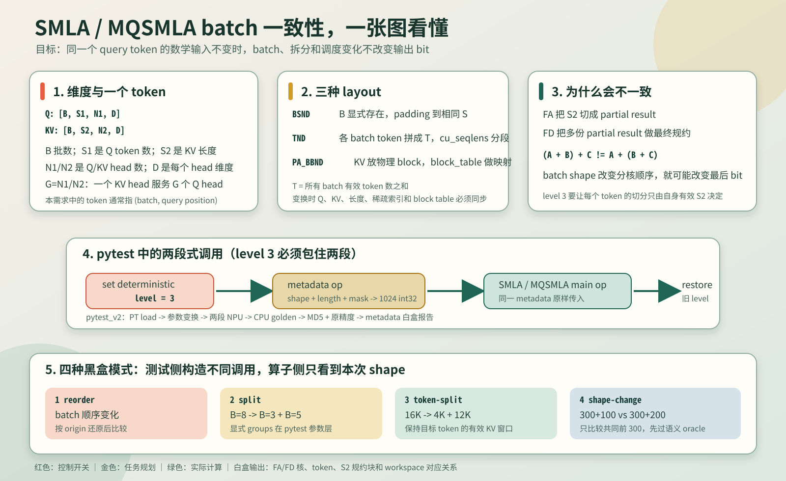
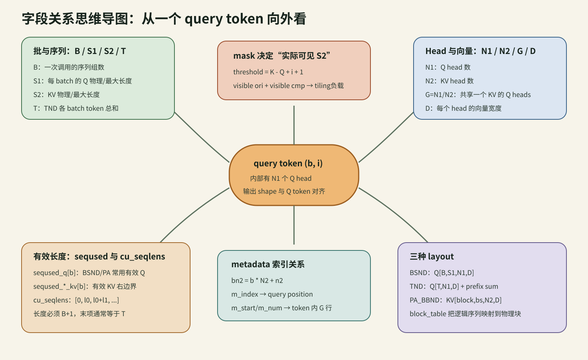
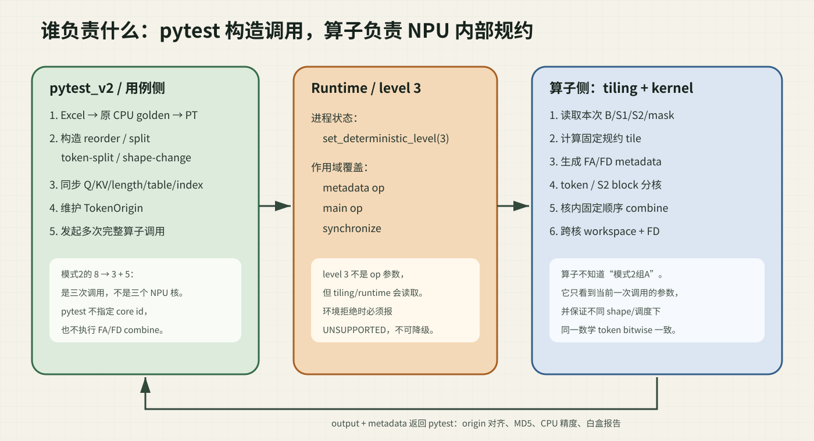
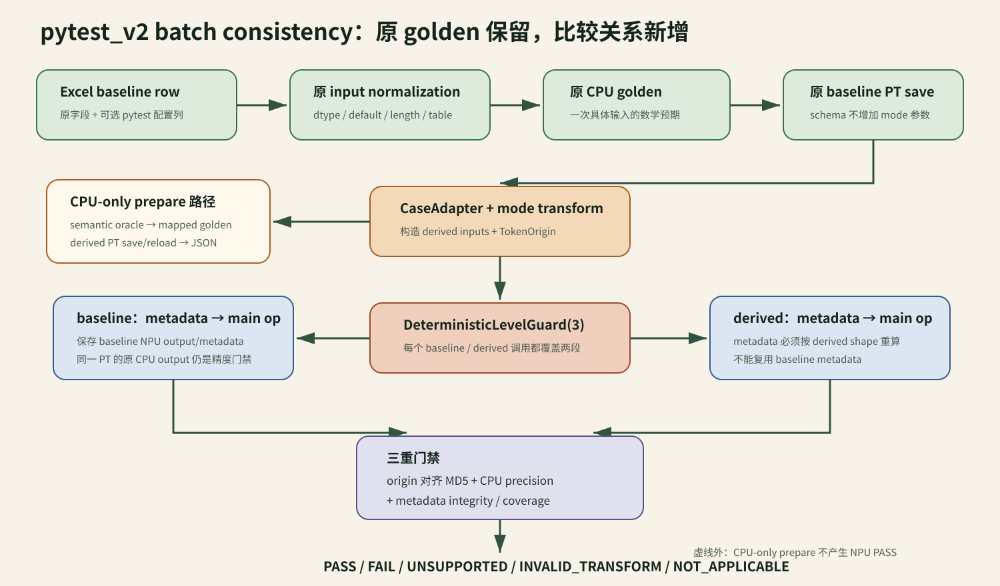
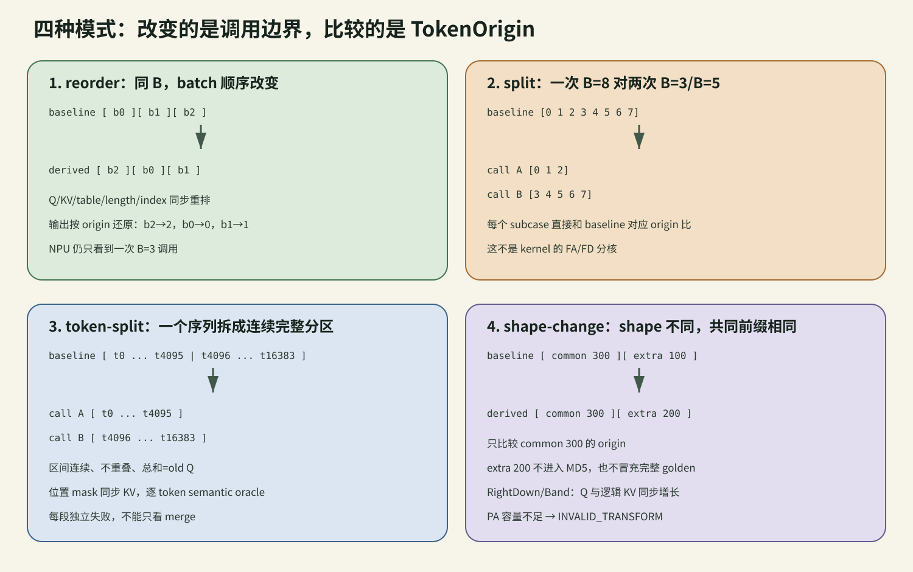
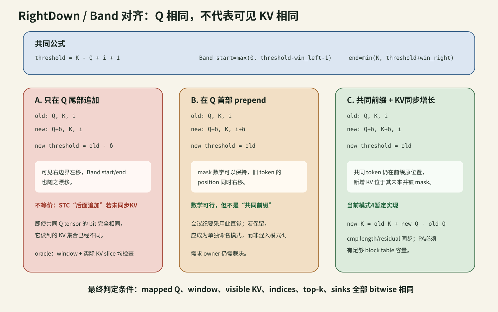

# SMLA / MQSMLA batch 一致性入门教学

> 面向第一次接触 Attention、SMLA 和 MQSMLA 的读者。本文先解释“数据是什么”，再解释
> “算子怎么跑”和“一致性到底在比较什么”。需求裁决仍以 `docs/SMLA batch一致性.md` 为准。



建议第一次阅读按图走，不必先啃源码：

1. 看“字段关系思维导图”，弄清 shape；
2. 看“职责边界”，区分 pytest 拆调用与 NPU 分核；
3. 看“四种模式”，理解哪些 token 在比较；
4. 最后看 mask 对齐和完整数据流。

## 1. 先用一句话理解 Attention

Q（Query）可以理解成“我现在想查什么”，KV（Key/Value）可以理解成“可供查询的历史资料”。
一个 query token 会和自己允许看到的若干 KV token 计算相关度，再把对应 Value 汇总成输出。

```text
一个 Q token
    |
    | 与允许看到的每个 K 做打分
    v
[score_0, score_1, ..., score_S2-1]
    |
    | softmax 后加权汇总 V
    v
一个输出 token
```

不同 query token 的数学计算彼此独立，但算子为了利用 NPU 多核，会把很多 token 的工作一起
调度。batch 一致性要保证：其他 token 或 batch 改变调度时，同一个 token 的数学输入不变，
其输出 bit 也不变。

## 2. B、S1、S2、N1、N2、D、G、T 分别是什么

以常见形状为例：

```text
Q  = [B, S1, N1, D]
KV = [B, S2, N2, D]
```

| 符号 | 通俗解释 | 例子 |
| --- | --- | --- |
| `B` | 一次调用里有多少组互不相干的数据 | `B=8` 表示 8 个 batch |
| `S1` | 每个 batch 中 Q 的 token 数 | `S1=400` 表示 400 个 query token |
| `S2` | 每个 batch 中 KV 的有效 token 数，也是主要规约维 | `S2=16384` |
| `N1` | Q head 数 | `N1=64` |
| `N2` | KV head 数 | 当前常见 `N2=1` |
| `D` | 每个 head 的向量维度 | 当前常见 `D=512` |
| `G` | 一个 KV head 对应多少个 Q head，`G=N1/N2` | `64/1=64` |
| `T` | TND 下所有 batch 的 token 数之和 | 长度 `[2,3,5]` 时 `T=10` |

“一个 token”在本需求中通常指 `(batch_id, query_position)`。它内部仍有 `N1` 个 Q head；
metadata 还会用 `bn2 = batch_id * N2 + n2_id` 表示 batch 与 KV head 的组合。



### 2.1 为什么有 N1 和 N2 两种 head 数

GQA/MQA 会让多个 Q head 共用一个 KV head。例如 `N1=64, N2=1` 时，64 个 Q head 都读取
同一个 KV head，所以 `G=64`。PR8737 当前实现中 `mBaseSize=G`，因此 metadata 的一个
`m_index` 对应一个 query position；FD 的 `m_start/m_num` 则表示该 token 内负责哪些 Q head 行。

## 3. BSND、TND、PA_BBND 是三种怎样的摆放方式

### 3.1 BSND：batch 显式放在第 0 维

```text
Q[B, S1, N1, D]

batch 0: token 0, token 1, ...
batch 1: token 0, token 1, ...
```

不同 batch 的有效长度不同时，物理 tensor 通常按最大 `S1/S2` 补齐，`seqused_q`、
`seqused_ori_kv` 等字段指出真实有效长度。做模式 1/2 时，Q、KV、长度向量和稀疏索引必须
使用同一批 batch id 选择或重排。

### 3.2 TND：把各 batch 的 token 拼成一条长轴

```text
batch 长度: [2, 3, 5]
cu_seqlens: [0, 2, 5, 10]

TND tensor:
[ b0:t0, b0:t1 | b1:t0, b1:t1, b1:t2 | b2:t0 ... b2:t4 ]
```

`cu_seqlens` 是前缀和，长度必须为 `B+1`。模式变换后，除了切 tensor，还必须重新计算
`cu_seqlens`；只改 `B` 而不改前缀和会让算子把 token 归到错误 batch。

### 3.3 PA_BBND：KV 存在分页 block 中

```text
物理 KV cache: [block_num, block_size, N2, D]
block_table[b]: 这个 batch 依次使用哪些物理 block
seqused_kv[b]: 最后实际使用到多少个 KV token
```

模式 1/2 不复制整个物理 cache，只选择或重排 `block_table` 的行。模式 3/4 若要改变逻辑 KV
右边界，必须确认现有 block table 有足够容量；不足时应报 `INVALID_TRANSFORM`，不能越界。

### 3.4 “物理长度”和“有效长度”为什么要分开

以 `Q.shape=[2,8,64,512]`、`seqused_q=[3,5]` 为例：物理上两个 batch 都分配了 8 个位置，
数学上只有前 3、前 5 个有效。后面的 padding 可以是任意 bit，不应进入 MD5。相同道理：

| layout | 物理容量来自 | 有效边界来自 |
| --- | --- | --- |
| BSND Q | `q.shape[1]` | `seqused_q`，未给时才用物理S1 |
| TND Q | `q.shape[0]=T` | `cu_seqlens_q` 的每段，必要时再受 `seqused_q` 限制 |
| BSND KV | `kv.shape[1]` | `seqused_*_kv` |
| TND KV | `kv.shape[0]` 与 prefix slot | `cu_seqlens_*_kv` / `seqused_*_kv` |
| PA KV | `block_num*block_size` | block table可寻址容量 + `seqused_*_kv` |

因此“只改 `B/S1` 数字”远远不够；tensor、长度、table、metadata mirror 字段必须同时变化。

## 4. SMLA 与 MQSMLA 的差别

两者完成相似的稀疏 Attention，都是两段式调用：metadata 前置算子先排任务，主算子再消费
这份任务表。MQSMLA 额外把 KV 量化存储，主要多出 `quant_mode` 和 `rope_head_dim`；其 CPU
golden 还要按量化格式还原数值。因此两套 pytest 的执行器必须分别放在各自算子目录，不能
用 SMLA executor 跑 MQSMLA PT。

```text
SMLA PT                         MQSMLA PT
tensor 容器: input              tensor 容器: op_input
N1/N2/D/B                       num_heads_q/num_heads_kv/head_dim/batch_size
BF16 KV                         量化打包 KV + 对应量化参数
```

## 5. 为什么是 metadata + 主算子两段式

第一段 metadata 不计算最终 Attention，它根据 B、S1、S2、mask、有效长度和核数生成固定
`1024 * int32` 的任务表。第二段主算子读取这份任务表执行 FA/FD。

```text
输入 shape / 长度 / mask
          |
          v
metadata op ---------------> metadata[1024]
                                  |
Q / KV / sparse indices ---------+----> SMLA 或 MQSMLA ----> output
```

level 3 必须在 metadata 调用之前设置，并一直保持到主算子完成。否则可能出现“metadata 按
level 0 排任务、主算子却按 level 3 执行”的错配。执行结束还必须恢复进入测试前的真实 level。



这张图最重要的一点是：模式2的 `B=8 -> B=3+B=5` 是 pytest 发起多次调用；每一次调用内部
如何把 token/S2 block 分给 FA/FD core，仍然完全是算子任务。pytest 的 `split_groups` 不会变成
core id 参数。



## 6. FA、FD、规约块分别是什么

### 6.1 FA：先算局部结果

一个 token 的 S2 很长时，会切成多个规约块。每个 FA 任务处理一个 S2 区间，产生局部
`max/sum/output`。需求文档期望的 level-3 规约块大小是：

```text
actual_S2 = 当前 token 实际可见的 ori token + cmp token
R = align_up(ceil(actual_S2 / 32), 128)
规约块数 = ceil(ori_visible / R) + ceil(cmp_visible / R)
```

这里的 metadata `s2_start/s2_end` 是规约块索引的闭开区间，不是原始 KV token 下标。

但 PR8737 head `31a3b6d3` 的 C++ 当前先做整数 `actual_S2 / 32`，也就是 floor，而不是 ceil。
例如4097会得到128而不是256；1..31还会出现0 tile表达式。白盒报告同时列两套公式和冲突，
结构展开暂按PR head并对0加保护。这个问题尚待tiling owner裁决，不能把文档公式写成已确认实现。

### 6.2 FD：合并跨核局部结果

若同一 token 的规约块落在多个 FA 核上，就需要 FD 汇总。metadata 中：

| 字段 | 含义 |
| --- | --- |
| `bn2_index` | `batch*N2+n2` |
| `m_index` | 当前 query position 对应的 S1G/M 基本块 |
| `workspace_index` | partial result 在 workspace 的起点 |
| `workspace_num` | 该 token 一共有多少个规约块需要合并 |
| `m_start/m_num` | 这个 AIV 核负责 token 内哪段 G/head 行 |

白盒分析会把 36 个 FA record 和 72 个 FD record 展开为 token -> core -> S2 block -> workspace
关系，并自动报告单核、跨核和核内多 token 组合是否覆盖。

## 7. 四种黑盒模式究竟在做什么



### 模式 1：reorder

同一组 batch 改变顺序，所有相关输入同步重排。输出按 `TokenOrigin` 还原后比较。

### 模式 2：split

基准 `B=8` 一次调用，派生为独立的 `B=3` 与 `B=5` 两次调用：

```text
baseline: [0,1,2,3,4,5,6,7]
call A:   [0,1,2]
call B:   [3,4,5,6,7]
```

这个 groups 明确由 pytest 参数处理层构造。算子只看到本次调用的 `B=3` 或 `B=5`，不会读取
pytest seed，也不知道自己属于某次“拆分”。seed 只用于显式 fuzz，不是算子调度参数。

### 模式 3：token-split

主需求示例把 `B=1, Token=16K` 拆成 `4K + 12K` 两次调用。对 no-mask，Q token 互相
独立，直接选取区间即可。对 RightDownCausal/Band，mask 使用：

```text
threshold = ori_S2 - Q_length + query_position + 1
```

因此不能只截 Q。`pytest_v2` 对原区间 `[start,end)` 使用：

```text
new_ori_S2 = old_ori_S2 - old_Q_length + end
```

这样新位置 `query_position-start` 看到的 KV 窗口与原 token 完全相同。cmp 长度与 residual
也按 `cmp_ratio` 同步，随后实际输入语义 oracle 再逐 token 检查 Q、KV 窗口和稀疏索引。

### 模式 4：shape-change

主需求示例比较 `300+100` 与 `300+200` 的共同前 300 token。单纯在 Q 尾部追加 100 token
会改变右下角 mask 的 threshold，数学输入不再相同。`pytest_v2` 采用主需求的“共同前缀”作为
比较对象，同时让逻辑 ori KV 右边界与 Q 一起变化：

```text
new_ori_S2 = old_ori_S2 + (new_Q_length - old_Q_length)
```

这使 `ori_S2-Q_length` 保持不变，新增 KV 位于共同 token 的未来并被 mask 掉。若 layout 容量、
cmp 关系或实际可见 KV 不能证明一致，case 报 `INVALID_TRANSFORM`，不会伪装成算子失败。



图中的 prepend 并非数学上必错：旧 token 位置同步右移时 threshold 可以保持。它的问题是语义上
不再属于两个输入的“共同前缀”。尾部只加 Q 才是明确不等价；当前方案让 Q 与逻辑 KV 同步增长。
更详细的资料冲突、Band start/end公式和待确认问题见 `SMLA_MQSMLA需求冲突与对齐清单.md`。

## 8. 一致性为什么同时检查 MD5 和原精度

| 检查 | 回答的问题 |
| --- | --- |
| NPU baseline vs NPU derived 的 MD5 | 是否逐 bit 一致 |
| NPU baseline/derived vs CPU golden | 是否虽然一样但一起算错了 |
| metadata integrity | 任务链、FD workspace 和 token/core 映射是否合法 |

padding 不属于有效 token，不能参与 MD5。模式 2/3/4 只把有 `TokenOrigin` 的有效 token 打包成
规范 token-major tensor 后比较。

## 9. 如何运行

普通用户可以直接读取环境脚本时：

```bash
source /mnt/workspace/gitCode/env.sh
cd attention/sparse_flash_mla/tests/pytest_v2
bash test_run.sh consistency -P ./data \
  --modes reorder,split \
  --split-groups '0,1,2;3,4,5,6,7'
```

如果 MQSMLA 自定义安装目录需要 root 权限，注意 `source` 是 shell 内建命令，`sudo source`
不会工作；应让 sudo 启动一个 shell，再在同一 shell 中 source 和执行：

```bash
sudo -n bash -lc '
  source /mnt/workspace/gitCode/env.sh &&
  source /home/Ascend/vendors/custom_transformer/bin/set_env.bash &&
  cd /mnt/workspace/gitCode/cann/ops-transformer_0716/attention/mixed_quant_sparse_flash_mla/tests/pytest_v2 &&
  bash test_run.sh consistency --pt-dir ./mqsmla_testcase --modes reorder,split
'
```

不用 NPU，先把 Excel/golden/PT/mode transform 全链跑通：

```bash
cd attention/sparse_flash_mla/tests/pytest_v2
bash test_run.sh consistency_prepare \
  --excel ../../../../requs/cases/SMLA_MQSMLA_batch一致性离线预检.xlsx \
  --sheet SMLA --pt-dir /tmp/smla_pt --report-dir /tmp/smla_report

cd attention/mixed_quant_sparse_flash_mla/tests/pytest_v2
bash test_run.sh consistency_prepare \
  --excel ../../../../requs/cases/SMLA_MQSMLA_batch一致性离线预检.xlsx \
  --sheet MQSMLA --pt-dir /tmp/mqsmla_pt --report-dir /tmp/mqsmla_report
```

`consistency_prepare` 不设置device、不调用metadata/main op；它只声明CPU-only预检通过，绝不输出
NPU batch consistency PASS。当前本机 runtime 会在第一次 NPU 操作时拒绝level3，因此真实
`consistency` 仍预期为 `UNSUPPORTED`。

prepare还会在每个case和算子汇总目录输出`consistency_relation_manifest.json`。它用
`baseline_case_id + TokenOrigin spans`明确“derived哪个逻辑token对应baseline哪个token”，并
检查origin边界/重复/scope/oracle/digest。这里的PASS仍是CPU输入关系PASS，不是NPU结果PASS。

## 10. 最容易混淆的三件事

1. `Token` 不是一个标量，而是某个 batch 的一个 query position，内部还有多个 head 和 D 维向量。
2. 模式 2 的 `3+5` 是测试侧拆成两次算子调用；它不等于 metadata 在算子内部怎么分核。
3. “Q 数据相同”不一定代表数学输入相同；RightDownCausal/Band 下还必须保证该 token 的 KV
   可见区间相同，这正是模式 3/4 语义 oracle 的作用。

## 11. 一个从 shape 到 metadata 的手算例子

假设：

```text
B=2, S1=3, N1=8, N2=2, D=128
seqused_q=[2,3]
seqused_ori_kv=[4096,5121]
G=N1/N2=4
```

那么有效 query token 共 `2+3=5` 个；每个 token 有2个KV head，所以 metadata 中最多有
`5*N2=10` 个 `(bn2,m_index)` token任务。batch1/n2=1的索引为：

```text
bn2 = batch * N2 + n2 = 1*2+1 = 3
```

若mask后仍可见5121个KV，需求ceil公式和PR floor公式的quotient分别161、160，但128对齐后
都是256；报告会标 `quotient_formula_conflict=true`、`tile_formula_conflict=false`。若S2=4097，
最终tile分别256/128，两项都为true，FA cursor和FD workspace预期都会受影响。

## 12. 白盒报告怎样读

每个 baseline/derived 现在都带 `input_summary`：

| 字段 | 读法 |
| --- | --- |
| `provenance` | 原Excel、sheet、source PT以及baseline/derived阶段 |
| `dimensions` | B、physical/effective S1、S2 max、N1/N2/G/D、layout |
| `semantics` | template、mask、window、cmp_ratio、top-k |
| `tensor_inputs.*` | shape/dtype/device/numel/byte size/MD5/SHA256；长度小tensor给完整values |
| `metadata_input_sha256` | metadata op输入字典的稳定digest，不等同kernel输出metadata |
| `kernel_metadata_tensor` | NPU实际metadata[1024]的shape/dtype/digest |
| `transform` | order、group、token range、共同前缀、semantic oracle |
| `tile_formula_audit` | 每个token的visible ori/cmp、floor/ceil公式和冲突 |
| `relation_manifest` | baseline内容指纹、derived PT、压缩origin spans、预检与输入关系覆盖 |

Q/KV很大，JSON只保留首尾sample，不把数GB数据复制进报告；digest仍覆盖完整字节。cu/seqused/
residual等小控制tensor在不超过256项时记录完整值。

## 13. 文件导航图

```text
pytest_v2/
├── 原 utils / golden / result_compare_method
├── test_*_batch_consistency.py       # opt-in pytest入口
└── batch/
    ├── *_pt_save.py                  # 原baseline PT生成
    ├── *_process.py                  # 算子自己的metadata+main op
    ├── *_consistency.py              # 算子自己的executor
    ├── *_consistency_prepare.py      # CPU-only Excel/PT离线验收
    └── consistency/
        ├── adapter/schema/model      # 双PT格式与不变量
        ├── transform/layouts         # 模式1-4
        ├── compare/flow              # origin比较与level3编排
        ├── metadata_*                # 1024布局与FA/FD分析
        ├── reporting                 # 原始输入摘要
        ├── relation_manifest         # baseline/derived关系、预检与覆盖清单
        └── offline                   # derived golden/PT round-trip
```

两棵算子各自拥有完整目录，不跨算子import；核心文件通过单测做字节级镜像一致性门禁。临时
metadata-only probe不属于正式适配，已经从`batch/`删除。

## 14. 小白自检题

1. `B=8 -> B=3+B=5` 是几次算子调用？答案：三次；每次内部还会独立分核。
2. `cu_seqlens_q=[0,3,7]` 表示什么？答案：B=2，两段Q长度3和4，T=7。
3. PA中重排batch是否重排整个KV cache？答案：通常不动物理cache，只重排block table行。
4. 为什么只比较Q bit不够？答案：mask窗口、可见KV、index/top-k/sinks也属于数学输入。
5. CPU-only prepare通过能否说NPU一致性通过？答案：不能，它只证明输入/golden/PT/transform链。
6. 外部`output_seed=102`是否表示输出数值应为102？答案：不是，它只是分组标签；本项目使用
   可追溯的`TokenOrigin(source_batch,source_token)`替代。
