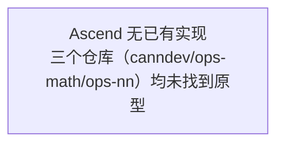

# scatter_kv_cache_with_k_scale Ascend 实现解析

## 现有适配框架

> 探测结果：**未探测到任何 Ascend 已有的 PyTorch/TensorFlow 适配框架。**

## 算子原型位置

**Ascend 无已有实现。**

搜索范围与结果：

| 仓库     | 搜索命令                                                                     | 结果        |
| -------- | ---------------------------------------------------------------------------- | ----------- |
| canndev  | `rg "REG_OP\(ScatterKvCacheWithKScale\)" ${CODE_REPO}/canndev/`             | NOT FOUND   |
| ops-math | `rg "REG_OP\(ScatterKvCacheWithKScale\)" ${CODE_REPO}/ops-math/`            | NOT FOUND   |
| ops-nn   | `rg "REG_OP\(ScatterKvCacheWithKScale\)" ${CODE_REPO}/ops-nn/`              | NOT FOUND   |

多轮变体搜索（`ScatterKvCache`、`ScatterKv`、`KvCache`）同样未命中任何结果。

**结论**：Ascend 无已有实现。在 canndev（目录为空）、ops-math、ops-nn 三个仓库中均未找到算子原型。此算子为全新自定义算子，需从用户需求文档和竞品分析出发设计。

## 调用链总览

**Ascend 无已有实现，本节为空。**

## 算子实现代码（TBE/TIK/AscendC）

**无已有实现。**

## 提取原型和 aclnn 接口

**无可提取内容。** 原型定义和 aclnn 接口将在 SE 文档第5章基于竞品分析（vLLM reshape_and_cache）和用户需求文档中的 REG_OP 原型进行设计。
