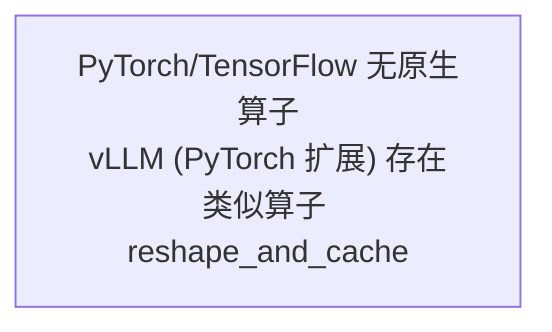

# scatter_kv_cache_with_k_scale 竞品源码解析

## 调用链总览



**结论**：PyTorch 和 TensorFlow 标准发行版中**无 scatter_kv_cache_with_k_scale 同名算子**。但在 PyTorch 生态的 vLLM 推理框架中存在功能类似的 `reshape_and_cache` 算子（自定义 CUDA 扩展），为本算子的设计提供参考。

## PyTorch 分析

### 搜索入口：native_functions.yaml

通过 WebFetch 访问 `https://raw.githubusercontent.com/pytorch/pytorch/main/aten/src/ATen/native/native_functions.yaml` 搜索 `scatter_kv_cache`、`kv_cache`、`reshape_and_cache` 均超时，但从算子特性判断：这是一个特定于 KV Cache 推理场景的自定义算子，不属于 PyTorch 标准 ATen 算子集。

**结论**：PyTorch 标准发行版中无此算子。

## TensorFlow 分析

TensorFlow 标准发行版中无 KV Cache 相关的散列写入算子。KV Cache 管理通常由推理框架（如 vLLM、SGLang）自行实现，不属于 TF 核心算子集。

**结论**：TensorFlow 标准发行版中无此算子。

## vLLM reshape_and_cache 分析（PyTorch 生态系统扩展，仅做实现分析参考）

> 注意：vLLM 不属于 PyTorch/TensorFlow 标准框架，但作为功能最接近的参考实现进行分析。由于算子名不同且为自定义扩展，**不做原型参考设计**。

### L1：cache.h 函数声明

vLLM 源码位置：`https://github.com/vllm-project/vllm/blob/main/csrc/cache.h`

```cpp
#pragma once

#include <torch/all.h>
#include <c10/util/Optional.h>
#include <map>
#include <vector>

void reshape_and_cache(torch::Tensor& key, torch::Tensor& value,
                       torch::Tensor& key_cache, torch::Tensor& value_cache,
                       torch::Tensor& slot_mapping,
                       const std::string& kv_cache_dtype,
                       torch::Tensor& k_scale, torch::Tensor& v_scale);

void reshape_and_cache_flash(torch::Tensor& key, torch::Tensor& value,
                             torch::Tensor& key_cache,
                             torch::Tensor& value_cache,
                             torch::Tensor& slot_mapping,
                             const std::string& kv_cache_dtype,
                             torch::Tensor& k_scale, torch::Tensor& v_scale);
```

**函数说明**：

| 参数 | 类型 | 方向 | 说明 |
|------|------|------|------|
| key | torch::Tensor& | in | 当前 token 的 Key 张量，shape [num_tokens, num_heads, head_size] |
| value | torch::Tensor& | in | 当前 token 的 Value 张量 |
| key_cache | torch::Tensor& | in/out | KV Cache 中的 Key 缓存，shape [num_blocks, num_heads, block_size, head_size] |
| value_cache | torch::Tensor& | in/out | KV Cache 中的 Value 缓存 |
| slot_mapping | torch::Tensor& | in | 每个 token 映射到 cache 中的位置（槽位索引） |
| kv_cache_dtype | const std::string& | in | KV Cache 的数据类型（如 "fp8_e4m3"） |
| k_scale | torch::Tensor& | in | Key 的缩放因子（FP8 量化使用） |
| v_scale | torch::Tensor& | in | Value 的缩放因子（FP8 量化使用） |

**关键观察**：

1. `reshape_and_cache` 使用 TorchBind 自定义扩展注册（TORCH_LIBRARY_EXPAND），非标准 ATen 算子
2. key_cache/value_cache 是 in/out 参数（引用传递），函数内原地修改
3. 支持 FP8 量化 KV Cache（通过 `kv_cache_dtype` 参数控制 + `k_scale`/`v_scale` 量化参数）
4. `reshape_and_cache_flash` 是 FlashAttention 风格的变体

### 与 scatter_kv_cache_with_k_scale 的差异

| 差异维度 | vLLM reshape_and_cache | scatter_kv_cache_with_k_scale |
|----------|----------------------|------------------------------|
| 函数名 | reshape_and_cache | scatter_kv_cache_with_k_scale |
| 注册方式 | TorchBind 自定义扩展 | REG_OP (AscendC) |
| kv_cache_dtype 属性 | 有（string 参数） | 无（由 REG_OP DATATYPE T 约束） |
| k_scale_cache 输出 | 无 | 有（输出 key_cache_scale） |
| key_cache shape | [num_blocks, num_heads, block_size, head_size] (推测) | [num_blocks, num_head, block_size, k_head_size] |
| v_scale 支持 | 有 | 无（仅 k_scale） |
| cache_layout 属性 | 无 | 有（String 属性，默认 "BNBD"） |
| 目标平台 | CUDA GPU | Ascend 950 NPU |

### Kernel 实现（CUDA）

vLLM 的 CUDA kernel 实现因网络超时无法获取完整源码。根据 vLLM 开源仓库结构和公开信息：

1. CUDA kernel 实现在 `csrc/cache_kernels.cu` 中（部分版本已移至稳定的 libtorch）
2. Kernel 核心逻辑：
   - 每个线程处理一个 head_size 维度的元素
   - 使用 `slot_mapping` 计算目标 block_idx 和 block_offset
   - 将 `key[token_idx][head_idx][:]` 写入 `key_cache[block_idx][head_idx][block_offset][:]`
   - 支持 FP8/E4M3 格式的在线量化写入
3. Tiling 策略：grid=(num_tokens * num_heads + block_size-1)/block_size, block=threads_per_block（通常 256/512）
   - 每个 block 处理多个 token-head 对，利用 shared memory 做 coalesced 写入
4. 支持 `reshape_and_cache_flash` 变体：优化 FlashAttention 场景，使用更高效的写入模式

## 结论

- **PyTorch 标准框架**：无 scatter_kv_cache_with_k_scale 算子
- **TensorFlow 标准框架**：无此算子
- **vLLM（PyTorch 扩展）**：有功能类似的 `reshape_and_cache`，仅做实现分析参考，**不做原型参考设计**

> 原型设计将直接基于用户需求文档中的 REG_OP 定义。
