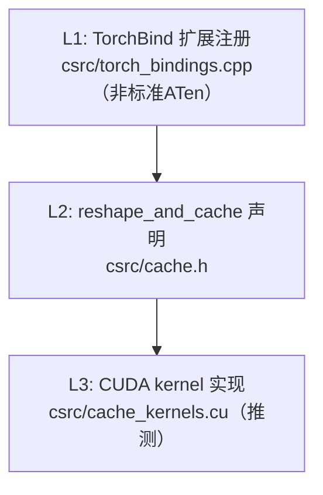

# AscendC SIMT 算子需求设计文档

## 文档信息

| 项目     | 内容                         |
| -------- | ---------------------------- |
| 算子名称 | scatter_kv_cache_with_k_scale |
| 文档版本 | v1.0                         |
| 创建日期 | 2026-05-30                   |
| 芯片类型 | ascend950                    |

---

## 1. 算子功能概述

### 1.1 功能描述与数学表达式

`scatter_kv_cache_with_k_scale` 是一个纯访存算子，用于将当前 token 的 Key/Value 张量按 slot_mapping 索引散列（scatter）写入 KV Cache 内存区域，同时写入每个 token 对应 head 的 Key Scale 值。该算子类似于 vLLM 推理框架中的 `reshape_and_cache` 算子，专门用于 LLM 推理场景的 KV Cache 管理。

```
# 伪代码（Python + NumPy 风格）
def ScatterKvCacheWithKScale(key, value, key_cache, value_cache, slot_mapping, key_scale, key_cache_scale):
    num_tokens = key.shape[0]
    num_head = key.shape[1]
    k_head_size = key.shape[2]
    v_head_size = value.shape[2]

    num_blocks = key_cache.shape[0]
    block_size = key_cache.shape[2]

    for i in range(num_tokens):
        block_idx = slot_mapping[i] // block_size
        block_offset = slot_mapping[i] % block_size
        for j in range(num_head):
            # scatter key
            key_cache[block_idx][j][block_offset][:] = key[i][j][:]
            # scatter value
            value_cache[block_idx][j][block_offset][:] = value[i][j][:]
            # scatter key_scale
            key_cache_scale[block_idx][j][block_offset][0] = key_scale[i][j]
```

### 1.2 计算逻辑说明

1. **输入解析**：从 `slot_mapping` 中获取每个 token 对应的缓存槽位索引
2. **地址计算**：`block_idx = slot_mapping[i] // block_size`，`block_offset = slot_mapping[i] % block_size`
3. **Key 散列写入**：将 `key[i][j][:]` 写入 `key_cache[block_idx][j][block_offset][:]`
4. **Value 散列写入**：将 `value[i][j][:]` 写入 `value_cache[block_idx][j][block_offset][:]`
5. **Key Scale 写入**：将 `key_scale[i][j]` 写入 `key_cache_scale[block_idx][j][block_offset][0]`

> 注意：该算子为 inplace 算子，`key_cache`、`value_cache`、`key_scale_cache` 输入输出同名，复用输入内存。

### 1.3 功能示例

```python
# 示例1：基本 KV Cache 散列写入
import numpy as np

# 输入
num_tokens, num_head, k_head_size = 2, 4, 128
v_head_size = 128
num_blocks, block_size = 8, 16

key = np.random.randn(num_tokens, num_head, k_head_size).astype(np.float16)
value = np.random.randn(num_tokens, num_head, v_head_size).astype(np.float16)
slot_mapping = np.array([5, 23], dtype=np.int64)
key_scale = np.random.randn(num_tokens, num_head).astype(np.float32)

# cache 初始状态（全零）
key_cache = np.zeros((num_blocks, num_head, block_size, k_head_size), dtype=np.float16)
value_cache = np.zeros((num_blocks, num_head, block_size, v_head_size), dtype=np.float16)
key_cache_scale = np.zeros((num_blocks, num_head, block_size, 1), dtype=np.float32)

# 执行散列写入（以 golden 函数模拟）
# 结果：slot_mapping[0]=5 → block_idx=0, block_offset=5 → key_cache[0][:][5][:] = key[0][:][:]
#      slot_mapping[1]=23 → block_idx=1, block_offset=7 → key_cache[1][:][7][:] = key[1][:][:]
```

### 1.4 边界条件处理

| 条件 | 处理方式 |
| ---- | -------- |
| slot_mapping[i] 越界（≥ num_blocks * block_size） | kernel 内 continue 跳过该 token，不写入 |
| slot_mapping[i] 为负数 | kernel 内 continue 跳过该 token，不写入 |
| k_head_size == v_head_size（特化场景） | 使用 2 个 VectorFactory（vf1: kv, vf2: keyScale） |
| k_head_size != v_head_size（泛化场景） | 使用 3 个 VectorFactory（vf1: key, vf2: value, vf3: keyScale） |
| 空 tensor（num_tokens = 0） | 无操作，直接返回 |
| FP8 格式不支持 | kernel 内用同位宽整型（uint8）读写，不解释数值 |

### 1.5 应用场景

LLM 推理框架（如 vLLM、SGLang 等）的 KV Cache 管理中，使用 PagedAttention 机制时，需要将新生成的 token 的 Key/Value 张量按页表散列写入全局 KV Cache。该算子是此过程的核心访存操作，支持 FP8 量化 KV Cache 场景下的 Key Scale 同步写入。

---

## 2. 输入输出规格

### 2.1 典型网络用例

| 用例名 | 输入1 shape/dtype | 输入2 shape/dtype | 输出 shape/dtype | 来源网络 |
|--------|-------------------|-------------------|------------------|---------|
| LLaMA-7B FP8 | key: [128, 32, 128] FP8 / value: [128, 32, 128] FP8 | key_cache: [256, 32, 16, 128] FP8 / value_cache: [256, 32, 16, 128] FP8 | key_cache/val_cache: 同输入 / k_scale_cache: [256, 32, 16, 1] FP32 | LLaMA-7B |
| GPT-3 13B | key: [256, 40, 128] FP8 / value: [256, 40, 128] FP8 | key_cache: [512, 40, 16, 128] FP8 / value_cache: [512, 40, 16, 128] FP8 | key_cache/val_cache: 同输入 / k_scale_cache: [512, 40, 16, 1] FP32 | GPT-3 |

### 2.2 完整输入规格

| 输入名 | Shape | Dtype | Layout | 说明 |
| ------ | ----- | ----- | ------ | ---- |
| key | [batch*seq_len, num_head, k_head_size] | DT_FLOAT8_E5M2 / DT_FLOAT8_E4M3FN | ND | 当前 token 的 Key 张量 |
| value | [batch*seq_len, num_head, v_head_size] | DT_FLOAT8_E5M2 / DT_FLOAT8_E4M3FN | ND | 当前 token 的 Value 张量 |
| key_cache | [num_blocks, num_head, block_size, k_head_size] | DT_FLOAT8_E5M2 / DT_FLOAT8_E4M3FN | ND | KV Cache 中的 Key 缓存（inplace） |
| value_cache | [num_blocks, num_head, block_size, v_head_size] | DT_FLOAT8_E5M2 / DT_FLOAT8_E4M3FN | ND | KV Cache 中的 Value 缓存（inplace） |
| slot_mapping | [batch*seq_len] | int64 / int32 | ND | 每个 token 映射到 cache 的槽位索引 |
| key_scale | [batch*seq_len, num_head] | float32 | ND | Key 的缩放因子 |
| key_scale_cache | [num_blocks, num_head, block_size, 1] | float32 | ND | Key Scale 缓存（inplace） |

### 2.3 完整输出规格

| 输出名 | Shape | Dtype | Layout | 说明 |
| ------ | ----- | ----- | ------ | ---- |
| key_cache | [num_blocks, num_head, block_size, k_head_size] | DT_FLOAT8_E5M2 / DT_FLOAT8_E4M3FN | ND | 写入后的 Key 缓存（inplace） |
| value_cache | [num_blocks, num_head, block_size, v_head_size] | DT_FLOAT8_E5M2 / DT_FLOAT8_E4M3FN | ND | 写入后的 Value 缓存（inplace） |
| k_scale_cache | [num_blocks, num_head, block_size, 1] | float32 | ND | 写入后的 Key Scale 缓存（inplace） |

> 注意：key_cache、value_cache、k_scale_cache 的 shape 和 dtype 与输入完全一致，为其 inplace 更新后的版本。

### 2.4 算子属性

| 属性名 | 类型 | 取值范围 | 默认值 | 说明 |
| ------ | ---- | -------- | ------ | ---- |
| cache_layout | String | {"BNBD"} | "BNBD" | KV Cache 的 layout 格式。<br/>B = num_blocks, N = num_head, B = block_size, D = head_size<br/>当前仅支持 "BNBD" 布局 |

---

## 3. 竞品实现分析 ⭐

> 详细分析见独立文档：
> - 竞品源码解析：`01_scatter_kv_cache_with_k_scale_competitor_analysis.md`

### 3.1 竞品源码位置

| 框架 | 源码链接 |
| ---- | -------- |
| PyTorch | 无标准算子。生态扩展 vLLM `reshape_and_cache`：`https://github.com/vllm-project/vllm/blob/main/csrc/cache.h` |
| TensorFlow | 无此算子 |

### 3.2 调用链摘要

> 标准 PyTorch/TensorFlow 中无此算子。vLLM（PyTorch 生态系统扩展）中存在功能类似的 `reshape_and_cache` 自定义 CUDA 扩展。以下为 vLLM 的调用链摘要，完整分析见独立文档。



| 层级 | 函数名 | 文件路径 | 关键逻辑 |
|------|--------|---------|---------|
| 1. TorchBind注册 | TORCH_LIBRARY_EXPAND | csrc/torch_bindings.cpp | 自定义扩展注册（非标准 ATen） |
| 2. 函数声明 | reshape_and_cache | csrc/cache.h | 传入 key/value + key_cache/value_cache + slot_mapping + kv_cache_dtype + k_scale/v_scale |
| 3. CUDA kernel | reshape_and_cache kernel | csrc/cache_kernels.cu（部分版本已移至稳定 libtorch） | GPU 核函数，实现 KV Cache 散列写入，支持 FP8 在线量化 |

### 3.3 关键实现细节

> **注意**：有 CUDA 实现时只分析 CUDA，无 CUDA 时才分析 CPU 实现！

#### 3.3.1 Tiling 切分策略（Host 侧）

| 检查项 | 竞品实现（vLLM reshape_and_cache） |
| ------ | ----- |
| 数据如何分块？（grid/block 配置） | grid=(num_tokens * num_heads + block_size - 1) / block_size; block=256/512 threads |
| 切分维度与粒度？ | 沿 token × head 维度切分，每个 block 处理多个 token-head 对 |
| 是否使用 shared memory？ | 是，用于 coalesced 写入缓冲 |
| 空 tensor（shape 含0维）如何切分？ | 不支持（推理场景 num_tokens ≥ 1） |

#### 3.3.2 Kernel 计算策略（Device 侧）

| 检查项 | 竞品实现（vLLM reshape_and_cache） |
| ------ | ----- |
| 是否需要 workspace/临时显存？ | 不需要 |
| 是否使用其他特殊接口（cuda特殊机制）？ | 无，纯访存 kernel |
| 支持哪些场景，哪些会明确报错？ | 支持 FP8 E4M3/E5M2 KV Cache；slot_mapping 越界时会跳过 |
| 都有哪些分支，是单kernel实现还是多kernel？ | `reshape_and_cache` 与 `reshape_and_cache_flash` 两个变体（FlashAttention 优化版） |
| 当前接口支持哪些数据类型？ | FP16、BF16、FP8 E4M3/E5M2 |
| 计算过程是否为确定性？ | 是，为确定性访存操作 |
| 空 tensor 如何处理？是否支持？ | 不支持空 tensor（推理场景必有 token） |
| 边界值如何处理？（极大/极小值、零除等） | 无计算，仅内存拷贝；slot_mapping 越界跳过 |

#### 3.3.3 累加方式

| 检查项 | 竞品实现（vLLM reshape_and_cache） |
| ------ | ----- |
| 是否使用 atomicAdd？ | 否（不同 token 写入不同 slot，无竞争） |
| 累加操作是否支持 deterministic？ | 不适用（纯访存，无累加） |
| 累加的顺序是否固定？ | 不适用 |

#### 3.3.4 索引处理

| 检查项 | 竞品实现（vLLM reshape_and_cache） |
| ------ | ----- |
| 是否检查索引越界？ | 是，kernel 内检查并跳过越界访问 |
| 越界索引如何处理？ | continue 跳过该索引对应的 token |
| 负索引如何处理？ | 视为越界，跳过 |

#### 3.3.5 特殊值处理

| 检查项 | 竞品实现（vLLM reshape_and_cache） |
| ------ | ----- |
| NaN 如何处理？ | 原始值直接拷贝，不解释 |
| Inf 如何处理？ | 原始值直接拷贝，不解释 |
| 是否有特殊的 padding 处理？ | 无 |

#### 3.3.6 精度相关

| 检查项 | 竞品实现（vLLM reshape_and_cache） |
| ------ | ----- |
| 是否使用高精度中间变量？ | 否（纯访存，无计算） |
| 计算低精度tensor时是否做了类型提升？ | 否（原始 bit-pattern 直接拷贝） |
| float16 和 float32 的计算路径是否不同？ | 不适用 |
| 是否有精度补偿逻辑？ | 不适用 |

---

## 4. Ascend 已有实现分析

> 详细分析见独立文档：
> - Ascend 实现解析：`01_scatter_kv_cache_with_k_scale_ascend_analysis.md`

### 4.1 交付件覆盖总览

> Ascend 无已有实现，以下表格标记所有交付件为"未找到"。

| 序号 | 交付件类型 | 状态 | 路径 | 一句话说明 |
|------|-----------|------|------|-----------|
| 1 | 算子原型（REG_OP） | ❌ | 未找到 | 在 canndev / ops-math / ops-nn 三仓均未找到原型 |
| 2 | OpDef | ❌ | 未找到 | 无已有实现 |
| 3 | 信息库（binary_config） | ❌ | 未找到 | 无已有实现 |
| 4 | aclnn 接口 | ❌ | 未找到 | 无已有实现 |
| 5 | Shape/Dtype 推导 | ❌ | 未找到 | 无已有实现 |
| 6 | Tiling | ❌ | 未找到 | 无已有实现 |
| 7 | Kernel | ❌ | 未找到 | 无已有实现 |
| 8 | TF 适配（tf_plugin） | ❌ | 未找到 | 无已有实现 |
| 9 | PyTorch 适配（op-plugin） | ❌ | 未找到 | 无已有实现 |

> 状态：✅ 已找到 ❌ 未找到

**结论**：Ascend 无已有实现。在 canndev（空仓）、ops-math、ops-nn 三个仓库中均未找到 `ScatterKvCacheWithKScale` 算子原型。本算子为全新自定义算子，原型定义基于用户需求文档设计。

### 4.2 Ascend 调用链摘要

#### PyTorch 适配链路

> 无 PyTorch 适配链路。Ascend 无此算子已有实现。

#### TensorFlow 适配链路

> 无 TensorFlow 适配链路。Ascend 无此算子已有实现。

### 4.3 与竞品实现的关键差异

| 差异维度 | 竞品实现（vLLM reshape_and_cache） | Ascend 本算子 | 影响分析 |
|----------|---------|------------|---------|
| k_scale_cache 输出 | 无（仅输入 k_scale/v_scale 用于写入时量化） | 有（独立输出 key_cache_scale，保存每 token 的 scale） | Ascend 版本额外管理 Key Scale 缓存，需额外 tensor 空间和访存 |
| kv_cache_dtype 属性 | 有（string 参数，控制量化类型） | 无（由 REG_OP DATATYPE T 在编译时约束） | Ascend 版本通过模板实例化支持不同 dtype，竞品运行时选择 |
| v_scale 支持 | 支持（同时传入 k_scale 和 v_scale） | 仅支持 k_scale（无 v_scale） | Ascend 版本简化了 Scale 参数 |
| cache_layout 属性 | 无（硬编码 layout） | 有（String 属性，默认 "BNBD"） | Ascend 版本保留 layout 扩展性 |
| key_cache/value_cache shape | [num_blocks, num_head, block_size, head_size] | [num_blocks, num_head, block_size, head_size] | shape 布局一致 |
| 注册方式 | TorchBind 自定义扩展 | REG_OP（AscendC） | 平台差异 |
| 目标平台 | CUDA GPU | Ascend 950 NPU | 硬件平台差异 |
| 特化/泛化场景分支 | 无明确分支（统一处理） | 分特化（2 vf）和泛化（3 vf）两个场景 | Ascend 版本通过多 VectorFactory 并行处理优化性能 |

---

## 5. 算子原型定义 ⭐

### 5.1 原型来源

| 项目 | 内容 |
|------|------|
| 原型来源 | 基于用户需求设计（场景 E：无 Ascend 已有实现 + 竞品功能类似但不同名） |
| 原型文件路径 | 基于用户需求文档新建 |
| 注册算子名 | ScatterKvCacheWithKScale |

### 5.2 REG_OP 定义

```cpp
#ifndef CANNDEV_SCATTER_KV_CACHE_WITH_K_SCALE_PROTO_H
#define CANNDEV_SCATTER_KV_CACHE_WITH_K_SCALE_PROTO_H

#include "graph/operator_reg.h"
#include "graph/types.h"

namespace ge {

/**
 * @brief 将 key/value 张量按 slot_mapping 索引散列写入 KV Cache，
 *        同时写入每个 token 对应 head 的 key_scale 值。纯访存算子。
 *
 * @par Inputs:
 * @li key: A 3D Tensor of shape [num_tokens, num_head, k_head_size].
 *          Must be FP8 (DT_FLOAT8_E5M2 or DT_FLOAT8_E4M3FN).
 * @li value: A 3D Tensor of shape [num_tokens, num_head, v_head_size].
 *            Must be FP8 (same dtype as key).
 * @li key_cache: A 4D Tensor of shape [num_blocks, num_head, block_size, k_head_size].
 *                Must be FP8 (same dtype as key). Inplace.
 * @li value_cache: A 4D Tensor of shape [num_blocks, num_head, block_size, v_head_size].
 *                  Must be FP8 (same dtype as key). Inplace.
 * @li slot_mapping: A 1D Tensor of shape [num_tokens].
 *                   Dtype must be IndexNumberType (int32/int64).
 *                   Values represent cache slot indices (must be < num_blocks * block_size).
 * @li key_scale: A 2D Tensor of shape [num_tokens, num_head]. Must be float32.
 * @li key_scale_cache: A 4D Tensor of shape [num_blocks, num_head, block_size, 1]. Must be float32.
 *                      Inplace.
 *
 * @par Attributes:
 * @li cache_layout: A optional String. Defaults to "BNBD".
 *                   Defines the KV Cache layout format (B=num_blocks, N=num_head, B=block_size, D=head_size).
 *                   Currently only "BNBD" is supported.
 *
 * @par Outputs:
 * @li key_cache: Updated key cache (inplace, same shape/dtype as input key_cache).
 * @li value_cache: Updated value cache (inplace, same shape/dtype as input value_cache).
 * @li k_scale_cache: Updated key scale cache (inplace, same shape/dtype as input key_scale_cache).
 */
REG_OP(ScatterKvCacheWithKScale)
    .INPUT(key, TensorType({DT_FLOAT8_E5M2, DT_FLOAT8_E4M3FN}))
    .INPUT(value, TensorType({DT_FLOAT8_E5M2, DT_FLOAT8_E4M3FN}))
    .INPUT(key_cache, TensorType({DT_FLOAT8_E5M2, DT_FLOAT8_E4M3FN}))
    .INPUT(value_cache, TensorType({DT_FLOAT8_E5M2, DT_FLOAT8_E4M3FN}))
    .INPUT(slot_mapping, TensorType::IndexNumberType())
    .INPUT(key_scale, TensorType({DT_FLOAT}))
    .INPUT(key_scale_cache, TensorType({DT_FLOAT}))
    .OUTPUT(key_cache, TensorType({DT_FLOAT8_E5M2, DT_FLOAT8_E4M3FN}))
    .OUTPUT(value_cache, TensorType({DT_FLOAT8_E5M2, DT_FLOAT8_E4M3FN}))
    .OUTPUT(k_scale_cache, TensorType({DT_FLOAT}))
    .ATTR(cache_layout, String, "BNBD")
    .OP_END_FACTORY_REG(ScatterKvCacheWithKScale)

} // namespace ge
#endif // CANNDEV_SCATTER_KV_CACHE_WITH_K_SCALE_PROTO_H
```

> 注意：用户原始需求中使用 `.DATATYPE(T, ...)` 宏定义类型约束（如 `DATATYPE(T, TensorType({ DT_FLOAT8_E5M2, DT_FLOAT8_E4M3FN}))`），经规范化后使用标准的 `TensorType({...})` 方式按各 INPUT 独立约束。两者语义等价，`TensorType({...})` 方式更符合 ops-math 仓库现有代码风格。

### 5.3 实现约束

> ⚠️ 实现约束原则：有竞品时与竞品保持一致，无竞品时与 Ascend 已有实现保持一致。本算子无 Ascend 已有实现，实现约束默认值如下。

| 约束项 | 竞品实现（vLLM reshape_and_cache） | 本算子实现策略 |
|--------|---------|--------------|
| 是否支持空 tensor（shape 含0维）？ | 不支持（推理场景必有 token） | 不支持（推理场景 num_tokens ≥ 1） |
| 是否支持非连续 tensor？ | 需连续内存 | 输入 tensor 内部假设为连续 layout（ND），如非连续需先做 contiguous |
| 确定性保证 | 确定性访存（无竞争） | 确定性访存（不同 token 写入不同 slot，无竞争） |

### 5.4 输出 Shape 推导规则

**推导逻辑说明**：

本算子为 inplace 算子，三个输出（key_cache、value_cache、k_scale_cache）的 shape 与对应输入完全一致。输出 shape 不依赖任何属性或计算，直接复用输入 shape。

**推导伪代码**：

```
key_cache.shape = input_key_cache.shape   // [num_blocks, num_head, block_size, k_head_size]
value_cache.shape = input_value_cache.shape // [num_blocks, num_head, block_size, v_head_size]
k_scale_cache.shape = input_key_scale_cache.shape // [num_blocks, num_head, block_size, 1]
```

**Shape 约束校验**（tiling 内执行）：

```
assert key.shape[1] == key_cache.shape[1]     // num_head 一致
assert key.shape[2] == key_cache.shape[3]     // k_head_size 一致
assert value.shape[1] == value_cache.shape[1] // num_head 一致
assert value.shape[2] == value_cache.shape[3] // v_head_size 一致
assert key.shape[0] == value.shape[0]          // num_tokens 一致
assert key.shape[0] == slot_mapping.shape[0]   // num_tokens 一致
assert key.shape[0] == key_scale.shape[0]      // num_tokens 一致
assert key.shape[1] == key_scale.shape[1]      // num_head 一致
assert key_cache.shape[0] == key_scale_cache.shape[0] // num_blocks 一致
assert key_cache.shape[1] == key_scale_cache.shape[1] // num_head 一致
assert key_cache.shape[2] == key_scale_cache.shape[2] // block_size 一致
assert key_scale_cache.shape[3] == 1                   // scale 维度为 1
```

### 5.5 输出 Dtype 推导规则

| 条件 | 输出 Dtype | 说明 |
|------|-----------|------|
| key_cache 输出 | 与输入 key 的 dtype 一致 | DT_FLOAT8_E5M2 或 DT_FLOAT8_E4M3FN |
| value_cache 输出 | 与输入 value 的 dtype 一致（同 key） | DT_FLOAT8_E5M2 或 DT_FLOAT8_E4M3FN |
| k_scale_cache 输出 | float32 | 固定为 FP32 |

**推导伪代码**：

```
key_cache.dtype = key.dtype        // FP8 类型
value_cache.dtype = value.dtype    // FP8 类型（与 key 一致）
k_scale_cache.dtype = DT_FLOAT     // 固定 FP32
```

### 5.6 aclnn 接口定义 ⭐

> ⚠️ **无需 aclnn 接口**。本算子为自定义算子，PyTorch 标准发行版中无同名算子（`scatter_kv_cache_with_k_scale` 不存在于 PyTorch ATen），因此无需设计 aclnn 接口。算子通过 REG_OP 直接调用，由自定义适配层（如模型侧 TorchBind 绑定）进行封装。

### 5.7 数据类型组合 ⭐

#### 数据类型组合来源

| 项目 | 内容 |
|------|------|
| 组合来源 | 基于用户需求文档 REG_OP 推导 |
| 组合文件路径 | 未找到已有 binary_config，基于 REG_OP 推导 |

#### 数据类型组合表格

| # | key dtype | value dtype | key_cache dtype | value_cache dtype | slot_mapping dtype | key_scale dtype | key_scale_cache dtype | 说明 |
|---|-----------|-------------|-----------------|-------------------|-------------------|-----------------|----------------------|------|
| 1 | DT_FLOAT8_E5M2 | DT_FLOAT8_E5M2 | DT_FLOAT8_E5M2 | DT_FLOAT8_E5M2 | int64 | DT_FLOAT | DT_FLOAT | FP8 E5M2 KV Cache + FP32 Scale |
| 2 | DT_FLOAT8_E4M3FN | DT_FLOAT8_E4M3FN | DT_FLOAT8_E4M3FN | DT_FLOAT8_E4M3FN | int64 | DT_FLOAT | DT_FLOAT | FP8 E4M3 KV Cache + FP32 Scale |
| 3 | DT_FLOAT8_E5M2 | DT_FLOAT8_E5M2 | DT_FLOAT8_E5M2 | DT_FLOAT8_E5M2 | int32 | DT_FLOAT | DT_FLOAT | FP8 E5M2 KV Cache with int32 slot_mapping |
| 4 | DT_FLOAT8_E4M3FN | DT_FLOAT8_E4M3FN | DT_FLOAT8_E4M3FN | DT_FLOAT8_E4M3FN | int32 | DT_FLOAT | DT_FLOAT | FP8 E4M3 KV Cache with int32 slot_mapping |

> 注意：所有 FP8 张量（key, value, key_cache, value_cache）的 dtype 必须保持一致（同 FP8 子类型），不可混用 E5M2 和 E4M3FN。

> ⚠️ **重要约束**：后续 MDE/DEV/PACK 中 `_def.cpp` 的 Input/Output 名称、kernel 入口参数顺序、`_proto.h` 的 REG_OP 定义必须与此原型严格匹配。`_infershape.cpp` 的推导逻辑必须与 5.4/5.5 一致。

---

## 6. Golden 计算（算法验收标杆）

```python
import numpy as np

def golden_scatter_kv_cache_with_k_scale(
    key: np.ndarray,
    value: np.ndarray,
    key_cache: np.ndarray,
    value_cache: np.ndarray,
    slot_mapping: np.ndarray,
    key_scale: np.ndarray,
    key_scale_cache: np.ndarray,
    cache_layout: str = "BNBD"
):
    """
    Golden 函数：将 key/value 按 slot_mapping 散列写入 KV Cache，同时写入 key_scale。

    Args:
        key:             [num_tokens, num_head, k_head_size]     fp8 (实际以 uint8 模拟)
        value:           [num_tokens, num_head, v_head_size]     fp8 (实际以 uint8 模拟)
        key_cache:       [num_blocks, num_head, block_size, k_head_size]  fp8 (inplace)
        value_cache:     [num_blocks, num_head, block_size, v_head_size]  fp8 (inplace)
        slot_mapping:    [num_tokens]                            int32/int64
        key_scale:       [num_tokens, num_head]                  float32
        key_scale_cache: [num_blocks, num_head, block_size, 1]   float32 (inplace)
        cache_layout:    str, default "BNBD"

    Returns:
        tuple: (key_cache, value_cache, key_scale_cache) - 原地修改后的 tensor
    """

    num_tokens = key.shape[0]
    num_head = key.shape[1]
    k_head_size = key.shape[2]
    v_head_size = value.shape[2]
    num_blocks = key_cache.shape[0]
    block_size = key_cache.shape[2]

    # Input validation
    assert key.shape == (num_tokens, num_head, k_head_size), f"key shape mismatch: {key.shape}"
    assert value.shape == (num_tokens, num_head, v_head_size), f"value shape mismatch: {value.shape}"
    assert key_cache.shape == (num_blocks, num_head, block_size, k_head_size), f"key_cache shape mismatch"
    assert value_cache.shape == (num_blocks, num_head, block_size, v_head_size), f"value_cache shape mismatch"
    assert slot_mapping.shape == (num_tokens,), f"slot_mapping shape mismatch: {slot_mapping.shape}"
    assert key_scale.shape == (num_tokens, num_head), f"key_scale shape mismatch: {key_scale.shape}"
    assert key_scale_cache.shape == (num_blocks, num_head, block_size, 1), f"key_scale_cache shape mismatch"

    max_slot = num_blocks * block_size

    for i in range(num_tokens):
        slot = int(slot_mapping[i])

        # 索引越界检查：越界或负数则跳过
        if slot < 0 or slot >= max_slot:
            continue

        block_idx = slot // block_size
        block_offset = slot % block_size

        for j in range(num_head):
            # scatter key (raw memory copy, dtype-agnostic)
            key_cache[block_idx, j, block_offset, :] = key[i, j, :]

            # scatter value
            value_cache[block_idx, j, block_offset, :] = value[i, j, :]

            # scatter key_scale
            key_scale_cache[block_idx, j, block_offset, 0] = key_scale[i, j]

    return key_cache, value_cache, key_scale_cache


def golden_scatter_kv_cache_with_k_scale_uint8(
    key: np.ndarray,
    value: np.ndarray,
    key_cache: np.ndarray,
    value_cache: np.ndarray,
    slot_mapping: np.ndarray,
    key_scale: np.ndarray,
    key_scale_cache: np.ndarray,
    cache_layout: str = "BNBD"
):
    """
    Golden 函数的 uint8 版本（FP8 数据以 uint8 同位宽整数模拟）。
    适用于检验纯访存算子的 bit-level 正确性。

    参数与 golden_scatter_kv_cache_with_k_scale 相同，但假设 FP8 tensor 以 uint8 存储。
    """
    return golden_scatter_kv_cache_with_k_scale(
        key, value, key_cache, value_cache,
        slot_mapping, key_scale, key_scale_cache, cache_layout
    )
```

> 说明：Golden 函数基于用户需求文档中的计算公式实现。由于 FP8 数据类型在 NumPy 中没有原生支持，测试时可将 FP8 数据以 `uint8` 方式存储，利用算子的纯访存特性（不做数值计算），直接在 bit-level 比较正确性。FP32 类型的 key_scale 按正常浮点运算处理。

---

## 7. 精度要求

### 7.1 精度标准

| 对比基准 | 精度要求 |
| -------- | -------- |
| Golden（NumPy bit-exact） | FP8（uint8）部分 bit-exact 一致（逐字节比较） |
| Golden（NumPy float32） | key_scale_cache 部分最大相对误差 < 1e-6 |

### 7.2 精度对齐要求

1. **FP8 数据**：本算子为纯访存算子，FP8 数据写入时应为 bit-exact 拷贝，精度对比基准为逐字节完全一致
2. **FP32 Scale 数据**：key_scale 和 key_scale_cache 为 float32 类型，写入精度对齐基准为 1e-6 相对误差
3. **索引越界处理**：当 slot_mapping 值越界时，Golden 和 kernel 均跳过该 token，不引起报错
4. **Inplace 行为**：key_cache、value_cache、key_scale_cache 在 kernel 内部原地更新，未命中的 slot 区域保持原值不变

---

## 8. 参考资料

| 序号 | 资料名称 | 链接/路径 |
|------|---------|----------|
| 1 | 用户需求文档 | `/workspace/workspace/scatterkvcachewithkscale.md` |
| 2 | vLLM cache.h（reshape_and_cache 声明） | `https://github.com/vllm-project/vllm/blob/main/csrc/cache.h` |
| 3 | AscendC SIMT 开发指南 | CANN 9.1.0 文档 |
| 4 | ops-math 仓库（代码组织参考） | `https://gitcode.com/cann/ops-math` |
| 5 | ops-nn 仓库（代码组织参考） | `https://gitcode.com/cann/ops-nn` |
| 6 | Ascend 分析文档 | `01_scatter_kv_cache_with_k_scale_ascend_analysis.md` |
| 7 | 竞品分析文档 | `01_scatter_kv_cache_with_k_scale_competitor_analysis.md` |

---

## 9. 确认清单

- [x] 功能描述与数学公式已确认
- [x] 输入输出规格已确认（含典型网络用例）
- [x] 竞品实现分析已确认（调用链、关键实现细节）
- [x] Ascend 已有实现分析已确认（确认无已有实现，三仓均搜索未命中）
- [x] 算子原型定义已确认（REG_OP 定义完整，含7输入3输出1属性）
- [x] 实现约束已确认（空tensor不支持、需连续layout、确定性访存）
- [x] 输出 Shape/Dtype 推导规则已确认（inplace 复用输入 shape/dtype）
- [x] aclnn 接口定义已确认（无需 aclnn 接口：PyTorch 无同名标准算子）
- [x] 数据类型组合已确认（4种组合：2 FP8类型 × 2 slot_mapping类型）
- [x] Golden 计算已确认（Python numpy 实现，含 uint8 变体支持 FP8 bit-exact 比较）
- [x] 精度要求已确认（FP8 bit-exact + FP32 相对误差 < 1e-6）
- [x] 边界条件处理已确认（slot_mapping 越界跳过、空 tensor 不支持、特化/泛化双场景）
