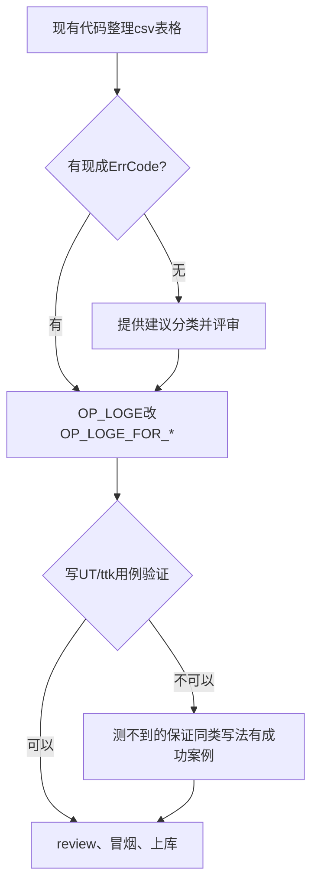

# GMM/GMMFR/NPU_FORMAT_CAST 算子错误码规范化整改 SRS

## 1. 迭代信息

| 项目 | 内容 |
| --- | --- |
| 责任人 | 马琦钧 |
| 预计工作量 | 0.7K（GMM: 0.45K, GMMFR: 0.25K） |
| 时间节点 | SRS/STC 5.11 → CODING 5.18 → UT 5.22 → ST 5.29 → 合入 6.1 |

---

## 2. 整改目标与范围

**目标：** 将op_host的 ERROR 日志规范化为 EZ0008-EZ0017 错误码

**范围：** A5责任田 + op_host

**约束：** 
- 不整改 op_kernel、op_graph 层代码
- 仅整改 A5 芯片相关文件，公共代码暂不整改
- NPU_FORMAT_CAST 为公共算子，纳入整改范围

### 2.0 OP_LOGE 调用方式

#### op_host 层（算子Host实现层）

**定义文件：**
- 原定义：`opbase/pkg_inc/op_common/log/log.h`
- 包定义：`pkg_inc/op_common/log/log.h`

**调用方式：**
```cpp
OP_LOGE(算子名, "message", args...)
```

**示例：**
```cpp
OP_LOGE(context->GetNodeName(),
        "When m(%lu)/n(%lu)/k(%lu)/groupNum(%lu) in mx quant mode, scaleFactor should not be equal to 0.",
        inputParams_.mSize, inputParams_.nSize, inputParams_.kSize, inputParams_.groupNum);
```

**行为：**
- 第一个参数传入算子名（通过 `context->GetNodeName()` 获取）
- 通过 `REPORT_INNER_ERR_MSG("EZ9999", ...)` 上报 EZ9999 通用错误码
- **问题：** 上报为 EZ9999 通用错误码，不够精确

#### 整改统一要求

无论 op_host 层，都需要整改为规范化的 `OP_LOGE_FOR_*` 宏：

| 层级 | 当前状态 | 整改后 | 整改原因 |
| --- | --- | --- | --- |
| op_host | 第一个参数传算子名，上报 EZ9999 | `OP_LOGE_FOR_*` | 上报精确的 EZ0008-EZ0017 错误码，没有的需要新增错误码 |

**整改后的统一调用方式：**
```cpp
// op_host 层整改示例
OP_LOGE_FOR_INVALID_VALUE_WITH_REASON(
    context->GetNodeName(),  // 算子名
    "scaleFactor",
    "0",
    "scaleFactor should not be 0 in mx quant mode"
);
```

### 2.1 数据统计总览

| 错误类型 | GMMFR | GMM | NPU_FORMAT_CAST | 合计 |
| --- | --- | --- | --- | --- |
| OP_LOGE | 231 | 653 | 37 | **921** |
| CHECK_COND | 0 | 397 | 41 | **438** |
| CHECK_RET | 18 | 7 | 5 | **30** |
| OPS_REPORT | 50 | 43 | 0 | **93** |
| **总计** | **322** | **1292** | **81** | **1695** |

---

## 3. 算子文件清单

其中 op_api 和 op_kernel 本次不修改，只修改 op_host

### 3.1 GMM 算子文件清单

**完整清单：**

| 完整路径 | 计数 | 占比 | 涉及芯片 | 量化类型 | 整改范围 |
| -- | --: | --: | -- | -- | -- |
| gmm/grouped_matmul/op_api/aclnn_grouped_matmul.cpp | 359 | 27.1% | 公共 | - | 暂不整改 |
| gmm/grouped_matmul/op_api/grouped_matmul.cpp | 3 | 0.2% | 公共 | - | 暂不整改 |
| gmm/grouped_matmul/op_api/grouped_matmul_no_quant_950_checker.cpp | 3 | 0.2% | A5 | 非量化 | 整改 |
| gmm/grouped_matmul/op_api/grouped_matmul_weight_quant_950_checker.cpp | 111 | 8.4% | A5 | 伪量化 | **重点整改** |
| gmm/grouped_matmul/op_api/grouped_matmul_950_checker.cpp | 153 | 11.5% | 公共 | - | 暂不整改 |
| gmm/grouped_matmul/op_host/grouped_matmul_infershape_weight_quant_checker.cpp | 97 | 7.3% | A5 | 伪量化 | **重点整改** |
| gmm/grouped_matmul/op_host/grouped_matmul_infershape.cpp | 190 | 14.3% | 公共 | - | 暂不整改 |
| gmm/grouped_matmul/op_host/op_tiling/arch35/grouped_weight_quant_batch_matmul_tiling.cpp | 123 | 9.3% | A5 | 伪量化 | **重点整改** |
| 其他文件（op_graph/op_kernel） | 18 | 1.4% | - | - | 不整改 |

**重点整改文件（A5 + 伪量化）：**

| 文件 | 计数 | 整改策略 |
| -- | --: | -- |
| grouped_matmul_infershape_weight_quant_checker.cpp | 97 | 参数验证错误全量整改 |
| grouped_weight_quant_batch_matmul_tiling.cpp | 123 | 参数验证错误全量整改 |

### 3.2 GMMFR 算子文件清单

**完整清单：**

| 完整路径 | 计数 | 占比 | 涉及芯片 | 量化类型 | 整改范围 |
| -- | --: | --: | -- | -- | -- |
| gmm/grouped_matmul_finalize_routing/op_api/grouped_matmul_finalize_routing_weight_quant_950_checker.h | 46 | 10.5% | A5 | 伪量化 | op_api的OP_LOGE不明确 |
| gmm/grouped_matmul_finalize_routing/op_api/grouped_matmul_finalize_routing_950_checker.h | 48 | 11.0% | A5 | - | 全量化 |
| gmm/grouped_matmul_finalize_routing/op_api/aclnn_grouped_matmul_finalize_routing.cpp | 108 | 24.7% | 公共 | - | 暂不整改 |
| gmm/grouped_matmul_finalize_routing/op_host/op_tiling/arch35/grouped_matmul_finalize_routing_weight_quant_tiling.cpp | 84 | 19.2% | A5 | 伪量化 | **重点整改** |
| 其他文件 | 36 | 8.6% | - | - | 公共文件不整改 |

**重点整改文件（A5 + 伪量化）：**

| 文件 | 计数 | 整改策略 |
| -- | --: | -- |
| grouped_matmul_finalize_routing_weight_quant_tiling.cpp | 84 | 参数验证错误全量整改 |

### 3.3 NPU_FORMAT_CAST 算子文件清单

| 完整路径 | 计数 | 占比 | 涉及芯片 | 整改范围 |
| -- | --: | --: | -- | -- |
| conversion/npu_format_cast/op_host/op_api/aclnn_npu_format_cast.cpp | 81 | 100% | 公共 | **全量整改** |

**重点整改文件（A5 + 伪量化）：**

因为npu_format_cast都是aclnn接口，所以本次整改不涉及
---

## 4. 错误类型分类与整改策略

### 4.1 可直接整改的错误（按错误码分类）

#### dtype 错误【30条】→ EZ0018

**整改策略：替换为 `OP_LOGE_FOR_INVALID_DTYPE`**

| 算子 | 文件 | 计数 |
| -- | -- | --: |
| GMM | grouped_matmul_infershape_weight_quant_checker.cpp | 17 |
| GMM | grouped_weight_quant_batch_matmul_tiling.cpp | 13 |

#### format 错误→ EZ0016

**整改策略：替换为 `OP_LOGE_FOR_INVALID_FORMAT`**

| 算子 | 文件 | 计数 |
| -- | -- | --: |
| GMM | grouped_matmul_infershape.cpp | 9 |
| GMM | grouped_weight_quant_batch_matmul_tiling.cpp | 3 |
| GMM | 其他文件 | 6 |

#### shape 错误→ EZ0008

**整改策略：替换为 `OP_LOGE_FOR_INVALID_SHAPE`**

| 算子 | 文件 | 计数 |
| -- | -- | --: |
| GMMFR | grouped_matmul_finalize_routing_weight_quant_tiling.cpp | 30 |
| GMM | grouped_matmul_infershape_weight_quant_checker.cpp | 13 |
| GMMFR | 其他文件 | 65 |

#### dim 错误【114条】→ EZ0011

**整改策略：替换为 `OP_LOGE_FOR_INVALID_SHAPEDIM`**

| 算子 | 文件 | 计数 |
| -- | -- | --: |
| GMMFR | grouped_matmul_finalize_routing_weight_quant_tiling.cpp | 15 |
| GMM | 其他文件 | 78 |


#### value 错误【41条】→ EZ0023

**整改策略：替换为 `OP_LOGE_FOR_INVALID_VALUE_WITH_REASON`**

| 算子 | 文件 | 计数 |
| -- | -- | --: |
| GMM | grouped_matmul_infershape.cpp | 17 |
| GMM | grouped_matmul_infershape_weight_quant_checker.cpp | 6 |
| GMM/GMMFR | 其他文件 | 18 |

### 4.2 需细分处理的参数错误【496条】→ EZ0023

**整改策略：按参数类型细分，统一使用 `OP_LOGE_FOR_INVALID_VALUE_WITH_REASON`**

#### group 参数错误

| 文件 | 计数 |
| -- | --: |
| grouped_matmul_infershape.cpp | 区分芯片 |
| grouped_matmul_weight_quant_950_checker.cpp | 24 |
| 其他文件 | 60 |

#### scale 参数错误

| 文件 | 计数 |
| -- | --: |
| grouped_matmul_infershape.cpp | 区分芯片 |

#### quant 参数错误

| 文件 | 计数 |
| -- | --: |
| grouped_matmul_infershape.cpp | 区分芯片 |
| grouped_weight_quant_batch_matmul_tiling.cpp | 20 |

#### 其他参数错误

| 参数类型 | 计数 | 主要文件 |
| -- | --: | -- |
| bias 参数 | 46 | 分散在多个文件 |
| offset 参数 | 34 | 分散在多个文件 |
| transpose 参数 | 34 | 分散在多个文件 |

### 4.3 OPS_REPORT 错误【43条】→ 逐条分析

**整改策略：手动分析内容后分类处理**

| 文件 | 计数 | 处理方式 |
| -- | --: | -- |
| grouped_matmul_tiling.cpp | ? | 公共代码，逐条分析分类处理A5的代码 |
| grouped_matmul_finalize_routing_infershape.cpp | 43 | 逐条分析分类 |

**分类规则：**
- 参数验证类 → 整改
- 内部错误类 → 上报新增
- 业务逻辑类 → 上报

---

## 5. 整改方案

### 5.1 直接整改类

**原则：替换为 `OP_LOGE_FOR_*` 宏**

**示例：dtype 错误**

```cpp
// 原代码
OP_LOGE(ACLNN_ERR_PARAM_INVALID, 
        "x1 and x2 dtype should be same, actual x1 dtype is %s and x2 dtype is %s.", 
        x1_dtype, x2_dtype);

// 整改后
OP_LOGE_FOR_INVALID_DTYPES_WITH_REASON(
    ACLNN_ERR_PARAM_INVALID,
    "x1, x2",
    "actual_x1_dtype, actual_x2_dtype",
    "x1 and x2 dtype should be same"
);
```

### 5.2 上报新增错误码类

**原则：无法匹配 EZ0008-EZ0024，上报并推荐新增错误码**

**示例：运行时错误**

```cpp
// 原代码
OP_LOGE(ACLNN_ERR_RUNTIME_ERROR, "Failed to allocate memory for the NZ");

// 整改：上报新增 EZ_RUNTIME_ERROR，待错误码定义后再整改
```

### 5.3 评审后决定类

**原则：需评审决定是否新增错误码或归类到现有类型**

**待评审事项：**
- optional 参数错误（86条）：新增 EZ_OPTIONAL_PARAM 或使用 EZ0023？
- 空指针参数错误（13条）：新增 EZ_PARAM_NULLPTR 或使用 EZ0023？

---

## 6. 整改流程

### 6.1 整改流程图



### 6.2 整改阶段

| Phase | 任务 | 工具 | 输出 |
| --- | --- | --- | --- |
| Phase 0 | 生成整改表格 | generate_refactor_table.py | refactor_table.csv |
| Phase 1 | 审阅表格 | 手动审阅 | 审阅记录 |
| Phase 2 | 代码替换 | 手动替换 | 整改后代码 |
| Phase 3 | 编译验证 | build.sh | 编译日志 |
| Phase 4 | UT/ttk 验证 | pytest/ttk | 测试报告 |
| Phase 5 | 生成报告 | 脚本 | unmatched_errors_report.md |

---

## 7. EZ错误码速查表

| 错误场景 | 错误码 | 宏名称 |
| --- | --- | --- |
| Format 错误 | EZ0006 | OP_LOGE_WITH_INVALID_INPUT_FORMAT |
| Dtype 错误 | EZ0007 | OP_LOGE_WITH_INVALID_INPUT_DTYPE |
| Shape 错误 | EZ0008 | OP_LOGE_FOR_INVALID_INPUT_SHAPE |
| Dim 错误 | EZ0009 | OP_LOGE_FOR_INVALID_INPUT_SHAPE_DIM |

---

## 8. 待评审事项

### 8.1 错误码新增建议

| 错误类型 | 数量 | 建议错误码 | 理由 |
| --- | --- | --- | --- |
| optional 参数错误 | 86 | EZ_OPTIONAL_PARAM | 需评审决定是否新增专用错误码 |
| 空指针参数错误 | 13 | EZ_PARAM_NULLPTR | 需评审决定是否新增专用错误码 |

### 8.2 OPS_REPORT 分类处理方案

| 分类 | 预估数量 | 处理方式 |
| -- | --: | -- |
| 参数验证类 | ~50 | 整改为 EZ 错误码 |
| 内部错误类 | ~30 | 上报新增错误码 |
| 业务逻辑类 | ~13 | 上报新增错误码 |

---

## 9. 验收标准

### 9.1 代码验收标准

- 所有 OP_LOGE 已替换为 OP_LOGE_FOR_* 宏（可整改部分）
- CHECK_COND 宏已展开并整改为对应错误码
- OPS_REPORT 已分类处理并记录处理结果
- 编译无错误无警告
- UT/ttk 测试通过率 100%

### 9.2 文档验收标准

- 整改表格记录完整（文件名、行号、原代码、整改后代码、错误码）

### 9.3 验收流程

- Code Review → 冒烟测试 → UT/ttk 测试 → 合入主库

---

## 10. 参考文档

- `ops-transformer/.opencode/skills/ascendc-error-code-refactor/SKILL.md`
- `ops-transformer/CANN_ERROR_LOG_COLLECTION_GUIDE.md`
- `opbase/log.h` - EZ 错误码宏定义

---

## 附录 A：整改文件路径映射表

| 算子 | 原路径 | 备注 |
| -- | -- | -- |
| GMM | gmm/grouped_matmul/op_host/grouped_matmul_tiling.cpp | 只改A5部分 |
| GMM | gmm/grouped_matmul/op_host/op_tiling/arch35/grouped_weight_quant_batch_matmul_tiling.cpp | - |
| GMMFR | gmm/grouped_matmul_finalize_routing/op_host/op_tiling/arch35/grouped_matmul_finalize_routing_weight_quant_tiling.cpp | - |
