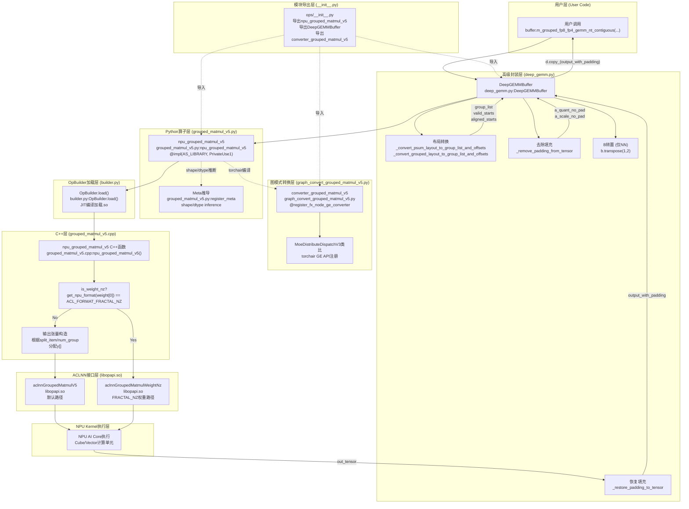
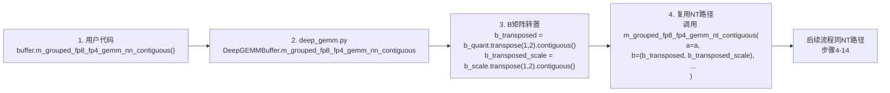
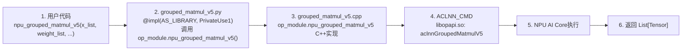
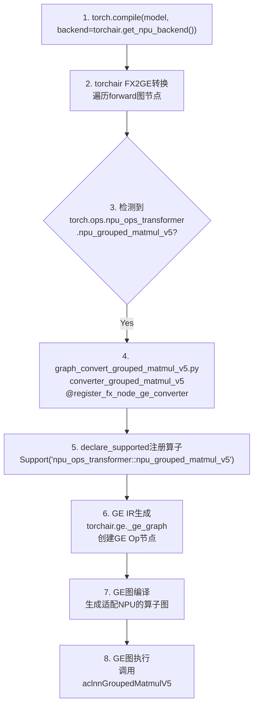
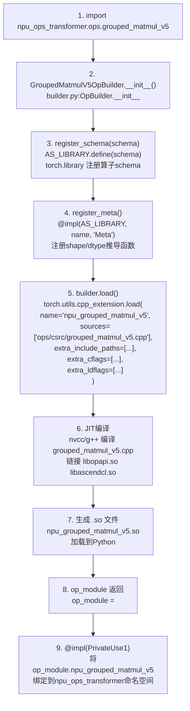
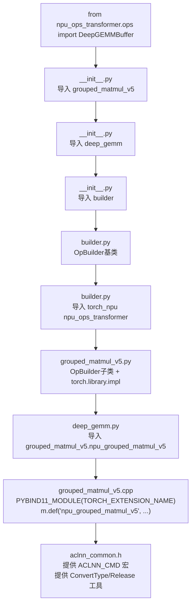
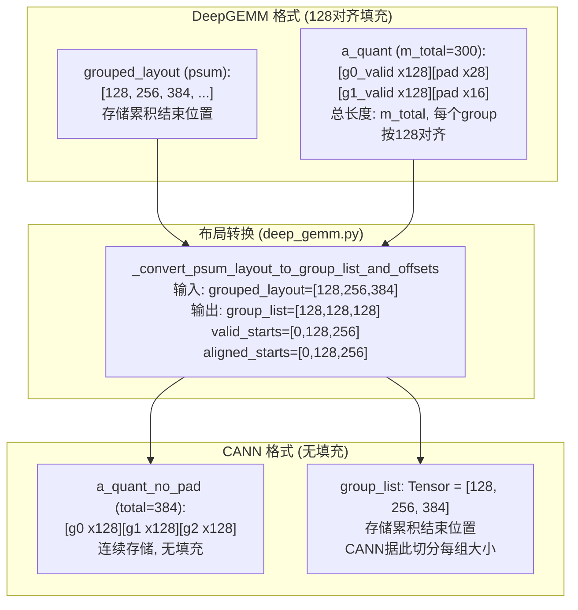

# deep_gemm

## 产品支持情况

| 产品                                                         | 是否支持 |
| ------------------------------------------------------------ | :------: |
| Atlas A3 训练系列产品/Atlas A3 推理系列产品                   |    √    |

## 功能说明

-   API功能：提供 DeepGEMM 风格的 grouped matmul 接口封装，使熟悉 DeepGEMM 接口调用的用户可以在 CANN 环境下继续使用 DeepGEMM 风格的分组矩阵乘法运算，底层适配到 CANN 的 `npu_grouped_matmul` 实现。
-   主要功能：
    - 支持 DeepGEMM 风格的 128 对齐填充格式与 CANN 格式的自动转换
    - 支持 FP8/FP4 量化模式的分组矩阵乘法
    - 支持 transposed B (NT) 和 non-transposed B (NN) 两种矩阵乘法形式
    - 支持 bias_add 偏置相加操作
    - 自动处理 DeepGEMM 的psum_layout和普通grouped_layout布局转换
-   计算公式：
    -   量化反量化流程（以NT为例）：

        $$
        a_{dequant} = a_{quant} \times a_{scale}
        $$

        $$
        b_{dequant} = b_{quant} \times b_{scale}
        $$

        $$
        y = a_{dequant} \times b_{dequant}^T + bias
        $$

## 调用流程图

下面以 `m_grouped_fp8_fp4_gemm_nt_contiguous` 方法为例，展示从用户代码到 NPU 硬件的完整调用链路。图中每个节点标注了对应的代码文件。

### 整体架构图



### 调用路径详解

下面分别说明三条核心调用路径的详细流程。

#### 路径一：DeepGEMMBuffer 高级封装路径（NT 形式）

此路径为用户主要使用的接口，内部自动完成 DeepGEMM 格式到 CANN 格式的转换。

```mermaid
flowchart LR
    A["1. 用户代码<br/>buffer.m_grouped_fp8_fp4_gemm_nt_contiguous()"]
    --> B["2. deep_gemm.py<br/>DeepGEMMBuffer.m_grouped_fp8_fp4_gemm_nt_contiguous"]
    --> C["3. 布局转换<br/>根据use_psum_layout选择:<br/>_convert_psum_layout_to_group_list_and_offsets<br/>_convert_grouped_layout_to_group_list_and_offsets<br/>输出: group_list, valid_starts, aligned_starts"]
    --> D["4. 去除填充<br/>_remove_padding_from_tensor<br/>从a_quant中按valid_starts/sizes切片并cat<br/>输出: a_quant_no_pad, a_scale_no_pad, (c_no_pad)"]
    --> E["5. 调用Python算子<br/>torch.ops.npu_ops_transformer.npu_grouped_matmul_v5(<br/>&nbsp;&nbsp;x=[a_quant_no_pad],<br/>&nbsp;&nbsp;weight=[b_quant],<br/>&nbsp;&nbsp;scale=[a_scale_no_pad, b_scale],<br/>&nbsp;&nbsp;bias=[c_no_pad],<br/>&nbsp;&nbsp;group_list=group_list,<br/>&nbsp;&nbsp;split_item=3,<br/>&nbsp;&nbsp;group_type=0,<br/>&nbsp;&nbsp;group_list_type=1,<br/>&nbsp;&nbsp;act_type=0,<br/>&nbsp;&nbsp;output_dtype=d.dtype<br/>)"]
    --> F["6. grouped_matmul_v5.py<br/>npu_grouped_matmul_v5() -> op_module.npu_grouped_matmul_v5()"]
    --> G["7. grouped_matmul_v5.cpp<br/>op_module.npu_grouped_matmul_v5 C++实现"]
    --> H{"8. 权重格式判断<br/>is_weight_nz = get_npu_format(weight[0])<br/>== ACL_FORMAT_FRACTAL_NZ?"}
    -->|Yes| I["9a. 调用 aclnnGroupedMatmulWeightNz"]
    --> J["10. ACLNN_CMD宏<br/>libopapi.so<br/>aclnnGroupedMatmulV5 或 aclnnGroupedMatmulWeightNz"]
    --> K["11. NPU AI Core执行"]
    H -->|No| J
    --> L["12. grouped_matmul_v5.cpp<br/>返回 out = y[0] (out_tensor)"]
    --> M["13. deep_gemm.py<br/>_restore_padding_to_tensor<br/>按aligned_starts/sizes将out_tensor写回<br/>对齐格式位置"]
    --> N["14. d.copy_(output_with_padding)<br/>原地写入用户输出张量"]
```



**关键文件节点说明：**

| 步骤 | 代码文件 | 函数/类 | 说明 |
|:---:|---|---|---|
| 1 | 用户代码 | - | 调用入口 |
| 2 | `deep_gemm.py` | `DeepGEMMBuffer.m_grouped_fp8_fp4_gemm_nt_contiguous` | 接收 DeepGEMM 格式输入 |
| 3 | `deep_gemm.py` | `_convert_psum_layout_to_group_list_and_offsets` / `_convert_grouped_layout_to_group_list_and_offsets` | DeepGEMM 128对齐填充格式 → CANN group_list |
| 4 | `deep_gemm.py` | `_remove_padding_from_tensor` | 从填充tensor中提取有效数据 |
| 5 | 用户代码 | `torch.ops.npu_ops_transformer.npu_grouped_matmul_v5` | torch ops 分发入口 |
| 6 | `grouped_matmul_v5.py` | `npu_grouped_matmul_v5` (PrivateUse1 impl) | Python 层接口实现 |
| 7 | `grouped_matmul_v5.cpp` | `npu_grouped_matmul_v5()` (PYBIND11暴露) | C++ 层入口 |
| 8 | `grouped_matmul_v5.cpp` | `get_npu_format()` | 判断权重是否为 FRACTAL_NZ 格式 |
| 9a/9b | `grouped_matmul_v5.cpp` | `aclnnGroupedMatmulWeightNz` / `aclnnGroupedMatmulV5` | ACLNN API 调用 |
| 10 | `libopapi.so` | `aclnnGroupedMatmulV5` / `aclnnGroupedMatmulWeightNz` | CANN OP API 实现 |
| 11 | NPU硬件 | AI Core | NPU 矩阵计算单元执行 |
| 12 | `grouped_matmul_v5.cpp` | `std::vector<at::Tensor> y` | C++ 层返回结果 |
| 13 | `deep_gemm.py` | `_restore_padding_to_tensor` | 将无填充结果恢复为128对齐填充格式 |
| 14 | `deep_gemm.py` | `d.copy_(output_with_padding)` | 原地写入用户张量 |

#### 路径二：DeepGEMMBuffer 高级封装路径（NN 形式）

NN 形式与 NT 路径的区别仅在于步骤 2 增加了 B 矩阵转置：



#### 路径三：直接调用 npu_grouped_matmul_v5

此路径跳过 DeepGEMM 格式转换，适合已自行处理格式转换的高级用户。



#### 路径四：图模式（torchair）路径



### OpBuilder 加载流程

当 `grouped_matmul_v5.py` 被首次导入时，OpBuilder 会自动完成 JIT 编译：



### 模块导入依赖关系



### 数据格式转换详解

DeepGEMM 使用 128 对齐填充格式，CANN 使用无填充格式，两者之间的转换是核心逻辑：



## DeepGEMMBuffer 类

### 类原型

```python
class DeepGEMMBuffer:
    def __init__(self, device=None)
    def m_grouped_fp8_fp4_gemm_nt_contiguous(self, a, b, d, grouped_layout, ...)
    def m_grouped_fp8_fp4_gemm_nn_contiguous(self, a, b, d, grouped_layout, ...)
    def extract_valid_a_from_padded_quant(self, a_quant, grouped_layout, ...)
```

### 方法说明

#### `__init__(self, device=None)`

初始化 DeepGEMMBuffer。

-   **device** (`torch.device`, 可选)：指定的 NPU 设备。如果为 None，则使用当前 NPU 设备。

#### `m_grouped_fp8_fp4_gemm_nt_contiguous(self, ...)`

执行 DeepGEMM 风格的分组 FP8/FP4 矩阵乘法（转置 B，NT）。

**函数原型**：

```python
def m_grouped_fp8_fp4_gemm_nt_contiguous(
    self,
    a: Tuple[torch.Tensor, torch.Tensor],
    b: Tuple[torch.Tensor, torch.Tensor],
    d: torch.Tensor,
    grouped_layout: torch.Tensor,
    recipe: Optional[Tuple[int, int, int]] = None,
    recipe_a: Optional[Tuple[int, int]] = None,
    recipe_b: Optional[Tuple[int, int]] = None,
    compiled_dims: str = "",
    disable_ue8m0_cast: bool = False,
    use_psum_layout: bool = False,
    expected_m_for_psum_layout: Optional[int] = None,
    c: Optional[torch.Tensor] = None,
) -> None
```

**参数说明**：

-   **a** (`Tuple[Tensor, Tensor]`)：必选参数，表示量化后的激活张量及其scale，格式为 `(a_quant, a_scale)`。其中 `a_quant` 的 shape 为 `(m_total, k)`，`a_scale` 的 shape 取决于量化粒度。
-   **b** (`Tuple[Tensor, Tensor]`)：必选参数，表示量化后的权重张量及其scale，格式为 `(b_quant, b_scale)`。其中 `b_quant` 的 shape 为 `(num_groups, n, k)` 或 `(num_groups, k, n)`，`b_scale` 的 shape 取决于量化粒度。
-   **d** (`Tensor`)：必选参数，表示输出张量，shape 为 `(m_total, n)`，结果将原地写入此张量。
-   **grouped_layout** (`Tensor`)：必选参数，表示分组布局张量，描述组边界。
    -   当 `use_psum_layout=True` 时：存储累积结束位置，如 `[end_0, end_1, ...]`
    -   当 `use_psum_layout=False` 时：存储每个位置的组ID，-1 表示填充，如 `[0, 0, 0, -1, -1, 1, 1, ...]`
-   **recipe** (`Tuple[int, int, int]`, 可选)：量化 recipe，格式为 `(gran_m, gran_n, gran_k)`。
-   **recipe_a** (`Tuple[int, int]`, 可选)：激活的量化 recipe，格式为 `(gran_a, scale_type_a)`。
-   **recipe_b** (`Tuple[int, int]`, 可选)：权重的量化 recipe，格式为 `(gran_b, scale_type_b)`。
-   **compiled_dims** (`str`, 可选)：DeepGEMM 编译维度字符串，默认值为 `""`。
-   **disable_ue8m0_cast** (`bool`, 可选)：是否禁用 float8_e8m0 转换，默认值为 `False`。
-   **use_psum_layout** (`bool`, 可选)：`grouped_layout` 是否使用 psum 格式，默认值为 `False`。
-   **expected_m_for_psum_layout** (`int`, 可选)：psum 布局的期望 m 值。
-   **c** (`Tensor`, 可选)：可选的偏置张量，shape 与去量化后的输出匹配。

**返回值**：无。输出结果将原地写入张量 `d`。

#### `m_grouped_fp8_fp4_gemm_nn_contiguous(self, ...)`

执行 DeepGEMM 风格的分组 FP8/FP4 矩阵乘法（非转置 B，NN）。

**参数说明**：

-   参数与 `m_grouped_fp8_fp4_gemm_nt_contiguous` 完全一致。
-   区别在于：对于 NN 形式（权重复制），函数内部会将 B 矩阵转置后调用 NT 版本。

**返回值**：无。输出结果将原地写入张量 `d`。

#### `extract_valid_a_from_padded_quant(self, ...)`

从填充的量化张量中提取有效（无填充）张量。

**函数原型**：

```python
def extract_valid_a_from_padded_quant(
    self,
    a_quant: torch.Tensor,
    grouped_layout: torch.Tensor,
    gran_k: int = 128,
    use_psum_layout: bool = False,
) -> Tuple[List[torch.Tensor], List[int]]
```

**参数说明**：

-   **a_quant** (`Tensor`)：填充的量化张量。
-   **grouped_layout** (`Tensor`)：描述组边界的布局张量。
-   **gran_k** (`int`, 可选)：对齐粒度，默认值为 128。
-   **use_psum_layout** (`bool`, 可选)：是否使用 psum 布局，默认值为 `False`。

**返回值**：元组 `(a_slices, group_sizes)`，其中 `a_slices` 是每个组有效张量的列表，`group_sizes` 是每个组有效长度的列表。

## npu_grouped_matmul_v5 接口

### 函数原型

```python
torch.ops.npu_ops_transformer.npu_grouped_matmul_v5(
    x, weight,
    bias=None, scale=None, offset=None,
    antiquant_scale=None, antiquant_offset=None,
    per_token_scale=None, group_list=None,
    activation_input=None, activation_quant_scale=None,
    activation_quant_offset=None,
    split_item=3, group_type=0, group_list_type=1, act_type=0,
    tuning_config=None, output_dtype=None
) -> List[Tensor]
```

### 参数说明

-   **x** (`List[Tensor]`)：必选参数，输入张量列表。
-   **weight** (`List[Tensor]`)：必选参数，权重张量列表。
-   **bias** (`List[Tensor]?`, 可选)：可选参数，偏置张量列表。
-   **scale** (`List[Tensor]?`, 可选)：可选参数，缩放张量列表。
-   **offset** (`List[Tensor]?`, 可选)：可选参数，偏移张量列表。
-   **antiquant_scale** (`List[Tensor]?`, 可选)：可选参数，反量化缩放张量列表。
-   **antiquant_offset** (`List[Tensor]?`, 可选)：可选参数，反量化偏移张量列表。
-   **per_token_scale** (`List[Tensor]?`, 可选)：可选参数，每token缩放张量列表。
-   **group_list** (`Tensor?`, 可选)：可选参数，组列表张量。存储累积结束位置。
-   **activation_input** (`List[Tensor]?`, 可选)：可选参数，激活输入张量列表。
-   **activation_quant_scale** (`List[Tensor]?`, 可选)：可选参数，激活量化缩放列表。
-   **activation_quant_offset** (`List[Tensor]?`, 可选)：可选参数，激活量化偏移列表。
-   **split_item** (`int`, 可选)：可选参数，拆分模式。0=IN_NOT_SPLIT_OUT_NOT_SPLIT，1=IN_SPLIT_OUT_NOT_SPLIT，2=IN_NOT_SPLIT_OUT_SPLIT，3=IN_SPLIT_OUT_SPLIT（默认）。
-   **group_type** (`int`, 可选)：可选参数，组类型。默认值为 0。
-   **group_list_type** (`int`, 可选)：可选参数，组列表类型。默认值为 1。
-   **act_type** (`int`, 可选)：可选参数，激活类型。默认值为 0。
-   **tuning_config** (`int[]?`, 可选)：可选参数，调优配置。
-   **output_dtype** (`ScalarType?`, 可选)：可选参数，输出数据类型。

### 输出说明

-   **output** (`List[Tensor]`)：输出张量列表。

## 约束说明

-   该接口支持推理和训练场景。
-   该接口支持静态图模式和动态图模式。
-   DeepGEMMBuffer 内部自动处理 128 对齐填充格式与 CANN 格式的转换，用户无需手动处理。
-   `grouped_layout` 的格式必须与 `use_psum_layout` 参数匹配。
-   `a` 和 `b` 中的量化 scale 必须与对应的 quant tensor 在同一设备上。
-   输出张量 `d` 的 shape 必须与 `grouped_layout` 描述的总 m 值匹配。

## 调用示例

### 单算子模式调用

```python
import torch
from npu_ops_transformer.ops import DeepGEMMBuffer

# 初始化 DeepGEMMBuffer
buffer = DeepGEMMBuffer()

# 配置参数
m_total = 1024  # 总的 m（token数）
k = 7168        # k 维度
n = 7168        # n 维度
num_groups = 8  # 分组数量

# 创建量化输入
a_quant = torch.randn(m_total, k, dtype=torch.float8_e5m2).npu()
a_scale = torch.randn(m_total, dtype=torch.float32).npu()

# 创建量化权重
b_quant = torch.randn(num_groups, n, k, dtype=torch.float8_e4m3fn).npu()
b_scale = torch.randn(num_groups, 1, k // 128, dtype=torch.float32).npu()

# 创建输出张量
d = torch.zeros(m_total, n, dtype=torch.bfloat16).npu()

# 创建 grouped_layout（非psum格式）
# 格式: 每个位置存储组ID，-1表示填充
grouped_layout = torch.zeros(m_total, dtype=torch.long).npu()
group_size = m_total // num_groups
for i in range(num_groups):
    grouped_layout[i * group_size:(i + 1) * group_size] = i
# 剩余位置设为-1
grouped_layout[(num_groups) * group_size:] = -1

# 可选: 创建偏置
c = torch.randn(m_total, n, dtype=torch.bfloat16).npu()

# 调用 NT 版本的 grouped matmul
buffer.m_grouped_fp8_fp4_gemm_nt_contiguous(
    a=(a_quant, a_scale),
    b=(b_quant, b_scale),
    d=d,
    grouped_layout=grouped_layout,
    use_psum_layout=False,
    c=c,  # 偏置
)

print(f"Output shape: {d.shape}")
print(f"Output dtype: {d.dtype}")
print(f"Output max: {d.max().item():.6f}, min: {d.min().item():.6f}")

# 调用 NN 版本的 grouped matmul
d_nn = torch.zeros(m_total, n, dtype=torch.bfloat16).npu()
buffer.m_grouped_fp8_fp4_gemm_nn_contiguous(
    a=(a_quant, a_scale),
    b=(b_quant, b_scale),
    d=d_nn,
    grouped_layout=grouped_layout,
    use_psum_layout=False,
)
```

### 使用 psum_layout 格式

```python
import torch
from npu_ops_transformer.ops import DeepGEMMBuffer

buffer = DeepGEMMBuffer()

m_total = 1024
k = 7168
n = 7168
num_groups = 8

# 创建量化输入
a_quant = torch.randn(m_total, k, dtype=torch.float8_e5m2).npu()
a_scale = torch.randn(m_total, dtype=torch.float32).npu()

# 创建量化权重
b_quant = torch.randn(num_groups, n, k, dtype=torch.float8_e4m3fn).npu()
b_scale = torch.randn(num_groups, 1, k // 128, dtype=torch.float32).npu()

# 创建 psum_layout
# psum_layout 存储累积结束位置
group_size = m_total // num_groups
psum_layout = torch.tensor(
    [(i + 1) * group_size for i in range(num_groups)],
    dtype=torch.long
).npu()

# 创建输出张量
d = torch.zeros(m_total, n, dtype=torch.bfloat16).npu()

# 使用 psum_layout 格式
buffer.m_grouped_fp8_fp4_gemm_nt_contiguous(
    a=(a_quant, a_scale),
    b=(b_quant, b_scale),
    d=d,
    grouped_layout=psum_layout,
    use_psum_layout=True,
)
```

### 直接调用 npu_grouped_matmul_v5

```python
import torch
from npu_ops_transformer.ops import npu_grouped_matmul_v5

# 配置参数
m_total = 1024
k = 7168
n = 7168

# 创建输入
x_list = [torch.randn(m_total, k, dtype=torch.bfloat16).npu()]
weight_list = [torch.randn(n, k, dtype=torch.bfloat16).npu()]

# 创建 group_list（累积结束位置）
group_list = torch.tensor([m_total], dtype=torch.long).npu()

# 调用 grouped matmul
out = npu_grouped_matmul_v5(
    x_list,
    weight_list,
    group_list=group_list,
    split_item=0,  # IN_NOT_SPLIT_OUT_NOT_SPLIT
    output_dtype=torch.bfloat16,
)

print(f"Output type: {type(out)}")
print(f"Output[0] shape: {out[0].shape}")
```

### 图模式调用

```python
import torch
import torch_npu
import torchair
from npu_ops_transformer.ops import DeepGEMMBuffer


class DeepGEMMGraphModel(torch.nn.Module):
    def __init__(self):
        super().__init__()
        self.buffer = DeepGEMMBuffer()

    def forward(self, a_quant, a_scale, b_quant, b_scale, d, grouped_layout):
        self.buffer.m_grouped_fp8_fp4_gemm_nt_contiguous(
            a=(a_quant, a_scale),
            b=(b_quant, b_scale),
            d=d,
            grouped_layout=grouped_layout,
            use_psum_layout=False,
        )
        return d


# 创建模型
model = DeepGEMMGraphModel().npu()

# 创建输入
m_total = 1024
k = 7168
n = 7168
num_groups = 8

a_quant = torch.randn(m_total, k, dtype=torch.float8_e5m2).npu()
a_scale = torch.randn(m_total, dtype=torch.float32).npu()
b_quant = torch.randn(num_groups, n, k, dtype=torch.float8_e4m3fn).npu()
b_scale = torch.randn(num_groups, 1, k // 128, dtype=torch.float32).npu()
d = torch.zeros(m_total, n, dtype=torch.bfloat16).npu()

grouped_layout = torch.zeros(m_total, dtype=torch.long).npu()
group_size = m_total // num_groups
for i in range(num_groups):
    grouped_layout[i * group_size:(i + 1) * group_size] = i
grouped_layout[(num_groups) * group_size:] = -1

# 编译模型
npu_backend = torchair.get_npu_backend()
model = torch.compile(model, backend=npu_backend, dynamic=False)

# 执行
output = model.forward(a_quant, a_scale, b_quant, b_scale, d, grouped_layout)
torch.npu.synchronize()
print(f"Graph mode output shape: {output.shape}")
```
